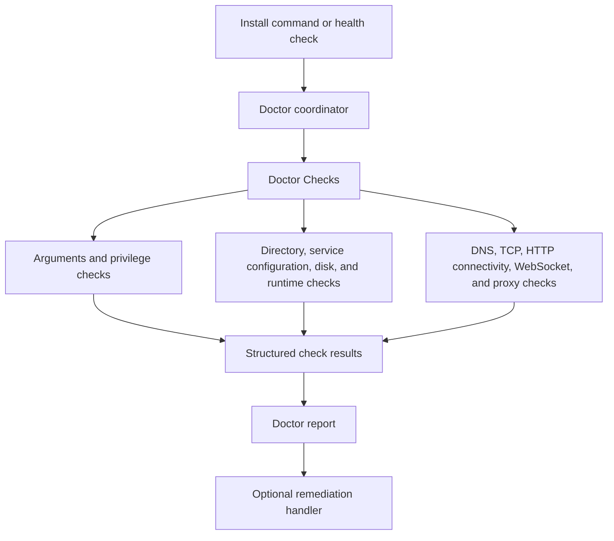
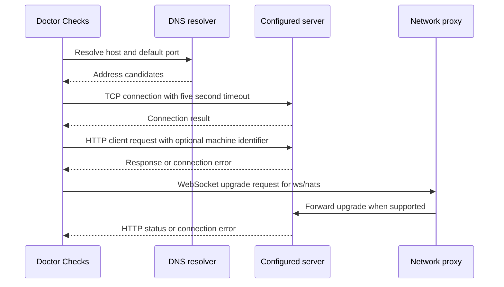
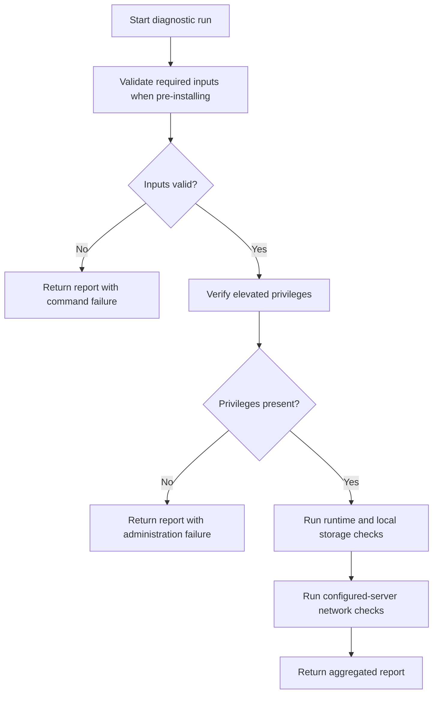

# Doctor Checks

Doctor Checks is the host-readiness and connectivity probe set used by the OpenFrame client agent. The implementation is supplied by the `openframe_agent_lib` Cargo dependency from [OpenFrame OSS Library](https://github.com/flamingo-stack/openframe-oss-lib/blob/7a766f00e4f58b5d89db007b878ac8d6e0c344f4/clients/openframe-client/src/doctor/checks.rs), which this repository assembles into the OpenFrame client runtime.

Its checks answer whether a device can install or operate the agent: installation arguments and elevation are valid, required local locations are usable, and the configured server can be reached through DNS, TCP, HTTP client connectivity, and the WebSocket path. Each probe yields a structured result rather than terminating the process, allowing the Doctor coordinator to build an actionable report.

## Role in the Client

Doctor Checks is a low-level, mostly side-effect-free layer. It performs a temporary write probe when checking a directory, reads the operating system's disk and registry information where applicable, and makes short network requests. It does not install software itself. The adjacent Doctor orchestration and healing components decide when to run the checks, render the report, and perform any declared remediation.

The coordinator has two principal entry points:

- **Pre-install diagnostics** first validate required install parameters, then elevation. A failure in either prerequisite ends that run early. It subsequently evaluates the optional Windows runtime, local storage and service configuration locations, disk capacity, and connectivity to the provided server URL.
- **Health check** first validates elevation, then loads the persisted `initial_config.json` file from the secured client directory. It reports an informational awaiting-authentication state when that file does not exist, fails for unreadable or malformed configuration, and otherwise runs the server connectivity checks using `server_host`.

The install parameter model carries optional `server_url`, `initial_key`, and `org_id` fields alongside optional logging, user, tagging, local-mode, and remote-access settings. Doctor Checks requires the first three for a parameterized installation.

## Check Families

| Family | Checks | What the result establishes |
|---|---|---|
| Command | Required arguments | `--serverUrl`, `--initialKey`, and `--orgId` are present and non-blank. |
| Administration | Administrator privileges | The installer or health-check process has elevated privileges. Failure includes Windows or Unix elevation guidance. |
| Disk and local configuration | Writable directory, service configuration directory, free disk space | The installation-related paths accept a temporary file write and the disk serving the application support directory has at least the configured minimum. The pre-install run uses 200 MB. |
| Runtime | WebView2 Runtime | On Windows, a valid machine-wide Microsoft Edge WebView2 registry version is available for the Tauri chat window. Other operating systems omit this check. |
| Network | DNS, TCP, HTTP client connectivity, WebSocket upgrade, proxy environment | The host resolves, at least one resolved address accepts a short TCP connection, a client request can connect, and the WebSocket endpoint remains reachable through intermediaries. Proxy variables are reported as context. |

## Local Readiness Checks

### Required Arguments and Privileges

`check_required_args` trims supplied values before deciding whether they are missing. It returns a command-category failure listing every absent switch and the expected install command shape. This prevents later checks from using an incomplete destination or unauthenticated install context.

`check_admin_privileges` delegates the platform decision to the client permission utility. It returns a failure with platform-specific guidance: use Administrator elevation on Windows or `sudo` on non-Windows systems. The orchestration layer treats this as an early prerequisite in both pre-install and health-check flows.

### Directory Write and Capacity Probes

`check_dir_writable` targets the requested path if it already exists; otherwise, it finds the nearest existing ancestor. It writes `.openframe_write_test`, removes that probe after a successful write, and reports whether permissions permit use of the requested location. A missing path with no accessible ancestor is a disk-category failure.

`check_service_config_writable` applies that generic probe to the platform's service configuration directory:

| Platform | Service configuration location checked |
|---|---|
| macOS | `/Library/LaunchDaemons` |
| Linux | `/etc/systemd/system` |
| Windows | The client installation directory with `bin` appended |

`check_disk_space` uses the operating system disk list to select the deepest mount-point prefix matching the target path. It reports a pass when available bytes meet the supplied megabyte threshold, a failure for low capacity, or a failure when it cannot determine a backing disk. The pre-install coordinator supplies the client application-support directory and a 200 MB minimum.

### Windows WebView2 Detection

The WebView2 check exists only on Windows because the agent's Tauri chat window depends on Microsoft Edge WebView2. It reads the EdgeUpdate client version from both standard and WOW6432Node registry paths, checking machine scope first and then current-user scope.

- A non-empty, non-placeholder machine-wide version passes.
- A per-user-only version warns because other accounts cannot use or reliably verify it. The result includes the `InstallWebview2` remediation.
- No detected version warns and includes the same remediation.

The remediation is intentionally represented in the result. Doctor Checks only detects and labels the condition; the Doctor healing layer consumes pending remediations and attempts their actions.

## Network Diagnostics

The following diagram distinguishes the evidence supplied by each network probe. A successful HTTP response does not imply application authentication, and the WebSocket probe treats several HTTP statuses as evidence that the route is reachable.

### Host and Port Handling

For DNS and TCP checks, the implementation removes a leading `https://` or `http://`. If the remainder has no colon, it appends port `443`; otherwise, it uses the supplied host-and-port text. DNS asks whether at least one socket address is available. TCP attempts each resolved address until one completes within five seconds.

A DNS failure is a network failure. TCP inability to connect is deliberately a network warning, enabling the report to retain diagnostics from later probes. The TCP advice points operators to outbound firewall access for the selected port.

### HTTP Client Connectivity and WebSocket Path

`check_tls_handshake` creates a request client with a ten-second timeout and sends a GET request to the configured server URL. When the input has no scheme, it prepends `https://`; an explicitly supplied `http://` or `https://` scheme is retained. Any completed response passes because the purpose is connection establishment rather than endpoint authorization. Connection failures produce warnings that mention server availability and, for connection-class errors, possible corporate-proxy certificate handling or local mode.

The platform firewall requires a machine identifier on requests to reach the gateway, so the HTTP and WebSocket probes add the client machine ID header when a local ID is available. This is optional at the function boundary: absent IDs result in the same requests without that header.

`check_websocket_upgrade` sends an unauthenticated upgrade-shaped request to `/ws/nats` beneath the configured server URL. A status of `101`, `400`, `401`, `403`, or `426` passes: each indicates the endpoint was reached, even when the request is invalid or unauthenticated. An unexpected HTTP status warns; an inability to send the request fails because a proxy or firewall may be blocking WebSocket connectivity. The remediation guidance is to ensure intermediary support for HTTP 101 WebSocket upgrade semantics.

`check_proxy_env` does not test a proxy. It provides an informational network result when any of `HTTP_PROXY`, `HTTPS_PROXY`, `http_proxy`, or `https_proxy` exists in the process environment. This context helps interpret certificate, connectivity, and upgrade failures.

## Result Semantics and Process Flow

Each check returns a `CheckResult` categorized as command, administration, disk, network, or runtime. Result statuses communicate the severity of the observed condition:

- **Pass** confirms the probe's narrow condition.
- **Info** records a non-error condition, such as detected proxy environment variables.
- **Warn** records a degraded or potentially blocking situation while allowing the diagnostic report to continue.
- **Fail** records an unmet prerequisite or a condition the check classifies as blocking.

The early exits apply to required parameters during pre-install and administrator privileges in both coordinator flows. Other individual results are accumulated so maintainers and operators can see several independent issues in one report.

## Maintenance Guidance

When adding or changing a check:

1. Keep it narrowly scoped and return a categorized `CheckResult` with operator-facing text.
2. Use warnings only when the coordinator should continue collecting evidence; use failures for prerequisites and clearly blocking conditions.
3. Preserve the distinction between endpoint reachability and authorization. In particular, the WebSocket check intentionally considers several non-success HTTP statuses reachable.
4. Avoid leaving artifacts behind. The directory writability probe removes its temporary file only after a successful write.
5. If the condition can be repaired automatically, attach the appropriate remediation to the result and implement that action in the healing layer rather than embedding repair behavior in a probe.
6. Test platform-specific branches on their target operating systems, especially service configuration paths and Windows registry access.

Doctor Checks belongs to the Rust OpenFrame client library supplied by OpenFrame OSS Library version `v0.0.5` as the `openframe_agent_lib` Cargo artifact. The tenant repository publishes and deploys the surrounding OpenFrame client service, while the check logic itself remains maintained in the linked library source.
