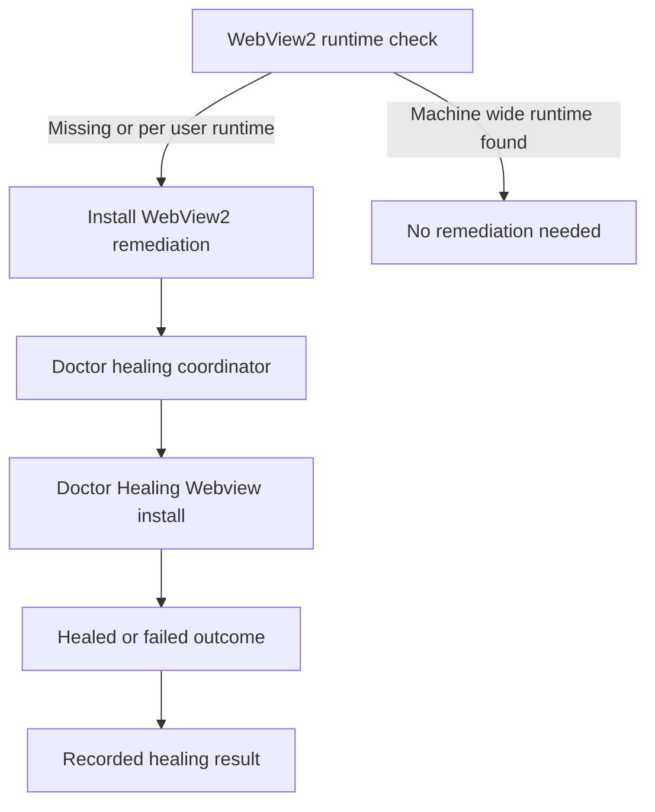
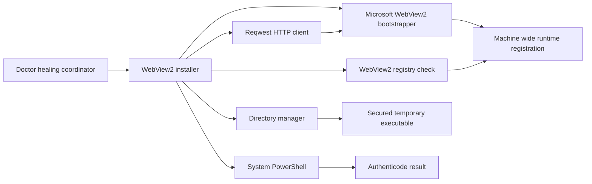
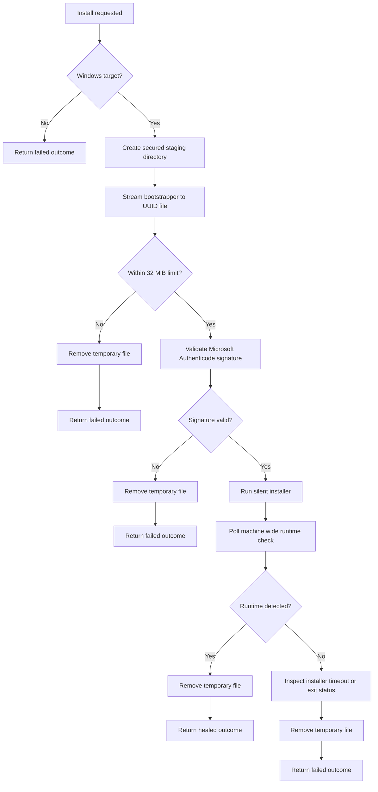
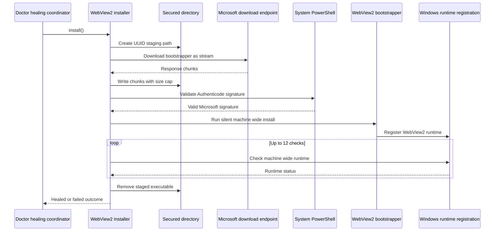

# Doctor Healing Webview

Doctor Healing Webview is the Windows-specific remediation that installs the Microsoft Edge WebView2 Runtime when the OpenFrame client doctor reports that the runtime is missing or available only to a single user. The runtime is required by the OpenFrame chat window. This module is implemented by the `install` function in the `openframe_agent_lib` crate supplied by the OpenFrame OSS Library at version `v0.0.5`.

The implementation is intentionally narrow: it downloads Microsoft’s Evergreen bootstrapper, validates its Authenticode signature, launches it without a visible window, and verifies that the runtime becomes registered machine-wide. It does not report success merely because the installer process exits successfully.

**Primary implementation:** [webview2_installer.rs](https://github.com/flamingo-stack/openframe-oss-lib/blob/7a766f00e4f58b5d89db007b878ac8d6e0c344f4/clients/openframe-client/src/doctor/healing/webview2_installer.rs)

## Scope and Responsibilities

| Responsibility | Behavior |
|---|---|
| Detect remediation need | The surrounding doctor check distinguishes a machine-wide runtime from a per-user-only runtime or no runtime. The latter two conditions request the WebView2 remediation. |
| Acquire installer | Fetches Microsoft’s Evergreen bootstrapper using the fixed Microsoft permalink. |
| Limit download impact | Streams the response directly to disk and rejects a payload larger than 32 MiB. |
| Authenticate executable | Uses PowerShell’s `Get-AuthenticodeSignature` and accepts only a valid signature whose certificate subject identifies Microsoft Corporation. |
| Install silently | Runs the bootstrapper with `/silent` and `/install`, without creating a visible window. |
| Verify outcome | Re-runs the machine-wide runtime check up to 12 times, waiting 5 seconds between attempts. |
| Clean temporary state | Removes the uniquely named downloaded executable after an installation attempt or an earlier failure. |

The module is compiled differently by operating system. On Windows, it performs the installation workflow. On non-Windows targets, `install` returns a failed healing outcome explaining that WebView2 installation applies only to Windows; it does not download or execute anything.

## Position in the Client Doctor

Doctor Healing Webview is a leaf remediation within the client diagnostic system. The doctor check produces a warning and an `InstallWebview2` remediation when the runtime is absent or only per-user. The healing coordinator selects pending remediations, invokes this module, and records its `HealOutcome` in a `HealResult`.

The broader doctor module owns report construction, result rendering, remediation selection, and outcome aggregation. The checks module owns detection and the machine-wide versus per-user distinction. Doctor Healing Webview owns only the installation and post-install verification step.

## Component Relationships

### Dependencies

- **Doctor healing coordinator:** Calls `install` only for the pending WebView2 remediation and converts the returned `HealOutcome` into a reportable healing result.
- **WebView2 runtime check:** Reads the relevant Windows registry locations. A local-machine registration passes; a current-user-only registration remains a warning because it is not reliable for every account and cannot be verified by the agent.
- **Directory manager:** Provides the secured directory used to stage the bootstrapper. Each download uses a UUID-based filename, reducing collisions and avoiding a fixed executable path.
- **PowerShell path resolver:** Locates the system PowerShell executable for signature validation.
- **Tokio and Reqwest:** Provide asynchronous file I/O, process control, request streaming, and timeouts.
- **Windows process APIs:** Supply the no-window creation flag used both for the installer and the PowerShell verification process.

## Installation and Verification Flow

### Detailed Execution Sequence

## Time Bounds and Completion Semantics

The bootstrapper download has a 120-second request timeout. Signature verification has a 60-second timeout. The installer process is allowed up to 600 seconds. If the process exceeds that time, Tokio is configured to reap the bootstrapper process when the command future is dropped.

Installer completion and runtime registration are deliberately decoupled. The implementation begins the registry polling immediately after launching the installer, then permits up to one minute total for registration through 12 attempts at 5-second intervals. This accounts for the bootstrapper launching an updater child process or the registry becoming available shortly after process completion.

A detected machine-wide runtime wins over the installer exit status: if the check passes, the module returns `Healed` even if obtaining a final process status would otherwise be delayed. Conversely, an apparently successful process exit is insufficient when the runtime remains undetected; the remediation returns failure with a diagnostic message.

## Security Properties

Doctor Healing Webview executes downloaded code, so the workflow applies layered controls before launch:

1. **Fixed origin:** The download target is a compile-time Microsoft permalink rather than a caller-provided URL.
2. **Secured staging:** The binary is placed under the agent’s secured directory with a fresh UUID in its filename.
3. **Streaming size bound:** The 32 MiB maximum prevents a large response from consuming unbounded disk through this path and is much larger than the expected bootstrapper while still rejecting anomalous payloads.
4. **Publisher verification:** The PowerShell check requires a valid Authenticode status and a signer certificate subject matching Microsoft Corporation.
5. **Controlled execution:** Both child processes use a no-window flag. The runtime installer receives only its silent-install arguments.
6. **Postcondition validation:** A registry-based machine-wide runtime check confirms the practical result rather than trusting the download, signature, or exit code alone.
7. **Cleanup:** The staged file is removed after download failure, signature failure, successful detection, or final installation failure.

The signature probe constructs a PowerShell command containing the staging path. The path is generated by the module beneath its secured directory, rather than supplied by an external user, which limits the command input surface.

## Failure Modes and Operator Signals

| Stage | Failure condition | Result |
|---|---|---|
| Platform gate | The client is not running on Windows. | Failed outcome stating that the install is Windows-only. |
| Staging | The secured directory or temporary file cannot be created. | Failed outcome with filesystem context. |
| Download | Request creation, network transfer, response status, body read, file write, or flush fails. | Temporary file is removed when present, then a failed outcome is returned. |
| Size enforcement | Download exceeds 32 MiB. | Download is rejected and the staged file is removed. |
| Signature validation | PowerShell cannot run, times out, or reports an invalid or non-Microsoft signature. | Staged executable is removed and execution is prevented. |
| Installer launch | The executable cannot start, the process times out, or exits unsuccessfully. | After verification polling and cleanup, a failed outcome records the cause. |
| Registration | The installer exits successfully but a machine-wide runtime is never detected. | Failed outcome explicitly states that the runtime remains undetected. |

Operational logs identify the download source, the start of the silent installation, the remediation selected by the healing coordinator, and the final healing status. Failure text retains error context, which allows a doctor report or client logs to distinguish download, verification, launch, timeout, and registration problems.

## Maintenance Guidance

- Keep the bootstrapper URL, size limit, signature requirements, and timeout values aligned with Microsoft’s supported Evergreen distribution process.
- Do not weaken the signature requirement to accept merely a successful HTTP response or any valid publisher. The code is about to execute the downloaded file as an elevated agent.
- Preserve the machine-wide post-install check. A per-user runtime does not satisfy the OpenFrame client requirement because another account may launch the chat window.
- Treat the registry check as the contract between detection and healing. If Windows runtime detection changes, update both the check and the installer verification behavior together.
- When changing process behavior, retain cleanup on every early-return path and retain bounded operations for downloading, signature checking, and installation.

## Source Ownership

Although the OpenFrame OSS Tenant repository runs the client that uses this module, the implementation comes from the OpenFrame OSS Library’s Rust client code. Changes to the installer should be made and reviewed in the [library source file](https://github.com/flamingo-stack/openframe-oss-lib/blob/7a766f00e4f58b5d89db007b878ac8d6e0c344f4/clients/openframe-client/src/doctor/healing/webview2_installer.rs), then consumed through the pinned `openframe_agent_lib` dependency.
