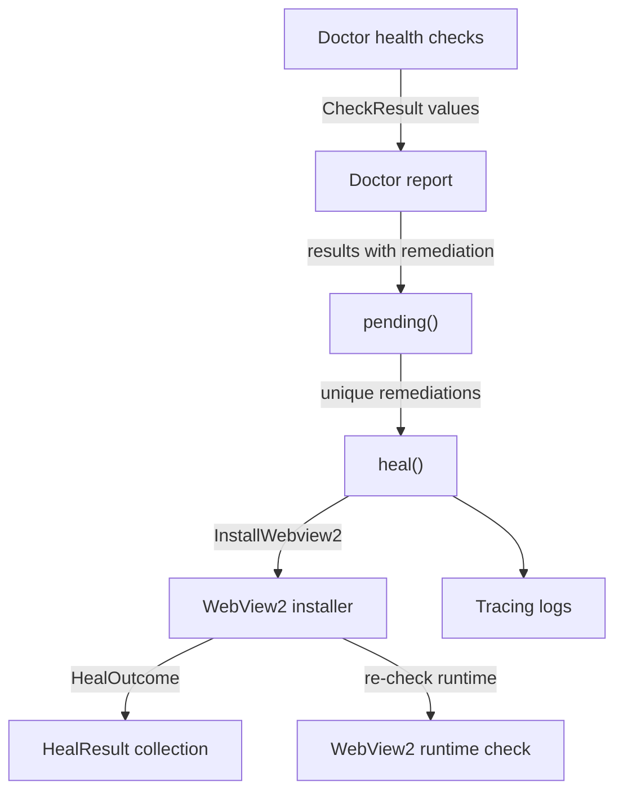
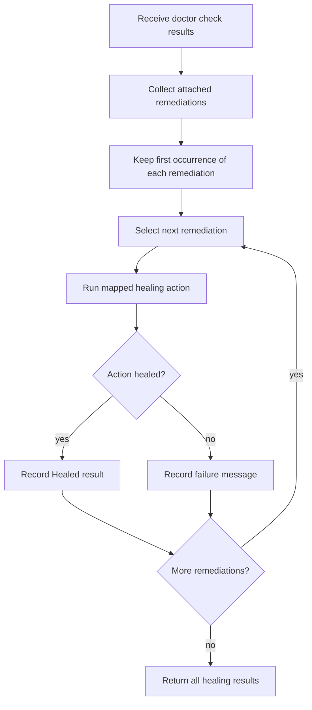
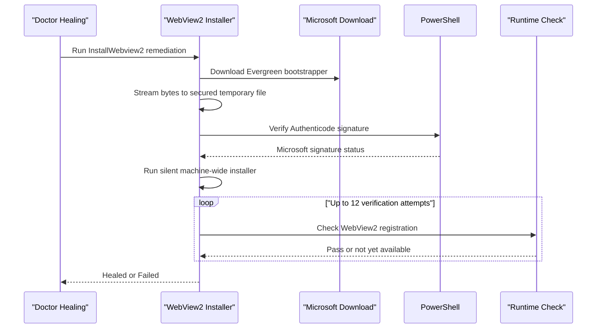

# Doctor Healing

Doctor Healing is the remediation layer of the OpenFrame Client doctor workflow. It receives diagnostic `CheckResult` values from the surrounding doctor subsystem, extracts the remediations requested by failed checks, and executes every distinct action once. In the current implementation, the supported action is installing the Microsoft Edge WebView2 Runtime when the WebView2 diagnostic reports it missing.

The module is implemented by the `openframe_agent_lib` Rust library from [OpenFrame OSS Library](https://github.com/flamingo-stack/openframe-oss-lib/blob/16e7c1cbd9664e7d10ec5ebca7d53c9bd314decf/clients/openframe-client/src/doctor/healing/mod.rs), which this repository runs through the OpenFrame Client. The Windows-specific installer is implemented in the library's [WebView2 installer source](https://github.com/flamingo-stack/openframe-oss-lib/blob/16e7c1cbd9664e7d10ec5ebca7d53c9bd314decf/clients/openframe-client/src/doctor/healing/webview2_installer.rs).

## Responsibilities

- Select remediation requests attached to doctor check results.
- Preserve the first-seen ordering of remediation requests while removing duplicates.
- Run each selected remediation independently and return a result for every attempt.
- Record the start, success, and failure of actions through structured tracing logs.
- Install and verify WebView2 on Windows without executing an unverified downloaded binary.

Doctor Healing does not decide whether a machine is healthy. Health checks assign remediations, and doctor reporting owns diagnostic status and presentation. Healing consumes those results and produces remediation outcomes; it does not mutate the original report.

## Architecture

### Component relationships

| Component | Responsibility |
|---|---|
| `pending` | Scans supplied check results, takes each attached remediation, and returns a deduplicated list in first-seen order. |
| `heal` | Iterates over pending remediations, logs each attempt, dispatches the action, and returns one `HealResult` per action. |
| `HealResult` | Associates the remediation that was attempted with its final `HealOutcome`. |
| `HealOutcome` | Represents either a verified repair or a failure message suitable for reporting and logs. |
| WebView2 installer | Windows-only implementation that downloads, verifies, silently installs, and then detects the runtime. |

## Remediation lifecycle

The orchestrator intentionally treats remediations as a sequence, rather than stopping after an individual failure. Consequently, a failed action is captured in its own `HealResult` while subsequent distinct actions can still run if the remediation set grows in the future.

The `pending` function uses equality on remediation values to remove duplicates. This prevents the same repair from running repeatedly when multiple checks recommend it, while preserving the order in which the doctor workflow encountered it.

## WebView2 installation

`Remediation::InstallWebview2` is dispatched to the WebView2 installer. The installer is applicable only on Windows. On other operating systems, it reports a failed outcome explaining that WebView2 installation is Windows-only; it does not attempt a cross-platform substitute.

On Windows, the OpenFrame Client normally runs with elevated service privileges. The installer stages the Microsoft Evergreen bootstrapper under the agent's secured directory with a random file name, then uses a silent, machine-wide installation attempt.

### Safety and verification controls

The installer includes several controls around the downloaded executable:

- **Bounded download:** the response is streamed directly to disk and rejected once it exceeds 32 MiB, avoiding an unbounded in-memory download and rejecting content that is too large to be the expected bootstrapper.
- **Network timeout:** the download client has a 120-second timeout.
- **Signature validation:** before execution, PowerShell checks for a valid Authenticode signature and requires a signer subject matching Microsoft Corporation.
- **Secured staging:** the executable is written beneath the agent-managed secured directory using a UUID-based file name.
- **Noninteractive execution:** the bootstrapper is started with silent installation arguments and the Windows no-window creation flag.
- **Bounded installation:** the installer process is allowed up to 600 seconds.
- **Post-install verification:** the module polls the existing WebView2 registry-based health check up to 12 times, five seconds apart. This allows for delayed runtime registration and makes success depend on detection rather than only on the process exit code.
- **Cleanup:** the staged bootstrapper is removed after execution and also after download or signature-validation failures where possible.

The verification phase runs even while evaluating the installer process result. This accommodates the bootstrapper spawning an updater child that completes registration after the bootstrapper exits. A zero exit code alone is not considered a verified repair: the runtime must be detected machine-wide.

## Failure behavior

Each failed remediation is converted into `HealOutcome::Failed` with contextual error text. Examples include download failures, oversized content, a failed or timed-out signature check, inability to start the installer, a nonzero installer exit status, and the runtime remaining undetected after polling.

The module logs the remediation before dispatch, logs a success after a verified repair, and logs the remediation plus error text on failure. Callers should retain the returned `HealResult` values alongside the original doctor report so that diagnostic findings and attempted repairs remain distinguishable.

## Extension points

To add a remediation:

1. Define the additional `Remediation` variant in the doctor reporting model.
2. Have the relevant health check attach that remediation to its `CheckResult`.
3. Add a corresponding branch in Doctor Healing's internal action dispatcher.
4. Ensure the action returns `Healed` only after independently verifying the required condition.
5. Preserve the current failure isolation so one unsuccessful repair does not prevent other pending remediations from being attempted.

The dispatcher currently has a single `InstallWebview2` branch. Its explicit matching makes unsupported remediation variants a compile-time maintenance concern when the remediation model changes.

## Operational boundaries

Doctor Healing is local agent behavior. It uses the client platform abstraction for secured directories and PowerShell resolution, and it reuses the doctor WebView2 runtime check as its verification source. It does not call the OpenFrame gateway or API directly, does not publish a remediation event, and does not alter agent registration, authentication, or tool-management state.
