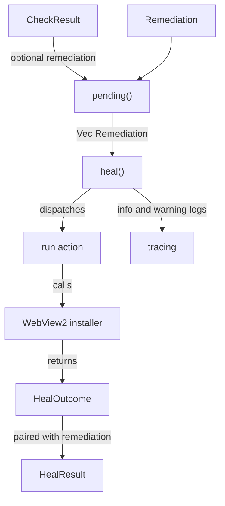
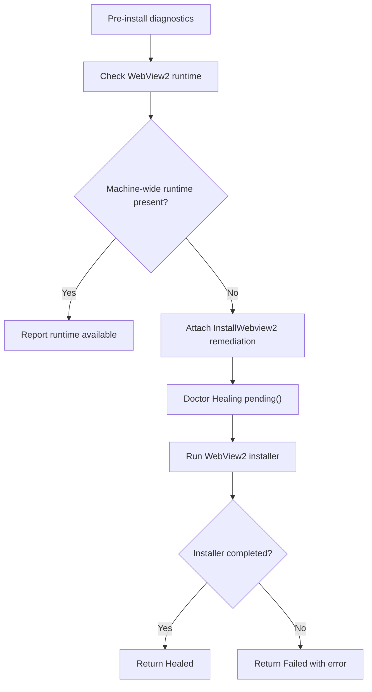
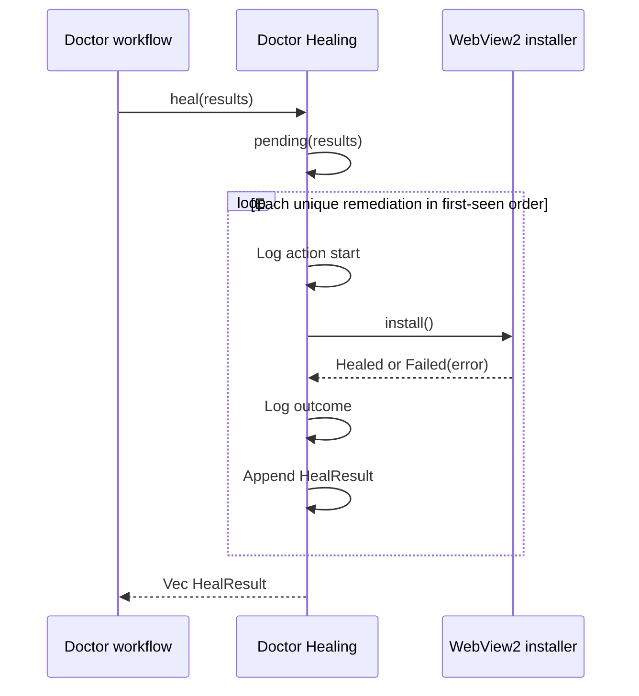

# Doctor Healing

Doctor Healing is the remediation executor for the OpenFrame Client's diagnostic workflow. It consumes diagnostic `CheckResult` values, selects the distinct remediation requests attached to those results, and runs each selected action once. In the current implementation, the only supported action installs the Microsoft Edge WebView2 Runtime on Windows.

The implementation is supplied by the `openframe_agent_lib` Cargo dependency from [OpenFrame OSS Library](https://github.com/flamingo-stack/openframe-oss-lib/blob/7a766f00e4f58b5d89db007b878ac8d6e0c344f4/clients/openframe-client/src/doctor/healing/mod.rs). OpenFrame OSS Tenant assembles and runs that client as part of its OpenFrame Client workload.

## Responsibilities and Boundaries

Doctor Healing has a deliberately narrow responsibility:

- Read remediation metadata from diagnostics without re-running the checks.
- Preserve the first-seen ordering of requested actions.
- Deduplicate repeated requests for the same remediation.
- Dispatch each supported action asynchronously.
- Return one structured result for every dispatched remediation.
- Emit informational logs when an action starts or succeeds, and warning logs when it fails.

It does **not** decide whether a machine is healthy, construct diagnostic reports, retry failures, or persist remediation results. Those concerns belong to the surrounding Doctor diagnostics workflow and the platform-specific installer.

## Architecture

`CheckResult` is produced by the Doctor diagnostics layer and can optionally contain a `Remediation`. Doctor Healing transforms the resulting collection into a unique remediation work list, invokes the matching action, and returns `HealResult` records to its caller.

```mermaid
flowchart LR
    DoctorChecks["Doctor diagnostics"] -->|"CheckResult values"| Healing["Doctor Healing"]
    Healing -->|"pending()"| WorkList["Ordered unique remediations"]
    WorkList -->|"heal()"| Dispatcher["Action dispatcher"]
    Dispatcher -->|"InstallWebview2"| Installer["WebView2 installer"]
    Installer -->|"HealOutcome"| Results["HealResult collection"]
    Results -->|"returned to caller"| Client["OpenFrame Client workflow"]
```

### Primary Types

| Component | Role |
|---|---|
| `HealOutcome` | Terminal outcome of one action: `Healed` or `Failed(String)`. The failure variant carries the formatted error details supplied by the action. |
| `HealResult` | Associates the requested `Remediation` with its `HealOutcome`, so callers retain both intent and outcome. |
| `pending()` | Extracts remediations from `CheckResult` values, omits entries without remediation metadata, and deduplicates using first-seen order. |
| `heal()` | Iterates the pending work list, logs progress, runs each action, and accumulates `HealResult` values. |
| Action dispatcher | A private match over `Remediation`; it currently routes `InstallWebview2` to the platform installer. |

The public remediation vocabulary currently contains only `InstallWebview2`. Adding another remediation requires both a new `Remediation` variant in Doctor diagnostics and a corresponding dispatcher branch in Doctor Healing.

## Dependency Model

Doctor Healing depends on diagnostic result and remediation types from the Doctor module, plus the private WebView2 installer implementation. It uses `tracing` for operational logs. It has no direct network client, service manager, configuration writer, or persistent store in this module.

## WebView2 Remediation

The doctor pre-install diagnostics include a WebView2 runtime check on Windows. A machine-wide runtime satisfies the check. A per-user-only installation and an absent installation both produce a warning with `InstallWebview2` remediation metadata. The warning explains that the OpenFrame chat window requires the runtime and that a per-user installation is not available to other machine accounts or verifiable by the agent.

When Doctor Healing receives that remediation, it invokes the WebView2 installer. The installer adapter translates a successful installation into `HealOutcome::Healed`; an installer error becomes `HealOutcome::Failed` with a formatted error message. The actual installation mechanics are encapsulated by the platform-specific installer rather than exposed through Doctor Healing.

The WebView2 runtime check is separate from the healing executor. It is the check that creates the remediation request; Doctor Healing only executes requests already present in the supplied result list.

## Execution Flow

The healing flow is asynchronous at the public `heal()` entry point, while remediation discovery itself is synchronous and deterministic.

### Selection Semantics

`pending()` walks the input slice in order. For each result, it considers only the optional remediation field. A remediation is appended only if it has not already appeared in the output list. Consequently:

1. Results without remediation metadata generate no action.
2. Repeated `InstallWebview2` requests execute once.
3. The output action order is the order in which each distinct remediation first appears.
4. The function does not filter by check category or status; remediation metadata itself is the execution signal.

This makes diagnostics responsible for attaching remediation only where automated repair is appropriate.

## Outcome and Failure Handling

Doctor Healing continues through the complete pending list even when an action fails. Each action produces a `HealResult`, rather than aborting the whole sequence. Callers should inspect every result to determine which actions succeeded and which need operator attention.

| Condition | Result | Logging |
|---|---|---|
| No diagnostic result carries a remediation | Empty result collection | No healing action log is emitted. |
| A remediation appears once or multiple times | One attempt for that remediation | Start and success logs on a successful action. |
| An installer action returns an error | `HealOutcome::Failed` with formatted error text | Start log followed by a warning log. |

There is no retry loop, rollback operation, or post-run aggregation in this module. The installer action owns its own verification contract, as documented by the `heal()` entry point; callers receive only the resulting `HealOutcome`.

## Maintainer Guidance

When introducing a new automatic repair:

1. Add the remediation variant to the Doctor remediation model.
2. Attach it only to diagnostics that should trigger that repair.
3. Implement the action behind the private dispatcher in Doctor Healing.
4. Ensure the action maps both success and failure into `HealOutcome`.
5. Preserve idempotent behavior where possible, because requests are deduplicated only within one `heal()` invocation.
6. Maintain actionable failure details, since the module returns them directly to its caller and writes them to warning logs.

Keep action selection separate from action execution. The existing design allows diagnostic checks to remain declarative: they report a condition and request a remediation, while Doctor Healing centralizes ordering, deduplication, dispatch, and outcome collection.

## Source References

- [Doctor Healing source](https://github.com/flamingo-stack/openframe-oss-lib/blob/7a766f00e4f58b5d89db007b878ac8d6e0c344f4/clients/openframe-client/src/doctor/healing/mod.rs)
- [WebView2 runtime check source](https://github.com/flamingo-stack/openframe-oss-lib/blob/7a766f00e4f58b5d89db007b878ac8d6e0c344f4/clients/openframe-client/src/doctor/checks.rs)
