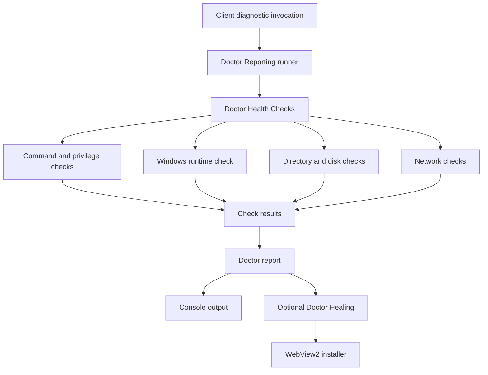
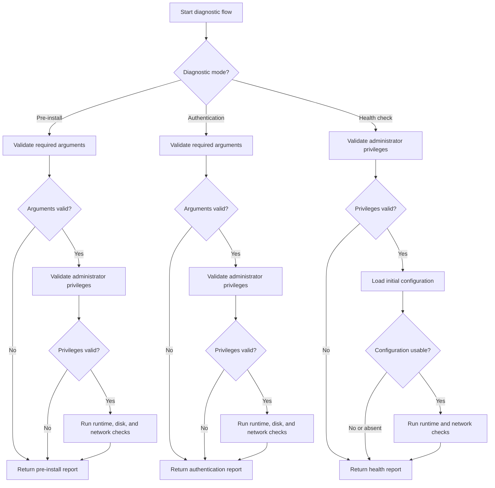
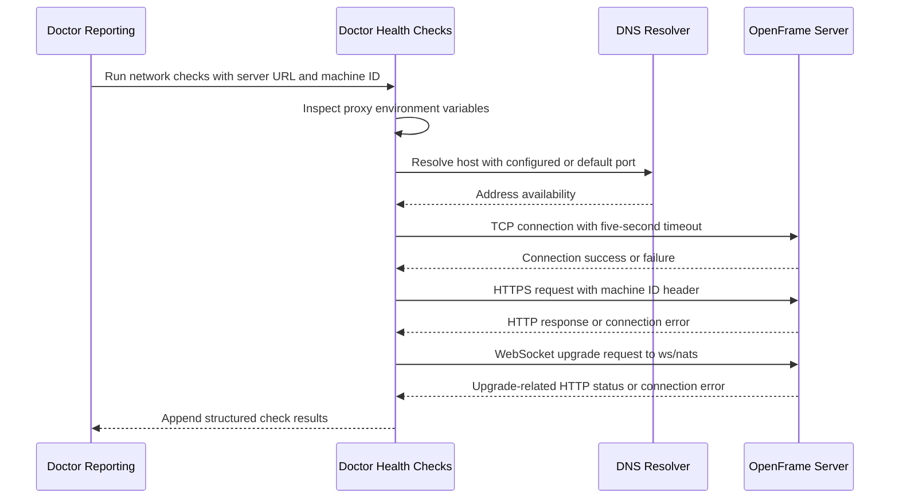

# Doctor Health Checks

Doctor Health Checks is the local diagnostic layer used by the OpenFrame client before installation, during authentication, and when an installed agent is checked. It validates the machine prerequisites and the path to the configured server, then returns structured results that the Doctor Reporting and Doctor Healing modules can present and, where supported, remediate.

The implementation is supplied by the `openframe_agent_lib` dependency from OpenFrame OSS Library. The tenant repository runs that client library; the authoritative implementation is [checks.rs](https://github.com/flamingo-stack/openframe-oss-lib/blob/16e7c1cbd9664e7d10ec5ebca7d53c9bd314decf/clients/openframe-client/src/doctor/checks.rs).

## Responsibilities

Doctor Health Checks provides targeted, side-effect-limited probes in five result categories:

| Category | Checks | Purpose |
|---|---|---|
| Command | Required installation arguments | Verifies that server URL, initial key, and organization ID are present before a parameterized install or authentication attempt. |
| Admin | Administrator privileges | Stops diagnostics early when the process lacks the privileges needed for installation and service management. |
| Runtime | WebView2 Runtime on Windows | Detects the runtime required by the Tauri chat window and identifies a per-user installation that is unsuitable for an agent serving multiple accounts. |
| Disk | Writable directories and free capacity | Verifies writable installation, application-support, secured, logs, and service-configuration locations, and checks for at least 200 MB at the application-support location. |
| Network | Proxy environment, DNS, TCP, TLS, and WebSocket upgrade | Reports proxy variables, resolves the configured host, tests outbound connectivity, probes TLS through HTTP, and confirms reachability of the NATS WebSocket route. |

The checks do not register a device, alter server configuration, or authenticate a user. The writable-directory check briefly creates and removes `.openframe_write_test` in an existing target directory or its nearest existing ancestor.

## Architecture

The module is intentionally a provider of individual `CheckResult` values. Orchestration, terminal rendering, failure counting, and remediation selection are owned by the sibling Doctor Reporting and Doctor Healing modules. A result carries its category, status, display name, optional operator hint, and optional remediation action.

## Invocation Modes and Short-Circuiting

The reporting layer composes these checks into three flows. The ordering is important because a failed prerequisite ends the current flow before later checks can produce misleading secondary errors.

### Pre-install diagnostics

Pre-install diagnostics validate the required command parameters first, then administrator privileges. If both pass, they optionally inspect WebView2 on Windows and check the installation parent directory, application-support directory, secured directory, logs directory, platform service-configuration directory, available disk space, and network path to the supplied server URL.

### Authentication diagnostics

Authentication diagnostics also require the three installation parameters and administrator privileges. After those prerequisites, they inspect the Windows runtime where applicable, verify available disk space, and run the network suite. They do not repeat the broader writable-directory checks used by the pre-install flow.

### Installed-agent health check

The installed-agent health check starts with administrator privileges. It then reads `initial_config.json` from the secured directory:

- A readable configuration with a non-empty `server_host` permits the runtime and network checks.
- A missing configuration is informational rather than a failure: the parameterless installation remains unauthenticated until the operator runs `openframe-client auth` with tenant parameters.
- Corrupt, unreadable, or incomplete configuration produces a failed command result and ends the flow.

## Check Behavior

### Command and privilege validation

`check_required_args` treats missing, empty, and whitespace-only values as absent. It reports every missing value together and includes the expected install command shape in its hint. The required inputs are `--serverUrl`, `--initialKey`, and `--orgId`.

`check_admin_privileges` uses the platform permission utility. On Windows, its failure hint directs the operator to run the installer as Administrator. On other supported platforms, it recommends using `sudo` for installation. This is a failure rather than a warning because the orchestration flows rely on the elevated context before proceeding.

### Filesystem and capacity validation

For an existing path, `check_dir_writable` writes its probe file directly in that directory. For a path that does not yet exist, it finds the nearest existing ancestor and tests there, which enables pre-install validation without creating the final directory tree. A path with no accessible existing ancestor fails immediately.

`check_disk_space` selects the most specific mounted filesystem whose mount point prefixes the requested path. The check passes at or above the supplied threshold and otherwise emits a disk failure with the available and recommended capacity. Current flows pass `200` as the minimum megabytes.

`check_service_config_writable` adapts its target to the operating system:

| Platform | Target checked |
|---|---|
| macOS | `/Library/LaunchDaemons` |
| Linux | `/etc/systemd/system` |
| Windows | The `bin` directory below the client installation directory |

### Runtime validation

WebView2 validation is compiled only on Windows. The check looks for the EdgeUpdate client version in both machine and current-user registry hives, including the 32-bit registry view. A machine-wide version passes. A per-user-only version or no runtime produces a warning and attaches the `InstallWebview2` remediation action. On macOS and Linux, this check returns no result and does not affect the report.

The remediation is intentionally separate from detection: Doctor Healing collects pending remediation actions from report results and invokes the WebView2 installer. Diagnostics therefore remain safe to run without implicitly installing software.

### Network validation

The network suite is ordered from inexpensive local checks to application-path checks:

- **Proxy environment:** The module reports `HTTP_PROXY`, `HTTPS_PROXY`, `http_proxy`, and `https_proxy` when present. This is informational, not a pass or failure, because proxy presence alone is not unhealthy.
- **DNS resolution:** The server URL scheme is stripped, and port `443` is used when the input has no explicit port. At least one resolved socket address passes; otherwise the check fails with guidance to validate DNS settings and the URL.
- **TCP reachability:** Each resolved address is attempted with a five-second timeout. Failure is a warning, allowing later HTTPS and WebSocket probes to provide more context.
- **TLS handshake:** The check builds a request client with a ten-second timeout and sends a request to the server URL, adding the machine ID header when available. A response of any HTTP status demonstrates that the TLS and HTTP path was reached. Connection errors are warnings that mention proxy certificate requirements and local mode; other request errors warn that the server should be verified.
- **WebSocket upgrade:** The module sends a standards-shaped upgrade request to the server's `/ws/nats` path with the same optional machine ID header. HTTP statuses `101`, `400`, `401`, `403`, and `426` all pass because each demonstrates that the endpoint is reachable and processing an upgrade-related request. Other HTTP statuses warn, while a connection error fails because it indicates that a proxy or firewall blocked the WebSocket path.

The machine ID header is significant: the platform firewall drops client requests that lack it, so TLS and WebSocket probes include it whenever the installed client can obtain a local machine ID.

## Results, Severity, and Operator Experience

Each diagnostic returns one of four statuses:

| Status | Meaning in Doctor Health Checks |
|---|---|
| Pass | The requirement or reachability probe succeeded. |
| Fail | A blocking prerequisite is absent, a critical local capability cannot be verified, or the WebSocket connection is blocked. |
| Warn | The agent detected a potentially recoverable condition, such as low network reachability confidence, TLS failure, or an unsuitable WebView2 installation. |
| Info | Context for the operator, such as proxy variables or an unauthenticated parameterless installation. |

Doctor Reporting prints each outcome with a compact status marker, its check name, and any hint. The check names are designed to make the subsystem obvious in CLI output, for example `Network: DNS resolves`, `Disk: ... writable`, or `Runtime: WebView2 Runtime not installed`.

## Dependency Boundaries

Doctor Health Checks depends on these client-library facilities:

| Dependency | Role |
|---|---|
| Installation Initial Config | Supplies the installation parameters checked before install and authentication. |
| Platform Permissions | Determines whether the current process is elevated. |
| Platform Directories and Service | Supplies installation, application-support, secured, and log paths used by orchestration. |
| Machine ID service constant | Names the header required for gateway-facing probes. |
| Doctor Reporting | Defines result categories, statuses, result construction, reports, mode-specific ordering, and console output. |
| Doctor Healing | Consumes remediation metadata and runs the supported WebView2 installation action. |

## Maintenance Guidance

When adding a check, keep it independently callable and return a `CheckResult` rather than terminating the process. Assign the narrowest category, include an actionable hint for non-pass results, and choose failure versus warning according to whether the condition prevents the current flow from continuing safely. Add the check to the appropriate reporting flow deliberately; pre-install, authentication, and installed-agent health checks have different data and filesystem assumptions.

Network probes should remain bounded by explicit timeouts and should distinguish endpoint reachability from authentication success. In particular, do not treat an authorization response from the WebSocket endpoint as a connectivity failure: the existing probe intentionally accepts authentication-related status codes because it is testing upgrade-path availability, not credentials.
