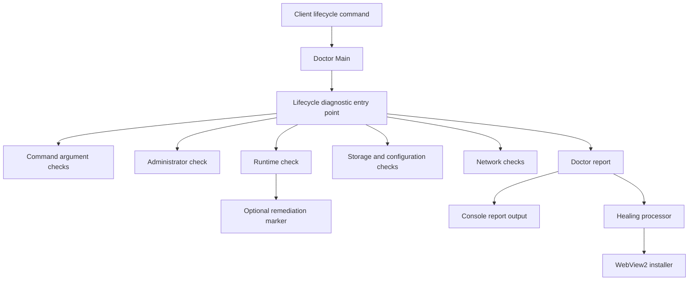
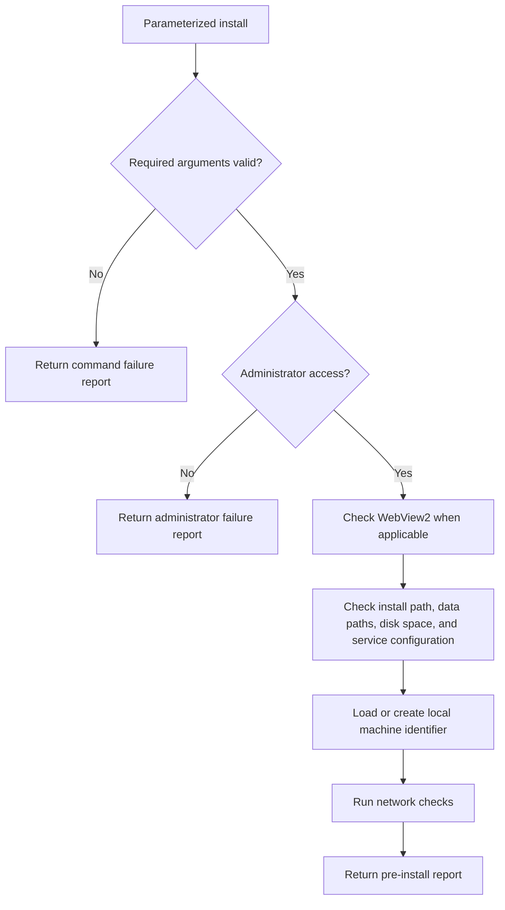
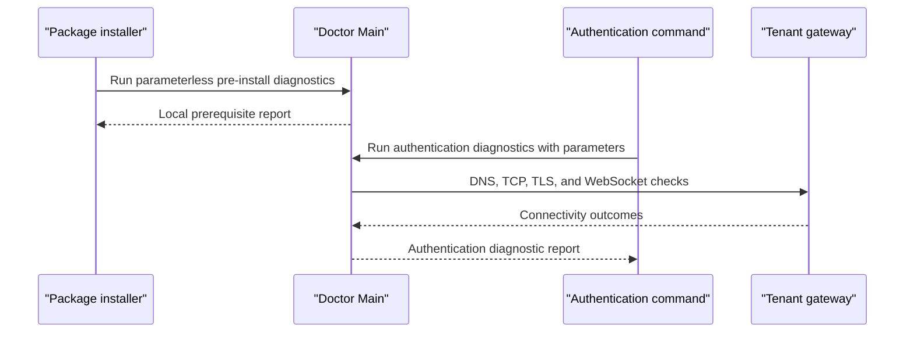
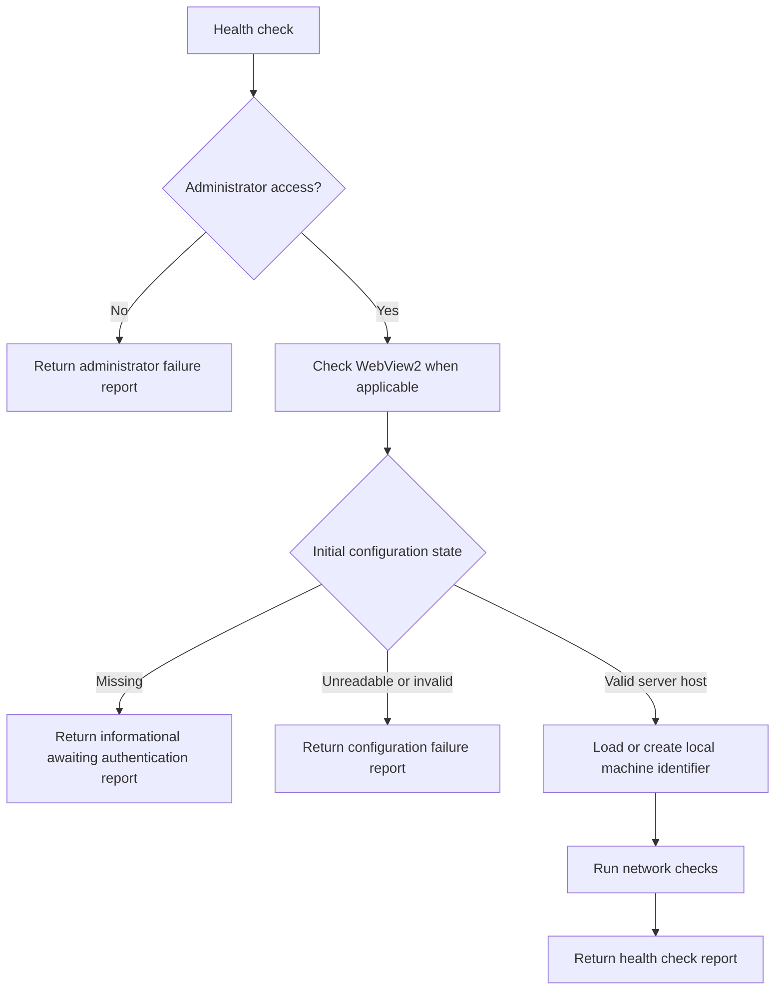
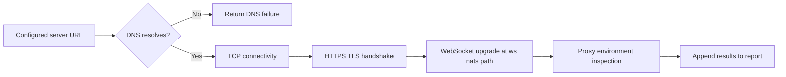
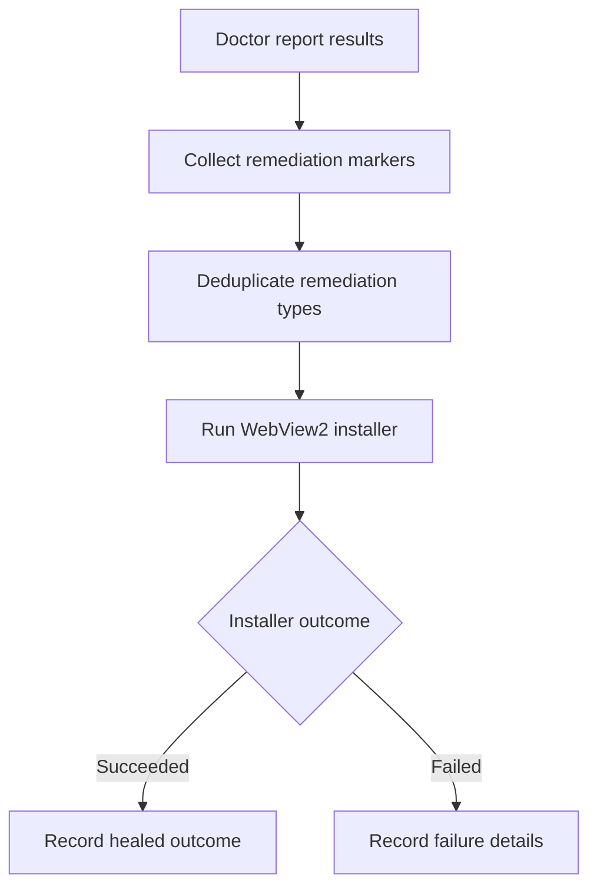

# Doctor Main

Doctor Main is the diagnostic orchestration layer for the OpenFrame device client. It assembles ordered, environment-specific checks into a `DoctorReport` before installation, authentication, or an operational health check. The implementation is supplied by the `openframe_agent_lib` dependency from [OpenFrame OSS Library](https://github.com/flamingo-stack/openframe-oss-lib/blob/7a766f00e4f58b5d89db007b878ac8d6e0c344f4/clients/openframe-client/src/doctor/mod.rs) and is run by this repository's OpenFrame client service.

Its central responsibility is to protect lifecycle transitions: fail early when prerequisites make a transition unsafe, retain warnings and informational outcomes for supportability, and attach a narrowly scoped automatic remediation where available.

## Responsibilities

Doctor Main provides four diagnostic entry points:

| Entry point | Intended lifecycle point | Validation scope | Early exit behavior |
|---|---|---|---|
| `run_preinstall` | Parameterized installation | Required tenant arguments, administrator access, optional WebView2 runtime, install and data paths, disk space, service configuration write access, and network reachability | Stops after missing arguments or insufficient privileges |
| `run_preinstall_parameterless` | Package manager installation before tenant parameters exist | Administrator access, installation and data paths, disk space, and service configuration write access | Stops after insufficient privileges |
| `run_auth` | Interactive authentication | Required tenant arguments, administrator access, optional WebView2 runtime, data disk space, and network reachability | Stops after missing arguments or insufficient privileges |
| `run_healthcheck` | Installed agent validation | Administrator access, optional WebView2 runtime, persisted configuration readability and validity, and network reachability | Stops after insufficient privileges, unusable configuration, or an unauthenticated parameterless installation |

The parameterless flow deliberately excludes tenant argument, network, and WebView2 checks during installation. Those prerequisites are instead evaluated during authentication, when tenant parameters and tool provisioning are relevant.

## Architecture

Doctor Main owns result construction, sequencing, report aggregation, and terminal presentation. The individual probes belong to the Doctor Checks capability in the OpenFrame OSS Library, while the Healing capability deduplicates requested remediations and runs their installers. Doctor Main also uses the client `DirectoryManager`, `Service`, and `MachineIdService` to locate local paths, resolve the installation directory, and obtain a reusable machine identity for gateway-oriented checks.

## Result Model

Every probe produces a `CheckResult` with five fields:

| Field | Purpose |
|---|---|
| `category` | Groups the result as command, administrator, runtime, disk, or network work |
| `status` | Communicates pass, failure, warning, or informational state |
| `name` | Identifies the examined prerequisite |
| `hint` | Provides an operator-facing explanation or corrective guidance when applicable |
| `remediation` | Identifies an optional automated fix |

`CheckResult` factory methods ensure that successful and informational results have no hint or remediation, while failures and warnings carry a hint. `with_remediation` augments an existing result instead of changing its severity.

`DoctorReport` collects results under a fixed title. It exposes `has_failures`, `failure_count`, and `warn_count`, allowing callers to decide whether the lifecycle action may proceed. Its `print` method renders a concise console report using `+`, `x`, `!`, and `i` markers for pass, failure, warning, and information respectively. Warnings do not count as failures.

## Check Categories and Severity

| Category | Examples | Typical severity |
|---|---|---|
| Command | Required installation or authentication parameters, persisted configuration | Missing required parameters and malformed configuration fail |
| Administrator | Elevated execution requirement | Missing elevation fails |
| Runtime | Microsoft Edge WebView2 availability on Windows | Missing or per-user-only WebView2 warns and can request remediation |
| Disk | Directory writability, available application support storage, service configuration writability | Result depends on the underlying local prerequisite |
| Network | DNS, TCP reachability, TLS negotiation, WebSocket upgrade, proxy environment | DNS and blocked WebSocket transport can fail; connectivity and TLS uncertainty may warn |

The WebView2 check is platform-conditional. It is included when the underlying checker returns a result. A machine-wide runtime passes; a missing runtime or a per-user-only installation warns because it can prevent the chat window from launching for all relevant accounts.

## Lifecycle Flows

### Parameterized Pre-install

The installation path validates parameters before making environment changes. Required inputs are the server URL, initial key, and organization identifier. A failed argument check prevents privilege, filesystem, and network work. Likewise, installation stops after a privilege failure.

The flow checks the parent directory of the service installation target, then the application support, secured, and log directories. It requires at least 200 units of free space according to the disk checker on the application support path. The report includes each non-short-circuited result, so a caller can see multiple storage and network findings in one run.

### Parameterless Pre-install and Authentication

A package-manager installation can complete without tenant parameters. Doctor Main therefore confines pre-install validation to prerequisites needed to establish the local agent installation. The later authentication command validates the omitted parameters, checks administrator access, checks disk space and the runtime, and performs network diagnostics before tenant-specific configuration is written.

This separation means an unauthenticated but correctly installed agent is not reported as a failed installation solely because no tenant configuration exists yet.

### Health Check and Persisted Configuration

The health check reads the initial configuration from the secured client directory. A missing configuration is an informational state for a parameterless installation: the report tells the operator to run the authentication command with tenant parameters. A configuration that exists but cannot be read, is invalid JSON, or lacks a non-empty server host is a failure because the client cannot safely determine its endpoint.

## Network Diagnostic Pipeline

When a server URL is available, Doctor Main invokes network checks in a deterministic order. DNS resolution is the only hard gate in this pipeline: if it fails, later probes are not meaningful and are skipped. Otherwise, TCP, TLS, WebSocket, and proxy environment checks are collected.

The machine identifier is obtained on a best-effort basis and only used if it is acceptable as an HTTP header value. This matches the identifier the agent later sends, so connectivity probes can resemble the agent's normal gateway interaction without making a malformed local identifier block diagnostics.

The TCP probe uses a bounded connection attempt. TLS and WebSocket probes use bounded HTTP clients. A WebSocket response of `101`, `400`, `401`, `403`, or `426` demonstrates that the endpoint recognizes the upgrade path; other responses are warnings. A transport error while attempting the upgrade is a failure because it indicates the connection is blocked rather than merely unauthenticated.

## Automatic Healing

A warning can nominate a `Remediation` without changing its warning status. At present, the remediation catalog contains `InstallWebview2`.

The Healing implementation scans results, preserves each distinct remediation only once, and executes it asynchronously. It returns one `HealResult` per requested action with either a healed outcome or a captured error. This keeps diagnosis separate from mutation: the report remains a factual account of the observed state, while callers choose when to invoke healing.

## Operational Considerations

- Treat `has_failures` as the lifecycle safety signal. A report containing warnings may still allow an operation, subject to caller policy.
- Preserve the short-circuit points when extending a flow. Argument and privilege failures prevent diagnostic work that depends on a valid command context or elevated permissions.
- Add new checks through the result model so terminal output, counters, and future machine-readable consumers receive consistent status and hint data.
- Keep remediation idempotent at the report level. Healing deduplicates markers, but each installer must also be safe to invoke for an already-correct environment.
- Avoid changing the accepted WebSocket status set without considering reverse proxies and authentication gates. Several non-upgrade statuses intentionally indicate that the route was reached and recognized.

## Source and Dependencies

Doctor Main is implemented in the OpenFrame OSS Library and consumed by this repository through the `openframe_client` Cargo dependency, pinned as `v0.0.5` in the current service dependency graph. The source file is [doctor/mod.rs](https://github.com/flamingo-stack/openframe-oss-lib/blob/7a766f00e4f58b5d89db007b878ac8d6e0c344f4/clients/openframe-client/src/doctor/mod.rs).

Its direct diagnostic collaborators are provided by the same library:

- [Doctor checks](https://github.com/flamingo-stack/openframe-oss-lib/blob/7a766f00e4f58b5d89db007b878ac8d6e0c344f4/clients/openframe-client/src/doctor/checks.rs) perform prerequisite and connectivity probes.
- [Doctor healing](https://github.com/flamingo-stack/openframe-oss-lib/blob/7a766f00e4f58b5d89db007b878ac8d6e0c344f4/clients/openframe-client/src/doctor/healing/mod.rs) executes registered automated fixes.
- The client directory, service, installation configuration, and machine identity services provide the local state that Doctor Main evaluates.
