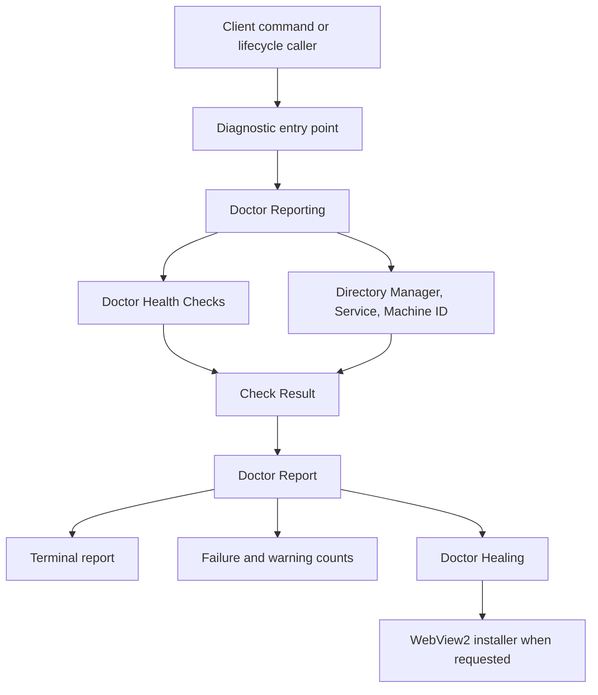
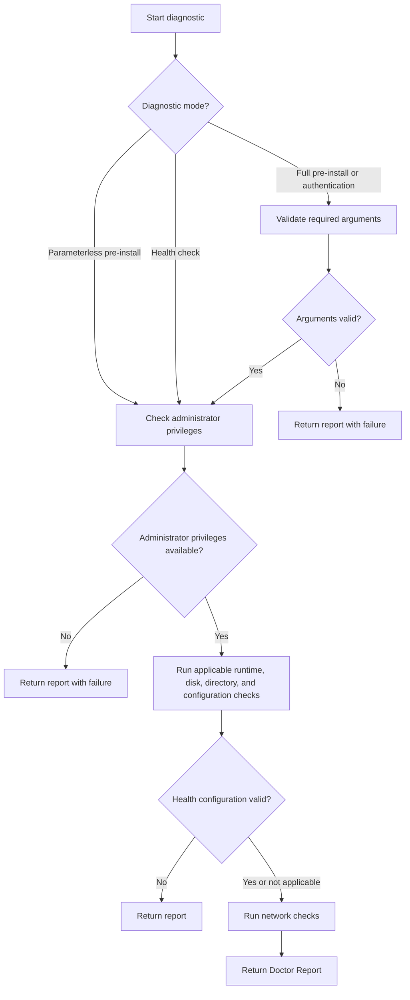
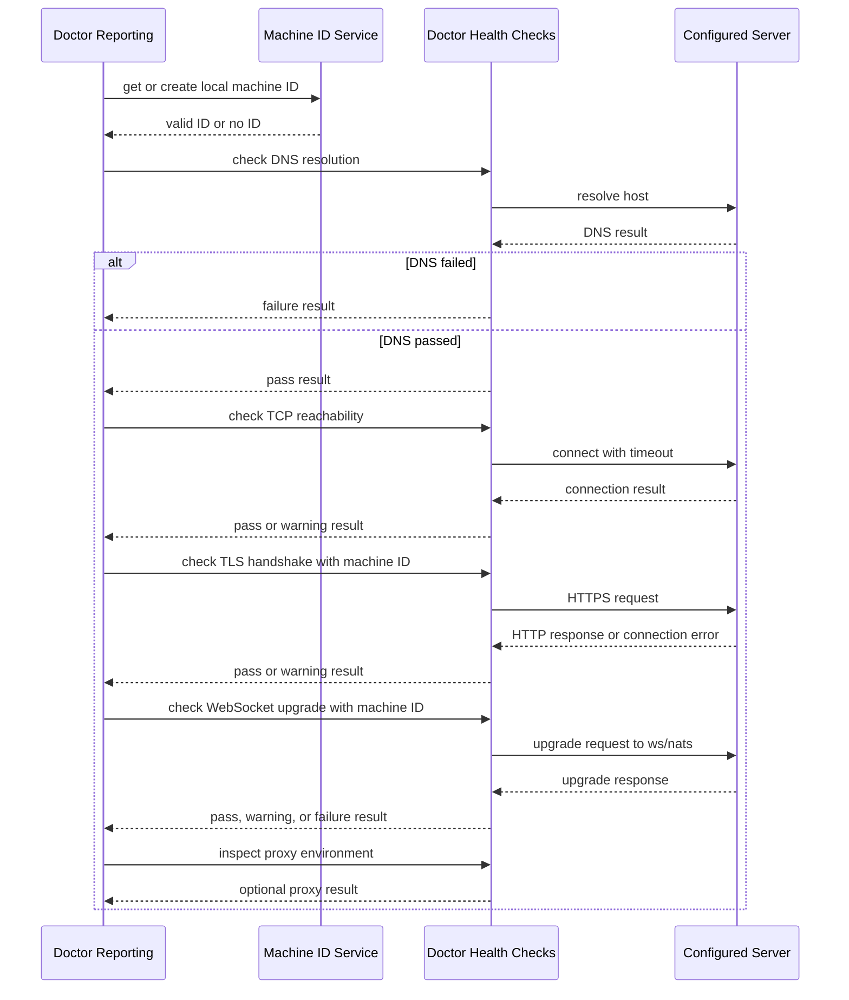
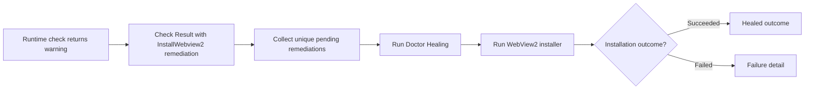

# Doctor Reporting

Doctor Reporting is the diagnostic orchestration and result-model layer of the OpenFrame client agent. It assembles local installation, authentication, and ongoing health diagnostics into a `DoctorReport`, renders a concise operator-facing summary, and annotates findings that can be automatically remediated. The implementation is supplied by the `openframe_agent_lib` crate from the OpenFrame OSS Library and is run by this repository's OpenFrame client deployment.

The primary implementation is [doctor/mod.rs](https://github.com/flamingo-stack/openframe-oss-lib/blob/16e7c1cbd9664e7d10ec5ebca7d53c9bd314decf/clients/openframe-client/src/doctor/mod.rs).

## Responsibilities

Doctor Reporting separates diagnostic **collection** from **presentation and policy**:

- Defines a common result vocabulary: categories, statuses, optional operator hints, and optional remediation actions.
- Selects checks appropriate to four lifecycle entry points: full pre-install, parameterless pre-install, pre-authentication, and post-install health checks.
- Applies fail-fast gates where continuing would be unsafe or meaningless, specifically required installation parameters, administrator privileges, and invalid persisted configuration.
- Reuses a locally persisted machine ID when possible so TLS and WebSocket probes identify the same device that the agent will later use.
- Aggregates failures and warnings for callers, prints a readable terminal report, and provides remediation metadata to the healing subsystem.

Doctor Reporting does not persist reports, install the service, authenticate the agent, or perform network repair. Individual probes are delegated to Doctor Health Checks; automated corrections are delegated to Doctor Healing.

## Architecture

### Component model

| Component | Role |
|---|---|
| `CheckCategory` | Classifies a finding as Command, Admin, Runtime, Disk, or Network. Categories support a stable diagnostic taxonomy without changing the result shape. |
| `CheckStatus` | Expresses Pass, Fail, Warn, or Info. Only Fail contributes to `has_failures` and `failure_count`; only Warn contributes to `warn_count`. |
| `CheckResult` | A single named outcome with category, status, optional hint, and optional remediation. Constructor helpers create pass, fail, warn, and informational results; `with_remediation` attaches a supported automatic fix. |
| `Remediation` | The action vocabulary shared with Doctor Healing. Currently, the reporting module can request `InstallWebview2`. |
| `DoctorReport` | Owns the ordered result list and a context-specific title, exposes summary methods, and formats the report for standard output. |
| `run_preinstall`, `run_preinstall_parameterless`, `run_auth`, `run_healthcheck` | Lifecycle-specific orchestrators that choose checks and define early-return behavior. |

## Result semantics and console output

Each report preserves check order. This is significant because callers see prerequisite checks before dependent checks, and fail-fast returns preserve the finding that blocked further work.

| Status | Meaning | Summary impact | Console marker |
|---|---|---|---|
| Pass | The check completed successfully. | None | `+` |
| Fail | A blocking or definitive problem was found. | Increments failure count and makes `has_failures` true. | `x` |
| Warn | A non-blocking issue or degraded condition was detected. | Increments warning count only. | `!` |
| Info | The diagnostic state is informative rather than erroneous. | None | `i` |

`DoctorReport::print` emits the report title, each status marker and check name, then indents any check hint beneath its result. A report is therefore usable directly in an interactive installer or service diagnostic command without a separate renderer.

## Lifecycle entry points

### Full pre-install diagnostics

`run_preinstall` validates a configured installation before tenant-specific state is written:

1. Checks required installation arguments. Missing server URL, initial key, or organization ID ends the run immediately.
2. Checks administrator privileges. Failure ends the run immediately.
3. Adds the WebView2 runtime result when that platform-specific probe is available.
4. Resolves the agent directories and service installation directory.
5. Checks that the binary directory and application-support, secured, and logs directories are writable.
6. Checks that application-support storage has at least 200 units of free disk capacity as requested by the underlying disk probe.
7. Checks that the service configuration can be written.
8. Runs DNS, TCP, TLS, WebSocket, and proxy-environment diagnostics against the supplied server URL.

### Parameterless pre-install diagnostics

`run_preinstall_parameterless` is for package-manager or pre-provisioned installation where tenant parameters are not yet available. It deliberately omits argument validation, network probes, and WebView2 validation. It retains the administrative, disk, writable-directory, and service-configuration checks required to install safely.

### Authentication diagnostics

`run_auth` runs while an operator is present and before authentication writes tenant-specific state. It validates required arguments and administrator privileges as blocking prerequisites, then checks the runtime, available disk capacity, and configured server connectivity. This is where WebView2 is checked for the authentication path because tool provisioning can begin after registration.

### Health check diagnostics

`run_healthcheck` validates an installed client:

1. Verifies administrator privileges, returning immediately if unavailable.
2. Includes the WebView2 result when available.
3. Reads `initial_config.json` from the secured directory.
4. Accepts a readable configuration only when `server_host` is present and non-empty.
5. Runs network checks with that configured server host.

A missing configuration file is not treated as an error: it produces an informational result instructing the operator to authenticate the client. A corrupt file, missing or empty server host, unreadable existing file, or other I/O error is a failure and stops subsequent network diagnostics.

## Diagnostic flow

## Network-check pipeline

Network probes are executed in a fixed order by the internal network runner. A DNS failure ends the network portion because later checks cannot form a useful target. TCP, TLS, WebSocket, and proxy-environment results are otherwise collected independently, allowing an operator to see multiple contributing conditions in one report.

The TLS and WebSocket checks attach the machine ID only when `MachineIdService` can create or load one and the value is valid as an HTTP header value. If ID acquisition fails, probes continue without it; diagnostics remain best effort rather than blocking solely on local identity persistence.

The WebSocket probe targets the server's `ws/nats` endpoint and considers protocol-relevant responses successful support signals, including upgrade success and selected responses that indicate the endpoint recognized the upgrade request. An unexpected HTTP response becomes a warning, while a blocked connection becomes a failure.

## Remediation handoff

A result can carry a `Remediation` without changing its status. At present, the WebView2 probe adds `InstallWebview2` to warning results for a missing machine-wide runtime or a per-user-only runtime. This preserves visibility of the prerequisite while allowing healing to act on it.

Doctor Healing de-duplicates remediation values before executing them. It records one `HealResult` per distinct action and preserves either a healed outcome or an error message. Reporting itself does not rerun diagnostics after healing; the caller must choose whether to run a new report to verify the repair.

## Dependencies and system fit

Doctor Reporting is part of the Rust OpenFrame client implementation supplied by the OpenFrame OSS Library, an upstream dependency pinned by this repository as `openframe_agent_lib` version `v0.0.5`. The tenant repository deploys the client as part of the OpenFrame platform, while the library provides the client-side diagnostic behavior.

| Dependency | Interaction |
|---|---|
| Doctor Health Checks | Provides the concrete argument, privilege, runtime, storage, configuration, DNS, TCP, TLS, WebSocket, and proxy probes. |
| Doctor Healing | Consumes remediation annotations, identifies distinct actions, and runs supported corrective actions. |
| Installation Initial Configuration | Supplies `InstallConfigParams` to pre-install and authentication diagnostics. |
| Directory Manager | Locates application-support, secured, and log directories, including the health-check configuration location. |
| Service Management | Supplies the installed binary location so its parent directory can be tested for write access. |
| Machine ID Service | Loads or creates a reusable machine identity for authenticated network probes. |

## Maintenance guidance

- Add a new diagnostic as a `CheckResult` with the narrowest accurate category and status. Use Fail only when the condition should count as a report failure.
- Preserve the distinction between pre-install, parameterless installation, authentication, and health checks. Each flow intentionally tests only prerequisites relevant to its lifecycle stage.
- Keep blocking checks before dependent work and return immediately when a prerequisite fails; this avoids misleading follow-on errors.
- Add an automatic correction by extending `Remediation`, attaching it with `with_remediation`, and implementing the corresponding Doctor Healing action. Ensure the action remains idempotent because remediations are selected from a report, not from a persistent transaction.
- When changing network behavior, retain DNS as the gate for downstream probes and preserve best-effort machine ID handling so diagnosis still works on partially initialized devices.
