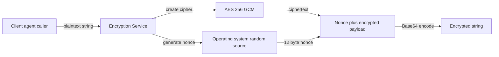
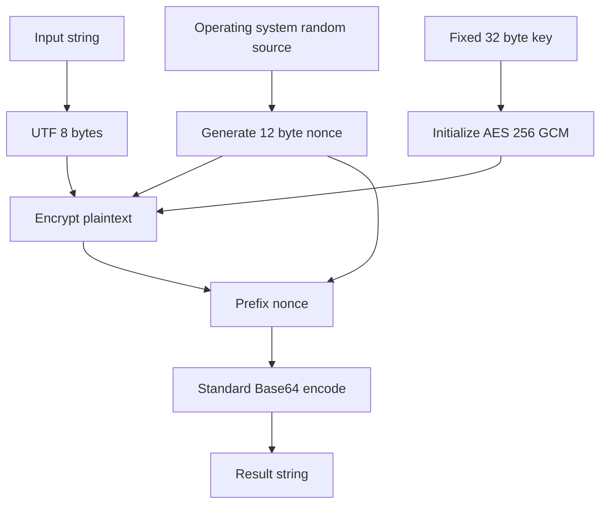
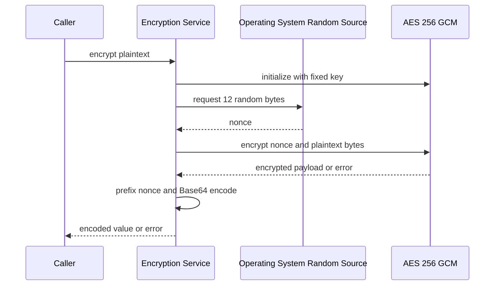

# Encryption Service

The Encryption Service is a small, stateless Rust utility in the OpenFrame client agent. It encrypts an input string locally with AES-256-GCM and returns a portable Base64 value. Its implementation is supplied by the OpenFrame OSS Library's `openframe_client` / `openframe_agent_lib` code, which this repository assembles into the client runtime.

> **Security notice:** the current implementation defines one fixed 32-byte key in source code and explicitly marks this as temporary with a TODO to use a generated key. Anyone who can read the binary or source can recover that key. Treat this component as an implementation detail requiring key-management work before it is relied on to protect secrets in production.

The implementation is available in the OpenFrame OSS Library: [Encryption Service source](https://github.com/flamingo-stack/openframe-oss-lib/blob/16e7c1cbd9664e7d10ec5ebca7d53c9bd314decf/clients/openframe-client/src/services/encryption_service.rs).

## Purpose and Scope

The Encryption Service has a deliberately narrow API:

- `EncryptionService::new()` constructs an empty, stateless service.
- `EncryptionService::encrypt(&str)` produces an encrypted Base64 string or returns an error.
- `Default` delegates to `new`, and `Clone` is supported because no instance-specific state is retained.

The component does not persist keys or output, communicate over the network, decrypt values, rotate keys, expose key identifiers, or accept authenticated associated data. Those concerns must be supplied by a caller or by a future replacement design.

## Architecture

The service is part of the Rust OpenFrame client code provided by the OpenFrame OSS Library. It uses `aes-gcm` for authenticated encryption, an operating-system random source for a fresh nonce, `base64` for transport-safe encoding, and `anyhow` for its fallible result.



### Component Responsibilities

| Component | Responsibility |
|---|---|
| `EncryptionService` | Stateless façade that creates the cipher and coordinates encryption for each call. |
| `Aes256Gcm` | Performs AES-256-GCM authenticated encryption using the configured 32-byte key. |
| `OsRng` | Fills a newly allocated 12-byte nonce from the operating-system-backed random generator. |
| Base64 standard encoder | Serializes the binary nonce-prefixed encrypted payload into a string. |
| `anyhow::Result` | Returns contextual errors if cipher initialization or encryption fails. |

## Encryption Data Flow

For each invocation, the Encryption Service builds a new AES-GCM cipher instance from the fixed key. It generates a nonce independently for that invocation, encrypts the UTF-8 bytes of the input string, prefixes the nonce to the encrypted payload, then applies standard Base64 encoding.



The returned binary layout, before Base64 encoding, is:

```text
nonce (12 bytes) || AES GCM encrypted payload
```

A consumer that needs decryption must Base64-decode the value, split the first 12 bytes as the nonce, and use compatible AES-256-GCM settings and the same key to process the remaining encrypted payload. This module does not implement that operation, so compatibility and authentication-failure handling belong outside its current scope.

## Component Interaction and Process

The interaction is local and synchronous. Each request is independent: no nonce, cipher, or result is shared through the `EncryptionService` instance.



### Operational Sequence

1. A caller creates the service through `new()` or `Default`.
2. The caller supplies plaintext to `encrypt`.
3. The service converts its fixed key string to bytes and initializes AES-256-GCM.
4. The service obtains a new 12-byte nonce from `OsRng`.
5. AES-GCM encrypts the plaintext bytes with that nonce.
6. The service concatenates nonce and encrypted payload in that order.
7. It Base64-encodes the combined bytes and returns the resulting string.

If cipher creation fails, the returned error is labeled `Failed to create encryption key`. If AES-GCM encryption fails, the returned error is labeled `Failed to encrypt data`.

## Security Characteristics and Constraints

### What the Implementation Provides

- **Confidentiality:** AES-256-GCM encrypts the supplied plaintext.
- **Integrity protection:** AES-GCM is an authenticated-encryption mode; compatible decryption verifies the encrypted payload.
- **Nonce uniqueness by generation strategy:** every call requests a fresh random 12-byte nonce and includes it in the output so it can be used during decryption.
- **String-safe transport representation:** Base64 makes the result suitable for text fields and protocol payloads.

### Current Limitations

- **Embedded shared key:** the key is a constant in the source rather than generated, injected, or stored through a platform keystore.
- **No key lifecycle:** there is no key identifier, rotation, revocation, or versioning scheme.
- **No envelope metadata:** the encoded output does not state the algorithm, output format version, or key version.
- **No associated data:** callers cannot bind additional context, such as a device identifier or message type, to the authentication check.
- **No decryption API:** the service only produces encrypted values.
- **No policy boundary:** access control, secret storage, secure transport, and logging redaction are outside the component.

## Maintenance Guidance

Changes to the output format are compatibility-sensitive. Any future change should retain an explicit decoder strategy for existing values or introduce versioned output before changing layout, algorithm, nonce sizing, or Base64 encoding.

Key-management improvements should prioritize removing the source-defined key, sourcing a distinct key through an appropriate protected configuration or keystore mechanism, and attaching a key/version identifier to the ciphertext format. Do not log the plaintext, the fixed key, or decrypted values while diagnosing encryption failures.

Because the service is stateless, tests should focus on behavior rather than object lifecycle:

- each encryption call returns a nonempty Base64-decodable result;
- results for the same plaintext differ across calls because the nonce changes;
- decoded results begin with a 12-byte nonce;
- compatible AES-256-GCM decryption recovers the original UTF-8 input;
- malformed key configuration or cryptographic failures are returned as errors rather than silently producing plaintext.
