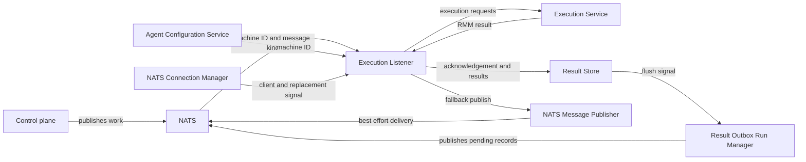
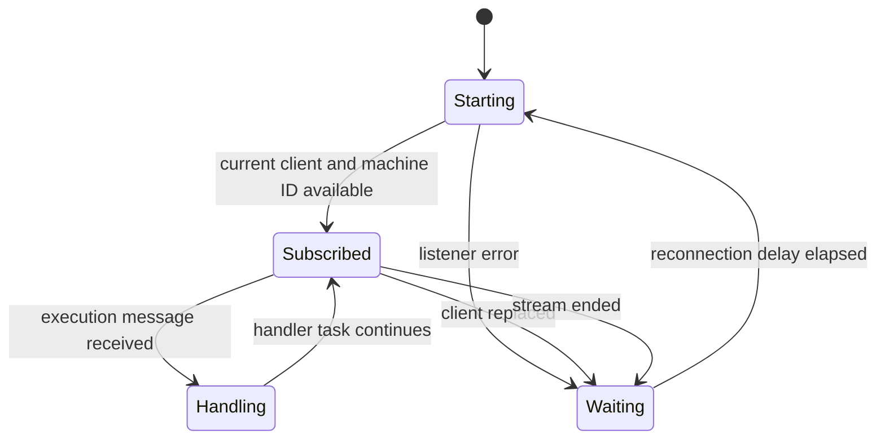
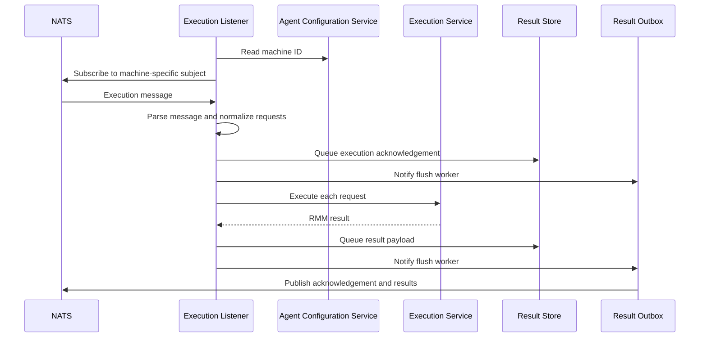
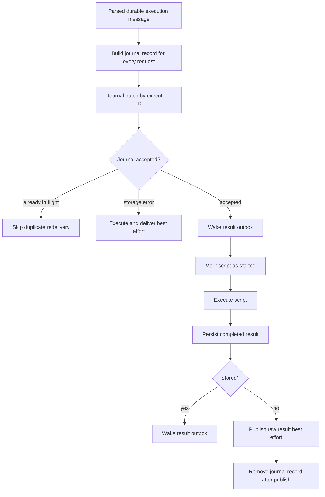
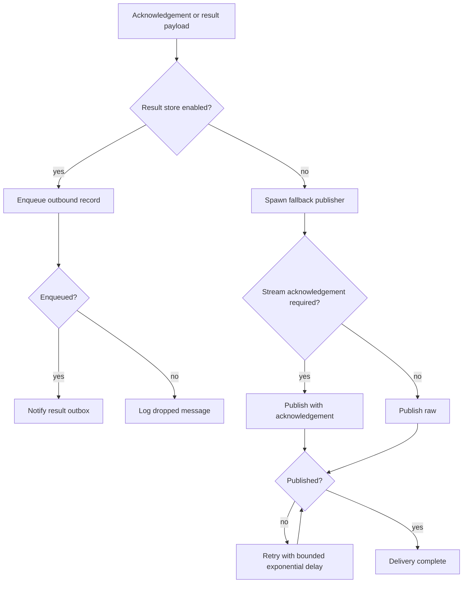

# Execution Listener

The Execution Listener is the OpenFrame Client agent component that subscribes to execution work addressed to one machine, converts each received payload into execution requests, runs the requested scripts, and publishes receipt acknowledgements and execution results. Its implementation is supplied by the `openframe_agent_lib` dependency from the OpenFrame OSS Library and is run by this repository's OpenFrame Client service.

Source implementation: [execution listener source](https://github.com/flamingo-stack/openframe-oss-lib/blob/16e7c1cbd9664e7d10ec5ebca7d53c9bd314decf/clients/openframe-client/src/listener/execution_listener.rs).

## Responsibilities

- Subscribe to the machine-scoped NATS subject for a concrete execution message type.
- Decode an `ExecutionMessage`, attach that message type's privilege policy to every request, and invoke `ExecutionService`.
- Publish an `ExecutionAck` after a valid request is accepted, before its scripts are run.
- Create machine- and result-kind-scoped result subjects.
- Use the persistent result store when available so result delivery can be recovered and retried by the outbox.
- Prevent duplicate execution of an already journaled durable batch.
- Reconnect and resubscribe when the NATS client is replaced or the subscription stream ends.
- Optionally notify a caller after all handling work for an incoming message has completed.

The listener is generic over `M`, where `M` implements `ExecutionMessage`. The message contract supplies the inbound kind, result kind, durability behavior, privilege policy, parser, execution identifier, optional schedule identifier, and one or more execution requests. This lets the same listener host several execution-message variants without embedding their wire format in the listener.

## Architecture

The `NatsConnectionManager` owns the active NATS client and exposes a replacement signal. The listener obtains the configured machine ID from `AgentConfigurationService`, then derives its subscription subject as `machine.{machine ID}.{message kind}`. Each message type defines its own `KIND`; results use `RESULT_KIND`, which defaults to the same kind.

## Main Components

| Component | Role in Execution Listener |
|---|---|
| `ExecutionListener<M>` | Coordinates subscription, parsing, acknowledgement, execution, durable journaling, and outbound delivery for message type `M`. |
| `new` | Builds a listener with connection management, publishing, execution, configuration, result storage, and outbox-flush dependencies. The optional handled-message notifier is initially unset. |
| `on_message_handled` | Returns the listener with a caller-provided `Notify` handle. The listener signals it after a valid message has completed processing. |
| `start` | Starts a long-lived Tokio task. The task listens, records the exit reason, waits for the configured reconnection delay, and repeats indefinitely. |
| `ExecutionMessage` | Generic contract that parses the payload and defines routing, durability, privilege, identifiers, and execution request conversion. |
| `ExecutionService` | Runs each normalized execution request for the machine and returns an `RmmResult`. |
| `ResultStore` | Persists outbound messages and durable execution journal records when storage is enabled. |
| `ResultOutboxRunManager` | Is awakened through `flush_notify` to drain stored outbound records to NATS. |
| `NatsMessagePublisher` | Provides immediate best-effort publishing when persistent storage is unavailable or a durable journal operation fails. |

## Listener Lifecycle

`start` clones the listener and runs an endless supervision loop in a Tokio task. Each iteration obtains the current NATS client, subscribes, and waits for either the subscription stream to end or the connection manager to report that its client changed. Both outcomes cause a delayed resubscription; handler failures are logged and do not terminate the supervision loop.

Messages are consumed by an unbounded dispatcher. For every received NATS message, the dispatcher spawns a Tokio task rather than waiting for earlier work to finish. Consequently, the listener can process multiple deliveries concurrently. Concurrency and ordering constraints that matter to the underlying scripts are therefore delegated to the execution layer and the individual message semantics.

## Request and Result Flow

### Message handling steps

1. The listener decodes the NATS payload as UTF-8 lossily and passes the resulting text to `M::from_payload`.
2. If parsing fails, it logs the error and skips the message. It does not execute work or send an acknowledgement for an invalid payload.
3. For a parsed message, it records the execution and optional schedule identifiers, converts the message to `ExecutionRequest` values, and overrides each request's `privilege_policy` with `M::PRIVILEGE_POLICY`.
4. It creates an `ExecutionAck` containing the execution ID, machine ID, optional schedule ID, and all present script IDs. The acknowledgement target is `machine.{machine ID}.{execution acknowledgement kind}`.
5. It derives the result destination as `machine.{machine ID}.{result kind}.result` and selects durable or direct processing according to `M::DURABLE` and whether the result store is enabled.
6. After execution processing returns, it signals the optional handled-message notifier.

Acknowledgements and results follow the same outbound delivery selection: when the result store is enabled, the listener enqueues the payload and wakes the outbox; otherwise it starts an in-memory fallback publisher.

## Durable Execution Processing

A durable message type adds a journal boundary before scripts run. This is the mechanism that distinguishes a redelivery from a new batch and preserves enough state to resume result delivery.

For each request, the journal record includes the result subject, execution ID, optional schedule ID, machine ID, optional script ID, creation time, and a `started` flag. `journal_batch` returns `false` if that execution batch is already in flight; the listener then logs the redelivery and intentionally does not run the scripts again.

When a durable batch is accepted, the listener marks each request as started, executes it, encodes a payload sized to the publisher's maximum payload, and completes the matching journal entry. A successful completion wakes the outbox. If completion cannot persist the result, the listener attempts a raw immediate publish; if that succeeds, it removes the journal entry. Failure to persist and failure to publish are both logged, leaving the operation without a confirmed result delivery.

If the initial batch journal cannot be written, the listener falls back to direct execution and the normal outbound delivery path rather than refusing the request.

## Non-durable Execution Processing

Non-durable messages, and durable messages when the result store is disabled, execute every request directly. For each request, the listener:

1. Runs the request through `ExecutionService`.
2. Logs the execution, schedule, script identifiers, exit code, timeout flag, and elapsed execution time.
3. Encodes the `RmmResult` according to the effective NATS payload limit.
4. Delivers the encoded result using the result-store queue or fallback publishing path.

There is no batch-level duplicate suppression in this direct path. Delivery semantics therefore depend on the incoming transport and the availability of persistent result storage.

## Delivery and Failure Behavior

Fallback publishing is asynchronous and bounded. The listener chooses acknowledged publishing for subjects that require stream acknowledgement and raw publishing for other subjects. It retries failed attempts in memory, doubling the delay up to the configured maximum. When the configured retry count is exhausted, it logs that the message was lost.

This creates two operationally important modes:

- **Persistent mode:** enqueue succeeds, then the result outbox is responsible for publishing and recovering queued work.
- **Fallback mode:** delivery is bounded to the current process lifetime and retry budget; an exhausted retry budget can lose the message.

## Integration Boundaries

The Execution Listener is part of the Rust OpenFrame Client runtime, not a server-side API endpoint. The runtime receives work from NATS and sends agent outcomes back over NATS. On the server side, the OpenFrame Client service contains RMM result listeners such as command, script acknowledgement, and script result listeners; those components consume the corresponding outcome traffic and update server-side execution state.

Within the agent, the listener depends on the following responsibilities rather than directly owning them:

- **Connection lifecycle:** the connection manager supplies the active NATS client and signals client replacement.
- **Machine identity:** the configuration service resolves the persisted machine ID used in all subjects and acknowledgement payloads.
- **Script execution:** the execution service applies operating-system-specific execution behavior and returns the structured result.
- **Durability and recovery:** the result store and result outbox manage journaled records and their later publication.
- **Transport policy:** the message publisher determines payload capacity and performs immediate NATS publishes.

## Operational Notes

- Subscription identity is machine-specific. If no machine ID can be read, subscription setup fails and the outer loop logs the error before retrying.
- The listener treats a client replacement as normal: it abandons the old subscription path and resubscribes using the replacement client after the configured delay.
- A malformed payload is intentionally skipped rather than retried by this component.
- The receipt acknowledgement is requested before execution, but its eventual publication follows the same queued or fallback delivery rules as results.
- The optional completion notifier observes completion of listener processing, not confirmed remote delivery. In persistent mode, the outbox may still be publishing when the notification occurs.
- The listener logs per-script completion details. These logs are the immediate observability signal for exit code, timeout status, and execution duration.

## Maintenance Guidance

When adding a new execution message type, implement the `ExecutionMessage` contract deliberately:

- Choose a unique inbound `KIND` and, if necessary, a different `RESULT_KIND`.
- Define whether results need durable journaling through `DURABLE`.
- Define the privilege policy at the message type, because the listener applies it to every generated request.
- Ensure parsing exposes a stable execution ID and, where relevant, schedule ID and script IDs; those identifiers form acknowledgement content, log fields, and durable journal keys.
- Consider redelivery behavior before enabling durability. A durable batch that is already in flight is skipped rather than executed a second time.

Changes to subject construction, acknowledgement format, result encoding, or the journal lifecycle affect the agent-to-server execution protocol and should be coordinated with the server-side consumers.
