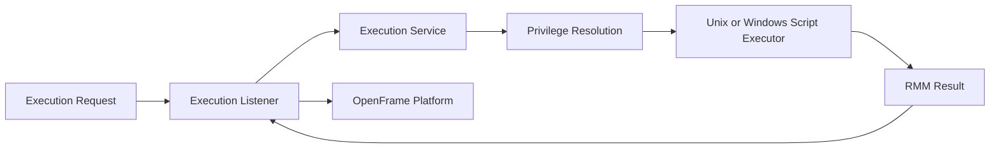
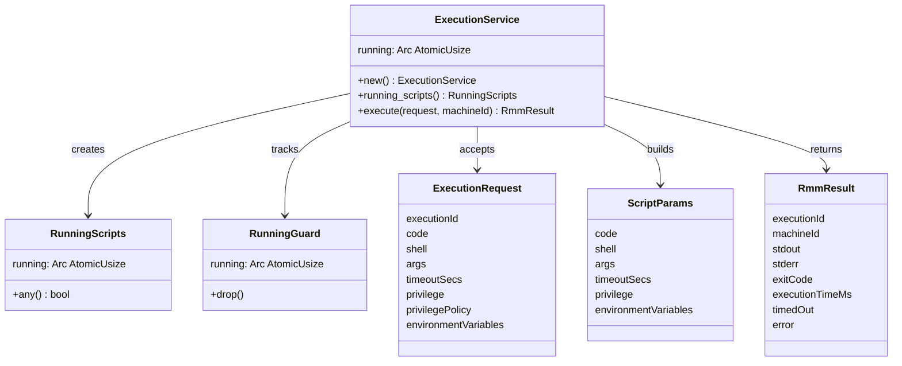
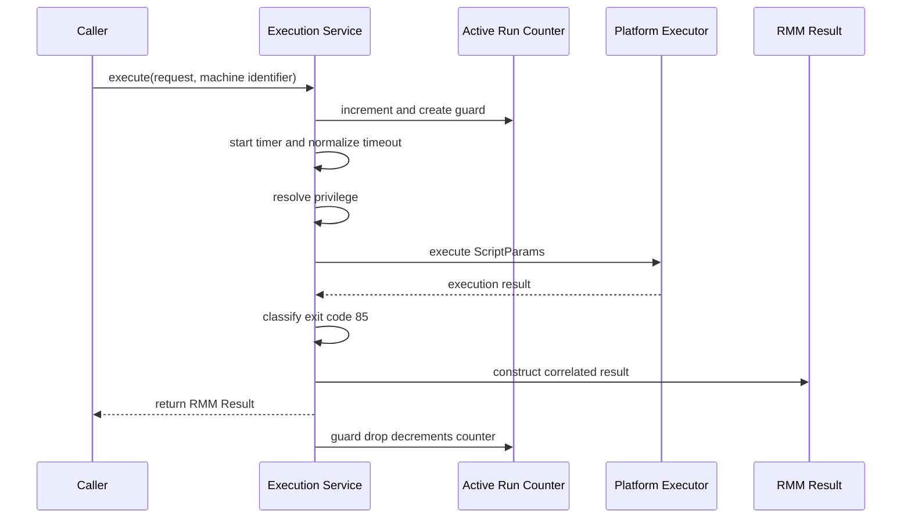
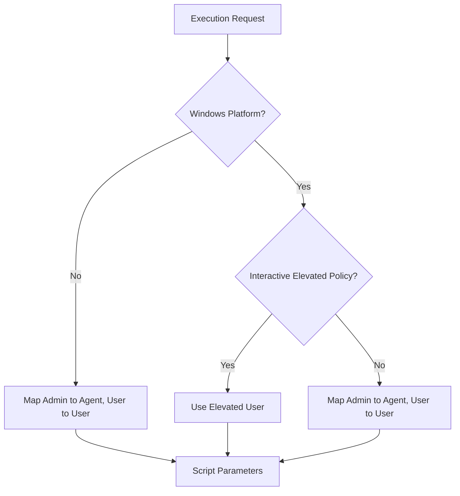
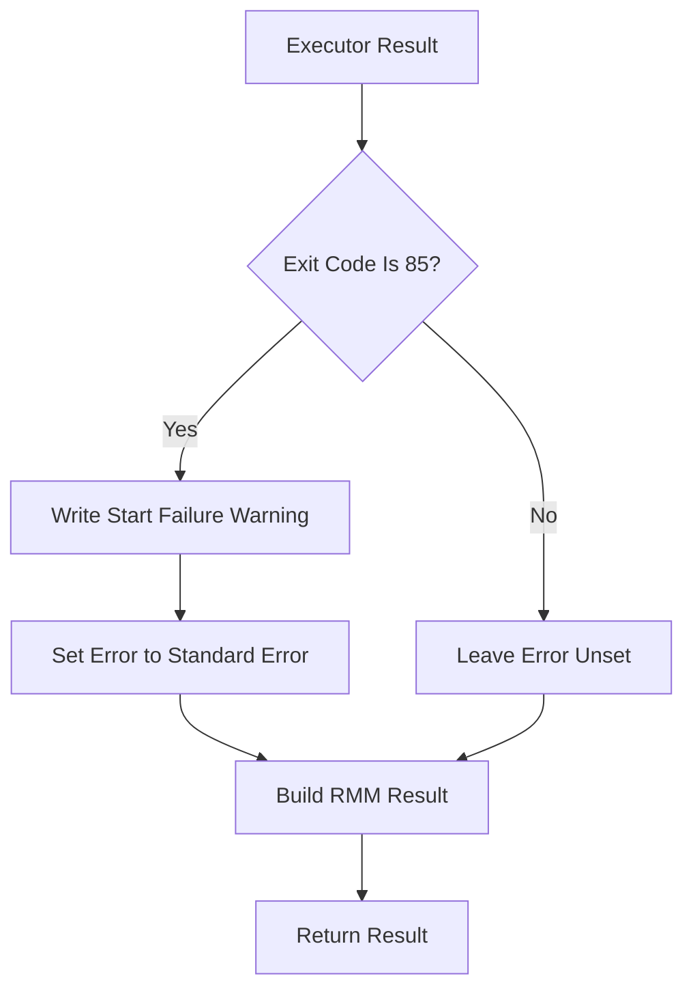

# Execution Service

The Execution Service is the OpenFrame client agent's local script-execution coordinator. It accepts an `ExecutionRequest`, selects the operating-system executor and privilege mode, measures the run, and returns an `RmmResult` that preserves the execution, machine, script, and schedule correlation identifiers. Its implementation belongs to the `openframe_agent_lib` Cargo dependency supplied by [OpenFrame OSS Library](https://github.com/flamingo-stack/openframe-oss-lib/blob/16e7c1cbd9664e7d10ec5ebca7d53c9bd314decf/clients/openframe-client/src/services/execution_service.rs), version `v0.0.5`, and runs as part of this repository's OpenFrame client deployment.

## Responsibilities

- Maintain an atomic count of scripts that are currently executing.
- Convert a requested timeout of `0` to the default 900 seconds, and cap explicit values at the maximum `u32` value accepted by the executor.
- Resolve the requested execution privilege into a platform executor privilege.
- Invoke the Unix or Windows script executor with script code, shell, arguments, timeout, resolved privilege, and environment variables.
- Produce an `RmmResult` containing captured output, exit code, duration, timeout status, correlation identifiers, and a start failure error when appropriate.
- Return a deterministic unsupported-platform result instead of attempting execution outside Unix and Windows.

The service does not deliver results to the platform, authenticate the agent, or interpret script content. Those responsibilities belong to the surrounding client runtime and message-processing components.

## Position in the Client Runtime

An execution request supplies the script body and execution metadata. The Execution Service translates that request into `ScriptParams` for the operating-system-specific executor. It then maps the executor response into the platform result model. The listener and result-delivery roles are shown as integration context; the supplied Execution Service source directly implements only the central service, privilege selection, active-run tracking, and result construction.

## Core API and State

| Component | Role |
|---|---|
| `ExecutionService` | Cloneable, default-constructible coordinator holding the shared atomic active-execution count. |
| `new()` | Constructs the service through its default implementation. |
| `execute()` | Starts active-run tracking, resolves platform execution settings, runs the script where supported, and returns an `RmmResult`. |
| `running_scripts()` | Produces a `RunningScripts` view backed by the same counter. |
| `RunningScripts::any()` | Reports whether at least one tracked execution is active. |

The counter is stored in an `Arc<AtomicUsize>`. Every call to `execute()` creates an internal guard before script launch. The guard decrements the counter on drop, which includes normal completion and early unwinding from the async method. Clones of the service and values returned by `running_scripts()` observe the same count.

## Execution Flow

### Request-to-Executor Mapping

On Unix and Windows, the service forwards the following request values into `ScriptParams`:

| Request field | Execution behavior |
|---|---|
| Script code | Passed unchanged as the code to execute. |
| Script shell | Converted through the shell model's parameter representation. |
| Arguments | Passed to the executor. |
| Environment variables | Passed by reference to the executor. |
| Timeout | Uses 900 seconds when the request specifies `0`; otherwise clamps the value to the largest `u32` value. |
| Privilege | Resolved according to the operating system and requested policy. |

The elapsed duration begins immediately after active-run tracking is entered and ends while the `RmmResult` is built. Consequently, `execution_time_ms` includes service-side setup and executor wait time, not only the child process runtime.

## Privilege Resolution

The service maps a requested `PrivilegeLevel` to the executor's privilege abstraction:

- `Admin` becomes the agent privilege.
- `User` becomes user privilege.

On Unix, that base mapping is always used. On Windows, an `InteractiveElevated` privilege policy overrides the base mapping and selects elevated-user execution. The `AsRequested` policy uses the base mapping.

This mapping is a selection mechanism, not an authorization check. Callers must ensure that execution requests and their privilege policy are trusted before they reach the client agent.

## Result Semantics and Failure Handling

The service always returns an `RmmResult`, including unsuccessful execution attempts. On supported platforms, it copies the executor's standard output, standard error, return code, and timeout indicator into that result. It also adds the supplied machine identifier and preserves optional script and schedule identifiers from the request.

Exit code `85` has special meaning in this layer: it indicates that the script did not start. The service writes a warning containing the execution identifier, selected privilege, and standard error, then sets `error` to a copy of standard error. Other exit codes leave `error` unset, even when the script itself reports an error through exit status or standard error.

On platforms that are neither Unix nor Windows, no executor is invoked. The result has empty standard output, a standard-error message stating that execution is unsupported, exit code `85`, `timed_out` set to false, and `error` set to `unsupported platform`. It retains the normal identifiers and measured duration.

## Concurrency and Lifecycle Considerations

`running_scripts().any()` is a lightweight observation API intended for coordination with operations that should avoid overlapping script activity. It reports only whether the count is positive; it neither reserves execution capacity nor prevents a new execution from starting immediately after the check. Consumers that need exclusion must provide their own synchronization.

The service increments its count before validating platform support or launching the executor. Therefore, unsupported-platform calls and start failures are visible as active briefly, until the method returns and its internal guard is dropped. Atomic operations use acquire, release, and acquire-release orderings so views of the count can safely observe lifecycle changes across cloned service instances.

## Dependencies and Integration Boundaries

| Dependency | Usage in Execution Service |
|---|---|
| Execution request model | Supplies the executable content, invocation configuration, privilege request, and correlation metadata. |
| Executor abstraction | Runs scripts only on Unix and Windows and returns output, return code, and timeout status. |
| Execution result model | Carries normalized outcome data back to the client message-handling path. |
| Tracing | Records execution start and script-start failure warnings on supported platforms. |
| System clock | Measures the end-to-end service execution duration. |

The code is sourced from the OpenFrame OSS Library rather than this repository. Maintain changes in the [Execution Service source](https://github.com/flamingo-stack/openframe-oss-lib/blob/16e7c1cbd9664e7d10ec5ebca7d53c9bd314decf/clients/openframe-client/src/services/execution_service.rs) alongside compatibility with the request, result, and executor contracts it imports.

## Maintenance Guidance

- Preserve the scope-bound active-run guard when changing `execute()`. Manual decrement paths are susceptible to leaks on error or cancellation paths.
- Treat exit code `85` as a cross-layer contract because it controls start-failure logging and population of `RmmResult.error`.
- Keep Unix and Windows privilege mappings explicit. Windows-only interactive elevation must remain excluded from Unix builds.
- When adding request fields, decide whether they belong in executor parameters, result correlation metadata, or neither; avoid silently dropping execution-critical data.
- Validate changes on Unix and Windows, plus the unsupported compilation path when portability is relevant. Timeout defaults, counter cleanup, privilege selection, output propagation, and result identifiers are the key behavioral boundaries.
