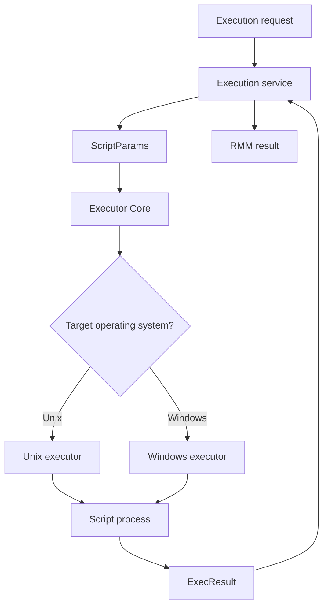
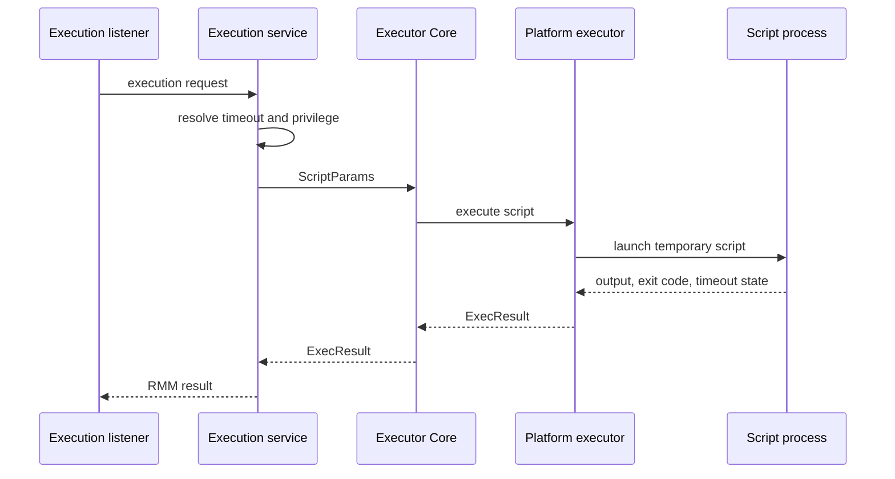
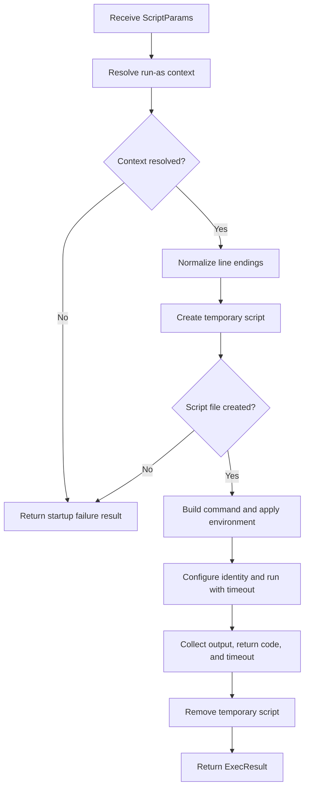
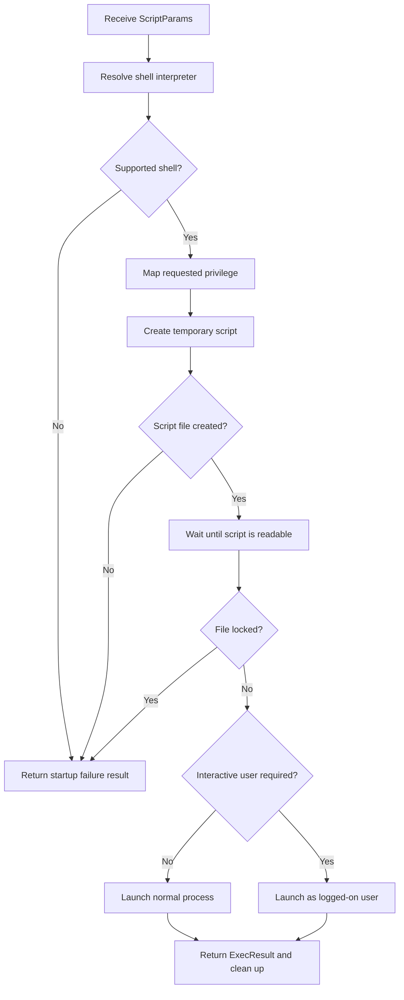

# Executor Core

Executor Core is the operating-system boundary for running an OpenFrame Client script. It defines the small, platform-neutral execution contract shared by the Unix and Windows implementations: requested privilege, script inputs, and captured completion data. The implementation is supplied by the `openframe_agent_lib` Cargo artifact from the OpenFrame OSS Library and is run by this repository's OpenFrame Client deployment.

The module deliberately does not receive messages, validate RMM requests, persist results, or publish them. Those responsibilities sit around it in the client runtime. Executor Core accepts an already-prepared script and returns process output, exit status, and timeout state.

## Responsibilities and boundaries

| Area | Executor Core responsibility | Outside the module |
|---|---|---|
| Execution contract | Defines `ScriptParams`, `Privilege`, and `ExecResult`. | Builds RMM execution requests and translates results for transport. |
| Platform selection | Exposes the Unix or Windows `execute_script` implementation through conditional compilation. | Chooses the operating system on which the client is built and run. |
| Process result | Returns standard output, standard error, numeric return code, and timeout state. | Decides how a returned result is stored, sent, retried, or displayed. |
| Privileges | Represents agent and interactive-user execution; Windows additionally represents elevated interactive-user execution. | Resolves a requested policy to a privilege and provides the necessary OS rights. |

## Public contract

The core API consists of three types in the [Executor Core source](https://github.com/flamingo-stack/openframe-oss-lib/blob/7a766f00e4f58b5d89db007b878ac8d6e0c344f4/clients/openframe-client/src/executor/mod.rs).

### `Privilege`

`Privilege` describes the execution identity requested by the caller:

- `Agent` runs under the client service or agent context.
- `User` requests execution as the logged-on interactive user.
- `ElevatedUser` is compiled only for Windows and requests an elevated interactive-user context.

The operating-system implementation determines whether the requested identity can be resolved. A failure before process creation is returned as an execution result rather than escaping the contract as an unstructured platform error.

### `ScriptParams`

`ScriptParams` is a borrowed input bundle. It carries:

| Field | Meaning |
|---|---|
| `code` | Script content written to a temporary script file by the platform implementation. |
| `shell` | Shell or interpreter selector. |
| `args` | Ordered command-line arguments passed to the script. |
| `timeout_secs` | Maximum process runtime in seconds. |
| `privilege` | Requested execution identity. |
| `env_vars` | Environment-variable assignments applied to the launched process where supported by the platform path. |

Because the parameters borrow their inputs, execution callers retain ownership of the script content and argument collections for the duration of the asynchronous call.

### `ExecResult`

`ExecResult` normalizes platform-specific completion into four fields:

| Field | Meaning |
|---|---|
| `stdout` | Captured standard output. |
| `stderr` | Captured standard error or startup failure detail. |
| `retcode` | Process exit code, or a module-defined startup failure code. |
| `timed_out` | Whether the execution exceeded the requested timeout. |

This structure records observable execution facts. It does not classify command success: callers must interpret the exit code and output in their own protocol context.

## Architecture

At compile time, conditional exports select one `execute_script` function: the Unix implementation on Unix targets and the Windows implementation on Windows targets. This means consumers call one API while each binary includes only its relevant implementation.

## Component interactions

The neighboring execution service is the immediate client-runtime consumer. It supplies a default timeout of 900 seconds when a request specifies zero, clamps representable timeouts to an unsigned 32-bit value, maps the requested policy to `Privilege`, and measures total execution time. It maps `ExecResult` into the RMM result message, preserving output, exit code, and timeout state. In that service, return code `85` denotes a script that did not start; it is also surfaced as an error detail.

## Platform execution paths

### Unix

The Unix executor resolves the requested run-as context before writing the script. It normalizes script line endings, creates a temporary script for that context, and schedules cleanup through a temporary-file guard. It then builds the process command, applies environment-variable assignments, configures pre-execution behavior for the chosen identity, and runs the command with the supplied timeout.

### Windows

The Windows executor first accepts only the `powershell` and `cmd` shell selectors. It maps agent execution to ordinary process launch, maps user execution to the logged-on user, and maps `ElevatedUser` to elevated interactive-user execution. It writes a temporary script with the interpreter's extension, waits for the file to become readable, and then launches either the normal process path or the interactive-user path. The temporary-file guard performs cleanup after execution returns.

## Data flow and lifecycle

1. The client execution service receives a normalized execution request from the message-handling path.
2. It resolves the effective timeout and privilege, then creates `ScriptParams` from the request's code, shell, arguments, and environment assignments.
3. Executor Core dispatches to the platform implementation selected during compilation.
4. The platform implementation materializes the code in a temporary file, launches the selected interpreter in the requested context, and applies the timeout.
5. The process outcome is captured as `ExecResult`. Temporary-script cleanup is scoped to the execution call.
6. The execution service translates the result into an RMM result carrying the execution and machine identifiers, captured streams, exit code, elapsed time, timeout status, and optional startup error.

## Failure and security considerations

- **Shell validation:** Windows rejects shell names other than `powershell` and `cmd` before creating a runnable process. The Unix shell handling belongs to its platform command builder.
- **Identity resolution:** A requested non-agent identity is not silently downgraded. If run-as setup fails, the platform path returns a startup failure result.
- **Temporary artifacts:** Both platform paths use a guard to remove the generated script after the call completes, including early-return paths after successful file creation.
- **Timeout reporting:** A timeout is explicitly represented by `timed_out`; consumers should not infer it solely from an exit code.
- **Output handling:** Standard output and standard error are returned as strings. Upstream transport and persistence layers should apply their own size, retention, and sensitive-data controls.
- **Platform scope:** The client execution service reports execution as unsupported on targets that are neither Unix nor Windows, rather than attempting a generic fallback.

## Maintainer guidance

When extending Executor Core, preserve the contract boundary between request preparation and process launch:

- Add a privilege variant only when every relevant platform has a defined, auditable implementation or conditional compilation clearly limits it.
- Keep `ExecResult` platform-neutral so upstream result publishing remains independent of OS process APIs.
- Ensure every temporary-file creation path retains cleanup ownership before further fallible work.
- Treat shell selection, argument construction, environment handling, and identity transitions as security-sensitive interfaces.
- Update both platform paths and the execution-service mapping when adding observable result fields or changing startup-failure semantics.

The platform-specific executor modules and the execution service are documented as separate areas of the OpenFrame Client module tree; consult their source when changing operating-system launch behavior or RMM result mapping.
