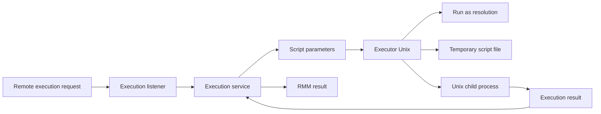
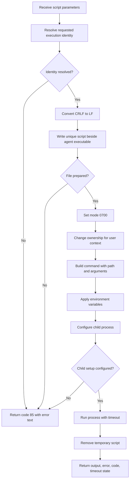
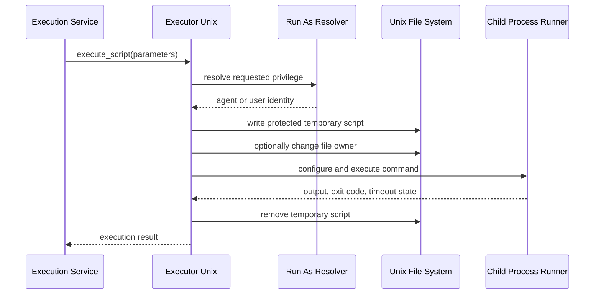

# Executor Unix

Executor Unix is the Unix-specific script-launching adapter used by the OpenFrame Client agent. It turns an already-authorized script request into a temporary executable file, configures the target execution identity, applies supplied environment variables, and delegates process collection and timeout handling to the Unix process runner.

The implementation belongs to the `openframe_agent_lib` Cargo dependency supplied by [OpenFrame OSS Library](https://github.com/flamingo-stack/openframe-oss-lib/blob/7a766f00e4f58b5d89db007b878ac8d6e0c344f4/clients/openframe-client/src/executor/unix/mod.rs). This repository consumes that library at version `v0.0.5`; the module runs inside the deployed OpenFrame Client agent rather than in a tenant-side Java service.

## Responsibilities

`execute_script` is the module's only public execution entry point. Its responsibilities are deliberately narrow:

- Resolve whether the script runs as the agent identity or the active console user.
- Normalize Windows-style line endings to Unix line endings before persisting code.
- Create a uniquely named shell-script file beside the running agent executable.
- Restrict the temporary script to owner access with mode `0700`.
- Transfer ownership to the selected user when user-context execution is requested.
- Launch the temporary path directly with the supplied argument vector and environment entries.
- Configure child-process setup before execution, then return the process runner's outcome.
- Remove the temporary file when the execution scope exits, including early returns after creation.

The module does not parse script syntax, choose an interpreter from `ScriptParams.shell`, validate remote requests, or publish results. In particular, the shown Unix command builder executes the generated file path directly; the `shell` field is accepted in the shared request contract but is not used by this adapter.

## Position in the Client Execution Path

The broader client library receives execution messages, converts them to execution requests, and dispatches them through `ExecutionService`. The service applies a default timeout of 900 seconds when the request supplies zero, resolves the privilege policy, and maps the executor output to the RMM result sent back through the client messaging pipeline. Executor Unix is the final platform-specific stage before operating-system process creation.

## Component Contract

The shared executor contract provides three values used to express a result or invocation:

| Component | Role in Executor Unix |
|---|---|
| `ScriptParams` | Input containing script code, shell identifier, arguments, timeout, privilege, and environment variables. Executor Unix uses all fields except the shell identifier. |
| `Privilege` | On Unix, selects either `Agent` or `User`; it is resolved before any file is created. |
| `ExecResult` | Returns captured standard output, standard error, integer return code, and a timeout flag. |

`ExecutionService` treats return code `85` as a start failure. It logs the failure, then copies standard error into the RMM result's error field. That convention makes failures during identity resolution, file creation, ownership changes, or pre-execution setup distinguishable from a script that successfully started and exited unsuccessfully.

## Execution Process

### Step Details

1. **Identity selection** — `resolve_run_as` asynchronously resolves the shared privilege request. Any error is converted to an `ExecResult` with empty output, error text in standard error, code `85`, and `timed_out` set to `false`.
2. **Normalization and persistence** — The implementation replaces every CRLF sequence with LF, derives a unique `sh` filename, and writes the code into the parent directory of the current executable. If the executable path has no parent or a filesystem operation fails, it follows the same code-`85` failure path.
3. **File protection and ownership** — The script is marked `0700`. For a user-context run, the file is changed to that user's UID and GID so the selected account can execute its private script.
4. **Command preparation** — Tokio receives the script path as the program and the request arguments as distinct arguments. Environment variables are applied before pre-execution configuration.
5. **Child execution** — Unix-specific pre-execution setup is applied, then the process runner executes the command using the requested timeout. Its result becomes the module result unchanged.
6. **Cleanup** — A `TempFileGuard` is constructed immediately after the file is successfully created. Its scope-bound cleanup covers both normal execution completion and an error from later setup.

## Component Interaction

## Failure and Timeout Semantics

The adapter has two distinct outcome paths:

- **Launch or setup failure:** a failed identity lookup, executable-path lookup, file write, permission update, ownership change, or pre-execution configuration returns code `85`. Standard output is empty and standard error carries the diagnostic message.
- **Started process outcome:** once delegated to the process runner, output streams, return code, and the timeout flag are propagated from that runner. The supplied source does not define how the runner terminates a timed-out process; maintain that behavior in the Unix process-runner implementation rather than changing this adapter's result mapping.

## Security and Operational Considerations

Executor Unix executes code that reaches the agent, so its security boundary depends on the request authorization and privilege-policy layers upstream. Maintainers should preserve these local safeguards:

- Keep `0700` permissions on generated scripts. The file may contain sensitive arguments or operational logic.
- Preserve ownership transfer for console-user execution. Removing it can make a valid user-context request fail or expose file contents to the wrong account.
- Preserve argument-vector construction rather than assembling a shell command string; arguments remain separate process arguments.
- Keep the cleanup guard adjacent to successful file creation so scripts are not left beside the agent binary after configuration failures.
- Treat code `85` as reserved for launch failures because higher-level execution reporting relies on that signal.
- Remember that the chosen temporary location must be writable by the agent and suitable for execution; otherwise script launch fails before a child process starts.

## Maintenance Notes

Changes to Executor Unix should be reviewed together with the shared executor contract and execution service mapping. Compatibility matters across Unix and Windows adapters because both produce the same `ExecResult` consumed by the client result pipeline. When adding a new privilege mode, update identity resolution, ownership and pre-execution behavior, and the upstream privilege-policy mapping as one design change.

The source implementation is maintained in OpenFrame OSS Library: [Unix executor source](https://github.com/flamingo-stack/openframe-oss-lib/blob/7a766f00e4f58b5d89db007b878ac8d6e0c344f4/clients/openframe-client/src/executor/unix/mod.rs).