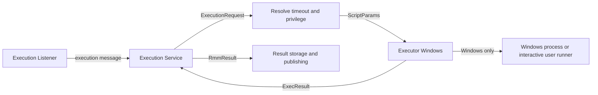
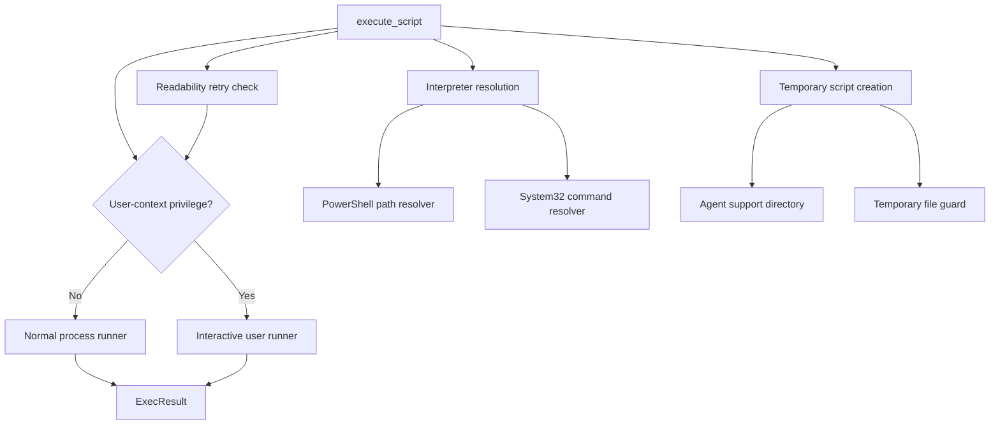
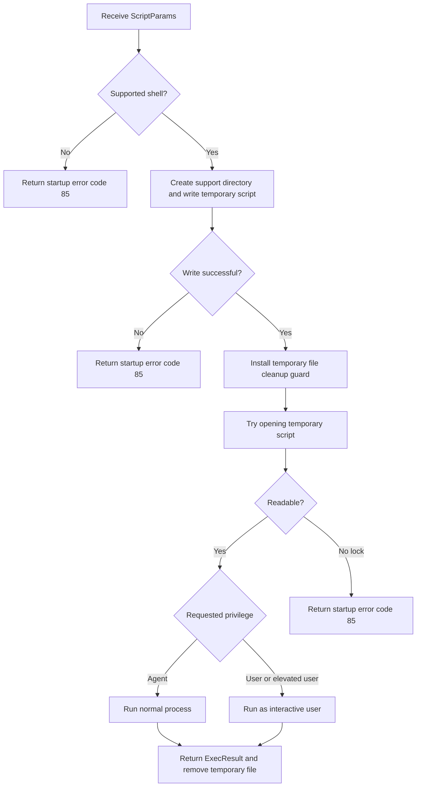
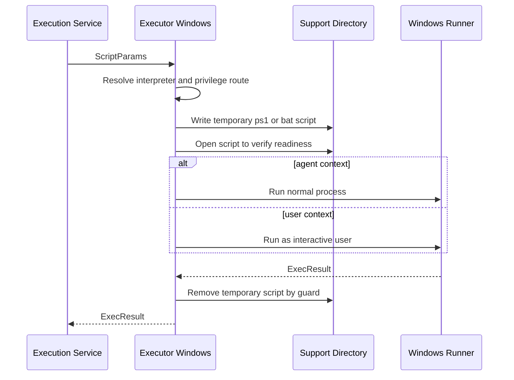

# Executor Windows

Executor Windows is the Windows-specific script launch boundary in the OpenFrame client agent. It converts a normalized execution request into a temporary PowerShell or Command Prompt script, selects whether it runs in the agent, logged-on user, or elevated logged-on user context, and returns a uniform execution result to the client runtime.

The implementation belongs to the `openframe_agent_lib` Cargo library supplied by [OpenFrame OSS Library](https://github.com/flamingo-stack/openframe-oss-lib/blob/7a766f00e4f58b5d89db007b878ac8d6e0c344f4/clients/openframe-client/src/executor/windows/mod.rs). OpenFrame OSS Tenant assembles and runs that library as part of its client agent; this module is not a service endpoint or a public remote API.

## Responsibilities

Executor Windows owns the platform-specific preparation and dispatch steps:

- Supports the `powershell` and `cmd` shell names only.
- Resolves PowerShell and Command Prompt from Windows system locations when possible, with executable-name fallbacks.
- Creates the agent support directory when needed, writes the supplied script to a uniquely named temporary file, and removes that file when execution completes or returns early.
- Detects a short-lived file access race before launch, such as an antivirus scan holding the freshly written file.
- Dispatches non-interactive agent-context execution to the normal process runner.
- Dispatches user-context execution to the interactive-user runner, including an elevated-user option on Windows.
- Reports startup and preparation failures using the shared `ExecResult` format with return code `85`.

It deliberately does not define incoming execution messages, authorize requested privilege, publish results, or implement the Unix launch path. Those concerns belong to the wider client execution pipeline.

## Position in the Client Execution Pipeline

The client execution service translates an `ExecutionRequest` into shared executor parameters. A request with no timeout uses 900 seconds; otherwise the supplied timeout is bounded to a 32-bit second value. The service resolves the requested privilege and passes script code, the shell parameter, arguments, environment-variable entries, and timeout to the OS-specific executor.

On Windows, `ScriptShell::Powershell` maps to `powershell` and `ScriptShell::Cmd` maps to `cmd`. Other model shell variants can exist in a request model, but Executor Windows rejects them rather than attempting an implicit fallback.



The listener is long-running: when its stream ends or its NATS client is replaced, it logs the event, waits for its reconnection delay, and subscribes again. Executor Windows is invoked only after that delivery layer has supplied an execution request to the service.

## Dependencies and Boundaries

The module is a thin orchestrator over shared executor types and Windows-specific helpers. Its immediate dependencies are shown below.



### Shared execution contract

The core executor provides these values to Executor Windows:

| Type | Role in Executor Windows |
|---|---|
| `ScriptParams` | Carries code, shell, argument list, timeout in seconds, privilege selection, and environment-variable entries. |
| `Privilege` | Selects `Agent`, `User`, or Windows-only `ElevatedUser` dispatch. |
| `ExecResult` | Holds standard output, standard error, process return code, and timeout status. |

The Windows module passes `ScriptParams` to its normal or interactive runner after it has selected an interpreter and created the script file. This keeps process setup and interactive-session handling behind their dedicated Windows modules.

### Interpreter resolution

For PowerShell, Executor Windows calls the platform resolver for the Windows PowerShell executable under the Windows system directory. The command receives these fixed flags:

```text
-NonInteractive -NoProfile -ExecutionPolicy Bypass -File
```

The temporary script uses the `ps1` extension. For Command Prompt, it resolves `System32\cmd.exe` and uses `/C`; the temporary script uses the `bat` extension.

The executable resolvers first inspect the `WINDIR` environment variable and then `SystemRoot`. If the expected system file is not present, they return the bare executable name, allowing normal Windows command resolution to locate it. Executor Windows returns an immediate startup error for any shell other than `powershell` or `cmd`.

## Script Execution Flow



### Temporary-file lifecycle

Scripts are written below the client application support directory. The module creates that directory before generating a name through the shared temporary-script utility and writing the content with the interpreter-specific extension. Immediately after creation, a `TempFileGuard` owns a clone of the path so cleanup also happens for early returns caused by readiness failures.

Before launching, the module tries to open the script. Windows errors `32` and `33` are treated as file locks. Access-denied error `5` is treated as transient for retry purposes, but only lock errors produce the explicit `Script file locked by another process` failure after retries. The check attempts at most three opens and waits 200 milliseconds between transient failures. Each retry logs the attempt, error, and path, identifying antivirus scanning as a possible source of the race.

## Privilege Routing

The privilege selection is performed before the temporary file is created, then translated as follows:

| Shared privilege | Executor Windows routing |
|---|---|
| `Agent` | No elevation request; dispatch to the normal process runner. |
| `User` | Request execution as the logged-on interactive user. |
| `ElevatedUser` | Request elevated execution as the logged-on interactive user. |



The source shown for this module establishes routing, not the underlying mechanism for process creation, timeout enforcement, argument handling, environment setup, user-session discovery, or elevation. Those responsibilities are delegated to the internal normal-process and interactive-user runner modules. Maintainers should preserve this separation when changing shell support or privilege behavior.

## Result and Failure Semantics

Every path produces `ExecResult`:

| Field | Meaning |
|---|---|
| `stdout` | Captured standard output when a runner starts and completes. |
| `stderr` | Captured standard error or a preparation/startup explanation. |
| `retcode` | Process exit code, or `85` when the script cannot be started by this module. |
| `timed_out` | Timeout status from the runner; startup failures set it to `false`. |

The execution service measures elapsed time around the executor call and creates an `RmmResult` containing the execution and machine identifiers, output, exit code, duration, timeout state, and optional script or schedule identifiers. It treats return code `85` specially: it logs that the script did not start and sets the result `error` field to the executor's standard-error message. Other return codes remain ordinary execution outcomes.

## Operational and Maintenance Notes

- Keep shell names and extensions paired with their interpreter flags. A new Windows shell requires an explicit `Interpreter` entry and an appropriate execution path rather than a fallback to Command Prompt or PowerShell.
- Preserve the cleanup guard immediately after successful script creation. Moving it later risks leaving generated scripts in the application support directory on an early return.
- Treat the readiness loop as a compatibility guard for Windows file scanning, not as a general process retry policy. Its bounded retry count and short delay avoid indefinitely blocking command execution.
- Return code `85` is an execution-pipeline contract for failures before a script begins. Changes to that value require coordinated changes to the execution service's error handling.
- The PowerShell `Bypass` execution-policy flag is part of the current invocation contract. It enables the agent to run its generated temporary script; it does not replace server-side authorization or privilege-policy enforcement.

## Scope Within OpenFrame

Executor Windows is one of two OS implementations beneath the shared executor abstraction. The Unix implementation follows the same `ScriptParams` to `ExecResult` shape but performs Unix-specific run-as selection, line-ending normalization, pre-execution configuration, environment application, and timeout execution. The platform-independent execution service selects the compiled OS implementation, while the Windows module confines Windows interpreter selection, file readiness handling, and interactive-user routing to the agent endpoint.
