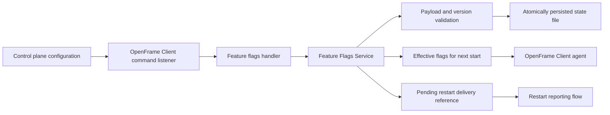
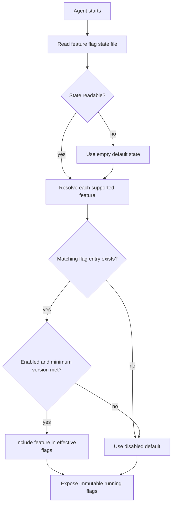
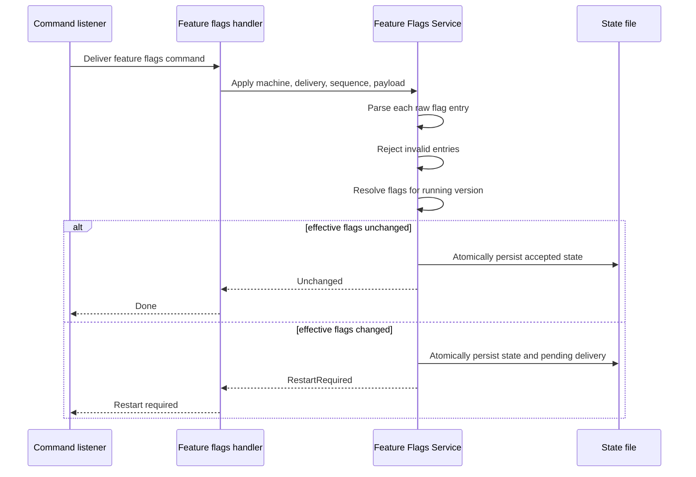
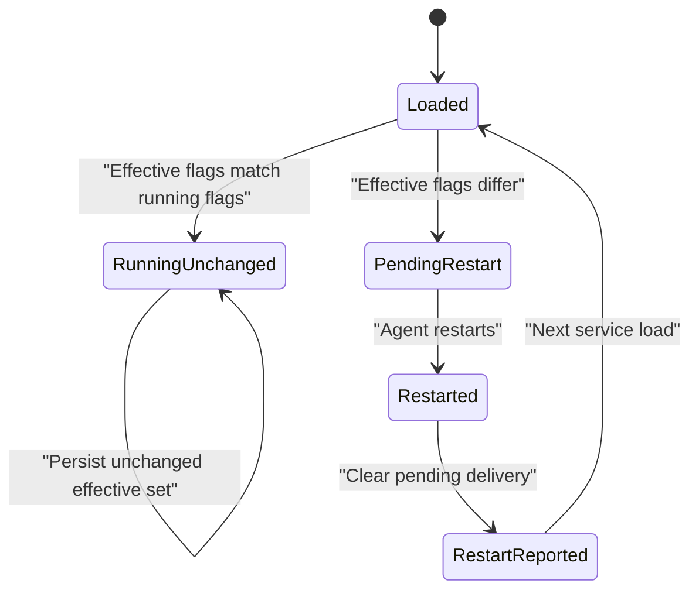

# Feature Flags Service

The Feature Flags Service manages the OpenFrame Client agent's locally persisted feature-flag configuration. It accepts a version-gated flag payload for a registered machine, validates and saves the payload atomically, and determines whether the agent must restart before the new effective configuration can take effect.

This module is implemented by the `openframe_agent_lib` dependency from [OpenFrame OSS Library](https://github.com/flamingo-stack/openframe-oss-lib/blob/16e7c1cbd9664e7d10ec5ebca7d53c9bd314decf/clients/openframe-client/src/services/feature_flags_service.rs). The tenant repository runs that agent library as part of its OpenFrame Client workload.

## Purpose and Scope

Feature flags provide a conservative rollout mechanism for selected agent capabilities. The supported features are:

- `delivery-tool-installation`
- `delivery-client-uninstall`
- `delivery-client-update`
- `package-auto-update`

All supported features default to disabled. A feature becomes effective only when the persisted payload contains a valid entry for its name, the entry is enabled, and the running agent version meets the entry's minimum semantic-version requirement.

The service is deliberately not a remote configuration client. It owns local state and effective-flag resolution after a command has delivered a `FeatureFlagsMessage`. Command transport, delivery sequencing, and restart coordination belong to the surrounding OpenFrame Client command-listener infrastructure.

## Architecture

The command handler owns an `Arc` reference to the Feature Flags Service. It participates in the shared command-handler protocol, including sequence handling and the `RestartRequired` outcome. The service itself protects mutable persisted state with a mutex, while the `running` effective flags are computed once when the agent starts and remain stable for that process lifetime.

## Core Data Model

| Type | Responsibility |
| --- | --- |
| `Feature` | Closed set of agent capabilities that can be gated. Each feature has a stable wire name and defaults to disabled. |
| `FeatureFlag` | One requested setting containing `enabled` and `min_version`. |
| `FeatureFlagsMessage` | Transport payload: a map of flag names to untyped JSON values. |
| `FeatureFlags` | Resolved in-memory set of enabled `Feature` values for the current agent version. |
| `FeatureFlagsState` | Persisted state containing the registered machine ID, sequence, accepted flags, and an optional delivery awaiting restart acknowledgement. |
| `FlagsApplied` | Apply result: `Unchanged` when the effective runtime set is unchanged, or `RestartRequired` when it differs. |
| `DeliveryRef` | Identifies the originating delivery so a pending restart can be settled after the agent starts again. |

The persisted state holds the accepted source configuration rather than only the resolved set. This lets a future agent version re-evaluate a valid flag whose minimum version was not met by the previous version.

## Flag Resolution

At startup, `load` reads and deserializes the saved `FeatureFlagsState`, then resolves the effective `FeatureFlags` against the agent's running version.

An unreadable, malformed, or unavailable state file does not prevent the agent from starting. The service logs a warning and substitutes the default state, which leaves every gated feature off. The service also logs the loaded sequence, configured flags, and effective flag set for diagnosis.

`flags` returns the immutable resolved set. Consumers use `is_enabled` with a `Feature` value rather than inspecting the raw persisted map, ensuring version constraints and defaults are applied consistently.

## Applying a Delivered Update

`apply` receives the registered machine ID, delivery reference, command sequence, and feature-flag payload. Its primary safety property is that it validates and persists all accepted source flags before updating the in-memory state.

### Validation Rules

For every map entry, the service attempts to deserialize the JSON value as a `FeatureFlag`. It accepts the entry only if its `min_version` is parseable as a semantic version. The parser accepts an optional leading `v` or `V` before the version. Entries that fail deserialization or have an invalid minimum version are ignored with a warning; they are not included in the new persisted map.

The module validates payload structure and version syntax, but it does not make unknown names effective. Resolution iterates the fixed supported `Feature` set, so an accepted but unknown flag name remains stored without enabling an agent capability.

### Restart Decision

The service compares the newly resolved set with the immutable `running` set that was resolved during `load`:

- **Unchanged**: the new configuration resolves to the same enabled-feature set as the running agent. The state is persisted and the command can complete without a restart.
- **Restart required**: the resolved set differs. The service persists the new state and the delivery reference in `awaiting_restart`, but it does not mutate `running`. The next agent process loads the new configuration, making the changed set active only after restart.

This distinction prevents live configuration changes from partially altering a running agent. It also means a later source update can be recorded as unchanged when version gating produces the same effective set, even if the raw persisted entries differ.

## Persistence and Recovery

The service writes state through `atomic_write`:

1. Create the parent directory when required.
2. Write the serialized, pretty-printed JSON to a temporary file in that directory.
3. Flush the temporary file to stable storage.
4. Atomically replace the target file.

On Unix, the helper sets the temporary file mode to `0644` before replacement. This process reduces the chance of a torn configuration file if the agent stops during a write.

If persistence fails, `apply` returns an error and leaves the service's in-memory state unchanged. The persisted configuration therefore remains the last successfully saved state. State reads fail closed: a missing file starts from defaults, while read or JSON errors are logged and also use defaults.

The service uses poison-tolerant mutex recovery for state access. If a prior holder panicked, later calls recover the inner state instead of permanently disabling feature-flag operations.

## Sequence and Machine Identity

The command framework identifies this handler as sequenced. `applied_sequence(machine_id)` returns the persisted sequence only when the stored machine ID matches the currently registered machine.

When the machine ID differs, the service logs that flags were applied for another registration and returns `0`. This intentionally permits a newly registered machine to accept any incoming sequence instead of treating a previous registration's sequence as its own. A successful apply then replaces the stored machine ID and sequence together with the accepted flag configuration.

## Restart Acknowledgement Lifecycle

A changed effective configuration stores the originating `DeliveryRef` as `awaiting_restart`. The command-listener protocol can retrieve it through `awaiting_restart` so that the delivery is not considered fully settled before the necessary restart has occurred.

After the restarted agent reports the restart outcome, `restart_reported` clears only that pending delivery reference and atomically saves the revised state. It preserves the machine ID, sequence, and accepted flags. If no restart was required, no pending delivery reference is stored.

## Integration Boundaries

| Boundary | Role in the feature-flag flow |
| --- | --- |
| OpenFrame Client command listener | Deserializes delivered commands, applies sequence behavior, invokes the handler, and converts the result into command outcomes. |
| Feature flags handler | Bridges the command protocol to `FeatureFlagsService`, including the restart-required and pending-restart hooks. |
| OpenFrame Client agent | Loads resolved flags at process startup and uses the exposed `FeatureFlags` set to gate capabilities. |
| Control plane | Produces feature-flag deliveries. The agent treats its message as untrusted configuration and validates each entry locally. |
| Local filesystem | Stores the durable state needed for restart activation, sequence checks, and restart acknowledgement. |

The platform also contains server-side feature-flag initialization and data-fetching components, but this module does not query them directly. Its boundary is the delivered `FeatureFlagsMessage` received by the local agent.

## Operational Guidance

- Treat the state file as agent-owned durable state. Deleting or corrupting it causes the next startup to resolve all feature-gated capabilities as disabled until a valid delivery is applied.
- Use valid semantic versions for every flag. An invalid `min_version` disables that entry by excluding it from persisted accepted flags.
- Expect an agent restart whenever an update changes the currently effective feature set. Persisting a new raw flag payload alone does not imply a restart if its effective set remains unchanged.
- Investigate warnings for unreadable state files or ignored flag entries. These warnings indicate fail-closed behavior rather than partial activation.
- When diagnosing delivery order, compare the active registration's machine ID with the state file's machine ID before interpreting the stored sequence.

## Source and Ownership

The Feature Flags Service is supplied by the OpenFrame OSS Library's Rust agent crate, `openframe_agent_lib`, consumed by this repository at version `v0.0.5`. The implementation source is [feature_flags_service.rs](https://github.com/flamingo-stack/openframe-oss-lib/blob/16e7c1cbd9664e7d10ec5ebca7d53c9bd314decf/clients/openframe-client/src/services/feature_flags_service.rs).