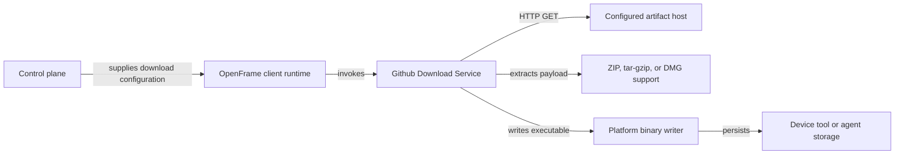
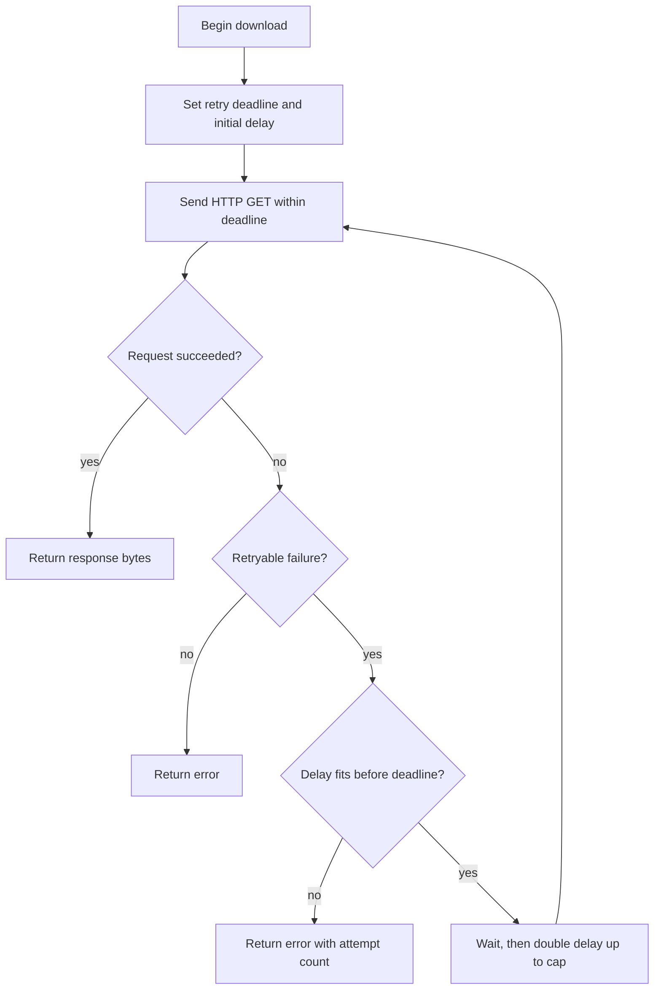
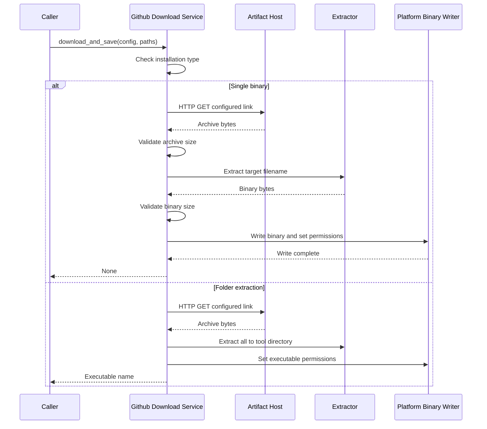
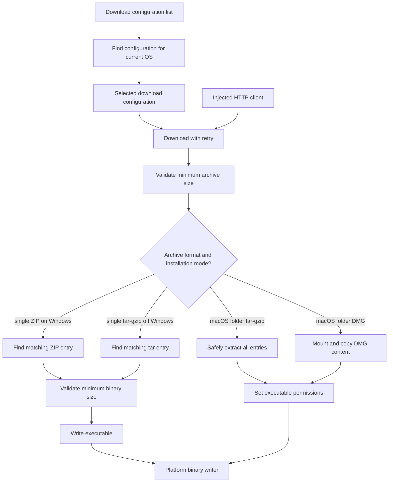

# Github Download Service

Github Download Service is the OpenFrame client agent component that retrieves packaged agent or integrated-tool artifacts, validates their minimum size, extracts the payload appropriate to the host operating system, and places an executable at its destination. The implementation is supplied by the `openframe_agent_lib` Cargo artifact from [OpenFrame OSS Library](https://github.com/flamingo-stack/openframe-oss-lib/blob/16e7c1cbd9664e7d10ec5ebca7d53c9bd314decf/clients/openframe-client/src/services/github_download_service.rs) and is run by this repository's OpenFrame client.

Despite its name, Github Download Service downloads the URL supplied in a download configuration; it does not construct GitHub API requests or release URLs itself. This separation allows the control plane to choose the artifact location while the device agent applies consistent download, validation, extraction, and file-permission behavior.

## Responsibilities

Github Download Service provides the following operations:

- Select the first `DownloadConfiguration` that matches the current operating system.
- Download artifact bytes using the injected `reqwest` HTTP client.
- Retry transient request failures until the configured retry-time budget expires.
- Reject downloads and extracted single binaries smaller than the configured minimum binary size.
- Extract a requested binary from a platform-supported ZIP or tar-gzip archive.
- Extract every archive entry for macOS folder-style installations, including DMG-based extraction.
- Persist a single executable through the platform binary writer, or return the configured executable name for a folder extraction.

## Placement in the Client

The service is one building block of the Rust OpenFrame client (`openframe_client` version `0.1.0` in this repository). It consumes a configuration describing an artifact and delegates final persistence to platform services. Tool installation and update orchestration remain outside this module; Github Download Service only performs artifact acquisition and preparation.

## Core Types and Operations

### `GithubDownloadService`

`GithubDownloadService` owns two injected dependencies:

| Dependency | Purpose |
| --- | --- |
| `reqwest::Client` | Issues artifact download requests. Client construction, including transport policy, is outside this service. |
| `DmgExtractor` | Used only by the macOS full-archive extraction path to mount, copy from, and clean up a DMG. |

The constructor, `new`, stores these dependencies and returns a cloneable service instance. The service holds no artifact cache, persistent state, credentials, or release metadata.

### `DownloadConfiguration`

The input configuration includes the target operating system, archive filename, expected payload name, source link, installation type, and optional bundle or service metadata. Github Download Service uses these fields as follows:

| Field | Role in Github Download Service |
| --- | --- |
| `os` | Considered by `matches_current_os` during configuration selection. |
| `link` | Download URL passed directly to the HTTP client. |
| `file_name` | Determines archive format from its filename suffix. |
| `target_file_name` | Identifies the expected extracted binary and, for folder extraction, the executable relative name returned to the caller. |
| `installation_type` | Determines whether the configuration requires folder extraction. |

`find_config_for_current_os` returns the first configuration whose platform predicate matches the running OS. It fails explicitly when no configuration matches, rather than selecting a fallback artifact.

### Public Download Paths

| Method | Use case | Result |
| --- | --- | --- |
| `download_and_extract` | A single binary is packaged inside an archive. | The extracted binary bytes. |
| `download_and_save` | A caller needs the artifact installed to its target location. | `None` after a single-binary write, or `Some` containing the configured executable name after folder extraction. |
| `download_and_extract_all` | macOS folder-style artifact installation. | Extracts the full archive into the supplied directory. |
| `find_config_for_current_os` | Multiple per-platform artifact definitions are available. | A matching configuration reference. |

## Download and Retry Behavior

The internal download operation performs an HTTP GET, requires a successful response status, then reads the response body as bytes. `download_with_retry` wraps this operation in a deadline-based retry loop:

1. The overall deadline is calculated from `DOWNLOAD_RETRY_BUDGET_SECS`.
2. The service attempts the request with a timeout capped by that deadline.
3. It returns immediately after a successful response.
4. It retries network errors and HTTP server errors, plus HTTP `403`, `408`, and `429`.
5. Other HTTP client errors fail immediately.
6. Before a retry, it waits using a doubling delay, capped by `DOWNLOAD_RETRY_MAX_DELAY_SECS`.
7. It stops when the next delay would meet or exceed the deadline, reporting the failed attempt count.

The retry classification is deliberately narrow. In particular, a client-side HTTP status other than `403`, `408`, or `429` is not retried. The configured retry constants define timing; this module does not expose them as runtime configuration.

## Extraction and Installation Flows

### Single-Binary Flow

`download_and_extract` validates the downloaded archive before extracting it, selects an extractor from `file_name`, then validates the extracted payload. The two size checks use `MIN_BINARY_SIZE_BYTES`; they detect unexpectedly small responses or payloads before the binary writer is invoked.

### Platform Format Matrix

| Running platform | Single-binary extraction | Full archive extraction |
| --- | --- | --- |
| Windows | ZIP is supported. Tar-gzip returns an error. | Not supported by Github Download Service. |
| Linux and other non-Windows, non-macOS platforms | Tar-gzip is supported. ZIP returns an error. | Not supported by Github Download Service. |
| macOS | Tar-gzip is supported. ZIP returns an error. | Tar-gzip and DMG are supported. |

For a ZIP single-binary archive on Windows, the service iterates entries and accepts an entry whose path ends with the target filename, case-insensitively. For a tar-gzip single-binary archive, it compares the basename case-insensitively and rejects Apple metadata entries whose basename starts with `._`.

For macOS folder extraction, a tar-gzip archive is unpacked entry-by-entry. Destination paths must contain only normal or current-directory components; absolute paths, parent-directory traversal, and other unsafe components are rejected before joining them to the target directory. Directories are created as needed, files are copied, and archive file modes are applied when available. An empty archive fails.

A macOS DMG is delegated to `DmgExtractor`. The configured target filename supplies the first path component used as the mounted source path. The extractor writes the DMG to a temporary location, mounts it, copies the selected source or mount content into the target directory, then attempts unmount and temporary-file cleanup.

## Component Interaction

## Filesystem Effects

For a standard single-binary installation, `download_and_save` calls the platform binary writer with the default agent path. The writer creates missing parent directories, attempts recovery if creation initially fails, writes and flushes the bytes, performs a bounded disk-sync attempt, closes the file handle, and sets executable permissions on Unix-family systems.

For a folder extraction, Github Download Service extracts into the supplied tool directory, sets executable permissions on the configured target file, and returns the target filename. If that expected executable is absent after extraction, the service logs a warning but still returns the filename. Callers that require the binary to exist should validate that condition after receiving the result.

## Failure Handling and Operational Notes

The service returns contextual errors for download, extraction, archive traversal, target lookup, filesystem, and permission failures. It logs the configured download URL, attempt number, delays, archive size, selected format, matching archive entry, and extracted output size. These messages can aid support investigations, but artifact URLs may be sensitive in some deployments and should be handled accordingly in log collection policies.

Important boundaries:

- No checksum, signature, publisher identity, or content-type validation is implemented here.
- Archive format selection relies on `file_name` suffixes, not HTTP headers or body sniffing.
- The minimum size threshold is a coarse integrity check, not authenticity verification.
- Full archive extraction is restricted to macOS in this component.
- This service does not start, register, stop, or update a tool after it has been written; the caller owns those lifecycle steps.

## Maintainer Guidance

When changing Github Download Service, preserve the relationship between configuration platform matching, archive format support, and installation type. A new package format needs both an explicit selection path and platform-specific behavior; silently treating it as an existing format could install the wrong payload. Changes to retry policy should retain the single overall deadline so a device cannot retry indefinitely.

For macOS archive work, keep the path validation before output paths are constructed. For single-binary installation changes, preserve both size checks and use the platform binary writer rather than writing directly, so the existing directory, lock-recovery, flush, and permission behavior remains consistent.
