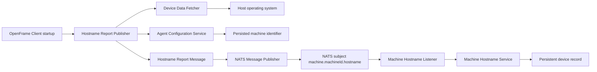
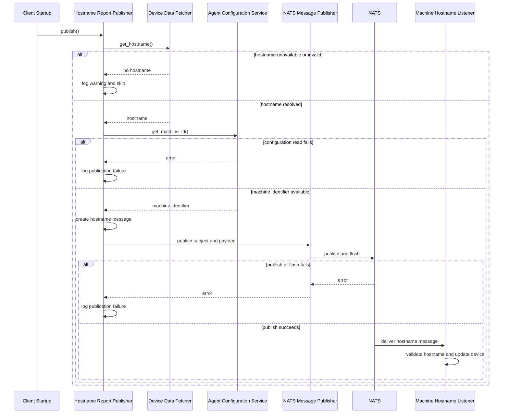
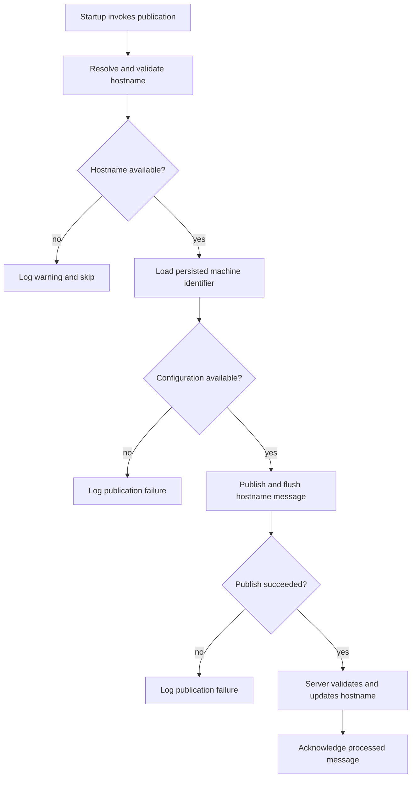

# Hostname Report Publisher

Hostname Report Publisher is a small, stateless OpenFrame Client startup service that reports the device's current hostname to the platform. Its purpose is to reconcile a device that has been renamed after registration without requiring an agent reinstall. The implementation is supplied by the `openframe_agent_lib` Cargo dependency from OpenFrame OSS Library and runs inside this repository's OpenFrame Client deployment.

The implementation is intentionally best-effort: it obtains a valid hostname, identifies the registered machine, publishes a single message, and records failures in client logs rather than interrupting client startup. The authoritative old-versus-new hostname comparison and persistent device update are owned by the server-side consumer.

## Responsibilities and boundaries

| Responsibility | Hostname Report Publisher behavior |
| --- | --- |
| Resolve local identity | Requests the hostname from Device Data Fetcher. |
| Address the report | Reads the persisted machine identifier from Agent Configuration Service and derives the NATS subject. |
| Build the payload | Creates a Hostname Report Message containing the resolved hostname. |
| Send the report | Uses NATS Message Publisher to JSON-serialize, publish, and flush the message. |
| Failure handling | Logs warnings and returns control to the caller; it does not persist a local outbox or retry loop. |
| Reconciliation | Leaves hostname comparison and device mutation to the backend listener and service. |

The module does **not** register a machine, authenticate, determine whether a hostname changed, or modify local configuration. A missing hostname causes a skipped report, while configuration or transport failures are contained by the public `publish` method.

## Architecture



The client-side publisher, payload model, configuration reader, hostname resolver, and NATS publisher come from OpenFrame OSS Library. The receiving `MachineHostnameListener` is supplied by the library's Java client-service core. It subscribes to the wildcard subject pattern `machine.*.hostname`, extracts the machine identifier from the subject, deserializes the payload, and delegates the update to `MachineHostnameService`.

## Core components

### Hostname Report Publisher

`HostnameReportPublisher` owns three collaborators injected by its constructor:

- `NatsMessagePublisher` performs transport serialization and publication.
- `AgentConfigurationService` supplies the registered machine identifier from the client configuration.
- `DeviceDataFetcher` resolves the local hostname.

Its public `publish` method is asynchronous but deliberately returns no result. It calls an internal fallible operation and logs a warning when that operation fails. This prevents a transient NATS outage, serialization failure, unavailable connection, or unreadable configuration from failing the surrounding startup path.

The source implementation is available in the [OpenFrame OSS Library hostname report publisher](https://github.com/flamingo-stack/openframe-oss-lib/blob/16e7c1cbd9664e7d10ec5ebca7d53c9bd314decf/clients/openframe-client/src/services/hostname_report_publisher.rs).

### Hostname Report Message

`HostnameReportMessage` is the wire payload. It has one field, `hostname`, and is serialized by the shared NATS publisher. The resulting JSON has the conceptual shape below:

```json
{
  "hostname": "workstation-01"
}
```

The hostname is intentionally not embedded in the subject. The subject carries routing and device identity; the message carries the mutable hostname value.

### Device Data Fetcher

`DeviceDataFetcher.get_hostname` first queries the operating-system hostname through the host-name provider. It converts the result to text, trims it, and validates it. On macOS, an invalid or unavailable kernel hostname can fall back to `LocalHostName`, represented with a `.local` suffix, and then `ComputerName`. If no valid value can be obtained, it returns no hostname and the publisher logs that the report was skipped.

### Agent Configuration Service

`AgentConfigurationService.get_machine_id` reads the persisted configuration and returns its machine identifier. This identifier is essential: it binds the report to the already registered device. An error reading configuration aborts the internal publish attempt and is logged by `publish`.

### NATS Message Publisher

`NatsMessagePublisher.publish` serializes the payload to JSON, retrieves the current NATS client from its connection manager, publishes to the requested subject, and flushes the client. The flush means a successful operation represents completion of the client's publish-and-flush sequence, not an application-level acknowledgement from the server-side hostname consumer.

## Publication flow



## Subject and routing contract

The publisher derives the destination as `machine.{machineId}.hostname`, where `{machineId}` is the persisted identifier. In a concrete installation, the subject follows this pattern:

```text
machine.machine-identifier.hostname
```

The server-side listener subscribes to `machine.*.hostname`. It uses the subject, rather than the JSON body, to identify the target device. This separation prevents a hostname payload from choosing the machine it updates.

## Processing and delivery semantics

The following sequence describes the normal server-side handling path:

1. The agent resolves a valid local hostname and loads its machine identifier.
2. It publishes the hostname payload to the machine-specific NATS subject and flushes the connection.
3. The Machine Hostname Listener receives the message through its `MACHINE_HOSTNAME` stream configuration.
4. The listener extracts the machine identifier from the subject and deserializes the hostname payload.
5. A blank received hostname is warned about and acknowledged without updating the device.
6. For a valid payload, the listener calls `MachineHostnameService.updateHostname` and acknowledges only after that call succeeds.
7. An unexpected parsing or processing exception leaves the message unacknowledged so the messaging layer can redeliver it.

Client publication is plain core NATS and does not wait for this downstream acknowledgement. Reliability is therefore split across layers: the backend listener supports redelivery for messages it received but could not process, while a report lost before reaching the server has no client-side durable retry. The next client startup publishes the then-current hostname again, which provides the intended eventual reconciliation mechanism.



## Operational behavior

### Startup behavior

The module is designed to run once per client startup. Its state is limited to injected collaborators, so it retains neither the last reported hostname nor a delivery record. This design makes a rename visible on a later restart even if an earlier report was never received.

The provided component does not show the client-composition call site that constructs or invokes the publisher. Maintainers changing startup wiring should preserve the non-blocking behavior of `publish` and should avoid turning hostname reporting into a prerequisite for the rest of client initialization.

### Logging and diagnosis

The module emits informative logs for successful reports, including the hostname and subject, and warnings for these conditions:

- no valid hostname can be resolved;
- the internal operation fails while reading configuration, serializing, obtaining a NATS client, publishing, or flushing.

The backend listener separately logs blank payloads, successful processing, and unexpected exceptions. A client-side success log confirms that the NATS publish path completed its flush; it does not prove that the persistent device record has already changed.

### Security and data considerations

The payload is deliberately minimal and contains only a hostname. Machine identity comes from locally persisted registration data and is represented in the NATS subject. Any authorization, NATS connectivity, stream configuration, and device-update authorization are outside this module's scope and belong to the client connection and server platform configuration.

## Maintenance guidance

- Keep the message field and the backend deserialization contract compatible when evolving the payload.
- Preserve the machine-specific subject pattern unless the server listener and machine identifier extractor are updated in lockstep.
- Treat hostname collection as fallible across operating systems. Validation and macOS fallbacks exist to avoid reporting empty or unusable values.
- Do not add a local old-versus-new comparison without considering the current recovery property: the server is the comparison authority, and every startup can resynchronize state.
- Do not assume a completed NATS flush is a persistent-update acknowledgement. Any requirement for end-to-end confirmation needs a separate acknowledged delivery protocol.

## System placement

Hostname Report Publisher is part of the OpenFrame Client runtime supplied by OpenFrame OSS Library version `v0.0.5` as the `openframe_agent_lib` Cargo dependency. This repository packages and deploys the platform services, including the OpenFrame Client service and NATS datasource used by client-connected components. The publisher is a narrow device-inventory synchronization path within that larger client-to-platform messaging topology.
