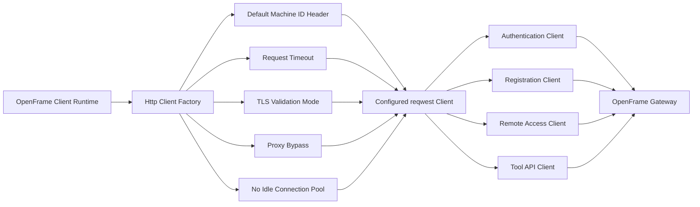
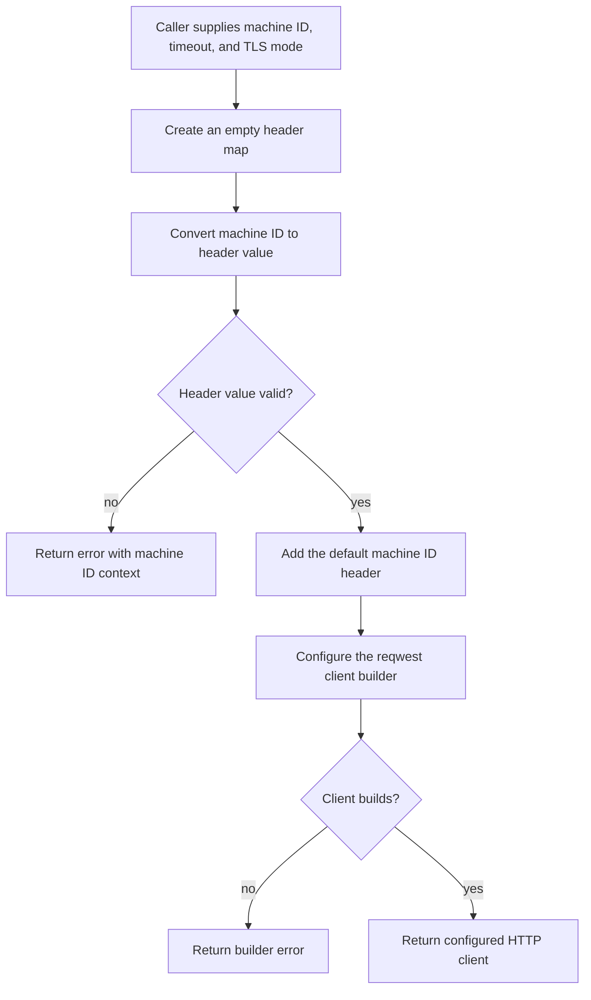
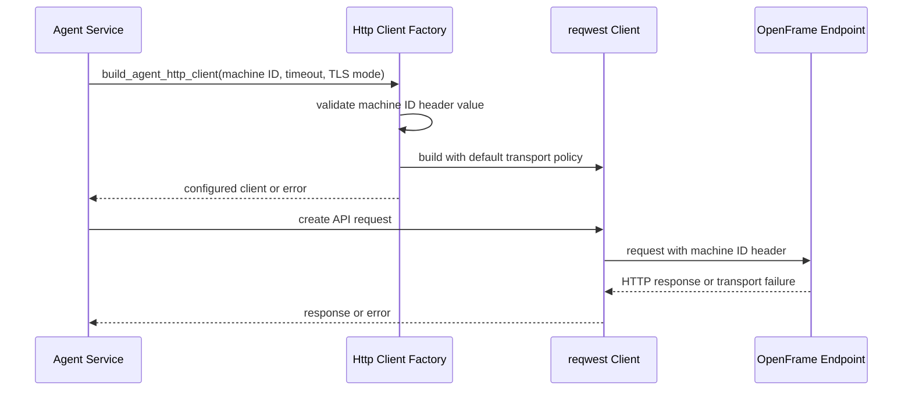

# Http Client Factory

Http Client Factory creates the shared `reqwest::Client` configuration used for the OpenFrame device agent's HTTP calls. It is implemented by the `build_agent_http_client` function in the OpenFrame OSS Library's `openframe_agent_lib` artifact, which this repository consumes at version `0.0.5`.

The factory establishes transport-wide behavior once: a machine identity header, a request timeout, an explicit TLS-validation mode, proxy bypassing, and disabled idle connection pooling. Higher-level API clients receive the completed `reqwest::Client`; they do not configure these cross-cutting transport rules themselves.

**Source:** [http_client_factory.rs](https://github.com/flamingo-stack/openframe-oss-lib/blob/16e7c1cbd9664e7d10ec5ebca7d53c9bd314decf/clients/openframe-client/src/clients/http_client_factory.rs)

## Public Contract

```rust
pub fn build_agent_http_client(
    machine_id: &str,
    timeout: Duration,
    accept_invalid_certs: bool,
) -> Result<Client>
```

| Input or result | Responsibility |
| --- | --- |
| `machine_id` | Converted to an HTTP header value and installed as the default value of the agent machine ID header. Invalid header values cause construction to fail. |
| `timeout` | Applied as the `reqwest` client's overall request timeout. |
| `accept_invalid_certs` | Controls whether the client accepts invalid TLS certificates. |
| `Result<Client>` | Returns either a fully configured `reqwest::Client` or an error from header conversion or client construction. |

The machine ID header name is supplied by the client library's `MACHINE_ID_HEADER` constant. This module owns neither machine ID generation nor authentication-token handling; it only installs the identity value provided by its caller.

## Architecture



The library's authentication, registration, remote-access, and tool API client constructors each accept a `reqwest::Client`. Consequently, one factory-produced client can provide consistent transport behavior to each of these request-oriented adapters.

## Construction Flow



The error context added during header conversion identifies the failing operation as an invalid machine ID for a header. Builder failures are propagated through the function's `anyhow::Result` return value.

## Transport Policy

### Identity Propagation

The factory creates a `HeaderMap`, parses the supplied machine ID into a `HeaderValue`, and registers it as a default header under `MACHINE_ID_HEADER`. Requests issued through the returned client therefore inherit the machine identity header unless a request overrides that header.

This is request metadata rather than a credential exchange. Authentication and registration behavior belong to the API clients and services that use the client.

### Time Boundaries

The caller supplies a `Duration`, which becomes the `reqwest` client timeout. The factory does not select a timeout value, implement retries, or add per-endpoint overrides. Callers must choose a duration appropriate to their operating environment and operation.

### TLS Behavior

`accept_invalid_certs` is passed directly to `danger_accept_invalid_certs`. When this option is enabled, certificate validation is weakened. It should therefore be enabled only when the deployment's trust requirements explicitly require it, such as a controlled local environment with a nonstandard certificate arrangement. The factory does not load or manage certificate authorities.

### Proxy and DNS Behavior

The configured client calls `no_proxy()`, preventing use of proxy configuration by this client. It also sets `pool_max_idle_per_host(0)`. The implementation documents this as disabling connection pooling so each request performs a fresh DNS lookup. This policy favors endpoint resolution freshness over the connection reuse normally provided by idle HTTP connection pooling.

## Request Interaction



The factory is synchronous and has no background worker, mutable shared state, request queue, persistence, or retry loop. It performs its work during client creation, after which the returned `reqwest::Client` owns the configured transport behavior.

## Module Boundaries

| Concern | Owned by Http Client Factory | Delegated elsewhere |
| --- | --- | --- |
| Base HTTP transport | Builds the `reqwest::Client` and its shared defaults. | API-specific request paths and payloads. |
| Device identity | Attaches the supplied machine ID as a default header. | Creation and persistence of machine IDs. |
| Authentication | Does not authenticate requests. | Authentication Client and token-oriented services. |
| Registration lifecycle | Does not register or deregister devices. | Registration Client and registration services. |
| Remote access modes | Does not change remote access state. | Remote Access Client and remote access services. |
| Tool downloads | Does not resolve or download assets. | Tool API Client and tool services. |
| Certificate material | Selects whether invalid certificates are accepted. | Local TLS configuration and certificate provisioning. |

## Operational Considerations

- Treat a factory failure as a startup or dependency-initialization failure: no configured client is returned.
- Validate machine ID inputs before reaching this module when possible. The function rejects values that `reqwest` cannot represent as a header value.
- Keep certificate validation enabled by default. The invalid-certificate option changes a security-sensitive property for every request using the returned client.
- Account for the proxy-bypass policy in environments that require an outbound HTTP proxy; this client will not use it.
- Account for the no-idle-pool policy when evaluating latency and connection volume. Its stated purpose is fresh DNS resolution for each request.

## Maintenance Guidance

Changes to this factory affect every consumer sharing the returned `reqwest::Client`. Preserve the separation between generic transport policy and endpoint-specific client behavior. In particular:

1. Keep machine identity handling limited to attaching the supplied value; avoid duplicating identity persistence logic here.
2. Review any TLS-policy change as a security-impacting change.
3. Review proxy and connection-pooling changes against agent deployments that rely on dynamic DNS or constrained networks.
4. If adding another HTTP-facing adapter, accept an already constructed `reqwest::Client` so it inherits the common policy rather than creating a divergent client configuration.
