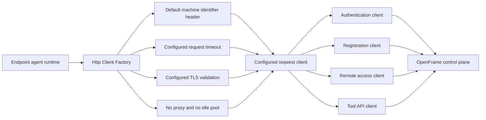
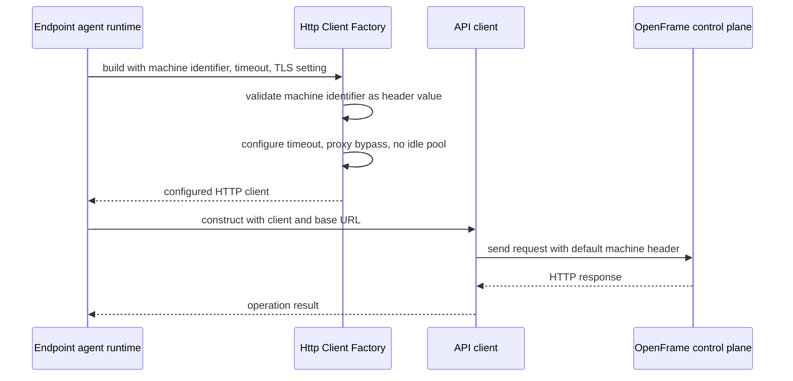
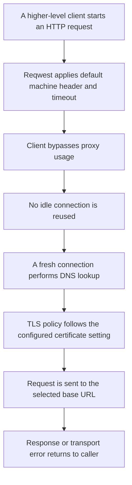

# Http Client Factory

Http Client Factory builds the shared `reqwest::Client` used by the OpenFrame endpoint agent for HTTP-based control-plane interactions. The implementation is supplied by the **OpenFrame OSS Library** as part of the Rust `openframe_agent_lib` artifact, which this repository consumes at version `v0.0.5`. Its single function, [`build_agent_http_client`](https://github.com/flamingo-stack/openframe-oss-lib/blob/7a766f00e4f58b5d89db007b878ac8d6e0c344f4/clients/openframe-client/src/clients/http_client_factory.rs), standardizes request identity, timeout behavior, TLS validation, proxy handling, and connection reuse.

## Responsibilities

`build_agent_http_client(machine_id, timeout, accept_invalid_certs)` accepts:

| Input | Purpose |
|---|---|
| `machine_id` | Identifies the endpoint machine. It is converted into an HTTP header value. |
| `timeout` | Sets the request timeout on the constructed client. |
| `accept_invalid_certs` | Controls whether TLS certificate validation errors are accepted. |

The factory returns `anyhow::Result<reqwest::Client>`. It can fail before a request is sent when the machine identifier is not valid for an HTTP header, or when `reqwest` cannot construct the client.

## Constructed Client Policy

The function creates a header map, inserts the `MACHINE_ID_HEADER` header, and applies the following client-wide policy:

| Policy | Implementation effect | Operational rationale |
|---|---|---|
| Machine identity | Adds the configured machine identifier as a default header. | Every request made through the client carries endpoint identity without each caller rebuilding the header. |
| Request timeout | Applies the supplied `Duration` with `Client::builder().timeout(...)`. | Prevents a request from waiting indefinitely. |
| TLS validation switch | Applies `danger_accept_invalid_certs(accept_invalid_certs)`. | Supports explicitly selected environments that require invalid certificates to be accepted. This is security-sensitive and must remain disabled unless such behavior is intentionally configured. |
| Proxy bypass | Applies `no_proxy()`. | Agent HTTP traffic does not use proxy configuration recognized by the client. |
| No idle pool | Sets `pool_max_idle_per_host(0)`. | Disables idle connection pooling, causing later requests to establish fresh connections and therefore perform fresh DNS resolution. |

The machine-header name is defined with the agent's machine identifier service, while this factory only validates and inserts the provided value. The factory does not create, persist, refresh, or authorize the identifier.

## Architecture

The factory is intentionally narrow: it owns transport defaults only. The higher-level clients own their base URL and endpoint-specific behavior. Each of the Authentication, Registration, Remote Access, and Tool API clients stores a `reqwest::Client` passed to its constructor, allowing them to share the factory's configured behavior.

## Client Interaction

## Request Lifecycle and DNS Behavior

Disabling idle connections is a deliberate resiliency trade-off. It favors discovering changed DNS answers between requests over the reduced connection-establishment cost of HTTP connection reuse. The function itself does not implement retries, response-status interpretation, authentication, or DNS error recovery; those responsibilities remain with callers and their surrounding services.

## Integration Boundaries

### Inputs and validation

The machine identifier is passed to `HeaderValue::from_str`. An invalid value stops construction with contextual error text indicating that the machine identifier cannot be used as a header. This protects the shared client from being created with malformed default headers.

`timeout` and `accept_invalid_certs` are direct transport settings. No default values, normalization, or policy checks are applied in this module; configuration assembly occurs outside the factory.

### Consumers in the agent design

The agent library defines four HTTP-focused client types that accept a `reqwest::Client` during construction:

- **Authentication client** performs secret- and refresh-token authentication flows.
- **Registration client** registers and deregisters the agent.
- **Remote Access client** updates device remote-access mode.
- **Tool API client** retrieves tool assets.

Their common client dependency gives these control-plane operations consistent machine identification and network behavior. The repository graph does not record direct organization-wide consumers of `build_agent_http_client`; this module should therefore be evaluated through its runtime wiring in the endpoint-agent library rather than treated as an independently consumed public integration point.

## Security Considerations

- Treat `accept_invalid_certs` as an explicit exception path. When enabled, the client accepts invalid TLS certificates, weakening server-identity verification.
- Keep machine identifiers valid for HTTP header values. The factory rejects invalid values rather than silently omitting endpoint identity.
- The function deliberately disables proxy use. Deployments that require a proxy must account for this behavior at the agent transport-design level; this factory does not expose an alternate proxy path.
- The default machine identifier header is attached to every request produced by this client. Do not reuse a client built for one machine identity in a context representing another machine.

## Maintenance Guidance

When changing this module:

1. Preserve error propagation from header validation and `reqwest` client construction.
2. Evaluate timeout, proxy, TLS, and pooling changes across all four HTTP-focused clients, not just the immediate caller.
3. Treat the no-idle-pool setting as behaviorally significant because it forces fresh DNS lookup during new connections.
4. Test valid and invalid machine identifiers, the TLS policy choice, and request timeout behavior.
5. Keep source-level changes in the OpenFrame OSS Library: the implementation documented here originates at [clients/openframe-client/src/clients/http_client_factory.rs](https://github.com/flamingo-stack/openframe-oss-lib/blob/7a766f00e4f58b5d89db007b878ac8d6e0c344f4/clients/openframe-client/src/clients/http_client_factory.rs).
