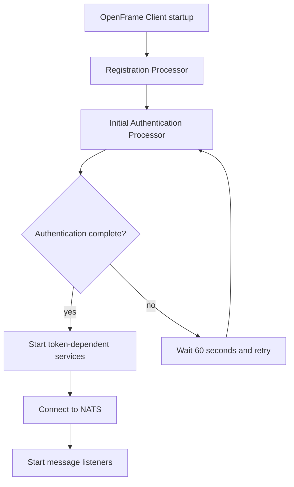
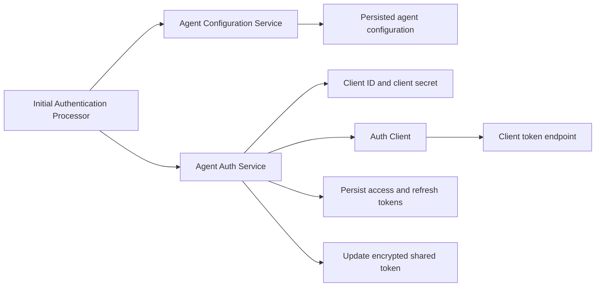
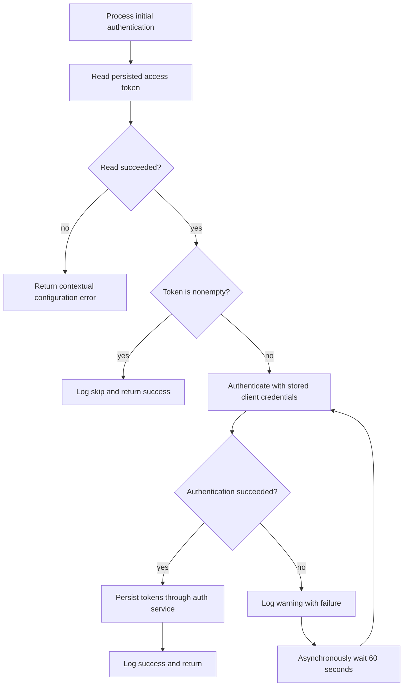
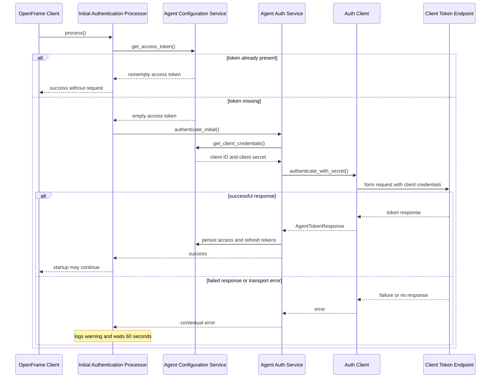

# Initial Authentication Processor

The Initial Authentication Processor establishes the OpenFrame Client's first usable access token before token-dependent runtime services start. It is implemented by `InitialAuthenticationProcessor` in the `openframe_agent_lib` Cargo dependency, supplied by OpenFrame OSS Library version `v0.0.5` to this repository. The implementation source is [initial authentication processor.rs](https://github.com/flamingo-stack/openframe-oss-lib/blob/16e7c1cbd9664e7d10ec5ebca7d53c9bd314decf/clients/openframe-client/src/services/initial_authentication_processor.rs).

Its responsibility is deliberately narrow: inspect persisted agent credentials, avoid an unnecessary bootstrap request when an access token already exists, and otherwise retry initial client-credentials authentication until it succeeds. This makes successful authentication a startup gate for the OpenFrame Client's messaging, listeners, and other token-reliant work.

## Responsibilities

- Construct an authentication processor from an `AgentAuthService` and an `AgentConfigurationService`.
- Read the persisted access token before performing network work.
- Treat a nonempty token as already authenticated and complete without requesting a new token.
- Delegate first-time authentication to `AgentAuthService`.
- Keep retrying a failed bootstrap attempt after a fixed 60-second delay.
- Add contextual error information when configuration access or delegated authentication fails.

The processor does not itself create registration credentials, compose HTTP requests, parse token responses, encrypt tokens, or run token refresh. Those concerns remain in its collaborators.

## Position in Client Startup

The OpenFrame Client calls registration processing first and then invokes `auth_processor.process()` during its startup sequence. The client does not initialize the log-key service, token refresh manager, remote-access mode service, NATS connection, or command listeners until this call returns successfully. Consequently, a bootstrap failure delays normal client operation rather than allowing components to run without authentication.

The startup ordering also starts the deactivation supervisor before the authentication gate. The auth client's gateway-status handling can therefore inform deactivation behavior even while initial authentication is retrying.

## Component Architecture

The module has one public type and two public entry points:

| Component | Role |
| --- | --- |
| `InitialAuthenticationProcessor` | Holds the authentication and configuration services. It is cloneable so the same service dependencies can be shared by the client runtime. |
| `new` | Creates a processor from already constructed services; it performs no I/O. |
| `process` | Executes the persisted-token check and, where needed, the retrying initial-authentication loop. |

### Collaborator Boundaries

**Agent Configuration Service** provides `get_access_token()`, which reads the persisted configuration and returns the current access-token string. Its configuration writes are serialized by an internal asynchronous mutex so concurrent read-modify-write operations do not lose fields. The Initial Authentication Processor uses only the read operation directly.

**Agent Auth Service** implements `authenticate_initial()`. It reads the stored client ID and client secret from the configuration service, authenticates through the auth client, then persists the resulting tokens. It is also responsible for updating the encrypted shared-token artifact used elsewhere by the client.

**Auth Client** performs the concrete HTTP exchange. The initial path uses a form-encoded request to `/clients/oauth/token` with the OAuth `client_credentials` grant, client ID, and client secret. It reports the received gateway status to the deactivation service, rejects non-success statuses, and deserializes a successful response as `AgentTokenResponse`.

## Processing Flow

`process()` is the operational entry point. It first requests the stored access token and turns a configuration read failure into an error with the context `Failed to read existing access token`. A nonempty value means the client has already passed initial authentication, so the method logs the decision and returns successfully.

When the token is empty, the processor enters an unbounded loop. Each iteration calls its private authentication attempt, which delegates to `authenticate_initial()` and adds error context if the delegation fails. A successful attempt ends the loop immediately. A failed attempt is logged at warning level and followed by a 60-second asynchronous Tokio sleep before the next attempt.

## Initial Token Exchange

The following interaction describes the responsibilities across the processor and its dependencies. Token persistence is performed by the authentication service after the auth client successfully returns an `AgentTokenResponse`; the processor only observes whether the delegated operation succeeded.

## State and Persistence

The effective state is the persisted access-token field managed by the Agent Configuration Service:

| State | Detection | Processor behavior | Result |
| --- | --- | --- | --- |
| Previously authenticated | Access token is nonempty | Skip delegated initial authentication | Startup proceeds immediately from this gate. |
| Bootstrap required | Access token is empty | Invoke initial authentication | Success persists fresh access and refresh tokens. |
| Configuration unavailable | Access-token read returns an error | Return immediately with added context | Startup fails at the authentication gate. |
| Authentication unavailable or rejected | Delegated authentication returns an error | Warn, wait 60 seconds, then retry | Startup remains blocked until success. |

The nonempty-token check is intentionally a presence check, not token validation or expiration analysis. Continuing credential maintenance is handled later by the token refresh manager, which starts only after initial authentication processing completes.

## Failure Handling and Operational Characteristics

### Retry behavior

- Retry timing is fixed at 60 seconds.
- The wait uses `tokio::time::sleep`, so it does not block the async runtime thread.
- Retries continue indefinitely; there is no retry limit or terminal failure condition for an authentication request error.
- The implementation contains an explicit TODO for exponential backoff. Any retry-policy change should preserve the startup-gate semantics and make its delay behavior observable in logs or metrics.

### Error context and logging

The processor distinguishes configuration-read and delegated-authentication failures through error context. It logs informational messages for an existing token, bootstrap-loop start, and successful authentication. Failed attempts are logged at warning level together with the underlying error and the stated retry delay.

Do not log client secrets, access tokens, refresh tokens, or complete token endpoint responses when extending this path. The auth client includes an HTTP failure body in its error construction, so callers should also take care not to surface sensitive upstream content in broad diagnostic channels.

## Maintenance Guidance

1. **Preserve idempotence for a stored token.** Repeated calls with a nonempty access token must remain free of outbound authentication requests.
2. **Keep persistence below the processor.** The processor should coordinate startup, while credential acquisition and token storage remain inside `AgentAuthService` and `AgentConfigurationService`.
3. **Assess startup dependencies before changing failure behavior.** Returning on a transient authentication failure would allow later initialization to be reconsidered; today, the explicit design is to wait until authentication succeeds.
4. **Test both control paths.** Cover an existing token, a successful empty-token bootstrap, an authentication failure followed by retry, and a configuration read error. Use a controllable delay or clock abstraction in unit tests rather than waiting for the production interval.
5. **Treat the registration and authentication sequence as coupled.** Registration precedes this processor because it establishes the client credentials consumed by initial authentication.

## Source and Ownership

This module runs in the OpenFrame Client assembled by this repository, but its implementation belongs to the OpenFrame OSS Library artifact. Use the verified library source when inspecting or changing its behavior: [initial authentication processor.rs](https://github.com/flamingo-stack/openframe-oss-lib/blob/16e7c1cbd9664e7d10ec5ebca7d53c9bd314decf/clients/openframe-client/src/services/initial_authentication_processor.rs).
