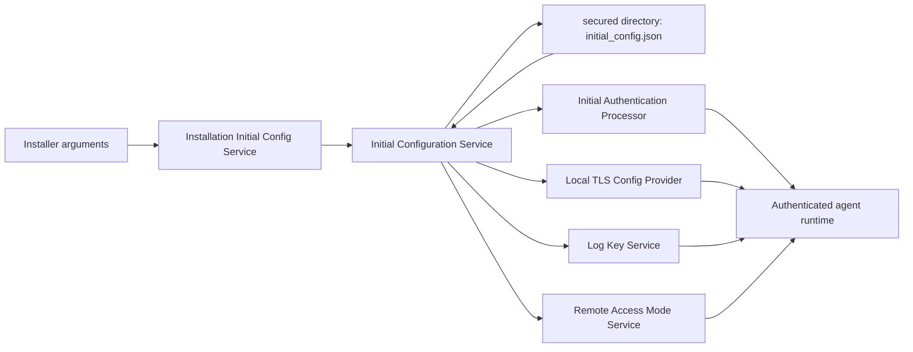
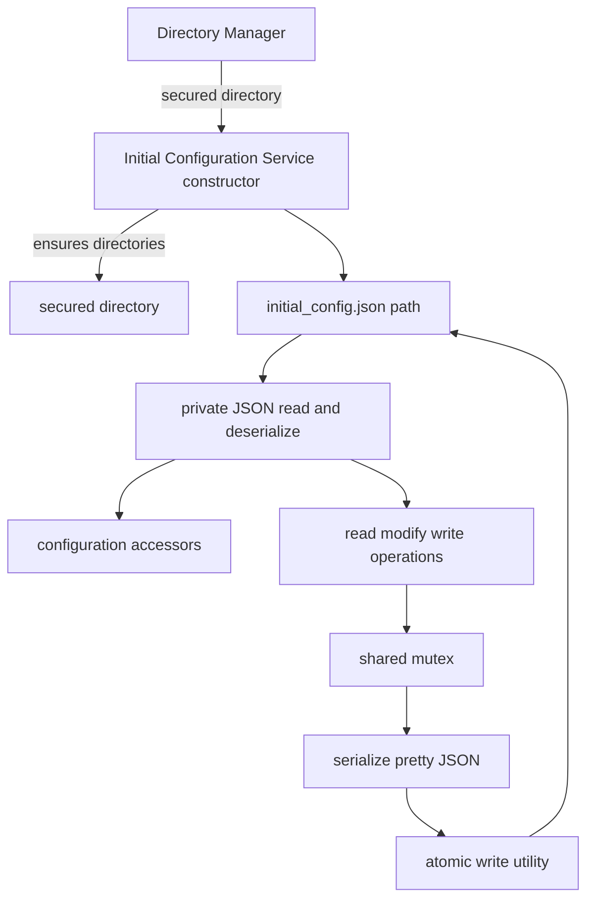
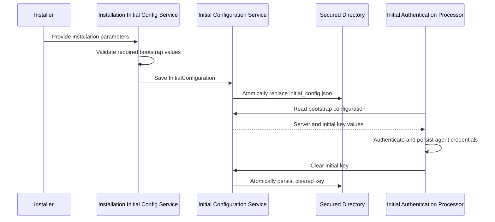
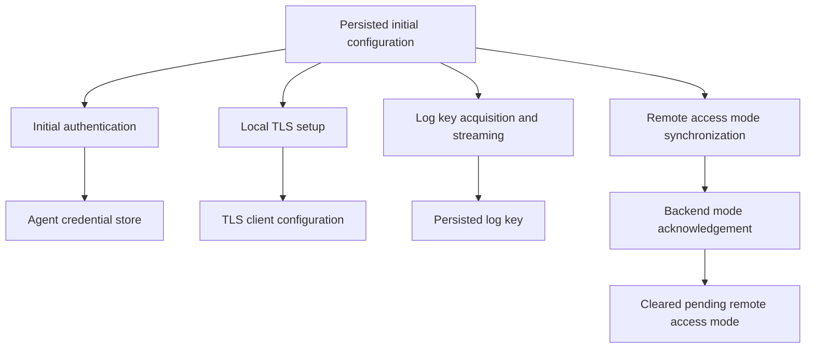

# Initial Configuration Service

The Initial Configuration Service is the OpenFrame client agent's durable bootstrap-configuration store. It is implemented in the `openframe_agent_lib` Cargo artifact supplied by the OpenFrame OSS Library and executed by this repository's OpenFrame client. Its single JSON document records the information needed before and during enrollment: the platform server location, one-time bootstrap key, optional log-stream key, organization and user context, local development TLS information, device tags, and a pending remote-access mode.

The implementation is in the OpenFrame OSS Library: [initial_configuration_service.rs](https://github.com/flamingo-stack/openframe-oss-lib/blob/16e7c1cbd9664e7d10ec5ebca7d53c9bd314decf/clients/openframe-client/src/services/initial_configuration_service.rs). This repository consumes `openframe_agent_lib` version `v0.0.5` as part of its client runtime.

## Responsibilities

- Create and maintain `initial_config.json` below the agent's secured directory.
- Provide narrowly scoped accessors for all persisted bootstrap values.
- Determine whether a usable bootstrap configuration exists without treating a missing, malformed, or empty-host file as configured.
- Serialize read-modify-write changes that clear the initial key, update the log key, or clear the pending remote-access mode.
- Persist configuration through an atomic file replacement, preventing a partially written JSON document from being observed after a successful save.

The service does not authenticate an agent, register it, or establish a NATS connection itself. It supplies persisted inputs to the services that perform those actions.

## Position in the Client Runtime

At installation time, the Installation Initial Config Service validates required parameters and builds the initial configuration. For local mode, it resolves the `mkcert` certificate authority root and records the `rootCA.pem` path before saving. At runtime, consumers read only the values they need rather than depending on file-path details.

## Persisted Configuration Contract

`InitialConfiguration` is the serialized document managed by this service. The fields below describe the on-disk contract as represented by the library model.

| Field | Purpose | Default or optional behavior |
|---|---|---|
| `server_host` | Platform server URL or host used by the agent. | Required for a configuration to be considered usable. |
| `initial_key` | Bootstrap credential used for initial authentication. | Cleared after it is no longer needed. |
| `log_key` | Credential for log streaming. | Defaults to an empty string for older or incomplete documents. |
| `local_mode` | Enables local development TLS handling. | Stored boolean. |
| `org_id` | Organization context supplied at installation. | Defaults to an empty string. |
| `user_id` | User context supplied at installation. | Defaults to an empty string. |
| `local_ca_cert_path` | Local certificate authority file for development TLS. | Defaults to an empty string. |
| `tags` | Device tags parsed from installation input. | Defaults to an empty list. |
| `remote_access_mode` | Install-time remote-access setting awaiting backend acknowledgement. | Absent values are omitted when serialized. |

The installation path requires nonblank server URL, initial key, and organization ID. Other fields are populated when supplied. The service itself does not revalidate those business requirements when saving an arbitrary `InitialConfiguration`; callers that construct a full replacement must preserve the model invariants.

## Component Design

### Construction and storage location

`new` derives the file path by joining `initial_config.json` to `DirectoryManager.secured_dir()`. It then calls `ensure_directories`; construction fails if the secured location cannot be prepared. Each clone of the service shares an `Arc<Mutex<()>>`, so mutation operations through cloned instances coordinate on the same in-process lock.

### Reads and configuration gate

All getters delegate to a private `get` operation. It explicitly rejects a missing file, reads the file as text, and deserializes it as `InitialConfiguration`. Errors retain context for the missing file, read failure, or JSON decoding failure.

`is_configured` is intentionally non-throwing. It returns `true` only when the document can be read and parsed and `server_host` is nonblank after trimming whitespace. This makes it suitable for the awaiting-auth gate: a missing, invalid, or partially populated configuration cannot release the agent into the authentication workflow.

### Mutation and persistence guarantees

The incremental mutation methods obtain the shared mutex before reading the current document, changing one field, and saving it:

- `save_log_key` updates `log_key` while preserving other fields.
- `clear_initial_key` is idempotent: it leaves an already empty key unchanged, otherwise persists an empty key.
- `clear_remote_access_mode` removes the pending mode by persisting `None`.

`save` pretty-serializes the full configuration and delegates to the shared atomic-write utility. That utility writes and flushes a temporary file in the target directory, then atomically persists it over the destination. On Unix it assigns file mode `0644` to the temporary file; on Windows it includes a replacement path for a held target. The mutex prevents two in-process read-modify-write updates from losing one another's changes, while atomic replacement prevents readers from seeing a half-written JSON file.

## Configuration Lifecycle

The initial key is intentionally a transitional credential. The Initial Authentication Processor first checks whether an access token is already present in the agent configuration. If not, it repeatedly attempts initial authentication. Once the normal credential state is established, the bootstrap key can be removed through `clear_initial_key`, reducing the lifetime of that install-time secret in this document.

## Runtime Consumers and Data Flow

### Authentication

The Initial Authentication Processor owns the authentication loop and uses separate agent-configuration storage for access and refresh tokens. The Initial Configuration Service provides the bootstrap values, including the server URL and initial key, rather than owning token lifecycle state.

### Local TLS

The Local TLS Config Provider reads the configured local certificate authority path when creating a development TLS configuration. The installation service only resolves and writes this path when local mode is enabled; non-local installation explicitly skips `mkcert` certificate-authority discovery.

### Log key transition

The configuration model supports a log-stream key supplied during installation or obtained later. `save_log_key` updates only that field. The Log Key Service starts its retrieval work asynchronously and requests a client restart after it completes so log streaming can start using the new credential. The documented model semantics state that the initial key is dropped once the log key is held.

### Remote access mode acknowledgement

A supplied install-time remote-access mode is stored as its wire name. On startup, the Remote Access Mode Service reads it, parses it to a supported mode, and applies it to the device. If no value exists, it does no work. If the value is unknown, it is dropped. A successful backend acknowledgement clears the persisted pending mode, preventing repeated application after subsequent restarts.

## Public API Summary

| API group | Operations | Result |
|---|---|---|
| Construction | `new` | Prepares the secured directory and returns a service bound to the configuration file. |
| Full persistence | `save` | Replaces the entire configuration document atomically. |
| Bootstrap and identity reads | `get_initial_key`, `get_server_url`, `get_org_id`, `get_user_id`, `get_tags` | Returns installation and identity context. |
| Local-mode reads | `is_local_mode`, `get_local_ca_cert_path` | Supplies development TLS decisions and certificate path. |
| Log-key management | `get_log_key`, `save_log_key` | Reads or preserves an updated log-stream credential. |
| Remote-access management | `get_remote_access_mode`, `clear_remote_access_mode` | Tracks an install-time mode until it is processed. |
| Bootstrap cleanup | `clear_initial_key` | Removes the no-longer-needed initial authentication secret. |
| Readiness | `is_configured` | Safely answers whether a parseable configuration with a nonblank server host exists. |

## Failure Handling and Operational Considerations

- **Missing or malformed document:** normal getters return an error with read or deserialization context. `is_configured` instead returns `false`.
- **Directory setup failure:** construction fails before the service can be used.
- **Concurrent in-process updates:** the shared mutex serializes the mutations implemented by the service. A caller performing a whole-document `save` must coordinate with other writers if it introduces an additional update path.
- **Interrupted write:** the atomic-write mechanism flushes the temporary file before replacement, reducing the chance of a replacement containing unwritten data.
- **External file modification:** the service reads fresh JSON for every accessor and mutation; it does not cache the document. Invalid external changes therefore surface as read errors or as `false` from `is_configured`.
- **Credential hygiene:** callers should clear the bootstrap key only after durable agent credentials are available. Avoid logging the configuration document or its credential fields.

## Maintenance Guidance

When extending `InitialConfiguration`, add a serde default if existing agent installations must accept documents written before the new field existed. Preserve the nonblank `server_host` requirement used by `is_configured`, because it protects the authentication-release condition. For any new single-field mutation, follow the existing lock, read, modify, and atomic-save pattern so unrelated fields are retained.

The service's tests are declared alongside the implementation in `initial_configuration_service_tests.rs`. Changes should exercise missing-file handling, malformed JSON handling, readiness evaluation, mutation idempotence, and preservation of unrelated fields during concurrent or sequential updates.
