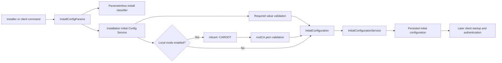
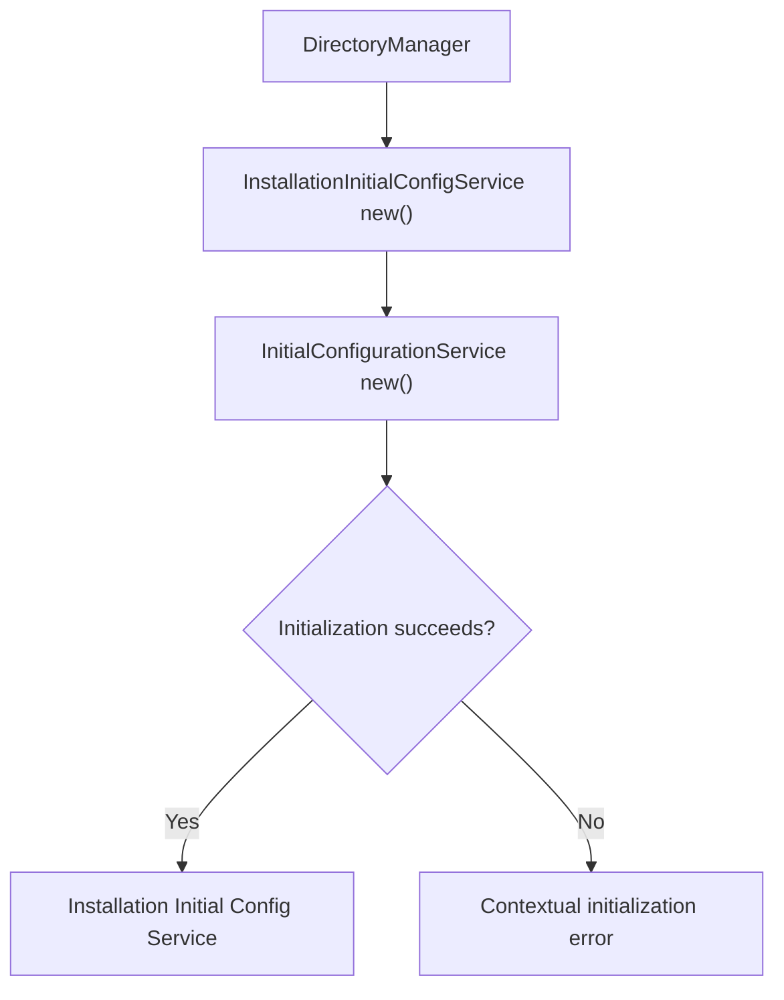
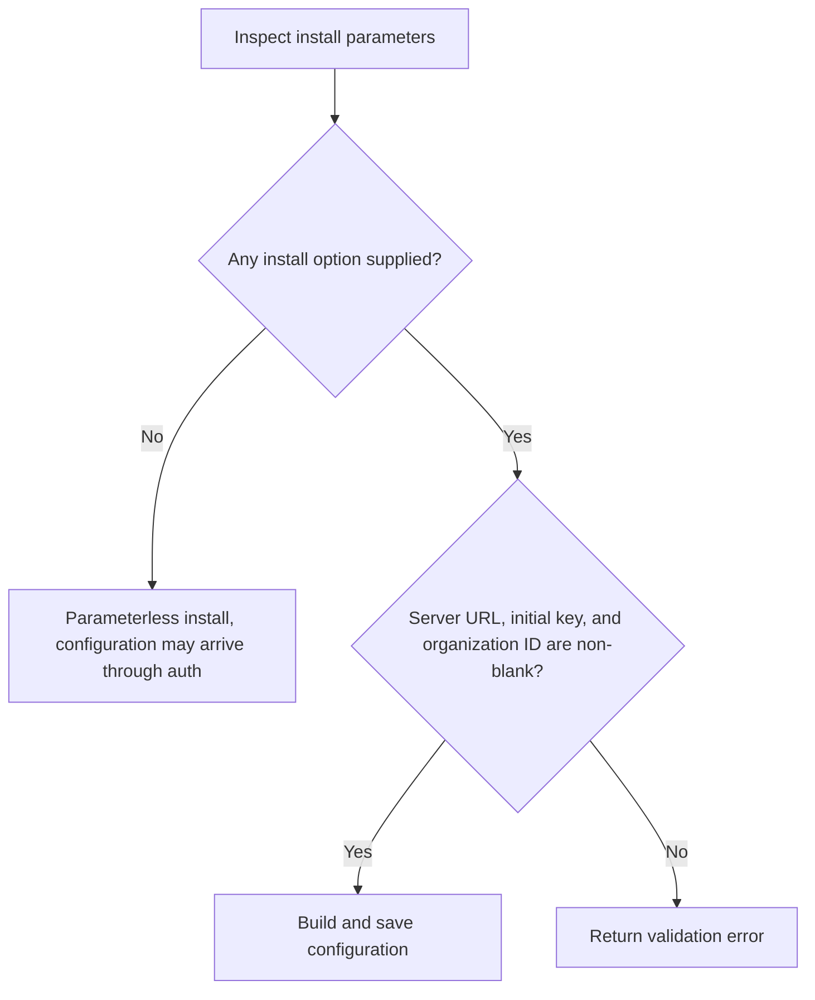
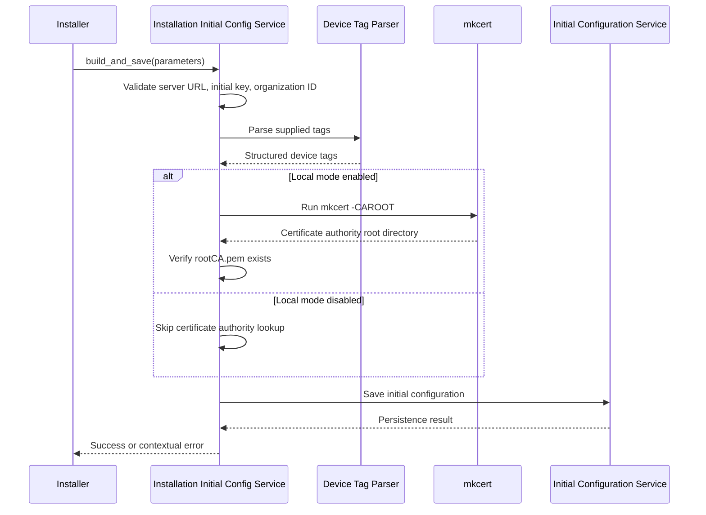
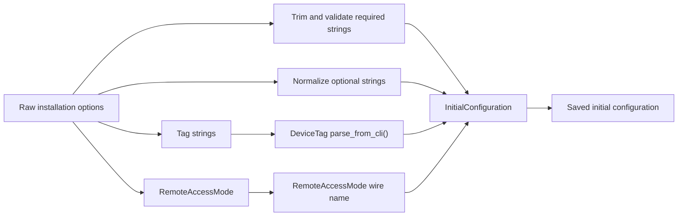
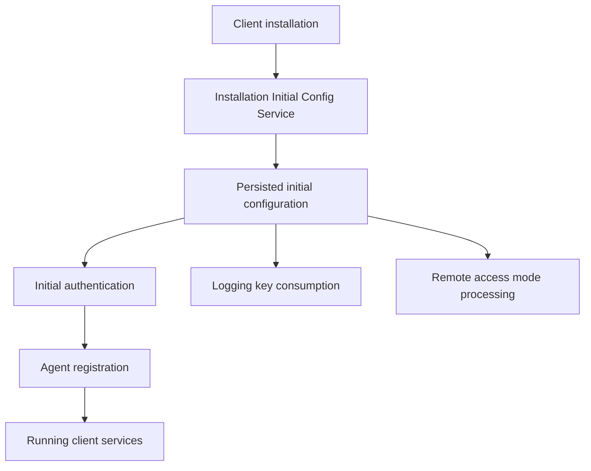

# Installation Initial Config Service

The Installation Initial Config Service converts installation-time options into the OpenFrame Client's persisted initial configuration. It belongs to the Rust client delivered by this repository and is implemented by the `openframe_agent_lib` library from [OpenFrame OSS Library](https://github.com/flamingo-stack/openframe-oss-lib/blob/7a766f00e4f58b5d89db007b878ac8d6e0c344f4/clients/openframe-client/src/installation_initial_config_service.rs). Its primary responsibility is to reject incomplete parameterized installs before writing configuration, preserve the values needed for later registration and authentication, and resolve the local certificate authority only when local mode is explicitly enabled.

This module does not contact the platform during installation. It prepares local state that subsequent client startup, authentication, registration, logging, and remote-access processing can consume.

## Scope and Responsibilities

The service provides three closely related concerns:

- **Install input representation:** `InstallConfigParams` holds optional server, initial, logging, organization, and user values, plus local-mode, tag, and remote-access selections.
- **Install-path classification:** `is_parameterless()` distinguishes a genuinely argument-free installation from a partially specified command.
- **Configuration construction and persistence:** `build_and_save()` validates required values, constructs an `InitialConfiguration`, conditionally locates the local certificate authority, then delegates persistence to `InitialConfigurationService`.

The implementation is in the OpenFrame OSS Library at the [installation initial configuration service source](https://github.com/flamingo-stack/openframe-oss-lib/blob/7a766f00e4f58b5d89db007b878ac8d6e0c344f4/clients/openframe-client/src/installation_initial_config_service.rs). This repository consumes that library as the Cargo artifact `openframe_agent_lib` version `v0.0.5`.

## Architecture

### Component Roles

| Component | Role | Key behavior |
|---|---|---|
| `InstallConfigParams` | Installation input contract | Carries optional string values and typed options supplied at install time. |
| `InstallationInitialConfigService` | Installation-time coordinator | Owns an `InitialConfigurationService` and exposes construction plus build-and-save behavior. |
| `InitialConfiguration` | Persisted configuration model | Stores server host, initial key, logging key, organization and user identifiers, local-mode state, certificate path, tags, and a pending remote-access mode. |
| `InitialConfigurationService` | Configuration persistence boundary | Is created with a `DirectoryManager` and saves the completed model; it serializes read-modify-write updates with an internal lock. |
| `DirectoryManager` | Local filesystem location provider | Supplies the directory context used while initializing configuration persistence. |
| `DeviceTag` | Tag model and parser | Converts the supplied command-line tag strings into structured tag entries. |
| `RemoteAccessMode` | Typed remote-access selection | Is converted to its wire name before it is recorded as an optional pending mode. |

## Construction and Dependencies

`InstallationInitialConfigService::new(directory_manager)` creates an `InitialConfigurationService` using the supplied `DirectoryManager`. Failure to initialize that dependency is returned with context stating that initial configuration service setup failed. The installation module therefore does not choose installation directories itself; filesystem layout remains owned by the directory-management abstraction.

The relevant dependencies are all supplied by the same OpenFrame Client library:

- The initial configuration model provides the persistence schema.
- The initial configuration service owns safe persistence operations rather than exposing direct file writes to installation code.
- The directory manager supplies the local storage context.
- Device-tag parsing avoids storing raw command-line tag syntax.
- The remote-access model supplies stable wire names instead of serializing an implementation-specific enum representation.

## Input Contract

`InstallConfigParams` deliberately uses optional strings for values that may be absent from a command invocation. During a normal parameterized installation, the service requires non-blank values for:

| Input | Requirement | Persisted destination |
|---|---|---|
| Server URL | Required and non-blank | `server_host` |
| Initial key | Required and non-blank | `initial_key` |
| Organization ID | Required and non-blank | `org_id` |
| Logging key | Optional; blank is treated as absent | `log_key`, defaulting to an empty value |
| User ID | Optional | `user_id`, defaulting to an empty value |
| Local mode | Boolean | `local_mode` |
| Tags | Zero or more tag strings | Parsed `tags` entries |
| Remote-access mode | Optional typed value | Optional wire-name value |

### Parameterless Install Detection

A parameterless installation is valid only when **every** optional string is either absent or whitespace-only, local mode is disabled, no tags are supplied, and no remote-access mode is present. This supports the two-step workflow in which configuration is provided later through authentication.

Conversely, supplying any argument makes the invocation parameterized. It must then satisfy the required server URL, initial key, and organization ID checks. This distinction is intentional: a malformed partial command is rejected rather than silently being treated as a deferred configuration flow.

## Build and Save Flow

`build_and_save(params)` executes the parameterized configuration path. It first filters whitespace-only values and validates the server URL, initial key, and organization ID. It then creates an `InitialConfiguration` with defaults for the remaining fields, parses tag values, and records an optional remote-access wire name.

### Local Mode Certificate Resolution

When local mode is disabled, the module explicitly skips `mkcert` discovery and leaves the local certificate authority path at its default value.

When local mode is enabled, it runs `mkcert -CAROOT` and applies all of the following checks before persistence:

1. The `mkcert` process must be executable.
2. The command must exit successfully.
3. Its standard output must contain a non-empty certificate authority root directory.
4. A file named `rootCA.pem` must exist inside that directory.

Only after these checks does the service persist the resulting certificate path. Failures include contextual information such as a command failure, empty output, or the missing certificate path, preventing the client from receiving a misleading local-mode configuration.

## Data Transformation

The module performs a narrow, purposeful transformation from installation input to persisted configuration:

Important normalization rules:

- Whitespace-only required strings fail validation just as missing values do.
- A blank optional logging key becomes an empty persisted value.
- A missing user identifier becomes an empty persisted value.
- Tags are parsed before persistence, so downstream consumers receive `DeviceTag` structures.
- A remote-access mode is stored only when one was supplied, using the mode's wire-name mapping.
- The local certificate authority path is populated only by the successful local-mode certificate lookup.

## Error Handling and Operational Behavior

The service returns Rust `Result` values and enriches dependency failures with installation-specific context. Operators and callers can distinguish these classes of failure:

| Failure class | Example condition | Effect |
|---|---|---|
| Validation | Missing or whitespace-only server URL, initial key, or organization ID | No configuration is built or saved. |
| Initialization | The underlying initial configuration service cannot be created | The installation service cannot be constructed. |
| Local certificate discovery | `mkcert` cannot execute, exits unsuccessfully, returns no root directory, or lacks `rootCA.pem` | No local-mode configuration is saved. |
| Persistence | The initial configuration service cannot save the completed model | The build operation fails after model construction. |

The module logs whether certificate discovery is being resolved or skipped, and logs the resolved local certificate path when discovery succeeds. It does not log the initial key or logging key itself.

## Position in the Client Lifecycle

The service is an installation boundary, not a long-running runtime worker. It prepares the state needed for later client lifecycle stages:

The persisted initial key is intended for the early authentication path. The configuration model notes that the initial key is dropped after it has been retained elsewhere, while the logging key may be supplied during installation or acquired later. The pending remote-access mode is likewise retained for subsequent backend acknowledgement.

## Maintenance Guidance

When modifying this service, preserve these behavioral boundaries:

- Keep parameterless detection strict. It is the guard that separates deferred configuration from an invalid partial installation command.
- Validate required fields before any filesystem persistence or local certificate discovery that depends on a valid installation request.
- Do not invoke `mkcert` outside local mode; non-local installations must not acquire an unnecessary local certificate dependency.
- Preserve typed tag parsing and remote-access wire-name conversion so the persisted representation remains compatible with later client services.
- Route configuration writes through `InitialConfigurationService` rather than introducing independent file-write logic, so persistence synchronization remains centralized.
- Treat initial and logging keys as sensitive values. Errors and diagnostics should describe the operation without exposing their contents.
