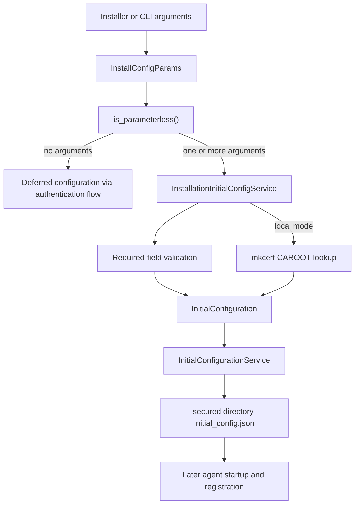
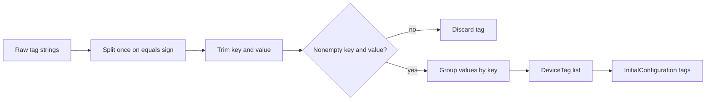
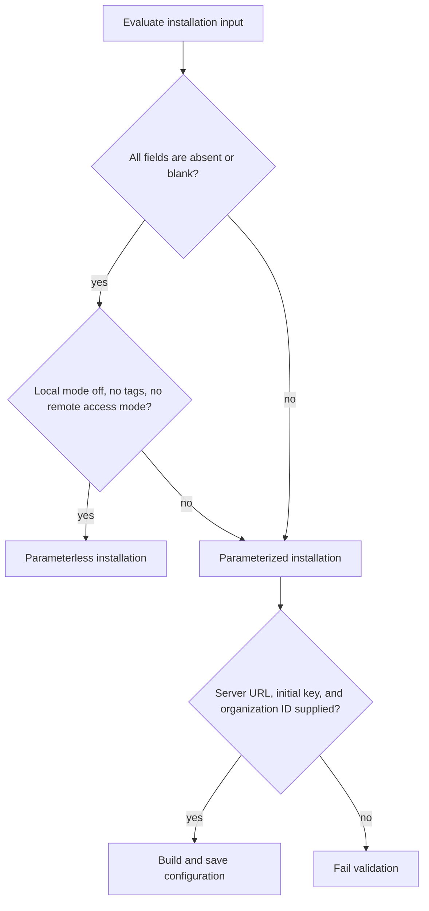
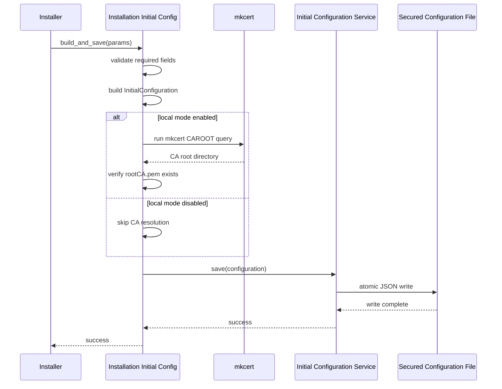

# Installation Initial Config

Installation Initial Config is the OpenFrame client-agent setup boundary that converts installation arguments into the persisted bootstrap configuration used by later registration and authentication stages. Its implementation is supplied by the `openframe_agent_lib` Cargo dependency from [OpenFrame OSS Library](https://github.com/flamingo-stack/openframe-oss-lib/blob/16e7c1cbd9664e7d10ec5ebca7d53c9bd314decf/clients/openframe-client/src/installation_initial_config_service.rs), which this repository assembles into the OpenFrame client runtime.

The module deliberately distinguishes an installation launched with **no configuration arguments** from an incomplete configured installation. A completely argument-free invocation is the supported two-step path: installation completes first and configuration is supplied later by the client authentication flow. Any supplied value selects the parameterized path, where required fields are validated rather than silently deferring a malformed command.

## Responsibilities

- Classify install input with `InstallConfigParams::is_parameterless`.
- Require a server URL, initial key, and organization ID for parameterized configuration.
- Translate raw tag arguments into structured device tags.
- Serialize a selected remote-access mode into its protocol wire value.
- Resolve and validate a local CA certificate only when local mode is enabled.
- Persist the resulting `InitialConfiguration` through `InitialConfigurationService`.

## Architecture

`InstallationInitialConfigService` owns an `InitialConfigurationService`. During construction, the latter obtains the configuration path from `DirectoryManager`, ensures the secured directory exists, and targets `initial_config.json`. Saving serializes the full configuration as pretty JSON and uses an atomic write, so the file is not replaced by a partially written document.

## Inputs and persisted configuration

### Install parameters

`InstallConfigParams` carries the complete installation-time input:

| Parameter | Required for parameterized installation | Persisted behavior |
|---|---:|---|
| `server_url` | Yes | Stored as `server_host`. Whitespace-only values are rejected. |
| `initial_key` | Yes | Stored as the bootstrap credential. |
| `org_id` | Yes | Stored as the organization identifier. |
| `log_key` | No | Stored when nonblank, otherwise persisted as an empty string. |
| `user_id` | No | Stored when present, otherwise persisted as an empty string. |
| `local_mode` | No | Enables local CA discovery and records local-mode operation. |
| `tags` | No | Parsed from `key=value` strings into grouped `DeviceTag` values. |
| `remote_access_mode` | No | Stored as an optional serialized mode awaiting backend acknowledgement. |

The persisted `InitialConfiguration` also contains `local_ca_cert_path`. Installation Initial Config populates it only in local mode; otherwise it retains the model default.

### Tag normalization

Tag processing accepts raw strings in `key=value` form. The parser trims both sides, drops entries with an empty key or value, and groups repeated keys into one `DeviceTag` with multiple values. Input order is not a persistence contract because tags are accumulated through a map.

### Remote-access modes

The accepted in-memory `RemoteAccessMode` variants are `ApprovalRequired`, `NotifyOnly`, `SilentAccess`, and `DenyAccess`. When supplied, the service converts the selected variant through its wire-name serialization before placing it in configuration. It does not apply the setting itself; the stored value remains available to the later remote-access processing path.

## Parameterless versus parameterized installation

`is_parameterless()` returns true only when every optional string is absent or whitespace-only, `local_mode` is false, the tag list is empty, and no remote-access mode is provided. This strict all-fields test prevents a partial command from being treated as an intentional deferred configuration request.

The classifier itself does not save data. The installation caller uses its result to choose the deferred path or invoke `build_and_save`. Calling `build_and_save` without the required parameterized fields fails with an error identifying the missing field.

## Build and save process

`build_and_save` consumes the parameter object and follows this sequence:

1. Reject missing or whitespace-only `server_url`, `initial_key`, and `org_id`.
2. Construct `InitialConfiguration`, applying empty-string defaults for absent optional identifiers and keys.
3. Parse CLI tags and serialize the optional remote-access mode.
4. If local mode is enabled, run `mkcert -CAROOT`, require a successful command and nonempty output, then require `rootCA.pem` in that directory.
5. Set `local_ca_cert_path` to the validated certificate path in local mode.
6. Serialize and atomically write the configuration through `InitialConfigurationService`.

## Local-mode certificate requirements

Local mode has an explicit dependency on the `mkcert` executable and its CA material. The service fails rather than persisting a partial local configuration when any of the following occurs:

- `mkcert` cannot be executed.
- The `mkcert -CAROOT` command exits unsuccessfully.
- The command returns an empty directory.
- `rootCA.pem` does not exist beneath the returned directory.

When local mode is disabled, the service does not invoke `mkcert`; a normal non-local installation therefore has no `mkcert` requirement.

## Failure handling and operational implications

| Stage | Failure condition | Result |
|---|---|---|
| Parameter validation | Server URL, initial key, or organization ID is absent or blank | Configuration is not written. |
| Local CA discovery | `mkcert` fails, yields no path, or lacks `rootCA.pem` | Configuration is not written. |
| Service initialization | The secured directory cannot be prepared | Service construction fails. |
| Persistence | JSON serialization or atomic file write fails | Installation configuration fails with context. |

Because persistence occurs only after successful validation and, when relevant, successful CA discovery, a failed parameterized run does not deliberately write a newly constructed incomplete configuration. Operators should correct the install inputs or local certificate prerequisites before retrying.

## Relationship to the client lifecycle

Installation Initial Config is an early lifecycle component. It prepares only the bootstrap data; it does not authenticate an agent, register it, establish a message-bus connection, or change remote-access state. Those later lifecycle actions consume the persisted configuration through the client application's configuration and registration services.

The OpenFrame client is provided by OpenFrame OSS Library as the `openframe_agent_lib` dependency at version `v0.0.5`; this repository packages it within the OpenFrame tenant deployment. The configuration file contains bootstrap credentials and should be treated as sensitive: preserve the secured-directory permissions managed by the platform and do not expose its contents in installer logs or support messages.
