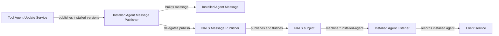
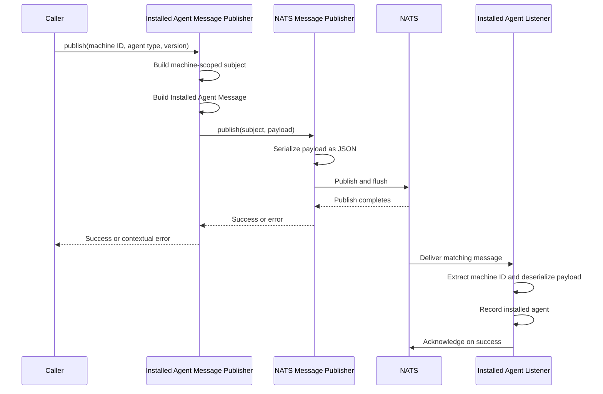
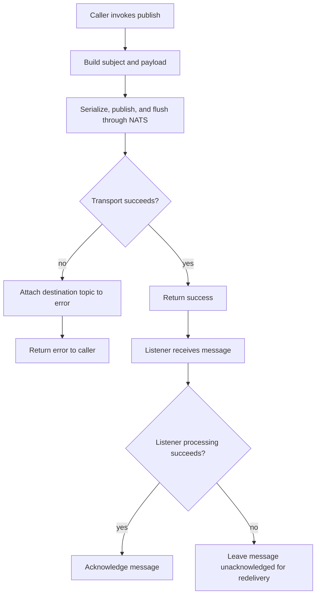

# Installed Agent Message Publisher

Installed Agent Message Publisher is a small Rust service in the `openframe_agent_lib` library that reports an installed agent's type and version for a machine. Running inside the OpenFrame client, it creates a machine-scoped NATS subject, builds an `InstalledAgentMessage`, and delegates delivery to the shared NATS publisher.

The implementation is supplied by the OpenFrame OSS Library artifact `openframe_agent_lib` version `v0.0.5`, which this repository consumes. Its source is maintained in [the library implementation](https://github.com/flamingo-stack/openframe-oss-lib/blob/16e7c1cbd9664e7d10ec5ebca7d53c9bd314decf/clients/openframe-client/src/services/installed_agent_message_publisher.rs).

## Responsibilities

- Accept the machine identifier, agent type, and version from a caller.
- Create the subject `machine.{machine_id}.installed-agent`.
- Construct the two-field `InstalledAgentMessage` payload.
- Publish through `NatsMessagePublisher` and return a contextual error that includes the destination subject when publishing fails.

The module does not discover installed software, persist the report locally, choose retries, or process the report on the server. Those responsibilities remain with its callers, the shared transport, and the client service that consumes the message.

## Architecture



At the client boundary, `ToolAgentUpdateService` owns an `InstalledAgentMessagePublisher` and exposes `publish_installed_versions`. It reads the installed-tool records, retains only records in the installed state, and reports their versions. The publisher itself remains generic: it receives its three values from the caller rather than reading tool state.

On the server side, the Java `InstalledAgentListener` subscribes to `machine.*.installed-agent` through the `INSTALLED_AGENTS` stream. It extracts the machine identifier from the subject, deserializes the payload, and passes the agent type and version to `InstalledAgentService`.

## Components and Contracts

| Component | Role | Contract with this module |
|---|---|---|
| `InstalledAgentMessagePublisher` | Thin, cloneable publishing facade. | Owns one `NatsMessagePublisher` and offers `new` plus asynchronous `publish`. |
| `InstalledAgentMessage` | Wire payload. | Contains `agent_type` and `version` strings. The machine identifier is intentionally carried in the subject rather than the payload. |
| `NatsMessagePublisher` | Shared NATS transport abstraction. | Serializes the payload to JSON, obtains the active NATS client, publishes, and flushes the client. |
| `ToolAgentUpdateService` | A known agent-side integration point. | Holds the publisher and sends installed-version reports for installed tool records. |
| `InstalledAgentListener` | Server-side consumer from `openframe-client-core`. | Consumes the machine-scoped subject, records the agent, and acknowledges only successful processing. |

## Publishing Flow



### Subject and payload separation

The publisher derives the routing key from the machine identifier:

```text
machine.{machine_id}.installed-agent
```

The message body contains only the inventory data:

```json
{
  "agent_type": "example-agent",
  "version": "1.2.3"
}
```

This separation lets the listener identify the target machine from the NATS topic while treating agent metadata as a serialized payload. Any subject change requires a coordinated change to the listener subscription and the machine identifier extractor.

## Delivery and Failure Semantics



`publish` propagates failures instead of suppressing them. Its added error context identifies the exact subject, which is useful when correlating client logs with machine-specific delivery failures.

The shared `NatsMessagePublisher.publish` path serializes the value, publishes it, and flushes the NATS client. This is distinct from its separate `publish_acked` method, which uses JetStream publish acknowledgements; Installed Agent Message Publisher uses `publish`, not `publish_acked`.

Processing reliability after publication is handled by the server listener: it acknowledges a message only after `InstalledAgentService` succeeds. If extraction, deserialization, or service processing fails, the listener deliberately leaves the message unacknowledged so the configured consumer can redeliver it.

## Lifecycle and Usage

Construct the publisher once with the shared NATS publisher, then reuse or clone it wherever installed-agent reporting is needed.

```rust
let publisher = InstalledAgentMessagePublisher::new(nats_message_publisher);
publisher
    .publish(machine_id, agent_type, version)
    .await?;
```

Callers should provide the stable machine identifier used by the rest of the client connection, an agent-type label understood by server-side inventory logic, and the installed version. They must handle the returned error according to their own operational policy because this module does not implement retry or durable outbox behavior.

## Maintenance Considerations

- **Treat the NATS subject as a compatibility contract.** The server listener currently matches `machine.*.installed-agent`; adding segments or changing the suffix would prevent delivery unless the listener and stream configuration change in lockstep.
- **Keep the payload minimal and compatible.** Server processing expects agent type and version. Extend the shared model deliberately and maintain compatible JSON deserialization across client and server releases.
- **Preserve error context.** The current error wraps failures with the target topic, avoiding a loss of machine-level routing information in logs.
- **Distinguish transport success from business processing.** A successful client publish means publication and flush completed; it does not prove the server stored the report. Consumer acknowledgement is the processing boundary.
- **Test both sides when changing the contract.** Validate subject construction, JSON serialization, listener extraction, listener deserialization, and acknowledgement behavior together.
