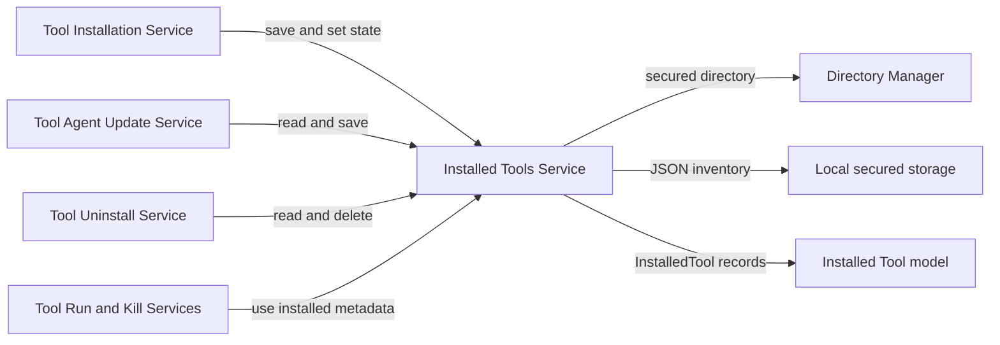
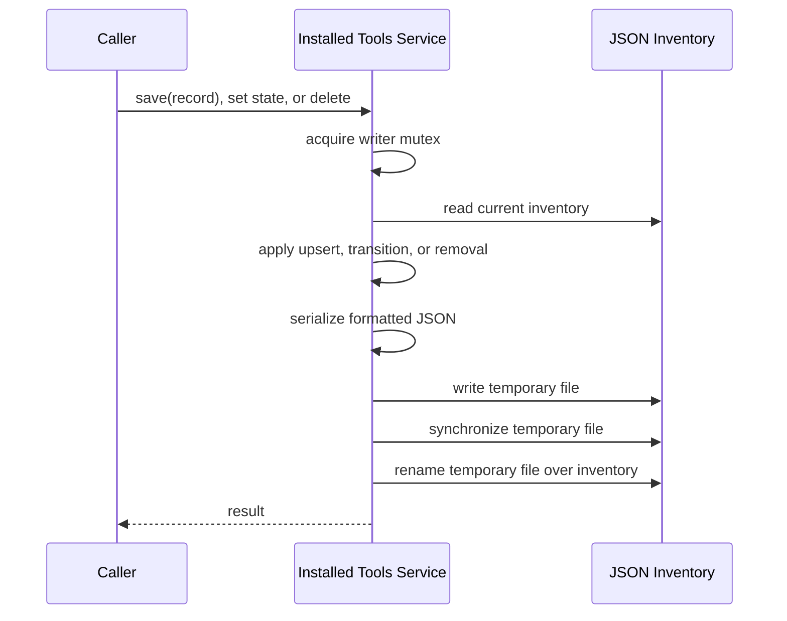
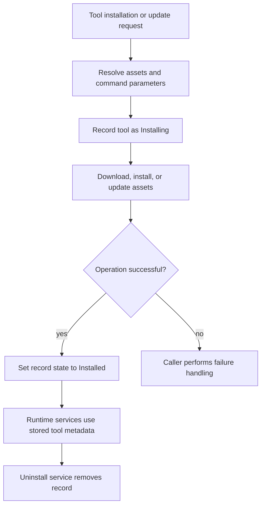

# Installed Tools Service

Installed Tools Service is the OpenFrame client agent's local inventory store for integrated tools. It records the tool-agent identity, tool metadata, launch and management arguments, installation assets, and lifecycle state in a durable JSON document. The service is implemented by the `openframe_agent_lib` crate from the [OpenFrame OSS Library source](https://github.com/flamingo-stack/openframe-oss-lib/blob/16e7c1cbd9664e7d10ec5ebca7d53c9bd314decf/clients/openframe-client/src/services/installed_tools_service.rs), which this repository consumes at version `v0.0.5`.

The service is deliberately a local persistence boundary. It does not download, launch, stop, or remove a tool itself. Instead, installation, update, runtime, connection, and uninstall services use its inventory as their durable source of installed-tool state.

## Responsibilities

- Create the agent's secured storage location when constructed.
- Maintain one inventory record per tool-agent identifier.
- Read the complete inventory or a single matching record.
- Insert or replace a record through `save`.
- Transition a known record between `Installing` and `Installed` through `set_state`.
- Remove an inventory entry when a tool is uninstalled.
- Preserve durability during writes by synchronizing a temporary file and atomically renaming it over the inventory.

## Architecture and Scope

The inventory is stored at `installed_tools.json` under the `DirectoryManager` secured directory. `DirectoryManager` also owns other platform paths, but Installed Tools Service uses only the secured directory and its directory-creation operation.

### Collaborating Components

| Component | Relationship to Installed Tools Service |
|---|---|
| `DirectoryManager` | Supplies the secured directory and ensures required directories exist during construction. |
| `InstalledTool` | The persisted record. Its fields include tool and tool-agent identifiers, type, version, command arguments, installation information, assets, and lifecycle state. |
| `ToolRecordState` | Captures the inventory lifecycle: `Installing` or `Installed`, with `Installed` as the model default. |
| Tool Installation Service | Reserves and installs tool assets, then persists the resulting local tool record and lifecycle changes. |
| Tool Agent Update Service | Uses the same inventory while updating installed tool-agent assets and reporting installed versions. |
| Tool Uninstall Service | Uses the inventory to identify installed tools and removes records once they are uninstalled. |
| Tool Run Manager and Tool Kill Service | Operate on tool metadata held in records while managing running processes. |

## Data Model

Each entry is uniquely identified by `tool_agent_id`; this is the key used by all lookup, replacement, state-transition, and deletion operations. `save` is therefore an upsert rather than an append-only operation.

| Field group | Persisted information |
|---|---|
| Identity | `tool_agent_id`, `tool_id`, and `tool_type` distinguish the installed integration and its associated asset. |
| Versioning | `version` records the installed tool version. |
| Execution | Run arguments and tool-agent identifier command arguments support subsequent process management. Optional uninstallation arguments are omitted from JSON when absent. |
| Installation | Installation metadata describes how the tool was installed. |
| Assets | A list of installed assets supports installations containing more than one artifact. |
| Lifecycle | `state` identifies whether the record is still being installed or is installed. Older or partial JSON that omits the state receives the model default. |

## Persistence Semantics

Mutating operations share an asynchronous mutex held for the full read-modify-persist sequence. This prevents two operations using the same service instance from losing each other's changes. Read operations do not acquire that mutex; callers receive the current deserialized file contents or an empty collection when the file does not yet exist.

The write protocol is:

1. Serialize the complete record collection with pretty JSON formatting.
2. Create a sibling temporary file with a temporary extension.
3. Write the serialized bytes and synchronize the temporary file.
4. Rename the temporary file onto the inventory path.

This avoids directly overwriting the live inventory document. Errors include contextual messages for directory creation, file reads, JSON deserialization and serialization, temporary-file creation and writes, synchronization, and replacement.

## Public Operations

| Operation | Behavior | Return value |
|---|---|---|
| `new` | Resolves the secured inventory path and ensures directories exist. | An initialized service or an error. |
| `get_all` | Reads and deserializes every record; treats a missing inventory file as an empty inventory. | All installed-tool records. |
| `get_by_tool_agent_id` | Searches the current inventory for one tool-agent identifier. | The matching record when present. |
| `save` | Replaces an existing matching record or adds a new record, then persists the entire collection. | Success or a persistence error. |
| `set_state` | Changes the lifecycle state of an existing matching record and persists it. | `true` when a record changed, otherwise `false`. |
| `delete_by_tool_agent_id` | Removes a matching record and persists only when removal occurred. | `true` when a record was removed, otherwise `false`. |

## Installation and Lifecycle Flow

Installed Tools Service stores the state boundary around installation; it does not decide tool compatibility or perform the platform-specific work. The surrounding services handle those concerns and update the inventory as the operation advances.

The explicit `Installing` state allows a caller to persist an in-progress operation before the final `Installed` state is recorded. The available API does not implement recovery policy itself: a caller must decide how to handle installation failure, stale in-progress records, or retries.

## Operational Considerations

### Consistency and Concurrency

- The mutex coordinates writes performed through clones of the same service because the lock is held in a shared `Arc`.
- The service rewrites the whole collection for each successful mutation. The persistence file is therefore the single local inventory snapshot, rather than a per-tool file layout.
- The implementation does not provide inter-process file locking. Separate agent processes operating on the same file are outside the mutex's protection.
- A malformed or unreadable existing file causes reads and mutations to fail rather than silently replacing the inventory.

### State and Deletion Results

`set_state` and `delete_by_tool_agent_id` return `false` for an unknown identifier and do not persist a file in that case. Callers can use this to distinguish a no-op from an applied change. `save` always persists after updating or adding a record.

### Security Boundary

The service relies on `DirectoryManager` to select and prepare a secured directory. Records can contain execution and uninstallation command arguments, so access permissions and backup handling for that directory are part of the agent's security posture. The service persists plain JSON and does not encrypt individual fields.

## Maintenance Guidance

When evolving `InstalledTool`, consider compatibility with already persisted JSON. Fields marked with serialization defaults or omission rules can help older records load safely, whereas required new fields can make an existing inventory unreadable. Keep the `tool_agent_id` identity rule stable: changing it affects upsert behavior, lifecycle updates, and deletion.

When adding a new mutating operation, follow the existing pattern: acquire the shared writer lock, load the collection, modify it in memory, and call the same persistence routine. This preserves the atomic-replacement and synchronization guarantees used by the current mutations.
