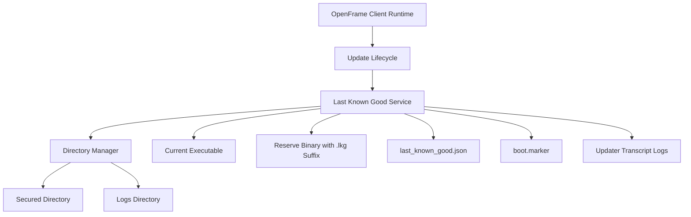
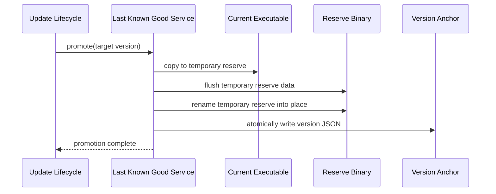
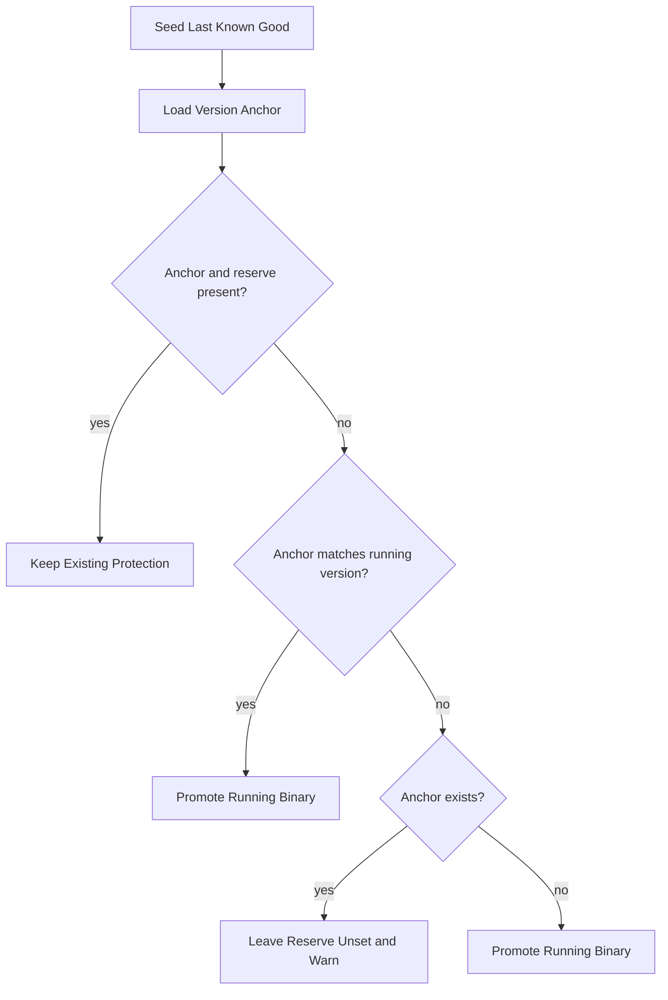
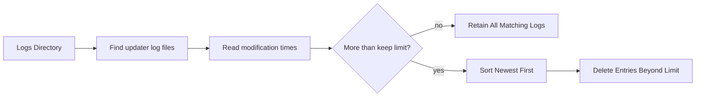

# Last Known Good Service

The Last Known Good Service protects the OpenFrame Client update lifecycle by keeping a durable copy of the binary that was most recently promoted as safe, plus a small version anchor. It also records that the current client booted and manages updater transcript retention. The implementation is supplied by the `openframe_agent_lib` Cargo dependency from [OpenFrame OSS Library](https://github.com/flamingo-stack/openframe-oss-lib/blob/16e7c1cbd9664e7d10ec5ebca7d53c9bd314decf/clients/openframe-client/src/services/last_known_good_service.rs) and runs inside this repository's OpenFrame Client distribution.

## Responsibilities

- **Anchor a known-good version.** `promote` records a version in `last_known_good.json` and creates a reserve copy of the currently running executable.
- **Preserve recoverability.** The reserve binary is written through a temporary file, flushed, then renamed into place so a power loss cannot leave a successfully renamed but unwritten backup.
- **Bootstrap safely.** `seed_if_missing` initializes the anchor on first run and only reconstructs a missing reserve when its recorded version matches the binary currently running.
- **Provide update lifecycle paths.** The service exposes the reserve path, boot-marker path, and unique timestamped updater transcript paths.
- **Bound diagnostic storage.** `prune_transcripts` retains the requested number of newest updater logs and attempts to remove older ones.

The service is local-only: it does not publish messages or call remote APIs. Its durable state is held in the client-managed secured directory and log directory.

## Architecture

### Durable artifacts

| Artifact | Location | Purpose | Writer |
|---|---|---|---|
| Version anchor | Secured directory, `last_known_good.json` | Stores the promoted version as JSON. | `promote` through atomic write support. |
| Reserve binary | Next to the current executable, with an `.lkg` suffix | Holds a byte-for-byte copy of the executable that was running during promotion. | `copy_running_to_reserve`, called by `promote`. |
| Boot marker | Secured directory, `boot.marker` | Contains the build-time `OPENFRAME_VERSION` for the booted client. | `write_boot_marker`. |
| Update transcript | Logs directory, named `updater-<target-version>-<timestamp>.log` | Supplies a distinct updater diagnostic file per target version and UTC timestamp. | Callers use `new_transcript_path`. |

The exact base directories are supplied by `DirectoryManager`. The service calls `ensure_directories` during construction before it resolves and uses its state paths.

## Component Model

`LastKnownGoodService` owns five paths:

- `anchor_file_path` for the JSON version anchor.
- `boot_marker_path` for boot recording.
- `logs_dir` for updater transcripts.
- `current_exe`, obtained from the running process environment.
- `reserve_path`, derived by appending `.lkg` to the current executable path.

| Operation | Behavior | Failure handling |
|---|---|---|
| `new` | Ensures managed directories exist, resolves the current executable, and derives persistent paths. | Returns contextual errors when directory setup or executable discovery fails. |
| `load` | Reads the JSON anchor with quarantine-aware JSON loading and returns its version when present. | Propagates read or parse errors with the anchor path in context. |
| `promote` | Copies and flushes the active binary into the reserve, then atomically persists the supplied version. | Returns an error; the anchor is not written if copying the reserve fails. |
| `seed_if_missing` | Establishes or repairs protection according to the current anchor and reserve state. | Logs anchor-read failure, treats it as missing, and tries to seed from the active binary. |
| `write_boot_marker` | Writes the running build version to a temporary marker and renames it into place. | Returns contextual filesystem errors. |
| `new_transcript_path` | Generates a UTC timestamped log path for a target version. | Pure path construction. |
| `prune_transcripts` | Keeps the newest configured number of matching updater logs. | Logs directory-read and individual deletion errors, without failing the caller. |

## Promotion Data Flow

Promotion deliberately establishes the reserve before persisting the anchor. This ordering avoids declaring a version known-good when the corresponding local binary copy could not be created. The reserve write has an additional durability step: the temporary copy is synchronized before rename.

## Bootstrap and Recovery Semantics

At startup, `seed_if_missing` compares three facts: the readable anchor, the existence of the reserve binary, and the compiled-in running version.

### Outcomes

1. **Anchor and reserve exist:** no work is performed.
2. **Anchor exists, reserve is missing, and versions match:** the current executable rebuilds the reserve through `promote`.
3. **Anchor exists, reserve is missing, and versions differ:** the service warns that rollback protection is degraded and does not overwrite the reserve with an unverified running binary. A later verified update must rebuild it.
4. **Anchor is missing or cannot be loaded:** the service treats the state as uninitialized and promotes the current binary. A load error is logged before this fallback.

This conservative mismatch behavior is significant: the anchor represents a previously verified version, while the currently executing version may be new or otherwise not suitable to become the fallback merely because the reserve disappeared.

## Transcript Retention Flow

Only regular directory entries whose names begin with `updater-` and end with `.log` are candidates. Entries without accessible metadata or modification times are excluded. Deletion continues per file; a failure to delete one transcript is logged and does not stop attempts for later candidates.

## Relationship to the Client Update Lifecycle

The Last Known Good Service is one element of the client-side update and startup safety boundary:

- The client update and update-handler services coordinate pending updates, launching, failure handling, and reporting the running version.
- The client information and update-state services persist client version and update phase information.
- The Last Known Good Service maintains the independent local fallback artifact and version anchor used to identify a previously promoted executable.
- Platform binary writing, updater launching, process management, and cleanup components perform platform-specific replacement and cleanup work.

Those neighboring capabilities are separate components. This service does not itself perform rollback, replace executables, or decide whether an update is valid; it supplies the persisted known-good state and operational paths that those lifecycle stages can use.

## Operational Notes

- The version stored in the anchor and boot marker comes from the compile-time `OPENFRAME_VERSION` value when seeding or writing a boot marker. `promote` accepts an explicit version from its caller.
- The JSON anchor is read through quarantine-aware filesystem support, protecting normal reads from malformed state files while surfacing contextual errors.
- `promote` requires sufficient permission to read the running binary, create its sibling reserve file, and update the secured state directory.
- Logs created elsewhere using `new_transcript_path` should retain the `updater-` prefix and `.log` extension if they are intended to participate in pruning.
- Transcript timestamps have second resolution. Callers that require collision resistance for multiple same-version operations within one second must coordinate their own usage.

## Maintenance Guidance

When changing this module, preserve these invariants:

1. Do not write the version anchor before a valid reserve has been created and flushed.
2. Keep anchor and marker replacement atomic through temporary-file rename patterns.
3. Do not rebuild a missing reserve from a running version that differs from the recorded anchor.
4. Keep the secured directory distinct from ordinary logs and retain contextual filesystem errors for supportability.
5. Treat transcript cleanup as best-effort so stale diagnostics cannot prevent the client from starting or updating.

The authoritative implementation is [last_known_good_service.rs](https://github.com/flamingo-stack/openframe-oss-lib/blob/16e7c1cbd9664e7d10ec5ebca7d53c9bd314decf/clients/openframe-client/src/services/last_known_good_service.rs) in OpenFrame OSS Library.