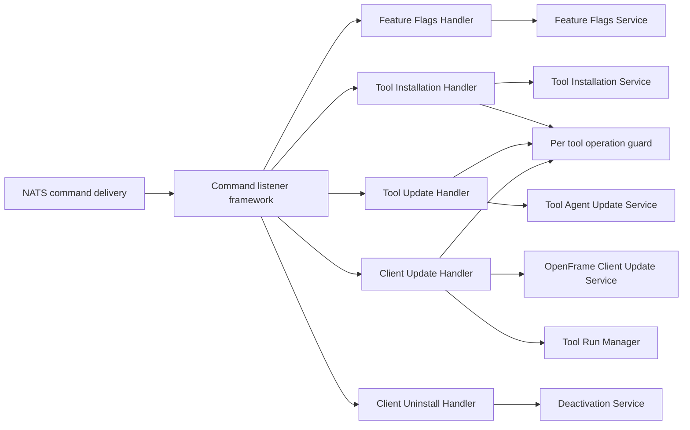
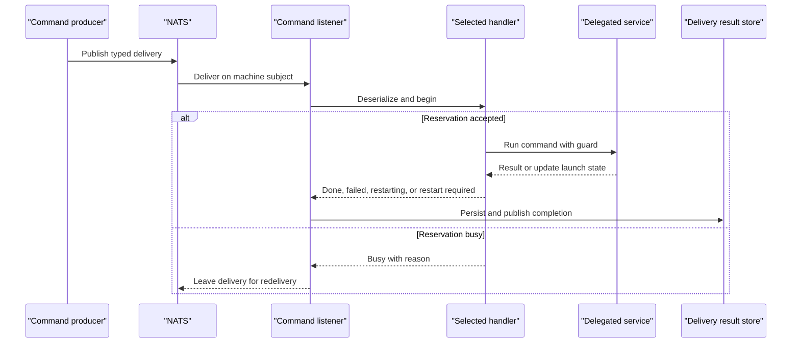
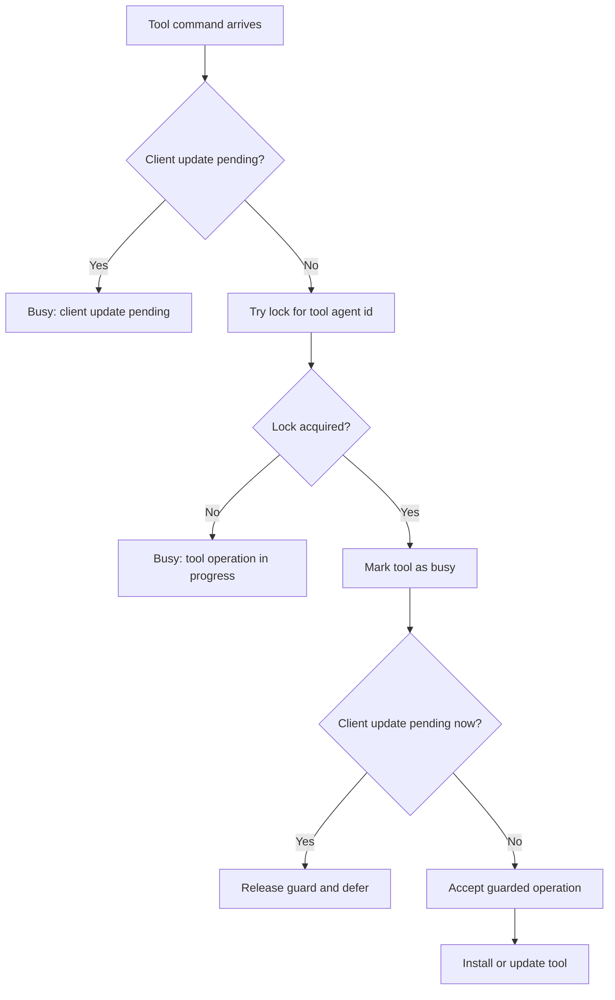
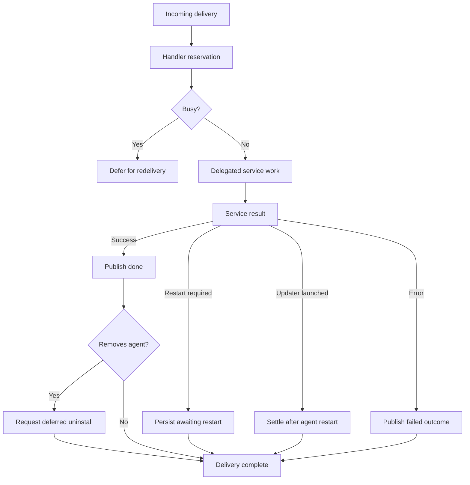

# Listener Command Handlers

Listener Command Handlers is the command-specific execution layer of the OpenFrame Client agent. It receives typed deliveries through the command-listener framework and applies five device-management operations: feature-flag changes, tool installation, tool update, client update, and client self-uninstall. The implementation is supplied by the OpenFrame OSS Library's `openframe_agent_lib` Cargo artifact, consumed by this repository at version `v0.0.5`.

The authoritative implementation is [`handlers.rs`](https://github.com/flamingo-stack/openframe-oss-lib/blob/7a766f00e4f58b5d89db007b878ac8d6e0c344f4/clients/openframe-client/src/listener/command/handlers.rs). This module is deliberately small: it identifies subjects, reserves concurrency guards, delegates the work to services, and converts each result into the listener's common outcome vocabulary.

## Responsibilities

Each handler implements the command listener's `CommandHandler` contract. The contract supplies a command kind and subject, optionally prevents replay of state-like sequenced commands, accepts or defers a delivery in `begin`, and executes accepted work in `run`. A handler can also mark a command as restarting or removing the agent, which changes how the surrounding listener settles the delivery.

| Handler | NATS subject per machine | Input | Key behavior | Completion behavior |
|---|---|---|---|---|
| `FeatureFlagsHandler` | `machine.{machineId}.feature-flags` | `FeatureFlagsMessage` | Persists validated flag state and compares its effective flags with those currently running. | Returns done when unchanged; otherwise requests a restart. |
| `ToolInstallationHandler` | `machine.{machineId}.tool-installation.v2` | `ToolInstallationMessage` | Acquires an exclusive operation for the target tool, then delegates installation. | Reports the delegated installation result. |
| `ToolUpdateHandler` | `machine.{machineId}.tool-update.v2` | `ToolAgentUpdateMessage` | Acquires the same per-tool exclusion and delegates repair or update. | Reports the delegated update result. |
| `ClientUpdateHandler` | `machine.{machineId}.client-update.v2` | `OpenFrameClientUpdateMessage` | Reserves the client-update guard and applies an agent binary update. | Reports restarting when an updater launches; otherwise done or failed. |
| `ClientUninstallHandler` | `machine.{machineId}.client-uninstall.v2` | Ignored payload | Accepts supported-platform requests, then signals deferred self-removal after completion. | Reports done before requesting removal. |

`FeatureFlagsHandler`, `ToolUpdateHandler`, and `ClientUpdateHandler` are sequenced. For these state-like commands, the listener uses the last applied sequence as a replay floor; deliveries at or below that floor can be answered without executing their side effects. Feature flags retain their applied sequence through `FeatureFlagsService`; the other sequenced handlers use the listener's normal delivery and result tracking.

## Architecture

The command listener owns subscription, delivery recovery, restart completion reporting, and reconnection. Its start loop performs one recovery pass, reports any restart completion, continuously listens, and retries after listener errors. Listener Command Handlers does not own that lifecycle; it plugs concrete commands into it.

The handlers depend on application services rather than performing network, filesystem, or process work directly:

- **Feature Flags Service** validates and persists received flag values, resolves them for the running client version, and records whether the delivery awaits restart confirmation.
- **Tool Installation Service** owns download, parameter resolution, installed-tool persistence, process control, directory handling, connection setup, and installed-agent publication.
- **Tool Agent Update Service** owns installed-tool lookup, repair detection, version comparison, asset updates, and installed-version publication.
- **OpenFrame Client Update Service** owns staging and launching a client update, update-state tracking, last-known-good protection, status tracking, and coordination with running tools and package upgrades.
- **Deactivation Service** serializes a self-uninstall request and prevents duplicate triggers.

## Delivery and Outcome Flow

A busy decision is intentional backpressure, not an execution failure. Tool handlers return a busy outcome when the target tool is already operating or when a client update is pending. Client-update reservation returns busy if an update is already in progress or if work such as active tools or package upgrades makes the update unsafe to start. The command can then be redelivered rather than racing concurrent work.

## Tool Operation Coordination

Tool installation and tool update share `reserve_tool`. The helper first rejects work if a client update is pending. It then attempts to acquire a nonblocking lock keyed by `tool_agent_id`, marks that tool as busy, and checks the client-update-pending flag again. The final check closes the race where a client update arrives between tool-lock acquisition and command execution.

The operation guard retains both the per-tool mutex and the busy marker for the duration of delegated work. This prevents overlapping operations for the same tool while permitting independent tools to proceed when no client update is pending.

## Handler Semantics

### Feature Flags

Feature-flag deliveries must include a sequence. The handler fails an unsequenced delivery instead of applying an unordered state change. The service accepts only values that deserialize as a feature flag with a boolean enabled state and a valid semantic-version minimum. Invalid entries are ignored by the service, while the complete validated state is persisted with the machine identifier, sequence, and delivery reference.

If the newly resolved flags equal the flags of the running client, the handler returns done. If they differ, it returns restart required. The listener can query the persisted awaiting-restart delivery through the handler and, after restart completion has been reported, clears that pending marker through `restart_reported`.

### Tool Installation and Tool Update

Both handlers isolate commands by tool-agent identifier before invoking their services. Installation passes the reserved guard to `install_reserved`; update passes it to `process_update_locked`.

Tool update handles several idempotency and recovery cases in its service layer:

- Missing tool registry records are treated as an orphaned update and are skipped until installation arrives.
- An interrupted installation state or absent tool artifact triggers repair behavior.
- Equal tool and asset versions result in no update work, but installed versions are still published.
- Downgrades are rejected when downgrade protection is enabled and installed versions are newer.
- A successful repair restores the installed state; supported GUI applications can be relaunched after a successful update.

### Client Update

Client updates are sequenced and explicitly marked as agent-restarting commands. Reservation first acquires a process-wide update guard. For a version other than the running version, it sets the client-update-pending signal before checking tool and package activity. This makes tool operations defer while an update is being admitted.

During apply, the service validates and normalizes the requested semantic version, skips the current version, and can refuse a downgrade relative to the last-known-good version. It records an updating status, stages and launches the updater, and records failure status plus cleanup when an error occurs. A launched updater produces `Restarting`, allowing the listener to settle the delivery after the next agent start rather than treating a stopped process as a failure. A skipped request produces done.

If apply fails, the handler clears the pending client-update signal before returning failed. This is essential because failed commands are not automatically resent by this path; without clearing the signal, later tool work could remain blocked indefinitely.

### Client Self-Uninstall

Self-uninstall accepts an otherwise ignored payload and is available only on macOS and Windows. Other platforms receive a failed outcome stating that the operation is unsupported. On supported systems, the handler returns done first. Because it is marked as agent-removing, the listener publishes the completion before invoking `remove_agent`; that method asks `DeactivationService` to initiate uninstall. The service makes this request idempotent, so duplicate removal calls do not start multiple uninstall flows.

## Failure, Restart, and Recovery Boundaries

Maintain the separation between reservation and execution when extending this module. `begin` must be quick, side-effect-limited, and safe for redelivery; it should either return a guard that owns the needed exclusivity or a clear busy reason. `run` should delegate substantive work to a service and map service results faithfully to `Outcome`. New sequenced handlers must provide a stable applied-sequence source, and any handler that can stop or remove the agent must set the appropriate listener contract flag so delivery settlement remains correct.
