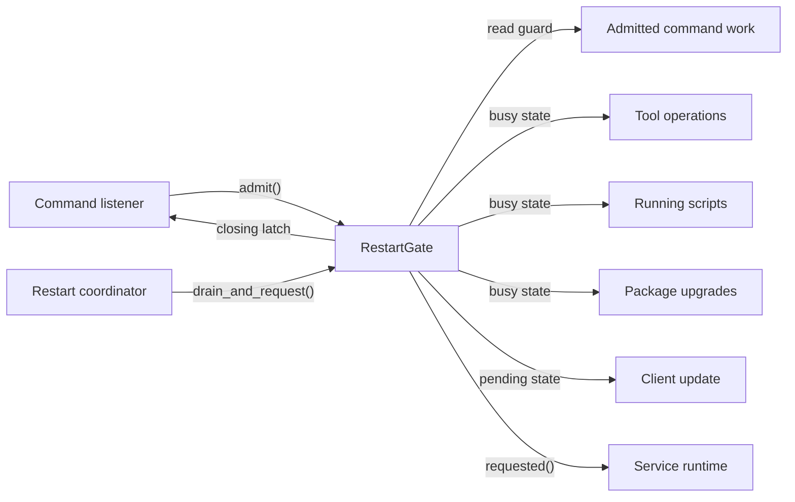
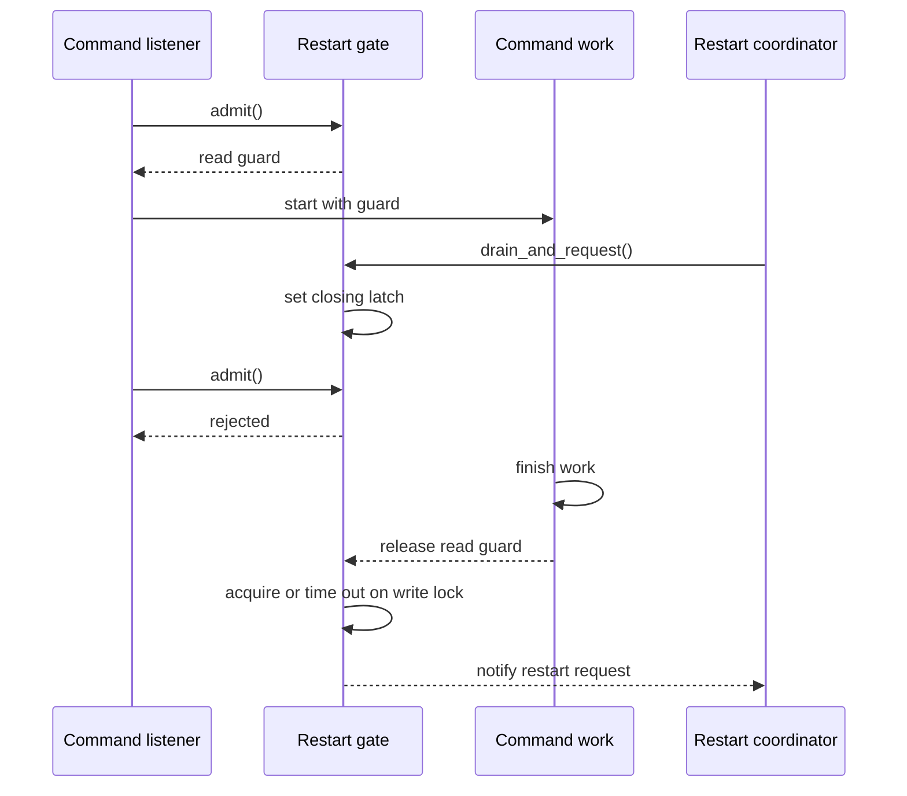
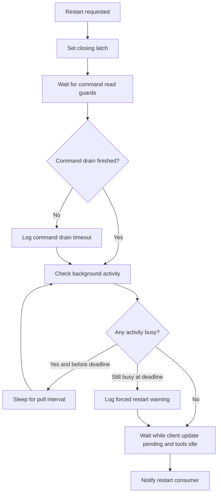

# Listener Command Restart

Listener Command Restart is the shutdown-and-drain coordinator for the Rust OpenFrame client agent. It turns a restart request into a controlled handoff: it prevents new command work from being admitted, gives existing commands and long-running device work a bounded period to finish, then signals that the client service may restart.

The implementation is supplied by the `openframe_agent_lib` artifact from OpenFrame OSS Library and is run by this repository's OpenFrame client. Its source is [restart.rs](https://github.com/flamingo-stack/openframe-oss-lib/blob/7a766f00e4f58b5d89db007b878ac8d6e0c344f4/clients/openframe-client/src/listener/command/restart.rs).

## Responsibilities

`RestartGate` owns four related responsibilities:

- **Admission control:** `admit()` grants a read guard only while the gate is open. A command retains that guard for its work, allowing the restart path to observe when admitted work has drained.
- **Restart closure:** `drain_and_request()` sets the shared closing latch before waiting, so no subsequent command is admitted.
- **Idle coordination:** the gate considers tool operations, running scripts, package upgrades, and a pending client update before requesting restart.
- **Restart notification:** `requested()` asynchronously waits for the one-shot notification emitted after the drain procedure completes.

The module does not stop the service itself, execute commands, or apply updates. Those concerns remain with the command listener, handlers, run managers, and service runtime that integrate this gate.

## Architecture

The command listener holds a handler and command context, while Listener Command Restart provides the lifecycle boundary around individual command execution. The separate restart coordinator is the caller that initiates draining; the service runtime is the consumer that waits for the restart signal and performs the actual process or service-level restart.

## Core State and Dependencies

| Element | Purpose |
|---|---|
| `closing: Latch` | Shared, monotonic closure signal. It is set before draining begins and prevents further command admission. |
| `work: Arc<RwLock<()>>` | Read guards represent admitted commands. The drain procedure attempts a write lock, which becomes available after all existing read guards are released. |
| `requested: Arc<Notify>` | Tokio notification used to wake the restart consumer after the bounded wait. |
| `busy_tools: BusyTools` | Indicates whether managed tool operations remain active. |
| `running_scripts: RunningScripts` | Indicates whether script execution is still active. |
| `client_update: ClientUpdatePending` | Indicates whether a client self-update remains pending. |
| `package_upgrades: InProgressView` | Indicates whether package upgrade activity is in progress. |

All shared fields are cloneable or reference-counted, allowing the gate and dependent tasks to coordinate without transferring ownership of the underlying lifecycle state.

## Command Admission and Drain Semantics

`admit()` uses a non-blocking owned read-lock acquisition. If the write side is already held or pending such that the read lock cannot be acquired, it returns no guard. It also checks the closing latch after acquiring the read guard and rejects the admission when closure has been requested.

A successfully admitted command must retain its returned guard for the duration of work that must finish before restart. Releasing the guard makes that command no longer part of the gate's drain barrier.

The latch check deliberately happens after the non-blocking read-lock attempt. This avoids admitting a command after closing becomes visible, while the lock establishes the drain relationship for commands that were already admitted.

## Restart Process

The restart workflow is bounded by `SELF_RESTART_IDLE_WAIT_SECS`. It polls non-command activity at `SELF_RESTART_IDLE_POLL_SECS` intervals.

### Busy Definition

The gate treats restart-sensitive work as busy when at least one of the following is true:

1. A tool operation is active.
2. A script is running.
3. A package upgrade is in progress.
4. A client update is pending.

The initial write-lock wait is separately bounded by the same deadline. If it expires, the implementation logs a warning and continues rather than indefinitely preventing a service restart. The background-work polling loop similarly stops at the deadline and logs a warning if activity remains.

### Client Update Exception

A pending client update receives special handling after the normal busy wait. The gate continues waiting while an update is pending **and** no tool operation is busy. This prevents a service restart from interrupting the client update's binary swap, because a running client update restarts the client itself.

The condition intentionally does not wait indefinitely when a tool is busy. In that case, an update can be deferred and repeatedly mark itself pending on redelivery, so the restart flow proceeds after its normal bounded drain behavior.

## Notification Contract

`requested()` waits on Tokio `Notify` and returns only after `drain_and_request()` calls `notify_one()`. Consumers should begin awaiting the notification before or in coordination with restart initiation so they do not depend on durable restart state; this module exposes an in-process notification, not a persisted restart record.

The gate logs two operational warnings:

- command work still holds admission guards after the configured drain timeout;
- a tool operation, script, package upgrade, or client update remains busy after that timeout.

These warnings indicate that the restart policy chose availability and eventual recovery over waiting without a bound.

## Integration Guidance

When integrating Listener Command Restart with a command-processing path:

1. Construct one shared `RestartGate` with the same tool, script, update, package-upgrade, and closing-state views used by the rest of the client runtime.
2. Call `admit()` before starting restart-sensitive command work. Treat a missing guard as a rejection caused by closure or current lock contention.
3. Keep the returned guard alive until all work that belongs to the command's drain scope has completed.
4. Invoke `drain_and_request()` from the component responsible for controlled client shutdown.
5. Run a restart consumer that awaits `requested()` and then delegates to the platform service lifecycle mechanism.

Do not use the notification as proof that all activity finished: it means the bounded drain policy completed and a restart may proceed, including timeout paths.

## Operational Properties

| Property | Behavior |
|---|---|
| New work during restart | Rejected after the closing latch is set. |
| Existing command work | Given time to release read guards, but only until the configured deadline. |
| Long-running background work | Polled for tools, scripts, package upgrades, and client updates. |
| Timeout behavior | Warnings are logged and restart notification still occurs. |
| Update safety | A pending client self-update is protected from service interruption while no tool is busy. |
| Restart execution | Outside this module; the gate only requests it. |

## Maintenance Notes

Changes to the busy predicate affect restart safety and latency. Any new subsystem that can be harmed by an in-process restart should either be represented in the gate's busy state or be explicitly designed to survive interruption. Conversely, adding an activity without a reliable completion signal can unnecessarily defer restarts.

Changes to guard lifetime are equally significant: releasing a guard early allows restart while the associated command continues, while holding it across unrelated work delays restart. Keep the admission scope limited to work whose completion is genuinely required before the client may restart.
