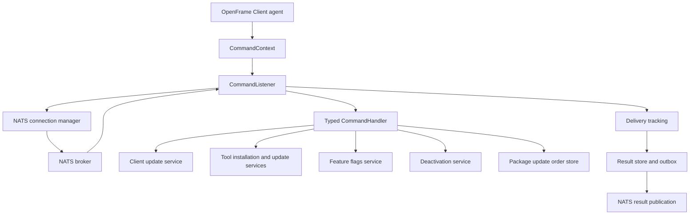
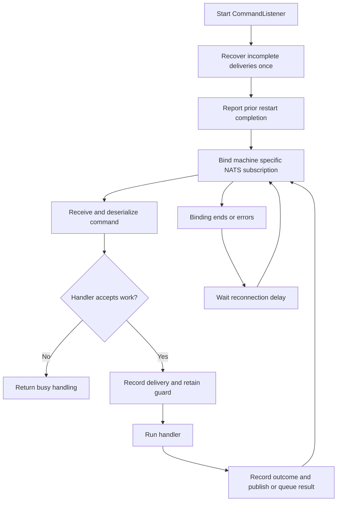
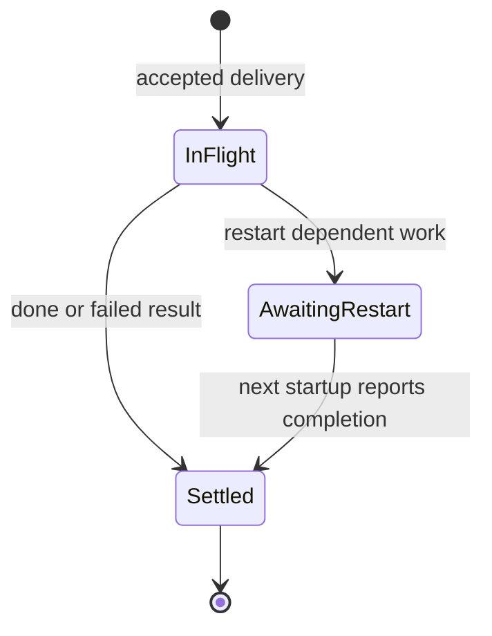
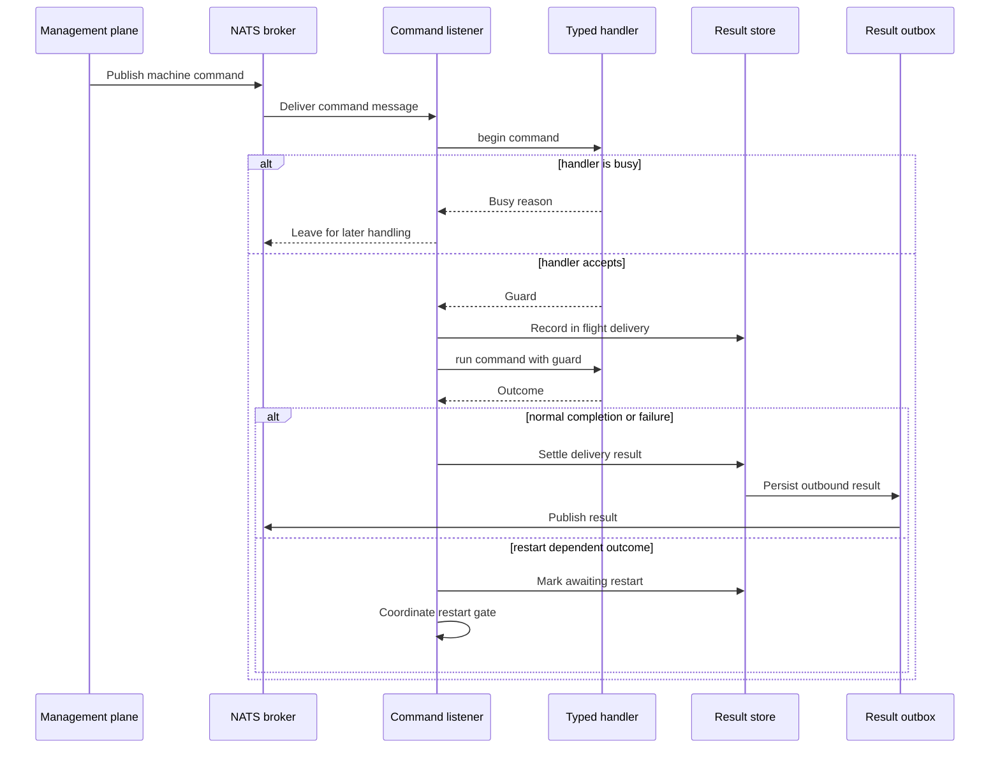

# Listener Command

Listener Command is the OpenFrame Client agent's generic, restart-aware command-consumption framework. It runs in the Rust client supplied by the OpenFrame OSS Library through the `openframe_agent_lib` Cargo dependency, pinned by this repository at version `v0.0.5`. The framework binds a typed command handler to a machine-specific NATS subject, prevents overlapping work where the handler declines it, records delivery state, and produces a durable result path that survives temporary transport failures and controlled agent restarts.

The implementation documented here is in the OpenFrame OSS Library: [command listener source](https://github.com/flamingo-stack/openframe-oss-lib/blob/7a766f00e4f58b5d89db007b878ac8d6e0c344f4/clients/openframe-client/src/listener/command/mod.rs).

## Responsibilities

The module separates message transport and delivery bookkeeping from command-specific work:

- `CommandListener` owns a handler and a shared `CommandContext`, then continuously binds and rebinds the listener.
- `CommandHandler` defines the command payload type, subject, admission policy, execution operation, and lifecycle properties.
- `CommandContext` centralizes NATS access, persisted agent configuration, restart coordination, and delivery tracking.
- `Begin` distinguishes accepted work from work rejected as busy.
- `Outcome` distinguishes a completed command, a command that needs a restart, a command that restarts the agent itself, and a failed command.
- `Delivery` is internal to the command module and combines result publication, persisted delivery state, and an outbox-flush notification.

The module does not itself implement a particular installation, update, or uninstall operation. Those operations are supplied by concrete handlers and their corresponding services.

## Position in the Client

The client starts this listener alongside other agent run managers. It consumes management-plane work from NATS, while the separate execution and remote-access listeners handle their own message families. The command layer is therefore the control plane for agent lifecycle, installed-tool lifecycle, feature state, and package-update requests rather than a script-execution engine.

## Core Abstractions

### `CommandHandler`

`CommandHandler` is a `Clone`, `Send`, `Sync`, and `'static` trait with an associated deserializable `Command` payload and a handler-specific `Guard`. A handler provides:

| Contract element | Purpose |
|---|---|
| `KIND` | Stable command-family identifier used by listener logging and delivery handling. |
| `subject(machine_id)` | Computes the NATS subject for one machine. |
| `begin(command)` | Performs synchronous admission and returns either `Accepted(guard)` or `Busy(reason)`. |
| `run(machine_id, delivery, command, guard)` | Asynchronously performs the accepted operation and returns an `Outcome`. |
| `SEQUENCED` | Declares state-like handling: deliveries at or below the applied sequence are answered as complete without repeating work. |
| `applied_sequence(machine_id)` | Supplies an optional external sequence floor for sequenced command families. |
| `RESTARTS_AGENT` | Marks work that may stop the current agent process before it returns. |
| `REMOVES_AGENT` | Marks work that removes the agent after its completion is published. |
| `awaiting_restart` and `restart_reported` | Allow a handler to persist and later settle a restart-dependent result. |

The `Guard` is intentionally handler-defined. It keeps the resource reservation made during `begin` alive throughout `run`, which makes admission and execution a single lifecycle instead of a check followed by unprotected work.

### `Begin` and `Outcome`

`Begin::Busy` carries a reason instead of executing concurrent work. The framework can therefore leave the message eligible for later processing rather than treating contention as an ordinary success.

`Outcome` communicates the post-execution delivery behavior:

| Outcome | Meaning |
|---|---|
| `Done` | The command finished normally. |
| `RestartRequired` | Work completed, but the agent must restart for the change to take effect. |
| `Restarting` | The command is responsible for restarting the agent; a future start reports the final delivery state. |
| `Failed(reason)` | Work failed with a human-readable error. |

Any `anyhow::Result<()>` can be converted to `Outcome`: success becomes `Done`, and an error becomes `Failed` with its formatted error chain.

### `CommandContext`

`CommandContext::new` receives a `NatsConnectionManager`, `AgentConfigurationService`, `RestartGate`, `NatsMessagePublisher`, shared `ResultStore`, and a flush `Notify`. It creates a shared `Delivery` helper and an asynchronous one-time recovery cell.

Before a listener subscribes, `recover_once` invokes delivery recovery once for all listeners sharing the context. This ordering is important: commands interrupted by a previous stop are resolved before new messages are consumed.

## Listener Lifecycle

`CommandListener::start` returns a Tokio `JoinHandle` immediately. The spawned task follows an unbounded reconnect loop. It first recovers incomplete deliveries and reports restart completion, then binds through the internal NATS listener. A clean return from binding is treated as a rebind event; an error is logged. In either case, the listener waits for `RECONNECTION_DELAY_MS` before retrying.

A NATS reconnection receiver is available from `NatsConnectionManager::subscribe_reconnect`, while `get_client` rejects use before the client has been initialized. `NatsMessagePublisher` serializes a payload to JSON, publishes it, and flushes the NATS client, so a successful publish includes a flush attempt.

## Delivery, Recovery, and Restart Semantics

The delivery ledger has three states: `InFlight`, `AwaitingRestart`, and `Settled(DeliveryResultMessage)`. When a delivery is accepted, the result store records the subject, delivery reference, and initial state. A restart-dependent command can transition an in-flight delivery to `AwaitingRestart`; the next agent startup reports and clears it through the handler's restart hooks. A settled result is stored for publication and subject to the store's retention policy.

The result store also maintains an outbox. It writes outbound entries before publication and removes them only after completion processing, which permits result delivery after a transient NATS outage. Its `recover` operation turns interrupted scheduled-script journal records into failure results with exit code `85`; that recovery path is broader than command delivery but uses the same shared persistence mechanism.

### Restart Gate

`RestartGate` coordinates restarts against active work. It has a closing latch, a read/write work lock, a notification for restart requests, and views of busy tools, running scripts, an in-progress client update, and package upgrades. `requested` waits until a restart request notification arrives. This prevents restart-causing outcomes from being treated as merely local handler state: coordinated shutdown can wait for safe conditions and leave the delivery in a recoverable state.

## Built-in Command Families

The command package exports these handler types. Their detailed behavior belongs to the associated services; the listener provides their common admission, transport, sequence, and delivery envelope.

| Handler | Delegated responsibility | Important dependency |
|---|---|---|
| `ClientUninstallHandler` | Requests controlled self-uninstallation. | `DeactivationService` guards against repeated uninstall triggers. |
| `ClientUpdateHandler` | Reserves and launches a client-binary update. | `OpenFrameClientUpdateService` and `ToolRunManager`. |
| `FeatureFlagsHandler` | Applies persisted feature-flag state. | `FeatureFlagsService`. |
| `ToolInstallationHandler` | Installs a requested integrated tool while holding a tool-operation reservation. | `ToolInstallationService` and `ToolOps`. |
| `ToolUpdateHandler` | Updates or repairs an installed tool and its assets. | `ToolAgentUpdateService` and `ToolOps`. |
| `PackageUpdateHandler` | Submits a package-update request for asynchronous processing. | `OrderStore` and `StatusReporter`. |

### Handler-specific behavior

- The feature-flags service validates each incoming flag before persistence. If the resolved flag set differs from the running set, it returns a restart-required application result and retains the delivery reference until restart completion is reported.
- The client-update service validates the requested version, skips an already-running version, refuses a lower version than the last-known-good anchor when downgrades are disabled, records update status, and clears stale update state if the update fails. Its reservation rejects overlapping update attempts and defers the update when tool or package work is active.
- The tool-update service skips an unknown installed-tool record, repairs records left in an installing state or with missing binaries, prevents downgrades when disabled, applies asset changes, and republishes installed versions when the target version is already present.
- The package-update order store rejects stale sequence numbers for the same request, updates an existing request, or supersedes a pending update for the same package when it is not currently installing. Accepted changes notify the asynchronous package-update run manager.
- The deactivation service makes the uninstall request idempotent by recording that the self-uninstall path was already triggered before sending its uninstall command.

## Command Interaction Flow

## Sequencing and Idempotency

For handlers declaring `SEQUENCED`, delivery is state-like rather than imperative: a sequence at or below the known applied sequence is answered as already complete without rerunning the operation. The default external sequence floor is zero, but handlers can override `applied_sequence` when another service owns prior state. The shared delivery ledger adds protection across process lifetimes by recording accepted and restart-waiting deliveries.

Maintainers adding a new command family should decide explicitly whether its message is state-like. Use sequencing for replaceable desired state, such as configuration, and avoid assuming it provides a universal deduplication mechanism for imperative work.

## Extension Checklist

1. Implement `CommandHandler` with a concrete deserializable payload and a machine-specific NATS subject.
2. Make `begin` acquire or validate every resource needed for safe execution, returning `Busy` when it cannot do so.
3. Keep the resulting guard alive for all of `run`.
4. Select `SEQUENCED` only when repeating or reordering lower sequence state is safe to settle without execution.
5. Return `RestartRequired` when the framework should coordinate restart after work completes. Set `RESTARTS_AGENT` and return `Restarting` only for work that can end the agent before a result can be finalized in the same process.
6. Set `REMOVES_AGENT` only when result publication must occur before agent removal, and implement `remove_agent` for the final teardown.
7. If a restart-dependent result is persisted by the handler, implement `awaiting_restart` and `restart_reported` so a future startup can settle it.
8. Wire the listener with the same shared `CommandContext` used by other command families so recovery remains one-time and consistent.

## Operational Notes

- Listener failures do not terminate the listener task. They are logged, followed by a delay, and then retried.
- A successful handler outcome and successful immediate network publication are different concerns. The result store and outbox retain outbound results when delivery cannot complete immediately.
- Update, tool, package, and restart behavior is intentionally coordinated to avoid replacing the client binary while tools, scripts, or package upgrades are active.
- Command logs include the handler `KIND`, enabling operators to distinguish reconnect and processing activity by command family.
