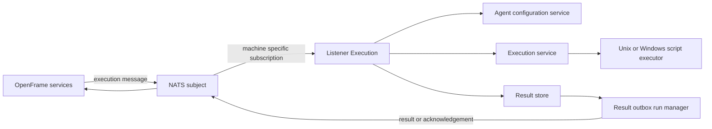
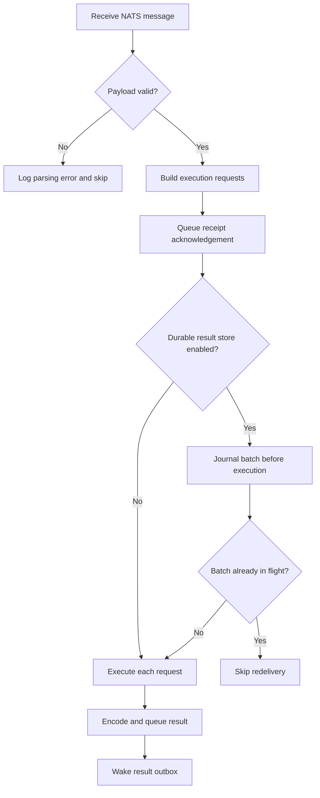
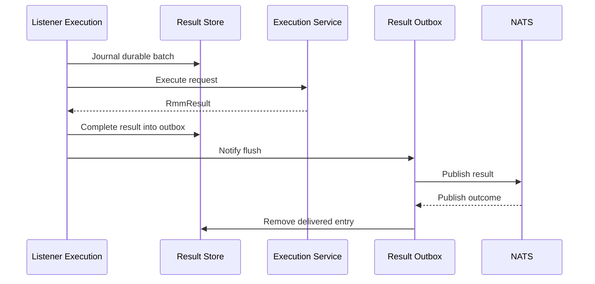

# Listener Execution

Listener Execution is the OpenFrame Client agent component that receives script-execution work for one machine from NATS, acknowledges receipt, invokes the platform-specific script executor, and returns a structured result. It is implemented by `ExecutionListener<M>` in the OpenFrame OSS Library's [`execution_listener.rs`](https://github.com/flamingo-stack/openframe-oss-lib/blob/7a766f00e4f58b5d89db007b878ac8d6e0c344f4/clients/openframe-client/src/listener/execution_listener.rs) and is assembled into this repository through the `openframe_agent_lib` dependency.

The listener is generic over an `ExecutionMessage` type. This lets one delivery mechanism process individual scripts, routed script messages, and scheduled batches while the message type supplies its subject kind, result kind, parsing, request conversion, privilege policy, and durability behavior.

## Responsibilities

- Subscribe to the per-machine execution subject `machine.{machineId}.{kind}`.
- Parse an incoming payload into an `ExecutionMessage` implementation and derive one or more `ExecutionRequest` values.
- Publish an `ExecutionAck` before execution, identifying the execution, machine, optional schedule, and script identifiers.
- Execute each request through `ExecutionService`, which selects the Unix or Windows executor and applies the resolved privilege policy.
- Publish or durably queue each `RmmResult` to `machine.{machineId}.{resultKind}.result`.
- Avoid repeated durable-batch execution after redelivery, preserve pending results in the outbox, and re-subscribe when the NATS client changes.

## Architecture

The agent configuration service provides the machine identifier used to form both inbound and outbound subjects. The NATS connection manager supplies the active client and a watch channel that reports client replacement. The message publisher is responsible for regular NATS publishing or JetStream-acknowledged publishing when a subject requires stream acknowledgement.

The listener owns no script-runtime implementation. `ExecutionService` converts each request into executor parameters, applies a default timeout of 900 seconds when the request specifies zero, resolves privilege, and returns an `RmmResult`. On unsupported platforms, it reports an execution result with exit code `85` rather than attempting to run a script.

## Message Contract and Routing

`ExecutionMessage` is the extension point. Its required operations parse a payload, expose an execution identifier, and transform the decoded message into execution requests. The optional schedule identifier defaults to absent. Implementations may override the default result kind, declare durable processing, and define a privilege policy.

Each `ExecutionRequest` carries the execution identifier, code, shell, requested privilege, arguments, timeout, environment variables, optional script identifier, optional schedule identifier, and the policy inserted by Listener Execution. The completed `RmmResult` includes standard output, standard error, exit status, elapsed milliseconds, timeout status, and optional error, script, and schedule information.

Acknowledgements are sent to `machine.{machineId}.{executionAckKind}`. Because acknowledgement subjects require stream acknowledgement, the publisher uses JetStream for their eventual delivery. Result subjects normally use regular NATS publishing unless their subject is one of the explicitly stream-acknowledged subject types.

## Processing Lifecycle

### Listener startup and reconnection

`new` receives the connection manager, publisher, execution service, configuration service, result store, and the outbox notification handle. `start` spawns a long-lived Tokio task rather than blocking its caller. For each lifecycle iteration it obtains the current NATS client, reads the machine identifier, subscribes, and concurrently waits for either the inbound stream to end or the connection manager to replace its client.

Either condition ends that subscription iteration. The task logs the condition, waits for the configured reconnection delay, and subscribes again. Individual message handlers are spawned without a concurrency bound, so slow script execution does not stop the subscription stream from receiving later messages.

`on_message_handled` optionally attaches a notification used by callers or tests that need to observe completion of a successfully processed message.

### Receipt acknowledgement

After parsing, Listener Execution creates an `ExecutionAck` from the execution identifier, local machine identifier, optional schedule identifier, and all non-empty script identifiers. Serialization failures are logged and prevent only the acknowledgement. Processing proceeds to execution, so the agent does not discard otherwise valid work solely because receipt acknowledgement serialization failed.

### Durable execution and duplicate suppression

When the message type is durable and the result store is enabled, the listener first writes one journal record per request as a batch. Each record stores its result subject, execution metadata, machine, optional script identifier, a not-started marker, and creation time.

The batch operation is idempotent by execution identifier:

1. A newly inserted batch permits processing.
2. An existing batch is treated as already in flight, so a redelivery is logged and skipped.
3. A journal failure falls back to direct execution and best-effort result delivery.

Before each durable request runs, the listener marks its journal entry as started. On completion, it atomically writes the serialized result into the outbox and removes the journal entry. This ordering ensures that a successfully executed request has a durable payload awaiting delivery rather than merely an in-memory publish attempt.

## Result Delivery and Failure Behavior

Before storage or publication, results are encoded using the lower of the result-store payload limit and the NATS publisher's advertised maximum payload. The encoded value is therefore the transport-safe form retained by the outbox.

When the result store is available, both acknowledgements and results are queued with stable keys and the outbox is notified. The Result Outbox Run Manager also flushes on an interval. It loads pending payloads, skips entries exceeding the current payload limit so they cannot block healthy entries, uses a publish timeout, removes confirmed deliveries, and retains failed or timed-out entries for a later flush.

If no durable store is enabled, Listener Execution starts an in-memory fallback publisher. It chooses JetStream acknowledgement only for subjects that require it, otherwise it publishes and flushes through NATS. Failures are retried with exponential backoff between the configured initial and maximum delays, up to the configured retry count. After the last failure the listener logs that the message was lost; this path intentionally has no restart persistence.

A durable completion failure uses a narrower recovery path: the listener attempts a direct raw NATS publish. If that succeeds, it removes the journal record. If direct publishing also fails, the error is logged and recovery depends on the persisted journal state.

## Operational Notes

- An invalid UTF-8 payload is lossy-decoded for parsing and logging. If parsing fails, the message is skipped without acknowledgement, execution, or completion notification.
- Completion logs include execution, schedule, and script identifiers along with exit code, timeout state, and elapsed time. These fields are the primary correlation data for investigating agent-side execution.
- The machine-specific subject prevents one agent from subscribing to another machine's assigned work. Correct persisted machine identity is therefore a prerequisite for receiving executions.
- Durable message types rely on the result store and outbox to survive transient NATS failures. Non-durable message types provide bounded, in-memory retry only.
- Because inbound handlers are unbounded, operational limits on execution throughput must be provided by surrounding agent controls or by the execution service rather than by this listener.

## Source and Ownership

Listener Execution runs in the Rust OpenFrame Client agent delivered by this repository, but its implementation belongs to OpenFrame OSS Library artifact `openframe_agent_lib` version `v0.0.5`. The tenant repository consumes that library as part of its client deployment; the source of record is the [OpenFrame OSS Library implementation](https://github.com/flamingo-stack/openframe-oss-lib/blob/7a766f00e4f58b5d89db007b878ac8d6e0c344f4/clients/openframe-client/src/listener/execution_listener.rs).