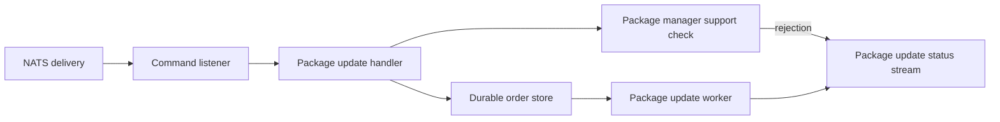
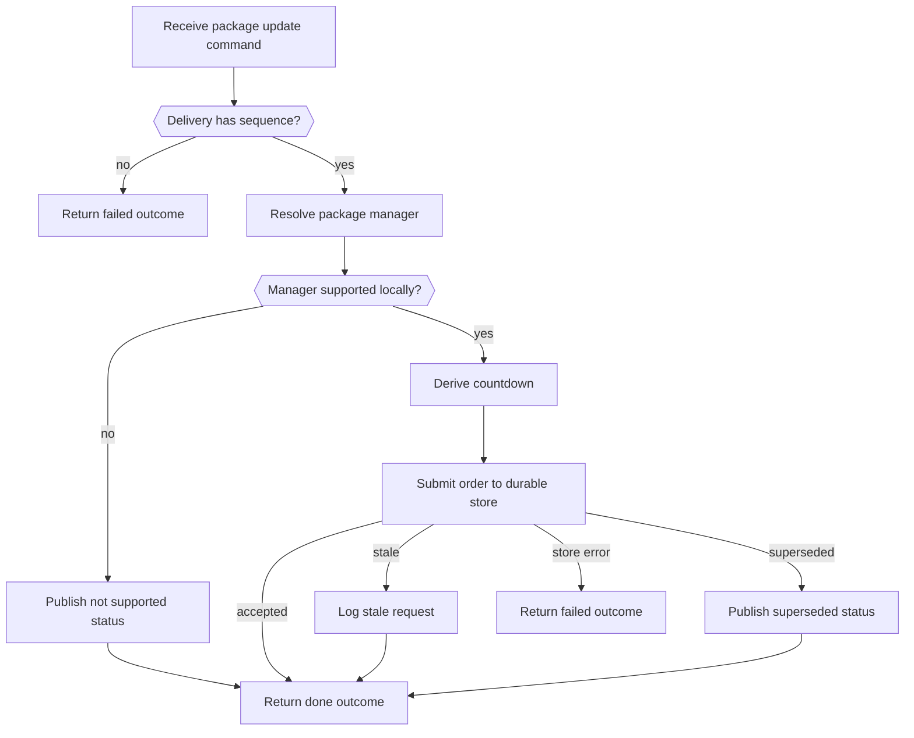

# Listener Package Update

Listener Package Update is the OpenFrame Client command handler that accepts package-update requests delivered to one managed machine. It validates the delivery and local package-manager support, persists accepted work to the package-update order store, and lets the background worker execute the order and publish its lifecycle status. The handler deliberately completes command delivery after durable acceptance rather than waiting for installation to finish.

This behavior is implemented by `PackageUpdateHandler` in the OpenFrame OSS Library's Rust client code: [package update handler source](https://github.com/flamingo-stack/openframe-oss-lib/blob/7a766f00e4f58b5d89db007b878ac8d6e0c344f4/clients/openframe-client/src/listener/command/package_update.rs). The tenant repository assembles and runs this Rust client artifact as part of its client service.

## Responsibilities

- Bind package-update commands to a machine-specific subject whose final segment is the package-update command kind.
- Require a delivery sequence before accepting work, because the order store uses it to recognize stale requests.
- Resolve the requested package to a package manager and refuse requests unsupported on the current device.
- Normalize the force-update countdown according to the command contract.
- Submit the order durably, report a superseded pending update, and return a delivery outcome to the shared command listener.
- Leave installation execution to the package-update run manager, which consumes persisted orders in the background.

## Architecture

`PackageUpdateHandler` implements the shared `CommandHandler` abstraction. Its `begin` operation accepts every deserialized package-update message without a per-command guard. Its `run` operation decides whether the request can be persisted and returns `Done` only when it has been accepted, identified as stale, or explicitly rejected through the status stream.

## Command and Delivery Contract

The handler consumes `PackageUpdateMessage`, which carries a request identifier, source metadata, a `PackageRef`, an update mode, and an optional countdown. A delivery also supplies the machine identifier and an optional sequence. The handler rejects a delivery without a sequence as a command failure; it cannot safely place such a command in the sequence-aware order store.

The delivery path has two distinct acknowledgements:

1. The command listener receives `Outcome::Done` after durable acceptance, a stale no-op, or a status-reporting rejection.
2. The platform receives package-update status messages asynchronously. A status message identifies the request and machine, repeats source and package details, and contains waiting, completion, or failure information as appropriate.

Consequently, command completion is not evidence that an application has already been updated. It confirms only that this listener handled the request according to its acceptance rules.

## Processing Flow

## Acceptance and Ordering Semantics

The order store persists the incoming command together with the machine identifier, delivery sequence, receipt time, and normalized countdown. This establishes the boundary between reliable command intake and later execution.

| Store result | Listener behavior | Status behavior |
|---|---|---|
| Accepted | Returns `Done`. | The worker later reports execution progress and outcome. |
| Stale | Logs that the sequence was already applied and returns `Done`. | No new status is emitted by the handler. |
| Superseded | Returns `Done` after accepting the newer order. | Immediately publishes a failure for the displaced pending order with reason `Superseded`. |
| Persistence error | Returns a failed outcome containing the error. | No acceptance status is implied. |

A request is stale when its request identifier is already known with an equal or greater sequence in pending or finished orders. When a newer request targets the same package, the store replaces a pending order unless that order is currently installing; an installing order is allowed to finish and the newer request remains pending behind it. Resubmitting the same request identifier with a newer sequence updates its package, source, mode, countdown, and revision. The revision lets the worker report a waiting order again after it is resent.

If the machine identifier changes, the store discards orders associated with the previous machine identity before accepting new work. This prevents orders from one device identity being executed under another.

## Package Manager Compatibility

The handler obtains a `ManagerId` from the package reference and calls the platform support check. The available manager identities are Brew, Chocolatey, and WinGet. Support is evaluated for the current device, so a syntactically valid request can still be rejected when its manager is unavailable or unsupported locally.

For an unsupported manager, the handler publishes a failed status with `NotSupported` and a detail that names the manager, then returns `Done`. This treats incompatibility as a completed, reportable package-update decision rather than a transport retry condition.

## Countdown Policy

The update mode determines whether the command may wait for a running application or force the update after a countdown.

| Mode or input | Normalized countdown |
|---|---|
| Wait mode | `0`; the worker installs only when the application is not running. |
| Force mode without a value | `300` seconds. |
| Force mode with `0` from a user-originated source | `0` seconds. |
| Force mode with another value below `60` seconds | `60` seconds. |
| Force mode with a value above `1800` seconds | `1800` seconds. |
| Force mode within the allowed range | Requested value. |

The handler logs a warning whenever it clamps a requested countdown. A zero countdown is therefore an exception reserved for the user's own action, not a general bypass of the minimum force-update delay.

## Status and Failure Reporting

Two handler-owned status paths are immediate:

- **Rejected:** an unsupported manager produces a failure with reason `NotSupported`.
- **Superseded:** replacing a pending update for the same package produces a failure with reason `Superseded` and explains that a newer request replaced it.

Other package-update outcomes are produced by the worker after it processes the stored order. The status model supports waiting, done, and failed states; defined failure reasons also include manager errors or absence, application-close failures, timeouts, packages that are not installed, and packages that are not upgradable. Those outcomes belong to execution rather than command intake.

## Operational Considerations

- The command listener starts with recovery and then continuously rebinds after listener errors. Durable submission is therefore important for messages delivered around connection interruptions.
- The package-update run manager starts a single worker and warns instead of launching another when it has already been started. This preserves one execution loop for the persisted order queue.
- Investigate a `Done` delivery together with package-update status messages. The former means the listener accepted or classified the request; the latter describes the actual update result.
- Preserve the sequence requirement and supersession reporting if extending this handler. They are the core safeguards against duplicate execution and invisible replacement of pending work.

## Implementation Surface

`PackageUpdateHandler::new` receives two dependencies:

- `Arc<OrderStore>` for synchronized, durable order submission.
- `StatusReporter` for immediate rejection and supersession reports.

The handler exposes no independent public network endpoint. Its externally observable interface is its command subject, command-delivery outcome, persisted order handoff, and package-update status publications.