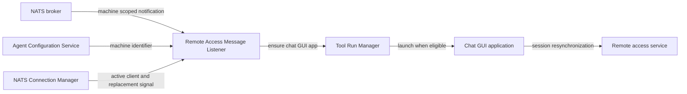
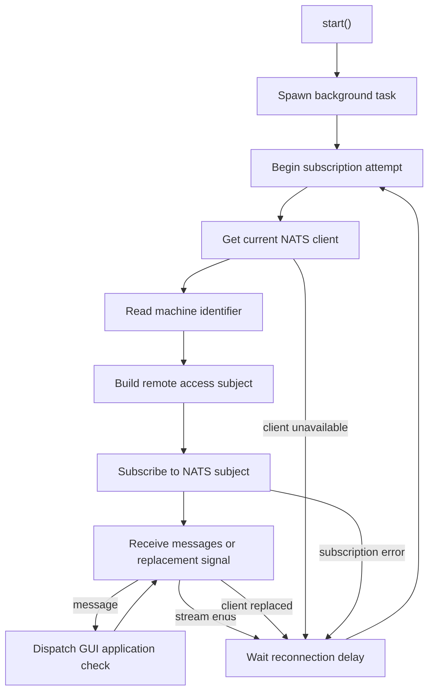
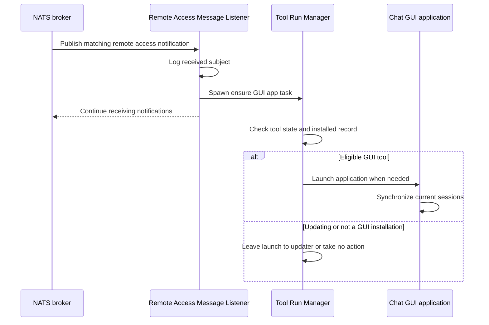
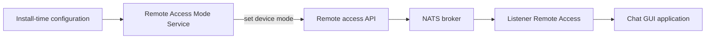

# Listener Remote Access

Listener Remote Access is the endpoint-agent component that reacts to per-device remote-access notifications. It subscribes to the device-specific NATS subject and ensures that the configured chat GUI application is running whenever a notification arrives. This lets a newly launched chat application synchronize its remote-access state through its own current-session workflow rather than requiring the listener to interpret message payloads.

The implementation is supplied by the OpenFrame OSS Library `openframe_agent_lib` dependency and runs in this repository's OpenFrame client deployment. Its source is [remote access message listener](https://github.com/flamingo-stack/openframe-oss-lib/blob/7a766f00e4f58b5d89db007b878ac8d6e0c344f4/clients/openframe-client/src/listener/remote_access_message_listener.rs).

## Responsibilities

- Derive a machine-scoped NATS wildcard subject using the persisted machine identifier.
- Maintain a subscription across stream closure, listener errors, and NATS client replacement.
- Treat each received notification as a signal to launch or retain the chat GUI application.
- Keep the subscription loop responsive by launching the GUI check in a separate task.
- Log listener lifecycle, subscription, reconnection, and launch failures.

The component does not parse notification bodies, authorize remote sessions, publish a reply, or change remote-access policy. Those concerns remain with the broker, the remote-access service, and the chat application.

## Architecture



`RemoteAccessMessageListener` owns references to `NatsConnectionManager`, `AgentConfigurationService`, and `ToolRunManager`. The constructor only stores these dependencies; `start` creates the long-lived asynchronous worker.

| Component | Role in Listener Remote Access |
|---|---|
| `RemoteAccessMessageListener` | Owns subscription lifecycle and dispatches notification handling. |
| `AgentConfigurationService` | Provides the persisted machine identifier used to scope the subscription. |
| `NatsConnectionManager` | Provides the current NATS client and a watch receiver that signals client replacement. |
| `ToolRunManager` | Ensures the chat GUI app identified by `CHAT_TOOL_AGENT_ID` is running. |
| Chat GUI application | Receives the wake-up effect and re-synchronizes sessions through its own logic. |

## Subject Scope and Message Contract

The `remote_access_subject` helper constructs this subject pattern:

```text
machine.{machine identifier}.remote-access.>
```

The final `>` is a wildcard, so the listener receives remote-access notifications below the device's remote-access namespace. The machine identifier comes from local agent configuration, rather than from notification content. The listener passes only the received subject to its logging path; it does not deserialize or inspect the message payload.

This design deliberately makes notifications a wake-up signal. If the chat application had exited and missed earlier notifications, starting it is sufficient for its current-session synchronization mechanism to reconcile state.

## Startup and Subscription Lifecycle

Calling `start` clones the listener and spawns a background task. That task runs indefinitely: it calls the internal subscription routine, logs any returned error, waits for the configured reconnection delay, and tries again. `start` returns the task handle immediately.



The internal listener obtains the replacement watch receiver before reading the active client. While subscribed, it waits for either a message or a client replacement:

- **Message received:** it delegates to `on_message` and continues receiving immediately.
- **Message stream ended:** it logs a warning and returns, allowing the outer loop to re-subscribe after the delay.
- **NATS client replaced:** it returns so the next iteration subscribes through the replacement client.
- **Setup failure:** failure to obtain a client, read the machine identifier, or subscribe reaches the outer loop, which logs the error and retries.

The delay is controlled by the client configuration constant `RECONNECTION_DELAY_MS`. This listener does not implement a separate retry policy or a bounded retry count.

## Notification Handling



`on_message` starts a separate Tokio task for `ToolRunManager::ensure_gui_app_running`. Consequently, a launch that waits for a console user does not block the NATS subscription. Failures from the launch check are logged as warnings and do not terminate the listener.

The tool-run dependency adds important behavior at the boundary:

- If the chat tool is being updated, the manager leaves relaunch responsibility to the updater.
- If the registered tool is not an installed GUI application, the manager records that there is nothing to start.
- Otherwise, it delegates to the normal tool launch path.

Because each notification schedules an independent check, this listener does not coalesce notifications itself. Any launch serialization or duplicate-run protection must be provided by `ToolRunManager` and its underlying tool-operation services.

## Relationship to Remote-Access Configuration

Listener Remote Access responds to events; it does not select a device's access mode. The separate remote-access mode service reads an install-time mode and applies it through the remote-access API. Supported model values are `ApprovalRequired`, `NotifyOnly`, `SilentAccess`, and `DenyAccess`.



This separation keeps policy application independent from event delivery. A mode configuration issue may affect remote-access behavior, but Listener Remote Access still has the narrower responsibility of reacting to notifications addressed to its machine.

## Operational Considerations

### Prerequisites

The listener requires:

- A machine identifier persisted in agent configuration.
- An initialized NATS client from the connection manager.
- Broker permissions to subscribe to the derived machine subject.
- A registered chat tool for `CHAT_TOOL_AGENT_ID` when GUI launch behavior is expected.

### Observability

The implementation emits structured logs for listener startup, active subscription subject, received notifications, stream termination, client replacement, reconnection delay, and failures. Investigate failures in this order:

1. Verify that the agent configuration contains the expected machine identifier.
2. Verify the NATS connection manager has initialized or replaced its client successfully.
3. Verify broker authorization permits the derived subject.
4. Verify the chat tool is installed as a GUI application and is not currently being updated.
5. Inspect the chat application's own session synchronization logs after it is launched.

### Failure Isolation

A failed GUI launch is isolated to the task handling that notification. A closed subscription or connection replacement causes re-subscription rather than process termination. The listener continues retrying until its hosting client process stops.

## Maintenance Notes

When changing this component, preserve the machine-specific subject construction and the non-blocking dispatch model. Changing the subject pattern changes the broker contract for every deployed agent. Moving the GUI check into the subscription loop can delay subsequent notification processing when application launch waits on an interactive user session.

Remote-access policy, authentication, and session-state synchronization should remain outside this listener unless the message contract is explicitly expanded and coordinated across the agent, broker publishers, and chat application.
