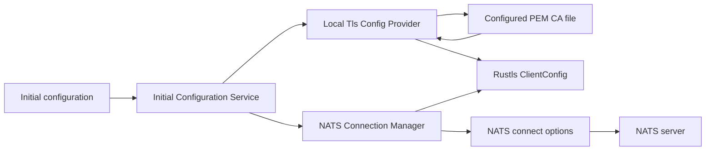
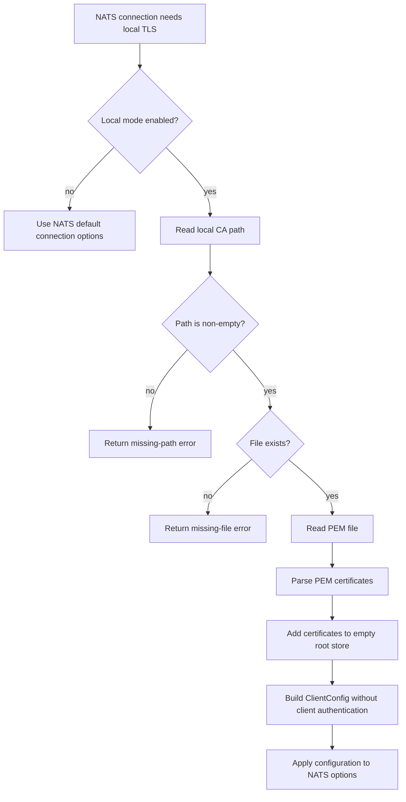
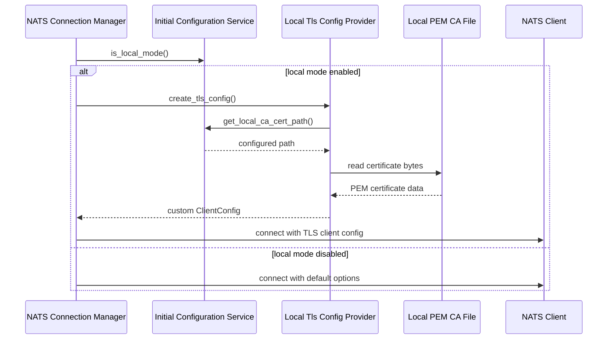

# Local Tls Config Provider

Local Tls Config Provider builds the Rust TLS client configuration used by the OpenFrame client agent when it runs in local development mode. It reads an explicitly configured local certificate-authority file, parses every PEM certificate in that file, and makes those certificates the complete trust store for the agent's NATS connection. It does not expose an API endpoint, persist certificates, or alter the normal production trust path.

The implementation is supplied by the `openframe_agent_lib` artifact from OpenFrame OSS Library and is executed by this repository's OpenFrame client workload. Its source is [local_tls_config_provider.rs](https://github.com/flamingo-stack/openframe-oss-lib/blob/16e7c1cbd9664e7d10ec5ebca7d53c9bd314decf/clients/openframe-client/src/services/local_tls_config_provider.rs).

## Responsibilities and Boundaries

| Responsibility | Behavior |
|---|---|
| Resolve local trust material | Obtains `local_ca_cert_path` through `InitialConfigurationService`. |
| Validate configuration | Rejects an empty path and a path that does not exist before reading it. |
| Build a custom trust store | Reads the selected file, parses PEM certificates, and adds each parsed certificate to an initially empty Rustls root store. |
| Produce connection configuration | Creates a Rustls `ClientConfig` with the custom root store and no client certificate authentication. |
| Limit scope to local mode | The NATS connection manager invokes configuration creation only when `local_mode` is enabled. |

The provider trusts only the PEM certificates loaded from the configured file. Because the root store starts empty, this configuration does not merge in platform or web-PKI roots. It also configures server-certificate validation roots rather than mutual TLS credentials: `with_no_client_auth()` means no client certificate is presented by this component.

## Architecture

The agent's persisted initial configuration carries both the local-mode switch and the path to the development CA. `NatsConnectionManager` owns a Local Tls Config Provider and conditionally applies its result to `async_nats::ConnectOptions` before connecting.



### Runtime Dependencies

| Component | Relationship to Local Tls Config Provider |
|---|---|
| `InitialConfigurationService` | Constructor dependency. Its `get_local_ca_cert_path()` method returns the persisted certificate path; its local-mode state is checked by the connection manager. |
| `InitialConfiguration` | Defines persisted `local_mode` and `local_ca_cert_path` fields. Both default safely when omitted during deserialization, but an unset path prevents TLS configuration creation. |
| `NatsConnectionManager` | Constructs and retains the provider, then calls `create_tls_config()` only for a local-mode NATS connection. It installs the returned configuration on the connection options. |
| `async_nats::rustls` | Supplies `ClientConfig` and `RootCertStore`, making the generated configuration compatible with the NATS client. |
| `rustls_pemfile` | Parses one or more PEM certificates from the configured file. |

The standard HTTP-client factory is separate from this path. It creates an HTTP client with a caller-provided invalid-certificate policy, whereas Local Tls Config Provider builds a NATS-specific Rustls configuration with an explicit trust anchor.

## Component Design

### Local Tls Config Provider

`LocalTlsConfigProvider` is a cloneable wrapper around `InitialConfigurationService`. It contains no certificate cache and no mutable trust state. Each `create_tls_config()` call resolves the current configured path and reconstructs a fresh `ClientConfig`, so changes to persisted configuration are observed by later calls.

### Constructor

`new(initial_configuration_service)` stores the configuration service dependency. It performs no file-system access, configuration validation, or certificate parsing. Errors are therefore deferred until configuration creation is requested.

### Certificate Path Resolution

The internal path-resolution step performs the following checks:

1. Read `local_ca_cert_path` through `InitialConfigurationService`.
2. Propagate an error if initial configuration cannot be read.
3. Reject an empty configured value.
4. Convert the value to a path and reject it if it does not exist.
5. Return the original configured string for file loading.

The existence check does not guarantee that the path is a readable regular PEM file. Readability, content format, and certificate validity are assessed by subsequent operations.

### TLS Configuration Creation

`create_tls_config()` reads the resolved path as bytes, places those bytes in an in-memory cursor, and asks the PEM parser for certificates. Every returned certificate is inserted into an empty `RootCertStore`. Finally, it builds a `ClientConfig` using that store and disables client authentication.



## Connection Interaction

The provider is not a background service. Its work occurs synchronously while `NatsConnectionManager::connect()` prepares its connection options. A successful result is passed to the NATS library; the provider itself neither opens a socket nor performs a TLS handshake.



## Failure Behavior and Diagnostics

Failures are returned as contextual `anyhow` errors to the NATS connection manager. The manager adds a higher-level context indicating that development TLS configuration could not be created, so connection setup fails before a NATS client is established.

| Failure point | Result |
|---|---|
| Initial configuration cannot be read | Path resolution fails with context identifying initial configuration access. |
| `local_ca_cert_path` is empty | Configuration creation fails with an explicit missing-path error. |
| Configured path does not exist | Configuration creation fails and reports the configured path. |
| Certificate file cannot be read | Configuration creation fails with the certificate file path in the read context. |
| PEM parsing fails | Configuration creation fails with certificate parsing context. |
| A parsed certificate cannot be added | Configuration creation fails with root-store insertion context. |
| TLS handshake fails after creation | The NATS client reports the connection failure; the provider has already returned its configuration. |

The provider emits informational tracing events while resolving the configured development CA path and while creating the configuration. These events identify the certificate path, so deployment logs should be treated according to the sensitivity of local filesystem layout.

## Configuration Contract

Local Tls Config Provider relies on the following persisted initial-configuration fields:

| Field | Required when local mode is used | Meaning |
|---|---|---|
| `local_mode` | Yes | Enables the connection manager's custom TLS branch. |
| `local_ca_cert_path` | Yes | Filesystem path to a readable PEM file containing one or more CA certificates. |

A representative configuration shape is shown below. The path is illustrative only; deployment tooling must supply a path that exists on the agent host.

```json
{
  "local_mode": true,
  "local_ca_cert_path": "/path/to/development-ca.pem"
}
```

## Operational Considerations

- Configure the CA file before starting an agent that uses local mode. The provider has no fallback to system roots when the path is absent or invalid.
- Include the CA certificate chain required to validate the local NATS server. Multiple PEM certificates are supported because all parsed certificates are added to the root store.
- Ensure the account running the agent can read the configured path. Existence alone is not sufficient.
- Restart or reconnect the client after replacing trust material. A previously established NATS connection continues using the TLS session already created; a later `connect()` call builds a fresh configuration.
- Do not enable `local_mode` in a deployment that expects public or platform trust roots unless the configured PEM file explicitly contains the required roots.

## Maintenance Guidance

When changing this module, preserve the distinction between development-only trust configuration and the default connection path. In particular, assess changes for these security properties:

1. The configured CA path must remain explicit and validated before use.
2. The trust store must not silently widen unless that is an intentional, reviewed product decision.
3. Errors must retain enough context to identify whether configuration access, file access, parsing, root-store construction, or later NATS connection setup failed.
4. Any introduction of client certificates must be designed separately, because the current configuration deliberately uses no client authentication.

No module-specific tests were supplied with the available component set. Suitable tests should cover an empty path, a missing file, unreadable or malformed PEM data, a valid single-certificate file, and a valid multi-certificate bundle.