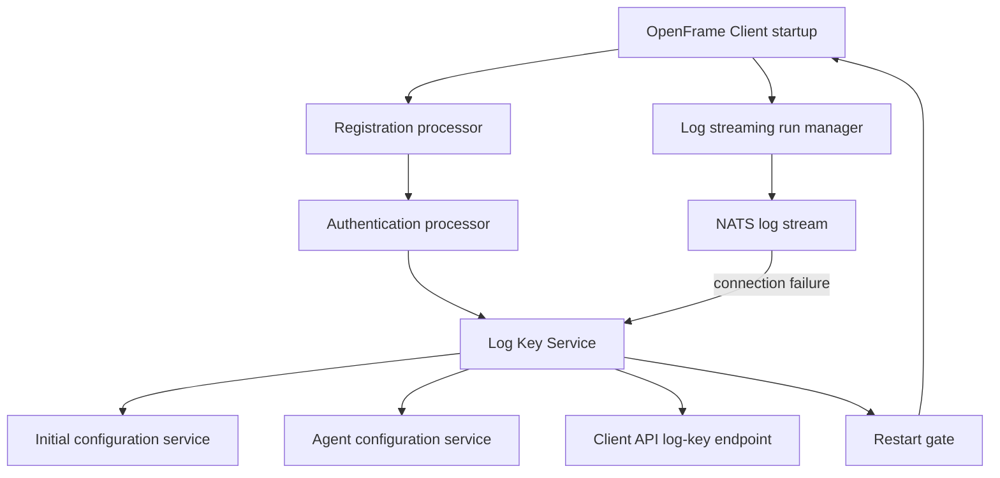
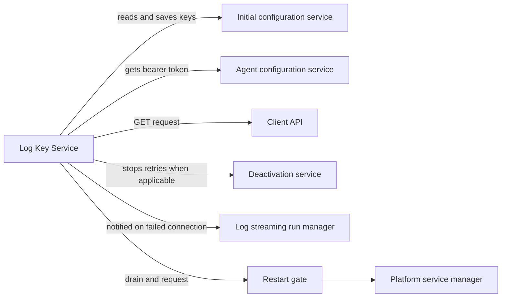
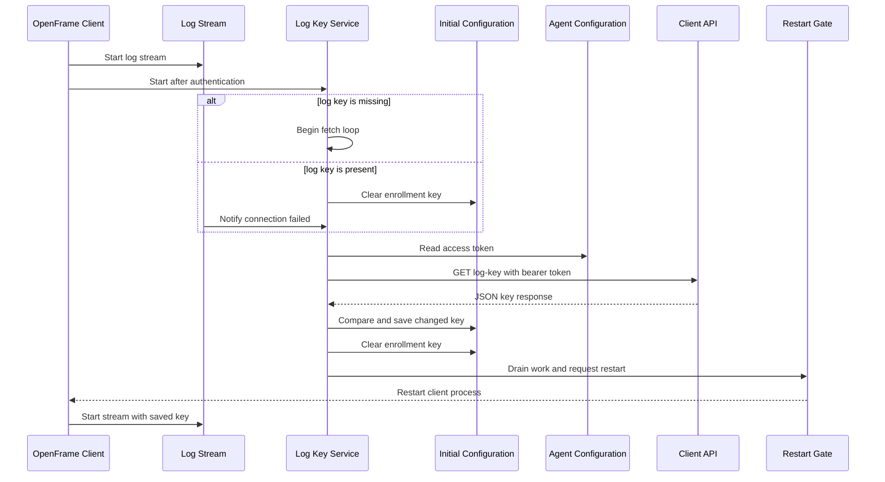
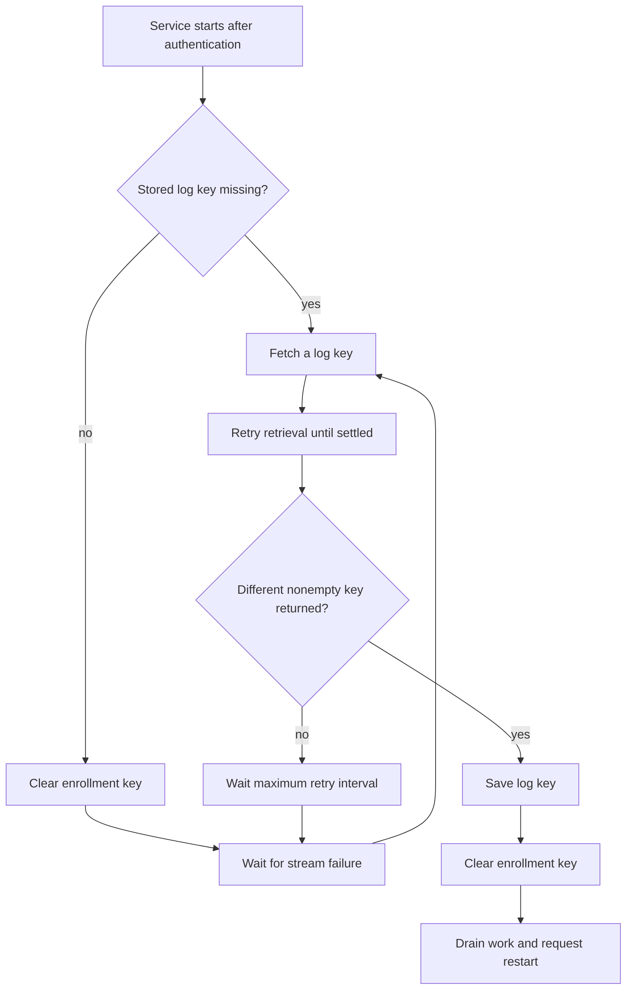

# Log Key Service

The Log Key Service is an OpenFrame Client background worker that obtains and rotates the per-tenant credential used by the agent log stream. It runs on managed devices after registration and authentication, persists a replacement key only when it differs from the stored value, removes the no-longer-needed enrollment key, and requests a safe client restart so log streaming can start with the new credential.

The implementation is supplied by the OpenFrame OSS Library as part of the `openframe_agent_lib` Cargo dependency. The tenant repository assembles and runs it through the OpenFrame Client service. The source implementation is [`log_key_service.rs`](https://github.com/flamingo-stack/openframe-oss-lib/blob/16e7c1cbd9664e7d10ec5ebca7d53c9bd314decf/clients/openframe-client/src/services/log_key_service.rs).

## Responsibilities

- Detect whether the persisted configuration has no log-stream key.
- Call `GET /clients/agent/log-key` with the registered agent's bearer access token.
- Validate that a successful response contains a nonempty `key` field.
- Retry failed retrievals using a 30-second initial delay and a maximum 10-minute delay, while respecting device deactivation.
- Persist a new key atomically through the initial-configuration service.
- Avoid restarting when the server returns the already-stored key.
- Clear the enrollment key after a device has a usable log key.
- Wait for an explicit log-stream connection failure before attempting replacement of an existing key.
- Request a drained restart after a changed key is saved, because the log stream reads its key only during startup.

## Position in the Client

The client initializes the log streaming run manager before registration and authentication. After authentication succeeds, it starts the Log Key Service because key retrieval requires the agent access token. The log streaming manager receives the same service instance and signals it when a stream connection attempt fails.

## Main Components

| Component | Role |
|---|---|
| `LogKeyService` | Holds the HTTP client, API base URL, configuration services, deactivation state, retry timing, and a notification used for stream failures. |
| `new` | Creates a service with the fixed retry policy: 30 seconds initially, capped at 600 seconds. |
| `start` | Spawns the background worker and asks the restart gate to drain and restart after the worker saves a different key. |
| `connect_failed` | Receives a failure signal from log streaming and wakes one waiter so the worker can obtain a replacement key. |
| `run` | Selects the initial retrieval or failure-driven renewal path, retries retrieval, saves changed values, and coordinates subsequent waits. |
| `fetch_log_key` | Performs the authenticated API request, limits returned error-body logging to 200 characters, parses the response, and rejects empty keys. |

## Dependencies and Boundaries

### Initial Configuration Service

The Log Key Service reads the log key with `get_log_key`, writes a replacement using `save_log_key`, and calls `clear_initial_key` after a device has an available log key. The configuration service serializes read-modify-write updates, preventing concurrent configuration changes from losing fields.

The enrollment key is intentionally removed only after the service considers the log-key state usable. Failure to clear it is logged as a warning and does not invalidate the saved log key or halt processing.

### Agent Configuration Service

Before contacting the backend, the worker asynchronously obtains the agent access token. It uses that token exclusively in an `Authorization: Bearer` request header; the log key itself is received in the response body and is not included in the request URL.

### Log Streaming and Restart Coordination

The log stream starts before authentication because it is established during client startup. The Log Key Service bridges that timing gap:

- If the configured log key is missing, it fetches a key as soon as it starts after authentication.
- If a key already exists, it clears the enrollment key and waits for the log stream to report a failed connection.
- Once a different key is persisted, `start` invokes `drain_and_request` on the restart gate. This permits ongoing guarded work to drain before the client performs its detached restart handoff.

## Retrieval and Renewal Flow

## State and Decision Flow

A response matching the persisted key is not treated as a rotation. The worker logs that condition, waits for the maximum retry interval, then waits for another connection-failure signal before making another attempt. A local persistence error is logged and follows the same wait-and-retry path.

## Failure Handling

| Condition | Behavior |
|---|---|
| Transport failure, token lookup failure, or unsuccessful HTTP response | The retry helper retries with bounded backoff and deactivation awareness. |
| Non-success API response | The error includes the HTTP status and at most 200 characters of the response body. |
| Invalid JSON or missing response field | Retrieval fails and enters the retry policy. |
| Empty `key` value | Explicitly rejected before persistence. |
| Unchanged key | No restart; wait before responding to a later stream-failure signal. |
| Cannot save the key | Log an error and continue the renewal loop. |
| Cannot clear enrollment key | Log a warning; do not discard the valid log key or block restart. |
| Deactivation in progress | The retry operation is governed by the deactivation service rather than continuing uncontrolled backend calls. |

## Operational Notes

- The endpoint is formed by appending `/clients/agent/log-key` to the configured base URL. Ensure the base URL is configured without an unintended trailing path segment.
- The service deliberately does not expose the fetched key in normal informational logs. Maintain that property when extending diagnostics or error reporting.
- A key update requires a restart by design. Changing live stream behavior without also changing the stream initialization contract could leave it using stale credentials.
- A single `Notify` wake-up is used for each reported stream failure. Failure reporters should call `connect_failed` when a connection attempt fails, rather than polling the key endpoint.

## Maintenance Guidance

When changing this module, preserve these invariants:

1. Authentication must complete before attempting retrieval, because the endpoint is accessed with the agent access token.
2. Persist only a nonempty key that differs from the stored value.
3. Do not request a restart for an unchanged key.
4. Remove the enrollment key only after a registered device has an established log-key path.
5. Continue to route restarts through the restart gate so script execution, tool operations, package upgrades, and client updates can drain safely.
6. Keep error-body truncation and avoid logging credentials.
