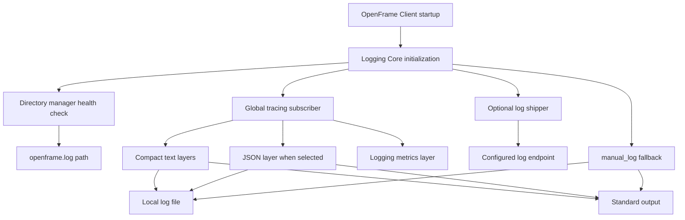
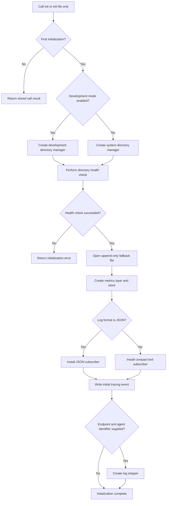
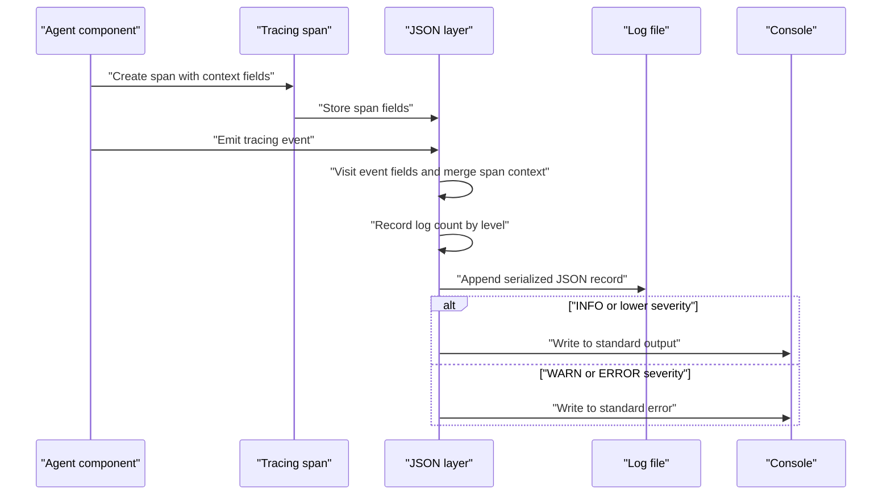

# Logging Core

Logging Core initializes the OpenFrame client agent's process-wide `tracing` subscriber, selects a durable log location, and makes log and metric state available to the rest of the agent. It is implemented in the OpenFrame OSS Library's Rust client and is assembled into this repository through the `openframe_client` artifact. The implementation source is [logging module](https://github.com/flamingo-stack/openframe-oss-lib/blob/7a766f00e4f58b5d89db007b878ac8d6e0c344f4/clients/openframe-client/src/logging/mod.rs).

The module supports compact text output by default and structured JSON output when `OPENFRAME_LOG_FORMAT` is set to `json`. In either format, it writes to the agent log file, registers log metrics, and provides a direct-write fallback for failures in the normal tracing path.

## Responsibilities

- Initialize logging once for the lifetime of an agent process.
- Run the directory health check before opening the log file.
- Resolve `openframe.log` under the system log directory, or the user log directory in development mode.
- Configure a `tracing` filter from the environment, with `info,async_nats=warn` as the fallback.
- Emit compact text logs by default, or enriched JSON records when requested.
- Collect log-level counter metrics through the logging metrics layer and expose its shared metrics store.
- Optionally initialize log shipping when both a log endpoint and an agent identifier are provided.
- Preserve a file handle for `manual_log` so critical fallback messages can be appended and flushed directly.

## Position in the Client Agent

Logging Core is an infrastructure boundary rather than a business feature. It is expected to run early, before the agent starts listeners, command handlers, network clients, or platform services. After initialization, any component using `tracing` shares the configured subscriber and can write to the same local log.

The directory and shipping facilities are separate OpenFrame client logging and platform components. Logging Core coordinates their use but does not parse, rotate, source, or transmit batches itself.

## Public Surface

| Component | Purpose |
| --- | --- |
| `init` | Initializes the full logging configuration, including console output for text format. Accepts optional shipping endpoint and agent identifier. |
| `init_file_only` | Uses the same initialization path but suppresses the text-format standard-output layer. It is intended for contexts that should write only to the local file. |
| `manual_log` | Appends and flushes a single text line using the retained fallback file handle, then prints the line to standard output. |
| `get_log_file_path` | Derives the `openframe.log` path from a `DirectoryManager` and the development-mode setting. |
| `get_metrics_store` | Returns the shared metrics store installed during initialization, if initialization has completed. |
| `JsonLayer` | A custom `tracing` layer that serializes events to JSON, preserves active span fields, and writes events to the file and a console stream. |

## Initialization Lifecycle

`init` and `init_file_only` delegate to one internal path guarded by `std::sync::Once`. Consequently, initialization is attempted only once per process: later calls do not replace the subscriber, log destination, format, filter, metrics store, or shipping configuration.

### Directory and file selection

The module creates a `DirectoryManager` in one of two modes:

- When `OPENFRAME_DEV_MODE` exists, it uses `DirectoryManager::for_development()` and targets the user log directory.
- Otherwise, it uses `DirectoryManager::new()` and targets the system log directory.

In both modes the file name is `openframe.log`. The directory health check must succeed before the fallback file or subscriber file writer is opened. This ensures the selected directory is usable before emitting normal agent logs.

### Filter and output selection

The subscriber filter is read through `EnvFilter::try_from_default_env()`. If the environment does not supply a usable filter, Logging Core uses `info,async_nats=warn`.

`OPENFRAME_LOG_FORMAT` controls the renderer:

| Value | Renderer | File behavior | Console behavior |
| --- | --- | --- | --- |
| Unset or any value other than `json` | Standard `tracing_subscriber` compact formatter | Appends compact, single-line records through a non-blocking writer. | Emits compact records unless `init_file_only` was used. |
| `json`, case-insensitive | `JsonLayer` | Appends one serialized JSON object per event and flushes after each write. | Sends `INFO` and lower-severity events to standard output, and higher-severity events to standard error. |

The non-blocking text writer is configured as non-lossy and its `WorkerGuard` is retained globally. Keeping the guard alive is necessary for the background writer to continue draining events.

## Structured Event Model

In JSON mode, `JsonLayer` visits event fields and creates a record containing timing, source, execution, message, error, and contextual data.

| JSON field | Source |
| --- | --- |
| `timestamp` | UTC timestamp with microsecond precision. |
| `level` | Event metadata level. |
| `target` | Event target. |
| `module_path`, `file`, `line` | Optional source metadata from the event. |
| `thread` | Current thread identifier. |
| `message` | The `message` tracing field. |
| `error` | The `error` tracing field when recorded as a string. |
| Additional context | All other event fields plus fields inherited from active spans. |

Span fields are saved when a span is created. When an event occurs, Logging Core merges enclosing span fields from root to leaf and then applies the event's own fields. Therefore, event fields take precedence over context with the same key. This lets a scoped identifier such as `tool_id` accompany every event within its span without repeating it in each call.

## Metrics

Initialization constructs a `MetricsLayer` and stores its `MetricsStore` in process-global state. Callers can retrieve that store through `get_metrics_store` after successful setup. The logging subsystem's metrics API supports counters, gauges, and histograms; the shared store is designed for in-process inspection by agent code.

The custom JSON layer also records a `log_count` counter labeled with the event level when it can obtain a write lock without waiting. Metrics collection is intentionally non-blocking at this point: if the lock cannot be acquired, the log event can still be written.

## Fallback Logging

`manual_log(level, message)` exists for paths where the standard subscriber is unavailable or unsuitable. It builds a UTC, microsecond-precision, single-line text record with a `manual` target; then it attempts to append and flush it through the global fallback file handle. It also prints the same record to standard output so a service host can capture it.

The fallback handle is installed before the subscriber. If it is not available or its lock cannot be acquired, `manual_log` still attempts console output. The JSON layer deliberately does not invoke this fallback after its own writes, avoiding duplicate records.

At the end of successful initialization, Logging Core emits an initial tracing event. The normal initialization mode additionally calls `manual_log` with an initialization message; this produces an explicit fallback-path confirmation alongside the subscriber event.

## Optional Shipping and Adjacent Logging Components

When both arguments to `init` are present, Logging Core creates a `LogShipper` with the endpoint and agent identifier. The module records that shipping was initialized but delegates batching, delivery, retry behavior, and remote protocol details to the shipping component.

The wider client logging subsystem is divided into focused components:

| Concern | Component family | Relationship to Logging Core |
| --- | --- | --- |
| Parsing and deduplication | Log Parser | Interprets log lines and produces entries or batches. |
| Reading and delivery acknowledgements | Log Source | Coordinates registered sources and commits or rolls back reads. |
| Rotation and offsets | Log Rotation | Manages readiness checks and persisted offsets. Rotation is intentionally handled by the streaming manager so logs are streamed before rotation. |
| Metric collection | Logging Metrics | Supplies the metrics layer and metrics store initialized here. |
| NATS delivery | NATS Streaming | Manages the log-streaming run loop and NATS connection. |
| Shipping | Shipping | Receives optional setup from Logging Core and sends batches. |

## Operational Considerations

- Call initialization before spawning normal agent work. The global subscriber can be installed only once.
- Choose `OPENFRAME_LOG_FORMAT=json` only for consumers that expect one JSON object per line. The default compact text format is optimized for human-readable single-line output.
- Use `init_file_only` when compact text logs must not be mirrored to standard output. JSON output follows `JsonLayer` stream routing.
- Configure a valid endpoint and agent identifier together when remote log shipping is desired; supplying only one does not create a shipper.
- Treat direct fallback logging as an emergency path. It is synchronous, flushes per message, and is less suitable than ordinary tracing for high-volume events.
- Avoid logging sensitive configuration, credentials, or tokens. JSON context includes arbitrary tracing fields and span fields, so every field added to a span may be persisted and shipped.

## Source and Runtime Provenance

Logging Core runs in the OpenFrame client agent included by this repository. Its implementation is supplied by the OpenFrame OSS Library rather than a source file in this repository. The tenant service repository consumes `openframe_agent_lib` version `v0.0.5` and OpenFrame OSS Library components pinned at version `7.0.11`; the exact implementation documented here is the linked library revision in the source header.
