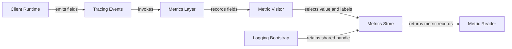
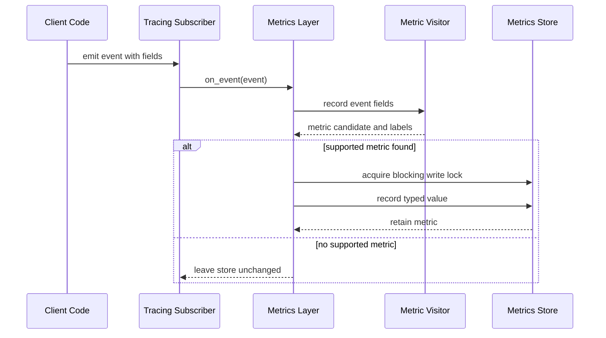
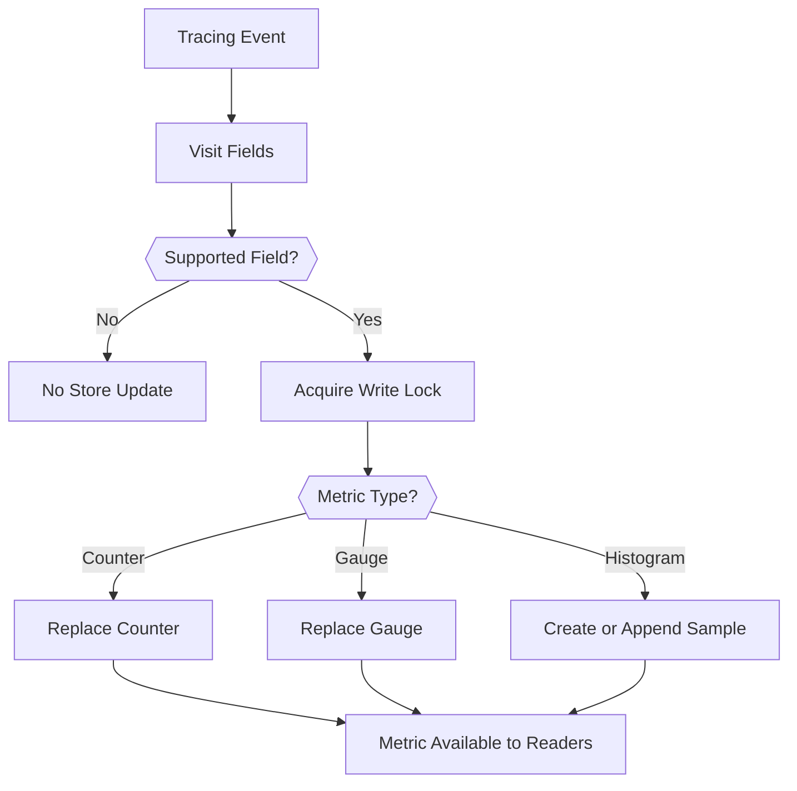

# Logging Metrics

Logging Metrics is the Rust OpenFrame client's in-process metric capture layer. It is implemented by the OpenFrame OSS Library's `openframe_client` code and is run by this repository's client service. The module translates selected `tracing` event fields into a shared, lock-protected metrics store; it does not persist, export, or transmit metrics.

The implementation is in [metrics.rs](https://github.com/flamingo-stack/openframe-oss-lib/blob/7a766f00e4f58b5d89db007b878ac8d6e0c344f4/clients/openframe-client/src/logging/metrics.rs).

## Responsibilities

Logging Metrics provides:

- three metric value forms: counters, gauges, and histograms;
- a name-keyed in-memory `MetricsStore`;
- a `MetricsLayer` that observes `tracing` events; and
- an `Arc<RwLock<MetricsStore>>` handle shared with metric readers.

It is distinct from the client logging bootstrap, log parsing, log rotation, log shipping, and NATS log streaming. Those components handle logs or setup, while Logging Metrics only captures values in the local process.

## Architecture

`MetricsLayer::new` returns the layer and the shared store together. The logging bootstrap may retain the store when installing the layer, and its `get_metrics_store` accessor returns the configured shared handle when available.

## Core Components

| Component | Purpose |
|---|---|
| `MetricValue` | Represents `Counter(u64)`, `Gauge(f64)`, or `Histogram(Vec<f64>)`. |
| `Metric` | Holds a metric name, value, labels, and UTC timestamp. Its fields are private to the module. |
| `MetricsStore` | Owns the `HashMap<String, Metric>` registry and recording operations. |
| `MetricsLayer` | Implements the tracing subscriber `Layer` interface and writes extracted values. |
| `MetricVisitor` | Internal visitor that extracts one supported metric field and debug-formatted labels. |

### Store Semantics

The store is keyed only by metric name. Labels are preserved as metadata, but do not create independent time series.

| Method | Result |
|---|---|
| `record_counter` | Replaces any metric under the name with a counter and a new UTC timestamp. |
| `record_gauge` | Replaces any metric under the name with a gauge and a new UTC timestamp. |
| `record_histogram` | Creates a histogram on first use, then appends samples to its value vector. |
| `get_metrics` | Returns references to all stored records; order is unspecified because the backing store is a hash map. |

A histogram retains the labels and timestamp from its first sample. Adding samples does not refresh them. If a counter or gauge already uses a name, histogram recording does not convert that record or append the sample. Recording a counter or gauge under a histogram name does replace the histogram and discards its samples.

## Event Contract

The visitor recognizes only the following exact tracing field names:

| Field | Accepted value | Stored name | Stored type |
|---|---|---|---|
| `counter` | `u64` | `counter` | Counter |
| `gauge` | `f64` | `gauge` | Gauge |
| `histogram` | `f64` | `histogram` | Histogram sample |

After a supported field is seen, debug-recorded fields are added as labels. Each value is stored using Rust debug formatting. The module does not derive a custom metric name from event metadata, enforce label cardinality, calculate histogram summaries, or evict old data.

`MetricVisitor` stores one candidate metric. Events should therefore contain one supported metric field. If an event contains multiple supported fields, the most recently visited supported field replaces the earlier candidate. Similarly, a debug field visited before a supported metric field is not retained as a label.

## Processing Flow

1. Client logging setup constructs `MetricsLayer` and obtains the paired shared store.
2. A tracing subscriber invokes `on_event` when runtime code emits an event.
3. `MetricVisitor` examines the event fields and returns a candidate only when it finds a recognized field.
4. The layer takes a write lock and delegates counter, gauge, or histogram handling to `MetricsStore`.
5. A holder of the shared store can take a read lock and call `get_metrics`.

## Concurrency and Operations

- `Arc<RwLock<MetricsStore>>` permits multiple consumers in the same client process.
- `on_event` is synchronous and calls `blocking_write`; write-lock contention can delay the thread processing a tracing event.
- Histogram vectors grow for the lifetime of the store. There is no capacity limit, downsampling, reset, expiry, or export mechanism.
- A counter is assigned, not incremented. Producers calculate the value that should be retained.
- Labels cannot distinguish values that share a name. Use distinct names for independent retained values under the present design.
- `Metric` metadata is module-private. Consumers can obtain a collection of records but cannot directly read names, labels, timestamps, or values without a new public accessor.

## System Fit

The client-wide metrics bootstrap currently logs its initialization and does not configure this store. Permission monitoring independently exposes permission error, fix, and last-check values. The repository's tenant deployment includes NATS, Kafka, and stream processing, but Logging Metrics has no direct network client. Remote delivery requires a separate consumer or exporter.

## Maintenance Guidance

1. Keep event capture separate from any exporter or remote transport.
2. Treat names and labels as an API: changing the map key to include labels changes the retention model.
3. Add explicit memory controls before recording high-frequency histogram samples.
4. Emit one supported metric field per event unless the visitor is redesigned to accumulate multiple metrics.
5. Add public read models if a consumer needs metric metadata; the current structure intentionally keeps it private.

The implementation is owned by the OpenFrame OSS Library dependency. Behavior changes belong in that library and are consumed by this repository through the pinned `openframe_agent_lib` artifact.

## Source Reference

- [Logging Metrics implementation](https://github.com/flamingo-stack/openframe-oss-lib/blob/7a766f00e4f58b5d89db007b878ac8d6e0c344f4/clients/openframe-client/src/logging/metrics.rs)
- OpenFrame OSS Tenant repository: [flamingo-stack/openframe-oss-tenant](https://github.com/flamingo-stack/openframe-oss-tenant)
