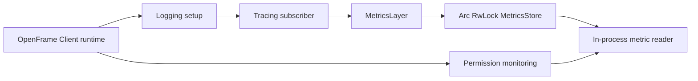
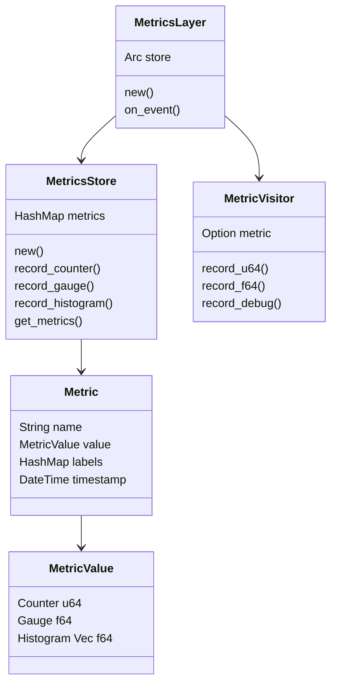
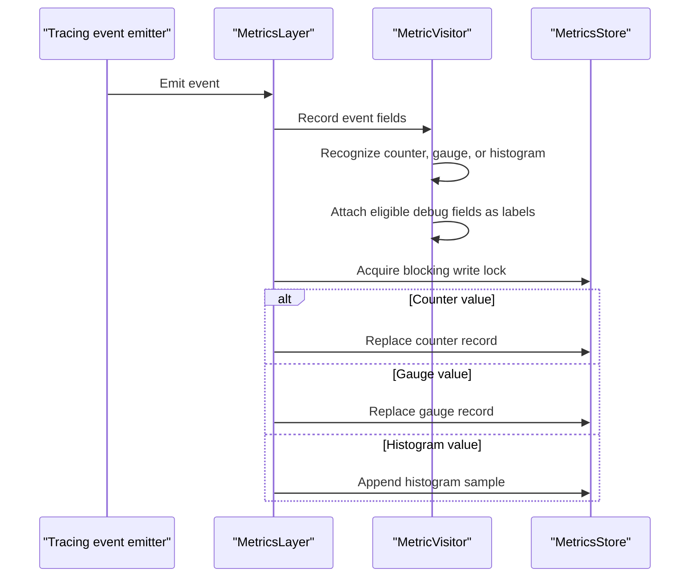
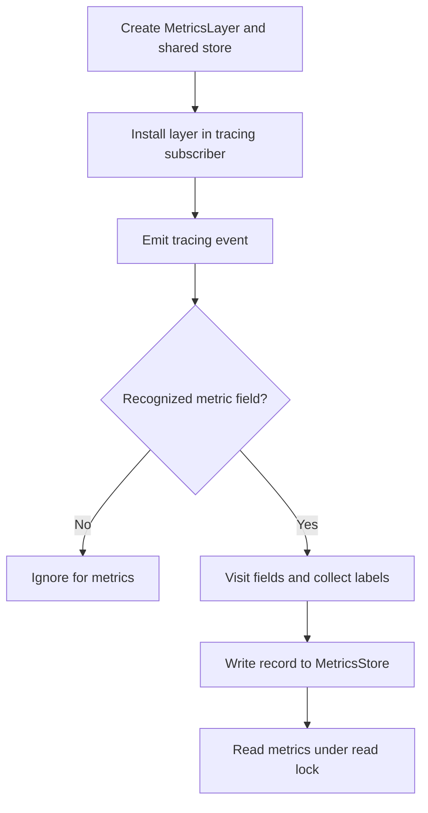

# Logging Metrics

Logging Metrics is the in-process metric capture layer used by the Rust OpenFrame Client. It translates selected `tracing` event fields into an asynchronously shared `MetricsStore`, allowing the running client to retain the latest counters and gauges plus collected histogram samples. The implementation belongs to the `openframe_agent_lib` artifact from OpenFrame OSS Library and is executed by this repository's OpenFrame Client deployment.

The implementation is in the upstream [metrics source](https://github.com/flamingo-stack/openframe-oss-lib/blob/16e7c1cbd9664e7d10ec5ebca7d53c9bd314decf/clients/openframe-client/src/logging/metrics.rs). This module is a capture and storage mechanism: the supplied code does not expose metrics over HTTP, serialize them, or export them to an external monitoring backend.

## Responsibilities

- Provide three metric value forms: `Counter(u64)`, `Gauge(f64)`, and `Histogram(Vec<f64>)`.
- Store metric metadata: name, value, labels, and creation timestamp.
- Create a `tracing_subscriber` layer and a shared `Arc<RwLock<MetricsStore>>` together.
- Inspect tracing fields named `counter`, `gauge`, or `histogram`.
- Write captured metric values under an exclusive Tokio read-write lock.
- Return a snapshot-like collection of references to all currently stored metrics through `get_metrics`.

## Position in the Client

Logging Metrics is part of the OpenFrame Client's logging namespace. It is designed to be attached during logging initialization, then made available to in-process consumers that hold the shared store returned by `MetricsLayer::new`.

The client module tree also contains Logging Setup, Metrics Integration, and Permission Monitoring components. They are adjacent integration points, but the supplied Logging Metrics source only defines the layer and store; it does not itself install the layer or schedule metric collection.

## Core Model

| Component | Role | Behavior |
| --- | --- | --- |
| `MetricValue` | Metric payload enum | Represents a counter as `u64`, a gauge as `f64`, or a histogram sample collection as `Vec<f64>`. |
| `Metric` | Stored metric record | Holds the internal name, current value, labels, and a UTC timestamp. Fields are private to the module. |
| `MetricsStore` | In-memory registry | Maps each metric name to one `Metric`. Provides explicit record and read operations. |
| `MetricsLayer` | Tracing integration | Implements `tracing_subscriber::Layer` and captures recognized event fields. |
| `MetricVisitor` | Event-field interpreter | Converts recognized numeric fields into a pending metric and attaches subsequent debug-formatted fields as labels. |

### Store semantics

The store is keyed only by metric name. `record_counter` and `record_gauge` replace the whole record already stored under that name; they do not increment or retain a time series. `record_histogram` creates a histogram on first use and appends each subsequent sample to its vector.

A histogram keeps the labels and timestamp created with its first insertion. Counters and gauges refresh both labels and timestamp whenever they are recorded. Since metrics are keyed by name rather than name-plus-label set, labels are metadata for the one stored record, not dimensions that create separate series.

## Event Capture Contract

`MetricsLayer::on_event` creates a fresh visitor and calls `event.record`. The visitor recognizes numeric fields by their exact field names:

| Field name | Accepted Rust value | Stored value | Stored metric name |
| --- | --- | --- | --- |
| `counter` | `u64` | `MetricValue::Counter` | `counter` |
| `gauge` | `f64` | `MetricValue::Gauge` | `gauge` |
| `histogram` | `f64` | `MetricValue::Histogram` containing one sample | `histogram` |

Other numeric field names are ignored. The implementation derives the metric name from the recognized field name; it does not read a separate custom-name field. Debug-recorded fields can become labels only after the visitor has established a metric tuple. Label values use Rust debug formatting, not a structured serialization format.

### Capture and storage flow

## Recording Behavior and Constraints

### Counters and gauges

`record_counter` and `record_gauge` insert a newly constructed `Metric` under the supplied name. An existing entry with the same name is replaced. Although the counter variant is named `Counter`, its method stores the provided absolute value rather than performing an additive increment.

### Histograms

`record_histogram` looks up the entry by name. When absent, it creates a record containing an empty histogram, initial labels, and the current UTC timestamp. It then appends the supplied sample when the existing value is a histogram. If an entry exists under the same name with a different value variant, the method leaves that entry unchanged.

When a tracing event carries a histogram value, `MetricsLayer` iterates its captured values and calls `record_histogram` for every sample. The current visitor produces one sample per recognized histogram field, but the loop accommodates a histogram value containing multiple samples.

### Concurrency

`MetricsLayer` is cloneable because it retains an `Arc` to a Tokio `RwLock`. Event handling uses `blocking_write`, so a tracing event obtains exclusive access synchronously before updating the store. Readers that retain the store handle should acquire an appropriate read lock before calling `get_metrics`.

`get_metrics` returns references to records rather than owned copies. Those references are only valid for the lifetime of the read guard that protects the store.

## Integration Lifecycle

The intended lifecycle is to construct the layer and store as one pair, install the layer in the process tracing subscriber, emit conforming events, and read the shared store from an in-process consumer.

A conceptual emitter must use a supported field name and numeric type. For example, a counter event must record `counter` as an unsigned 64-bit value; a gauge or histogram event must record the respective field as a 64-bit floating-point value. This is a behavioral description, not a public wire protocol or an assertion that all tracing macros accept identical field syntax.

## Operational Considerations

- **Unbounded histogram retention:** histogram samples remain in memory for the process lifetime unless a caller replaces the metric through another store operation. The supplied implementation has no capacity, rolling window, aggregation, or eviction policy.
- **Fixed metric keys:** events captured by this visitor use only `counter`, `gauge`, and `histogram` as storage keys. Repeated measurements of the same type overwrite counters and gauges, while histogram measurements accumulate in one vector.
- **Label collisions:** because the key excludes labels, a new counter or gauge record with the same name replaces previous labels. Histograms preserve the labels from their first creation.
- **Read-only exposure:** `Metric` fields are private, so consumers outside this module require an accessor or serialization mechanism that is not present in the supplied source to inspect metric details.
- **Synchronous event path:** `blocking_write` occurs inside the tracing layer callback. High event rates or long-held locks can make metric capture contend with writers and affect logging latency.

## Maintenance Guidance

When extending Logging Metrics, keep the capture contract, storage keying, and memory behavior aligned:

1. Add an explicit metric name field if measurements need separate named series rather than the three current type-derived keys.
2. Key storage by a stable combination of metric name and labels if labels are intended to represent independent dimensions.
3. Define a bounded histogram or aggregation strategy before using histograms for high-volume measurements.
4. Prefer non-blocking or carefully bounded work in the tracing callback if event throughput becomes material.
5. Add owned snapshot or export APIs before exposing the store across task or module boundaries, rather than returning references beyond a lock guard.

## Scope Boundary

Logging Metrics captures client-process observations only. Log-file parsing, file rotation, file-source management, NATS log streaming, and log batch shipping are distinct logging responsibilities in the OpenFrame Client. The broader OpenFrame platform also contains client-side metric message and gateway metric facilities, but they are not invoked by the provided Logging Metrics implementation.
