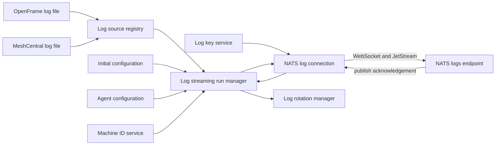
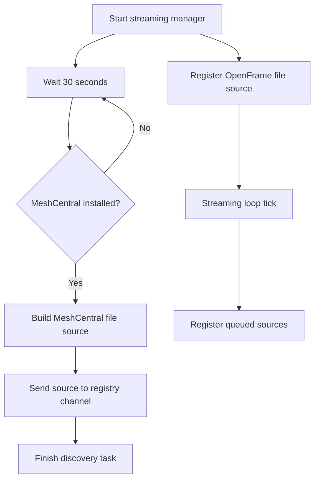
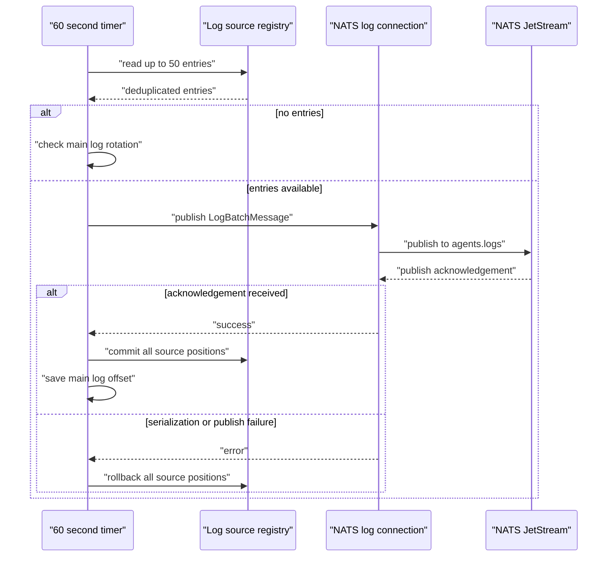

# Logging Nats Streaming

Logging Nats Streaming is the OpenFrame client agent's durable, best-effort log forwarding loop. It reads structured entries from the agent log and, once available, a discovered MeshCentral tool log; groups entries into bounded batches; and publishes each batch through NATS JetStream over a secure WebSocket endpoint. A batch is acknowledged before every source advances its read position, so a failed publish leaves the entries eligible for retry.

The implementation is supplied by the upstream OpenFrame OSS Library as part of the `openframe_agent_lib` Cargo artifact, which this repository consumes for its client runtime. The source of record is [nats_streaming.rs](https://github.com/flamingo-stack/openframe-oss-lib/blob/7a766f00e4f58b5d89db007b878ac8d6e0c344f4/clients/openframe-client/src/logging/nats_streaming.rs).

## Scope and Responsibilities

The module owns the delivery lifecycle after local logging has produced files. It does not configure the local tracing subscriber, parse every logging format, provision the remote endpoint, or persist received logs on the server. Its responsibilities are:

- Wait for a usable credential, preferring a device log key and falling back to the enrollment key.
- Derive the tenant domain, identify the device, and connect to the `wss` NATS logs endpoint.
- Attach tenant, credential, and machine identity headers during connection setup.
- Register the agent log immediately and discover the MeshCentral log source after installation.
- Read at most 50 entries across all registered sources every 60 seconds.
- Publish JSON batches to the `agents.logs` subject and wait for the JetStream publish acknowledgment.
- Commit source offsets only after an acknowledged publish, otherwise roll them back.
- Rotate the main agent log only after its already-streamed portion reaches the rotation threshold.

## Architecture

`LogStreamingRunManager` is the orchestrator. Its constructor reads the server host from initial configuration, removes an `api.` prefix to obtain the tenant domain, obtains a hostname through `DeviceDataFetcher`, selects the main log and protected offset paths through `DirectoryManager`, and obtains or creates the persistent machine ID.

`NatsLogConnection` is a focused transport wrapper. It creates an `async_nats` connection to `wss://{server host}/ws/nats-logs`, then wraps the connected client with a JetStream context. The wrapper serializes a `LogBatchMessage`, publishes it to `agents.logs`, and does not report success until the broker returns a publish acknowledgment.

## Credentials and Connection Identity

`LogStreamKey` makes the two permitted credentials explicit:

| Key variant | Connection header | Selection rule |
|---|---|---|
| `Log` | `x-log-key` | Used when the persisted log key exists and is nonempty. |
| `Initial` | `x-initial-key` | Used only when no usable log key is stored and the enrollment key is nonempty. |

Every connection also sends `x-tenant-domain` and the client machine-ID header. The agent polls every 10 seconds until one of the two keys is available. This avoids starting a connection with an empty secret while allowing log delivery before the device has received its dedicated log key.

The NATS client retries its initial connection. If a connection attempt fails, the run manager waits five seconds and tries again. Once connected, the client logs connection, disconnection, server-error, and client-error events. A client error invokes the log key service's connection-failure signal, allowing that service to react to authentication or connection failure. The log key service subsequently requests a client restart after it completes its own key-acquisition run, so a restarted client can reconnect using the newly available key.

## Source Registration and Discovery

The source registry begins with one `FileLogSource` for the agent's `openframe.log`. It tracks source-specific offsets and treats reading as provisional until the batch succeeds.

A separate asynchronous discovery task checks every 30 seconds for an installed tool whose identifier matches the MeshCentral source kind. Once found, it derives the MeshCentral log path from the application-support directory and registers a second `FileLogSource`. Discovery sends one source through a bounded channel and then exits; registration therefore occurs at most once during a streaming-manager lifetime.

The registry divides the remaining per-cycle capacity among active sources and guarantees at least one entry of progress where data is available. It deactivates a source for that cycle after an empty read or read error, then deduplicates the combined entries before returning them. This gives the dynamically added source a share of the 50-entry batch budget without allowing one file to monopolize a cycle.

## Batch Content and Delivery Flow

A `LogBatchMessage` contains the hostname, tenant domain, logs, and optional machine and organization IDs. Each parsed `LogEntry` has a level, timestamp, message, and an optional repetition count. Machine ID comes from agent configuration and organization ID comes from initial configuration; either field is omitted from JSON when unavailable or empty.

The loop reads on a 60-second interval. Before reading, it drains any newly discovered source from the channel. On an empty batch it does not publish and instead evaluates rotation readiness. On a nonempty batch it builds metadata at send time, publishes, and takes one of two paths:

1. **Acknowledged delivery:** all sources commit their provisional positions. The manager records the current size of the main log in the protected offset file.
2. **Failed delivery:** all sources roll back. The same entries remain available on the next cycle, prioritizing retry over loss.

The source abstraction also detects a file that became shorter than its stored position and resumes at position zero. This accounts for an externally truncated or replaced log file.

## Offset and Rotation Behavior

The main OpenFrame log uses a second offset managed by `LogRotationManager`. The manager loads it from a protected file, defaulting to zero if the file is absent or unreadable. After a successful main-log batch, it saves the main log's current file length.

When a cycle has no entries, the manager compares that recorded position with the current main-log length. It rotates only when all currently recorded bytes have been streamed and the file is at least the rotation threshold. A successful rotation resets the offset to zero. Read and write errors are logged rather than terminating the loop.

This rotation guard prevents deletion of unshipped main-log content. It applies to the main agent log path; the independently registered MeshCentral source maintains its own offset path.

## Operational Characteristics

| Concern | Behavior implemented by Logging Nats Streaming |
|---|---|
| Startup before log credentials | Polls until a nonempty log key or initial key is present. |
| Credential transition | Prefers a log key over an initial key at manager startup. A later key-service completion triggers a client restart. |
| Initial connection failure | Retries from the manager after five seconds. |
| Connection interruption | The NATS client has a five-second reconnect-delay callback and emits lifecycle errors. |
| NATS acknowledgement failure | Does not commit offsets and retries the entries on a future interval. |
| Empty files | Skips publishing and evaluates main-log rotation. |
| Tool installed after startup | Performs periodic MeshCentral discovery until it registers the source. |
| Read failure from one source | Logs the error and keeps other sources eligible within the same cycle. |

## Integration Boundaries

Logging Nats Streaming belongs to the agent-side logging pipeline and depends on neighboring logging components for parsing, source state, and rotation. It specifically relies on the log parser's `LogBatchMessage` and `LogEntry` contract, the source registry's read/commit/rollback semantics, and the rotation manager's main-log offset handling.

At the platform boundary, the module publishes only to the NATS logs WebSocket endpoint and `agents.logs` subject. The provided implementation does not define the server-side subscriber, retention policy, or downstream persistence mapping for that subject. Those pieces must be operated and documented with the platform's NATS and log-ingestion configuration rather than inferred from this client module.

The tenant deployment defined in this repository includes NATS as a datasource for the OpenFrame client service configuration. That service-level NATS connection is separate from this module's dedicated secure-WebSocket logs connection, which is established directly by `NatsLogConnection`.

## Maintenance Notes

- Preserve the acknowledgement-before-commit ordering when changing transport code. Reversing it can create log loss on failed publishes.
- Keep credential values out of diagnostics. Current connection messages identify only whether a log key or initial key is in use.
- If adding a source, provide independent durable cursor behavior through the `LogSource` contract so registry-wide rollback remains meaningful.
- Changes to batch size, interval, source discovery, key polling, or reconnect timing affect bandwidth, delay, and retry pressure. The current constants are 50 entries, 60 seconds, 30 seconds, 10 seconds, and five seconds respectively.
- The tenant domain normalization removes only a leading `api.` prefix. Changes to server URL conventions should review this derivation and the NATS endpoint route together.
