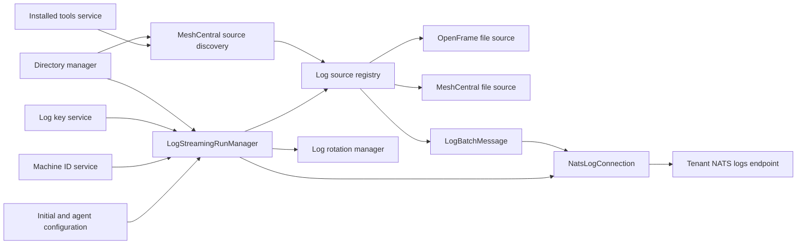
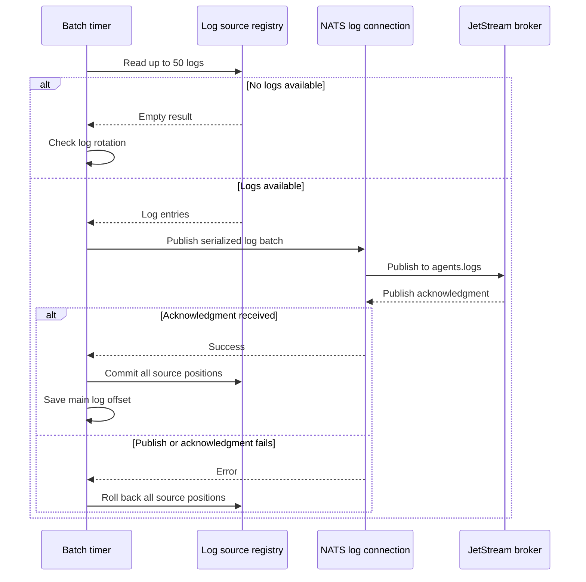
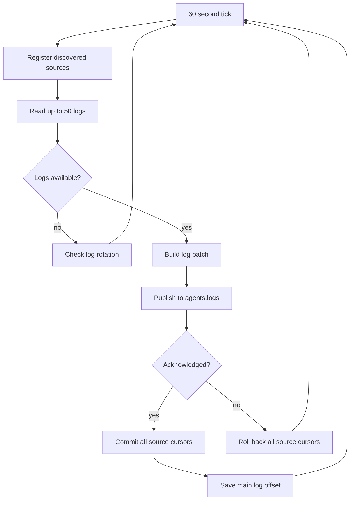

# Logging Nats Streaming

Logging Nats Streaming is the OpenFrame client agent's asynchronous log-export pipeline. It runs in the Rust client implementation supplied by the `openframe_agent_lib` dependency from the OpenFrame OSS Library, reads local agent and discovered tool logs, groups them into batches, and publishes acknowledged batches to NATS JetStream through the tenant logs WebSocket endpoint.

The implementation is in [the OpenFrame OSS Library source](https://github.com/flamingo-stack/openframe-oss-lib/blob/16e7c1cbd9664e7d10ec5ebca7d53c9bd314decf/clients/openframe-client/src/logging/nats_streaming.rs). This repository runs that client library as part of its OpenFrame Client deployment.

## Responsibilities

- Wait for a usable credential before opening the log stream.
- Connect to the tenant-scoped NATS logs endpoint over secure WebSocket transport.
- Attach tenant, device, and key identity headers to the NATS connection.
- Poll registered sources every 60 seconds and limit a publication to 50 log entries.
- Start with the OpenFrame agent log and discover the MeshCentral log source after MeshCentral is installed.
- Advance source read positions only when JetStream acknowledges the publish operation.
- Roll source positions back after a failed publication so the batch can be retried.
- Persist the main log's offset after a successful publication and coordinate log-file rotation.

## Position in the Client

The run manager owns the long-lived collection and delivery loop. It uses the client configuration and device services to establish the connection context, and it delegates source cursor behavior to the logging source and rotation components.



### Construction and startup

`LogStreamingRunManager::new` derives its runtime context from services already available to the agent:

| Input | Use in the module |
|---|---|
| Initial configuration service | Supplies the server address, stored log key or initial enrollment key, and organization identifier. |
| Agent configuration service | Supplies the optional registered machine identifier placed in each published batch. |
| Directory manager | Resolves the agent log location, the secured offset location, and the MeshCentral support directory. |
| Machine ID service | Gets or creates the machine identifier used in the NATS connection header. |
| Device data fetcher | Determines the hostname, falling back to `unknown` when it cannot be obtained. |
| Installed tools service | Enables delayed discovery of the MeshCentral log file. |
| Log key service | Is retained by the connection so client connection errors can signal key-refresh handling. |

`start` returns after spawning a Tokio task. That task first waits in ten-second intervals until it can choose a nonempty key, then retries the initial NATS connection every five seconds until successful. Consequently, agent startup is not blocked by unavailable logging credentials or a temporarily unreachable logs endpoint.

## Connection and credentials

`NatsLogConnection` wraps an optional async NATS JetStream context. Its `connect` method creates an `async_nats` connection to the following endpoint shape:

```text
wss://{server host}/ws/nats-logs
```

The connection is configured to retry its initial connection and wait five seconds between reconnect attempts. It emits diagnostic events for connection, disconnection, server errors, and client errors. A client error also invokes `LogKeyService::connect_failed`, allowing the surrounding key service to react to connection failures.

### Key selection

The module supports the device lifecycle before and after a dedicated logging credential becomes available. `choose_key` prefers a nonempty stored log key. If none is present, it uses a nonempty initial enrollment key. The selected variant determines both the authentication header and the logged credential kind:

| `LogStreamKey` variant | Header | When selected |
|---|---|---|
| `Log` | `x-log-key` | A stored log key is present. |
| `Initial` | `x-initial-key` | No usable log key is present and an initial key is available. |

Every connection also supplies `x-tenant-domain` and the client machine ID header. The tenant domain is derived by removing a leading `api.` from the configured server host; otherwise the configured host is retained.

> The module records the credential category in connection messages, not the credential value.

## Sources, batching, and delivery

At startup, `create_source_registry` registers a `FileLogSource` for the OpenFrame agent's `openframe.log` file. The source uses a cursor stored in the secured directory as `log_stream_offset`.

A separate Tokio task performs source discovery every 30 seconds. It queries installed tools for the MeshCentral tool identifier and only adds a MeshCentral source when the tool has an executable path. The added source reads the MeshCentral log in that tool's application-support directory and uses a separate secured cursor named `meshcentral_log_offset`. Discovery stops after the source is successfully sent to the streaming loop; the loop drains the channel and registers new sources before reading each batch.

The source registry is responsible for aggregating source reads and applying either `commit_all` or `rollback_all`. The NATS streaming module treats this registry as the delivery boundary: data is committed only after the broker acknowledges the publish.



### Batch contents

The module serializes a `LogBatchMessage` as JSON before publishing it to the `agents.logs` subject. A batch includes:

- `hostname`, captured when the run manager is constructed.
- `tenant_domain`, derived from the configured server host.
- `logs`, the entries returned by all registered log sources.
- Optional `machine_id`, read from agent configuration at each collection interval.
- Optional `organization_id`, read from initial configuration when it is nonblank.

The 50-entry limit applies to each registry read. Batches are considered delivered only after both the JetStream publish operation and its acknowledgment succeed.

## Processing loop and failure behavior

The collection loop ticks every 60 seconds. Its behavior is designed to avoid moving local read positions ahead of durable broker acceptance.



On an empty read, the loop invokes `rotate_if_ready` with the last known main-file position. After a successful batch, it obtains the current metadata length for the main agent log and persists that value through `LogRotationManager::save_offset`. The offset is initially restored through `load_offset`.

If serialization, publishing, or acknowledgment fails, the loop logs the error and rolls all sources back. It does not persist a new main-log offset. A later interval can therefore reread and retry the uncommitted data. Connection initialization similarly continues retrying after failures rather than terminating the background task.

## Operational considerations

- **Credential readiness:** If neither key is present, streaming remains in a ten-second wait loop. Verify agent enrollment and log-key provisioning when no connection is attempted.
- **Connection diagnosis:** Connection events identify the tenant and credential type. Client-error events additionally notify the log-key service.
- **Delivery semantics:** The source cursor advances after a broker acknowledgment, not merely after a publish request. Consumers should tolerate retries because a failed result triggers source rollback.
- **Source discovery:** MeshCentral logs are unavailable to this pipeline until the installed-tools record exists and reports an executable path. The module retries discovery every 30 seconds.
- **Volume control:** A maximum of 50 records per 60-second interval bounds individual batch size, but it also means sustained local log production can create a backlog.
- **Logging scope:** This module publishes the OpenFrame agent log and, when discoverable, the MeshCentral log. It does not itself configure log formatting or create the log files.

## Core types and methods

| Component | Role |
|---|---|
| `LogStreamKey` | Represents either the normal log key or initial enrollment key and maps it to the appropriate request header. |
| `NatsLogConnection::new` | Creates a connection holder with tenant, machine, credential, and key-service context. |
| `NatsLogConnection::connect` | Establishes the secure WebSocket NATS connection and initializes JetStream. |
| `NatsLogConnection::publish` | Serializes a log batch, publishes it to `agents.logs`, and waits for the broker acknowledgment. |
| `LogStreamingRunManager::new` | Collects paths, host identity, tenant context, services, and the persistent machine ID. |
| `LogStreamingRunManager::start` | Launches the asynchronous credential, connection, discovery, and batching workflow. |

## Boundaries

Logging Nats Streaming is transport orchestration rather than a general logging subsystem. It depends on the parsing, source-registry, rotation, configuration, key-management, installed-tools, and directory services provided by the same OpenFrame client library. It publishes to NATS JetStream and does not persist remote logs itself. Downstream storage, indexing, and presentation are handled outside this module.
