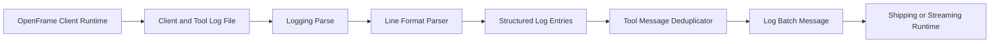
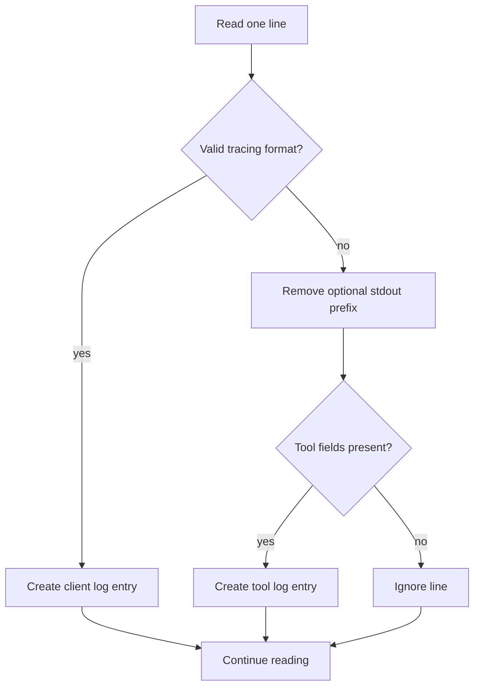
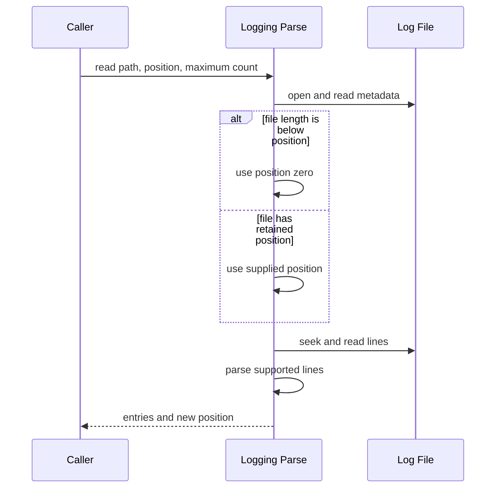
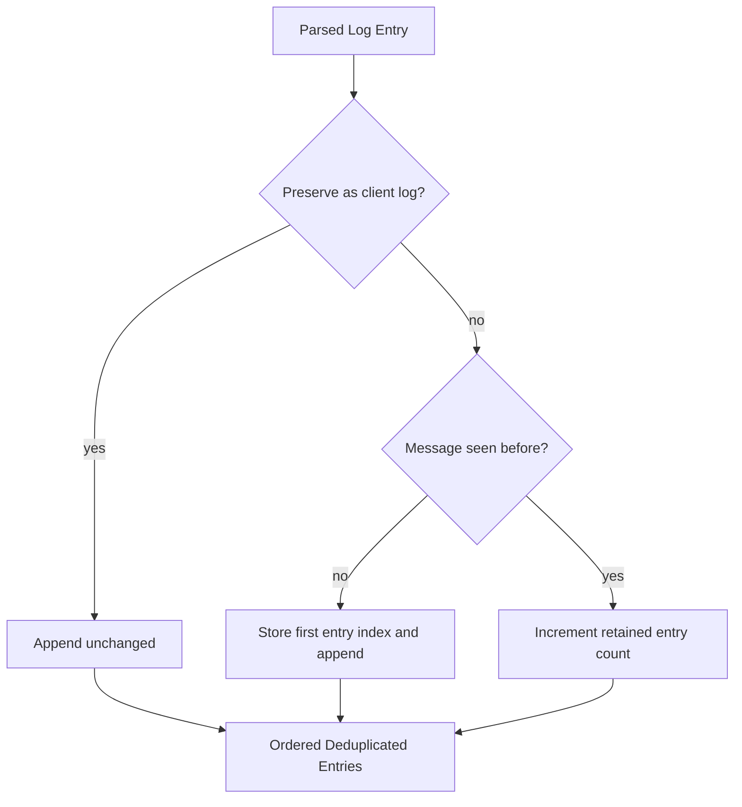
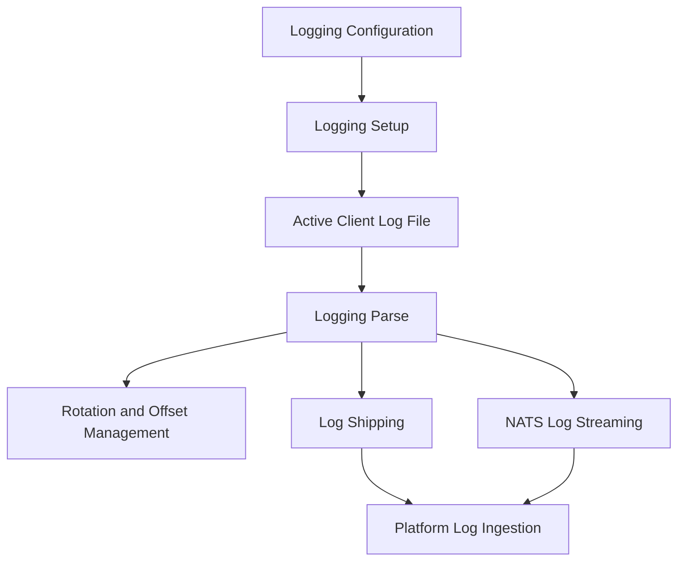

# Logging Parse

Logging Parse is the OpenFrame Client component that converts incremental records from the client log file into structured log entries. It recognizes the client tracing format and a tool-oriented log format, limits each read to a requested number of parsed entries, and can compact repeated tool messages before a batch is sent onward.

The implementation is supplied by the `openframe_agent_lib` Rust artifact from OpenFrame OSS Library version `0.0.5`. The tenant repository runs it as part of its OpenFrame Client workload. The authoritative implementation is [log_parser.rs](https://github.com/flamingo-stack/openframe-oss-lib/blob/16e7c1cbd9664e7d10ec5ebca7d53c9bd314decf/clients/openframe-client/src/logging/log_parser.rs).

## Responsibilities

- Open the configured log file and resume reading from a supplied byte position.
- Reset the read position to the beginning when the file is shorter than the saved position.
- Parse supported lines into `LogEntry` values while ignoring unreadable and unsupported lines.
- Preserve client and NATS-originated records individually.
- Collapse identical non-client message strings and annotate the retained entry with a repetition count.
- Define the serializable envelope used to associate a collection of entries with a machine, hostname, tenant domain, and optional organization.

Logging Parse does not write logs, persist offsets, rotate files, publish a batch, or configure the logging subscriber. Those concerns belong to the neighboring logging capabilities in the client runtime.

## Architecture and System Position



The parser is deliberately file-oriented: callers provide the log-file path, a previously known byte position, and a maximum entry count. The returned position is intended to become the next checkpoint, while the caller controls checkpoint storage and delivery semantics.

## Public Data Model

| Type | Purpose | Serialized behavior |
|---|---|---|
| `LogEntry` | One normalized log record. | Contains `level`, `ts`, and `msg`. The optional `count` field is omitted until deduplication observes a repeat. |
| `LogBatchMessage` | A device-scoped group of log entries. | Uses camel-case property names. `machineId` and `organizationId` are omitted when absent; `hostname`, `tenantDomain`, and `logs` are always present. |
| `LogDeduplicator` | Extension trait implemented for `Vec<LogEntry>`. | Consumes the vector and returns the filtered, ordered vector. |

`LogEntry.ts` remains a string rather than a parsed time object. Timestamp validation is used only while recognizing tracing-format input, preserving the accepted textual timestamp for the output record.

## Parsing Contract

Logging Parse tries the tracing format first, then the tool format. A line that matches neither format produces no entry.



### Client tracing format

A tracing record must begin with an RFC 3339 timestamp ending at the first `Z`. The prefix through that `Z` is validated using Chrono. After whitespace, the first token is the level and all remaining text is the message.

```text
2026-03-01T12:00:00Z INFO openframe client started
```

This produces a `LogEntry` with timestamp `2026-03-01T12:00:00Z`, level `INFO`, and message `openframe client started`.

### Tool format

For the fallback format, an optional leading `stdout:` is removed and leading whitespace is trimmed. The remaining line must start with `time="`, include a whitespace-terminated `level=` value, and include `msg="`. The parser converts the level to uppercase and prefixes the extracted message with `[tool] `.

```text
stdout: time="2026-03-01T12:00:00Z" level=warning msg="service restarted"
```

This produces a timestamp of `2026-03-01T12:00:00Z`, level `WARNING`, and message `[tool] service restarted`.

The tool parser does not parse quoted-field escaping or validate the timestamp. It extracts fields using the expected textual layout. The message is the text following `msg="` with trailing quote characters removed.

## Incremental File Reading

`read_new_logs` implements a stateless read operation around a caller-supplied position:



Important operational details:

- The maximum applies to successfully parsed entries, not physical lines. Malformed lines and read errors are skipped and do not consume the entry budget.
- If the file has been truncated or replaced with a shorter file, the operation starts from byte zero. This protects against retaining an offset that is past the end of a rotated file.
- File-open and file-metadata failures are returned with context; an individual line-read error is ignored so subsequent lines can still be processed.
- The returned position is obtained from the underlying file after buffered reading. Because buffered readers may fetch ahead, callers must treat the returned value as the parser's checkpoint result rather than assuming it exactly corresponds to the final emitted line. In particular, when the maximum is reached, an implementation change should be assessed carefully to avoid checkpointing past records that were buffered but not emitted.

## Deduplication Semantics

Deduplication is an explicit, consuming operation on a `Vec<LogEntry>`; parsing alone does not merge anything.



An entry is preserved without deduplication when its level is `TOOL`, or when its message starts with `openframe` or `async_nats`. Every other entry is treated as a tool entry for this purpose. Repeated entries are identified solely by exact `msg` equality:

- Levels and timestamps do not participate in the deduplication key.
- The first matching entry stays at its original position.
- Its `count` changes from absent to `2` on the second occurrence and increases for each later occurrence.
- Different messages are kept in first-seen order through an insertion-ordered map.

This means a non-client message with the same text but a different timestamp or level will be folded into the first occurrence. Changes to the message normalization rules therefore change the aggregation boundary and should be considered protocol-affecting for downstream log consumers.

## Component Interaction



The runtime surrounding Logging Parse selects the log-file location, schedules reads, saves or restores offsets, and chooses a transport. The batch envelope supplies tenancy and machine context required by the receiving platform, while `LogEntry` provides the normalized log payload.

## Maintenance Guidance

### Adding a format

Keep the tracing parser ahead of fallback parsers so an unambiguous client record remains client-originated. Add a focused parser that returns `None` for non-matches rather than treating arbitrary input as a valid event. Decide whether the new format must retain its own source marker, as the tool parser does with `[tool] `.

### Changing checkpoint behavior

Preserve the truncation check and test reads at the beginning of a file, at a saved position, after truncation, and at the maximum-entry boundary. Offset persistence and file rotation are external to this module, so compatibility depends on the contract between this return value and those callers.

### Changing deduplication

Test client logs, NATS logs, explicit `TOOL` logs, first occurrences, repeated messages, and messages with identical text but differing timestamps or levels. If deduplication begins using more than the message text, update consumers that interpret `count` as repeated identical output.

## Suggested Test Coverage

- Valid tracing input, invalid timestamps, missing levels, and messages with spaces.
- Tool input both with and without the `stdout:` prefix.
- Unsupported lines and line-level read failures.
- Reset-to-zero behavior for a saved position beyond the current file length.
- Maximum entry counts when invalid lines precede valid lines.
- Deduplication ordering, count creation, count increments, and preservation of client or NATS messages.
