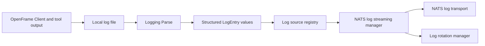
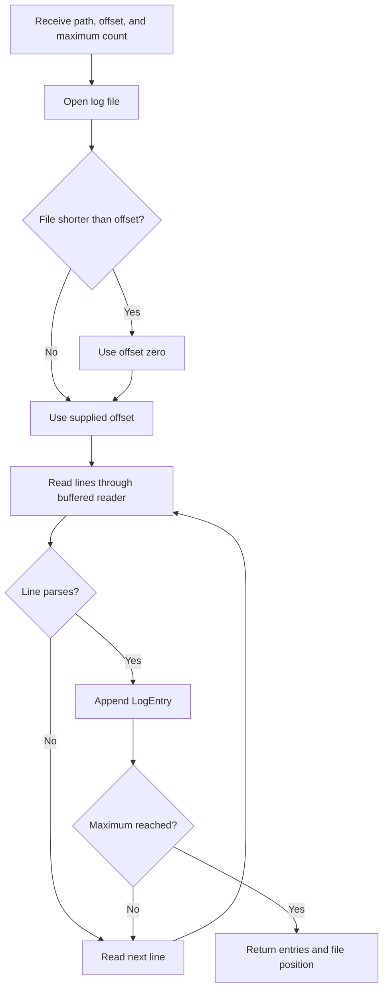
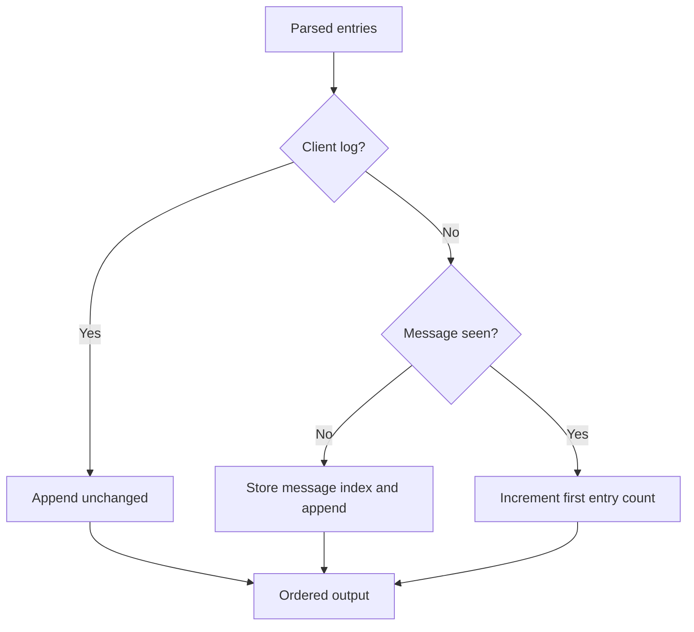
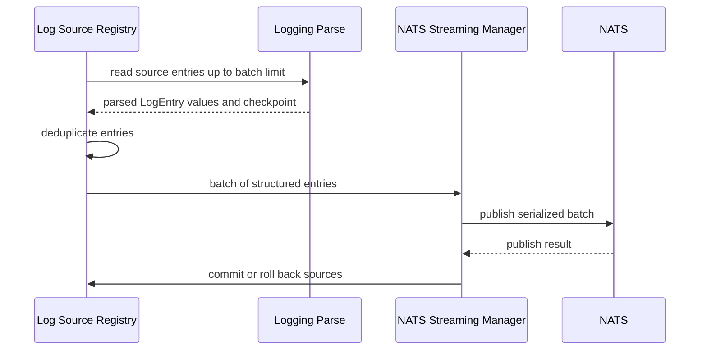

# Logging Parse

Logging Parse is the OpenFrame Client agent component that turns newly appended local log-file records into structured, serializable entries. It recognizes the agent's compact tracing output and a tool-oriented log format, attaches no transport concerns of its own, and supplies batches for the surrounding logging pipeline.

The implementation runs from the `openframe_agent_lib` dependency supplied by [OpenFrame OSS Library](https://github.com/flamingo-stack/openframe-oss-lib/blob/7a766f00e4f58b5d89db007b878ac8d6e0c344f4/clients/openframe-client/src/logging/log_parser.rs). This repository assembles and runs that library as part of the OpenFrame Client workload.

## Responsibilities

- Read at most a requested number of parseable entries beginning at a byte offset.
- Recover from a file that was truncated or replaced by reading from offset zero.
- Normalize two supported line layouts into `LogEntry` values.
- Preserve timestamp, level, and message fields in a consistent envelope.
- Collapse repeated non-client messages while preserving the first occurrence and its encounter order.

Logging Parse does not open a network connection, select NATS subjects, retain offsets, rotate files, or acknowledge delivery. Those responsibilities belong to adjacent logging components.

## Architecture and Placement



The broader client library initializes logging and runs a NATS streaming manager. That manager creates a log-source registry and a rotation manager before entering its streaming loop. The registry obtains entries and applies deduplication; the streaming manager is responsible for connection and publication behavior. The parser is deliberately a local, synchronous boundary between file bytes and the `LogEntry` data model.

## Public Data Model

### `LogEntry`

A `LogEntry` is the normalized representation of one accepted record:

| Field | Type | Meaning |
|---|---|---|
| `level` | string | Uppercased severity token extracted from the source line. |
| `ts` | string | Timestamp text from the supported source format. |
| `msg` | string | Parsed message text. Tool-format messages receive a `[tool] ` prefix. |
| `count` | optional unsigned integer | Present only when deduplication has combined equivalent entries. |

The type derives serialization. The `count` property is absent from serialized output until a duplicate is observed.

### `LogBatchMessage`

`LogBatchMessage` is the transport-facing batch envelope. It contains optional `machineId` and `organizationId`, mandatory `hostname` and `tenantDomain`, and a `logs` collection of `LogEntry` values. Serde converts its field names to camel case and omits optional identity fields when they are not available.

## Parsing Rules

`parse_log_line` attempts formats in a fixed order. A line that does not match either form produces no entry and is ignored by file reading.

### Agent tracing format

The primary format is recognized when the text up to the first `Z` parses as an RFC 3339 timestamp. The parser then takes the first whitespace-delimited token as the severity and treats the remaining trimmed text as the message.

```text
2026-01-15T10:42:00Z INFO openframe client started
```

This becomes an entry with timestamp `2026-01-15T10:42:00Z`, level `INFO`, and message `openframe client started`.

Important compatibility details:

- The timestamp must begin at the start of the line and end at the first `Z` character.
- RFC 3339 validation is performed before the line is accepted.
- The level is uppercased, but the message text is otherwise preserved after leading whitespace is removed.

### Tool log format

If the tracing format does not match, the parser optionally removes a leading `stdout:` prefix, trims leading whitespace, and recognizes a line beginning with `time="`. It extracts the quoted timestamp, `level=` token, and the value beginning at `msg="`.

```text
stdout: time="2026-01-15T10:42:01Z" level=warning msg="tool update pending"
```

This becomes a `WARNING` entry with message `[tool] tool update pending`. This format is selected only when all required pieces are present, including whitespace after the level token.

## Incremental File Reading

`read_new_logs` accepts a log-file path, a byte position, and a maximum number of entries. It opens the file, seeks to an effective start offset, reads lines through a buffered reader, parses accepted lines, and returns both the parsed entries and an updated file position.



A file whose current length is smaller than the supplied position is treated as truncated, which resets its effective start position to zero. Individual line-read failures are skipped rather than failing the whole read. Failure to open, inspect, seek, or otherwise operate on the file returns an error with context.

The returned position is the underlying file stream position after buffered reading. Callers should treat it as an opaque checkpoint and pair it with their source-commit strategy rather than calculating it from entry counts. In particular, test boundary behavior around the requested maximum and buffering when changing this code.

## Deduplication Semantics

`LogDeduplicator` is implemented for `Vec<LogEntry>`. It makes a single pass in encounter order and returns another vector.



An entry is considered a client log when its level is not `TOOL` and its message starts with either `openframe` or `async_nats`. Client logs are always retained individually. Every other entry is grouped by exact message text, regardless of timestamp or severity:

- The first matching entry remains in its original position.
- A later duplicate increments that first entry's `count`; the first duplicate changes `count` from absent to `2`.
- An insertion-ordered map retains the order in which distinct non-client messages first appeared.

This makes message text the deduplication key. Changes to that rule alter what operators can infer from streamed logs and should be accompanied by coverage for client logs, tool logs, and mixed levels sharing a message.

## Component Interaction and Delivery Outcome



The registry coordinates source reads under a shared total limit. It apportions quota among active sources, collects their entries, and deduplicates the combined collection. The NATS streaming manager establishes and reconnects its logging connection, discovers sources, and drives the delivery loop. A successful or unsuccessful transport attempt is handled outside Logging Parse through the registry's commit and rollback operations.

## Operational Boundaries

- **Rotation:** the rotation manager persists and resets the current offset after a fully streamed file reaches its rotation threshold. Logging Parse only detects that the current file became shorter than its supplied position.
- **Source lifecycle:** file-source registration, source discovery, and commit or rollback are owned by the log-source registry and its sources.
- **Transport:** NATS connection setup, log-key waiting, retry behavior, and publication are owned by the NATS streaming manager.
- **Local initialization:** logger setup and log-file selection are provided by the logging core, not by Parsing.

## Maintenance Guidance

1. Preserve the parsing order: compact tracing format takes precedence over tool format.
2. Keep format recognition strict enough to reject malformed lines without aborting a batch.
3. Treat the byte checkpoint as part of at-least-once delivery coordination. Update parser, source, rotation, and delivery tests together if checkpoint behavior changes.
4. Retain the explicit `[tool] ` namespace unless the downstream message contract is intentionally revised.
5. When adding a new log layout, add it as a distinct parser branch and document its timestamp validation, level normalization, and message transformation rules.
6. Validate repeated-message behavior using entries that differ only by timestamp or level, because deduplication intentionally keys solely on message text.

## Source and Runtime Context

The source file is maintained in OpenFrame OSS Library at [log parser source](https://github.com/flamingo-stack/openframe-oss-lib/blob/7a766f00e4f58b5d89db007b878ac8d6e0c344f4/clients/openframe-client/src/logging/log_parser.rs). The OpenFrame OSS Tenant repository consumes `openframe_agent_lib` version `v0.0.5` and deploys the surrounding OpenFrame Client as part of its tenant platform.
