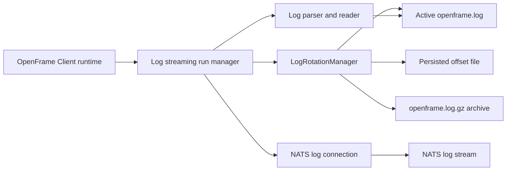
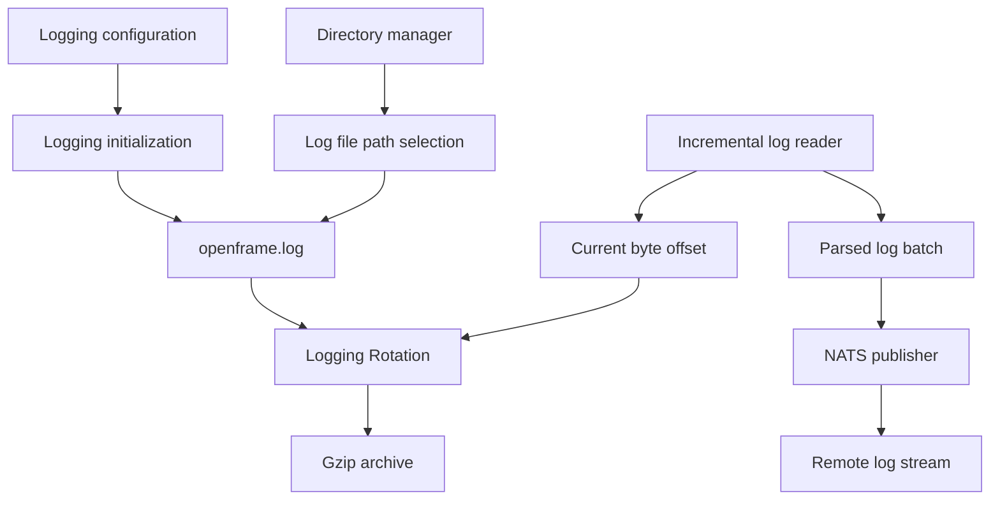
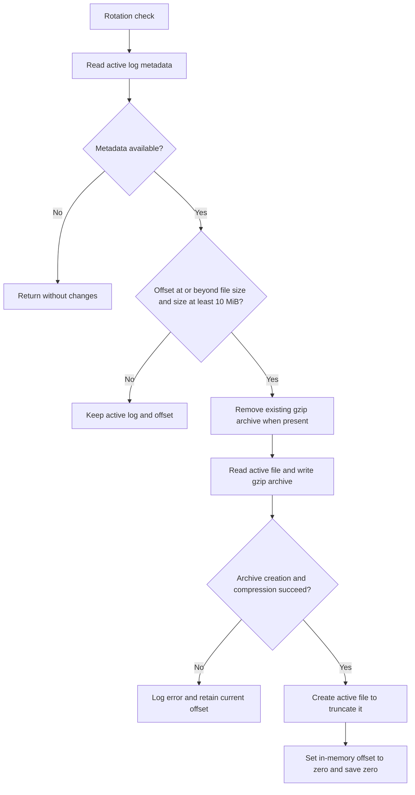
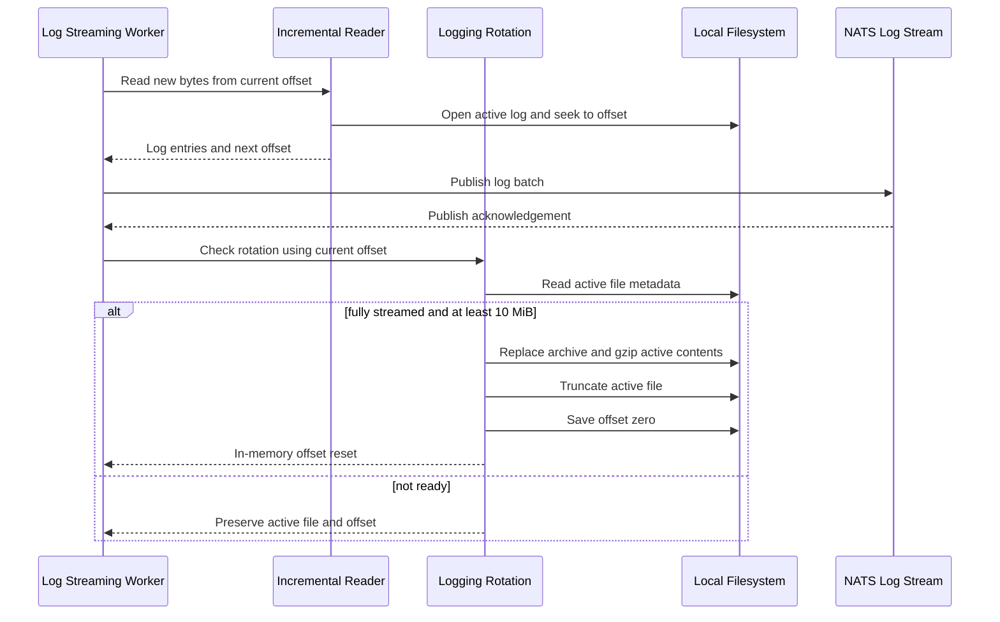

# Logging Rotation

Logging Rotation is the OpenFrame Client agent component that bounds growth of the agent's primary log file after its contents have been streamed. It is implemented by `LogRotationManager` in the OpenFrame OSS Library's [`log_rotation.rs`](https://github.com/flamingo-stack/openframe-oss-lib/blob/7a766f00e4f58b5d89db007b878ac8d6e0c344f4/clients/openframe-client/src/logging/log_rotation.rs), which is supplied to this repository through the `openframe_agent_lib` Cargo dependency.

The component has a deliberately conservative retention rule: it rotates only when the complete active file has already been read for streaming **and** the file is at least 10 MiB. Rotation compresses the complete prior file into `openframe.log.gz`, truncates the active log, and resets the persisted stream offset. This protects unstreamed logs from being discarded while keeping the local agent log bounded after successful delivery progress.

## Scope and Responsibilities

Logging Rotation is responsible for:

- Tracking the byte offset that represents the streaming reader's progress in the active log file.
- Persisting and restoring that offset across agent restarts.
- Checking that the active log is fully consumed before rotating it.
- Replacing a single gzip archive named `openframe.log.gz` beside the active log.
- Truncating the active log only after the archive has been written successfully.

It does not parse log records, establish the NATS connection, publish batches, retain multiple archives, or configure the tracing subscriber. Those responsibilities remain in the adjacent logging components assembled by the OpenFrame Client runtime.

## Runtime Architecture

The OpenFrame Client creates the log streaming manager, which in turn creates one Logging Rotation manager for the primary agent log and its offset sidecar. The same streaming loop is responsible for advancing the current offset as it reads and publishes logs; Logging Rotation makes a decision based on that progress.

### Primary Components

| Component | Role |
|---|---|
| `LogRotationManager` | Owns the active log path and offset file path, and coordinates conditional rotation. |
| `new` | Constructs the manager from those two paths without performing I/O. |
| `load_offset` | Reads a decimal byte offset from the sidecar file. Missing, unreadable, malformed, or non-numeric content resolves to `0`. |
| `save_offset` | Writes the decimal offset to the sidecar file and records an error if writing fails. It does not return the failure to its caller. |
| `rotate_if_ready` | Applies the size and stream-progress gates, performs rotation, then resets in-memory and persisted offsets after success. |
| private `rotate` | Replaces the gzip archive, compresses the full active file, finishes the compressor, and truncates the active file. |

The manager's public API is synchronous. Its caller can invoke it from an asynchronous logging workflow, but file metadata, reads, archive creation, compression, and truncation execute through standard blocking filesystem operations.

## Dependencies and Integration Boundaries

The following implementation boundaries are relevant when maintaining this module:

- **Logging initialization:** the logging core provides the agent's log output. Its path helper selects `openframe.log` in the directory manager's user log directory when `OPENFRAME_DEV_MODE` is present; otherwise it uses the standard logs directory.
- **Incremental reading:** the log parser's reader accepts a byte position and returns a new position. If it detects that the file length is smaller than the supplied position, it restarts from zero. This makes the reader tolerant of a truncation that occurred between reads or across a restart.
- **NATS streaming:** the streaming run manager creates `LogRotationManager` with the streaming log path and offset path, then passes it into the long-running log loop. NATS publication reports success only after its publish acknowledgement, allowing stream progress to be tied to delivery.
- **Configuration:** `LoggingConfig` defines `level`, `json`, `rotation_size_mb`, and `max_files`. The rotation implementation shown here does **not** consume `rotation_size_mb` or `max_files`; its threshold and one-archive naming policy are hard-coded in the module. Changing configuration alone therefore does not alter this module's behavior.

## Rotation Decision Flow

The manager uses two gates. A file must exist and its length must be at least 10 MiB. It must also be fully streamed, expressed as `current_offset >= file_size`. The latter condition permits rotation when an offset is equal to or beyond the length, but prevents it when unread bytes remain.

The module logs an informational message before attempting a ready rotation, an error if rotation fails, and another informational message after a successful reset. Metadata lookup failures intentionally return silently, so absence or temporary inaccessibility of the active log does not turn a periodic check into a reported rotation failure.

## File Lifecycle and Data Flow

### Persisted Offset Semantics

The offset is stored as plain decimal text in a caller-provided file. On startup, `load_offset` attempts to read, trim, and parse that text as an unsigned integer. Any failure yields zero, which makes the next read start at the beginning of the active log rather than preventing logging from starting.

After a successful rotation, the manager updates both representations of state: it changes the mutable `current_offset` supplied by the caller and calls `save_offset(0)`. If the offset write fails, the in-memory value is still reset. On a later restart, a stale offset greater than the now-truncated file length is handled by the incremental reader, which detects the short file and begins at zero.

## Archive and Retention Behavior

The archive lives in the active log's parent directory, or the process working directory if the log path has no parent. Its fixed name is `openframe.log.gz`.

1. If an archive already exists, the module makes a best-effort attempt to remove it and ignores removal errors.
2. It reads the entire active log into memory.
3. It writes that content through a default-compression gzip encoder into the archive.
4. It finalizes the encoder, then recreates the active file to truncate it.

This is **single-archive replacement**, not a rolling numbered archive strategy. Each successful rotation overwrites the previous compressed archive. Because the complete active file is read into memory before compression, large active files increase transient memory consumption beyond the 10 MiB eligibility threshold.

## Failure Behavior and Operational Implications

| Condition | Result |
|---|---|
| Active log is missing or metadata cannot be read | No rotation and no error log from the rotation check. |
| File is below 10 MiB | No rotation, even when fully streamed. |
| Offset has not reached file size | No rotation, preserving unread data. |
| Archive deletion fails | Processing continues; later archive creation may fail and is reported. |
| Reading, creating, compressing, finalizing, or truncating fails | Rotation error is logged; the caller's offset is not reset by `rotate_if_ready`. |
| Offset-file write fails after successful rotation | An error is logged; the current process uses offset zero, and the reader's truncation guard protects the next startup. |

The archive is not part of the normal incremental-streaming path described by the provided components. It exists as local diagnostic retention after an active file has already been streamed. Operators should therefore collect it separately when investigating historical agent behavior.

## Maintenance Guidance

When changing Logging Rotation, preserve the ordering invariant: do not truncate the active log until gzip output has been successfully finalized. The `current_offset >= file_size` gate is equally important because it prevents destroying bytes that have not yet entered the streaming workflow.

Consider these compatibility points before modifying the format or conditions:

- Keep offset interpretation aligned with the log parser's byte-position reader.
- If adding configurable thresholds or retention counts, explicitly wire them from `LoggingConfig`; their presence in the configuration type does not currently imply use here.
- If changing archive naming or moving it outside the log directory, account for existing local diagnostic and collection workflows.
- If rotating larger files, consider streaming the source into the gzip encoder rather than reading the full file into memory.
- If offset persistence needs stronger crash consistency, use an atomic write strategy and define recovery behavior for partial writes.

Logging Rotation is supplied by the OpenFrame OSS Library at the pinned `openframe_agent_lib` version `v0.0.5` consumed by this repository. Its source link above is the authoritative implementation for the behavior described here.
