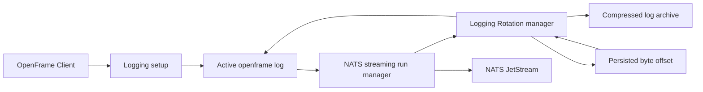
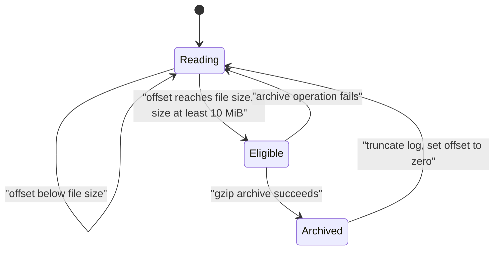
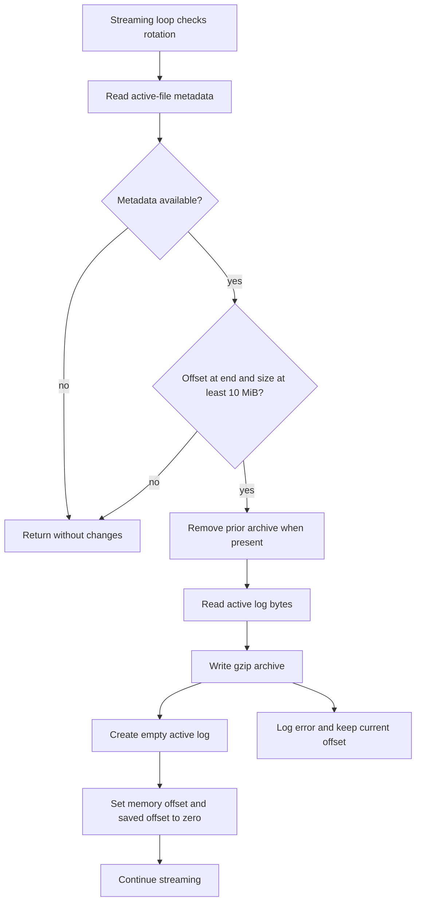
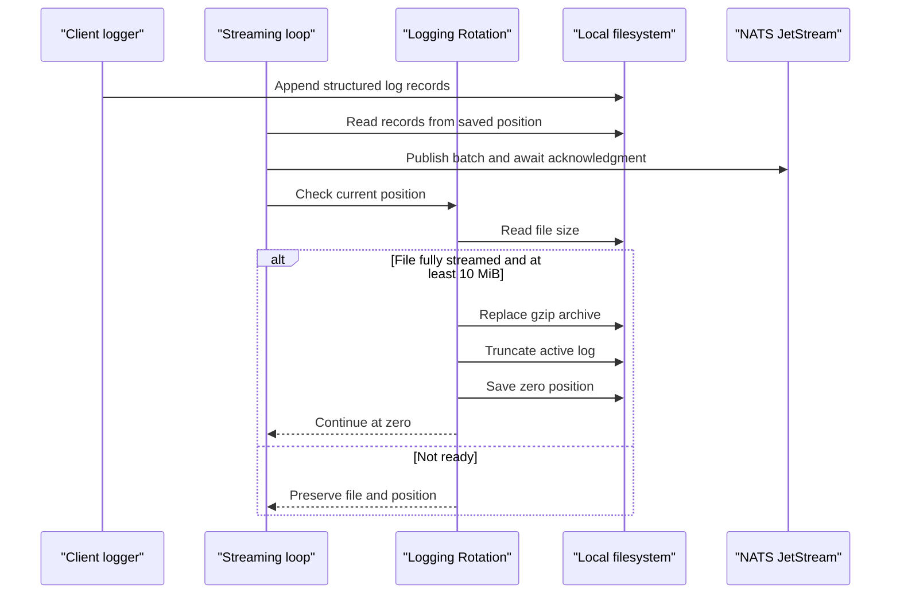

# Logging Rotation

Logging Rotation bounds the size of the OpenFrame Client's primary log while preserving an uploaded copy of completed log data. It is implemented by the `LogRotationManager` in the OpenFrame OSS Library's Rust client and is assembled by this repository when it runs the OpenFrame Client. Rotation is deliberately gated on the streaming position: the active log is compressed and truncated only after the streaming loop has consumed the whole file and it has reached 10 MiB.

The implementation is supplied by the `openframe_agent_lib` Cargo dependency, version `v0.0.5`, from OpenFrame OSS Library. Its source is available in [the Logging Rotation implementation](https://github.com/flamingo-stack/openframe-oss-lib/blob/16e7c1cbd9664e7d10ec5ebca7d53c9bd314decf/clients/openframe-client/src/logging/log_rotation.rs).

## Responsibilities

- Track the byte position at which the log streamer has finished reading the active log.
- Persist that position so streaming can resume after a client restart.
- Wait until the active file is both completely consumed and at least 10 MiB.
- Replace the single retained archive with a gzip-compressed snapshot of the active log.
- Truncate the active log and reset the in-memory and persisted positions to zero after successful rotation.

Logging Rotation does not parse records, select stream subjects, publish batches, or retry transport failures. Those responsibilities remain with the logging parser and NATS streaming facilities.

## System Placement

The OpenFrame Client resolves the primary log location through the logging setup module. In development mode it uses the user log directory; otherwise it uses the managed system log directory. The NATS streaming run manager constructs a Logging Rotation manager from that log path and its position file, then passes it to the streaming loop.

The client-side logger continues writing the active file. The streaming loop reads it from the saved byte position and publishes accepted batches to NATS JetStream. Rotation has no network operation: it relies on the stream position to decide when local retention is safe.

## Core Components

| Component | Responsibility |
|---|---|
| `LogRotationManager` | Holds the active-log path and the persisted-position path, coordinates the rotation decision, and performs archive creation. |
| Manager constructor | Receives the two paths and stores them without creating files or performing I/O. |
| Position loader | Reads the position file, trims it, and parses an unsigned byte count. Missing, unreadable, or malformed content resolves to zero. |
| Position saver | Writes the supplied byte count as text. A write failure is logged and does not terminate the caller. |
| Rotation check | Obtains active-file metadata, confirms that streaming has reached its end and that it meets the 10 MiB threshold, then invokes rotation. |

## Rotation Preconditions and State

The module treats the current byte offset as a progress marker for the active file.

A rotation attempt requires both conditions:

1. The supplied current offset is greater than or equal to the active file's current size. This means the log-streaming path has consumed all bytes visible at the time of the check.
2. The active file size is at least 10 MiB, or 10,485,760 bytes.

If metadata cannot be read, the check returns without rotating. If the offset is behind the file length, or the file is smaller than the threshold, the current state is retained.

The parser also defends the read path against a truncated file: when the stored position is greater than the current file length, it begins the next read at byte zero. That makes a previously persisted position safe to use after truncation or another file-replacement event.

## Rotation Process

The archive is named `openframe.log.gz` and is placed beside the active log. A pre-existing archive of that name is removed before the new archive is created, so the module retains one completed archive rather than a rolling sequence. Compression uses the default gzip compression setting. After the encoder is finalized, recreating the active file truncates it to an empty file.

## Interaction With Log Streaming

NATS publishing waits for a JetStream acknowledgment for each serialized batch. This establishes the upstream condition that allows the streaming loop to advance its position before Logging Rotation considers the active log fully consumed. The exact batching, record parsing, and source-registry behavior belong to the sibling logging modules and are intentionally outside this module's scope.

## Persistence and Failure Behavior

| Situation | Behavior | Maintained invariant |
|---|---|---|
| Position file is missing, unreadable, or invalid | Start at byte zero. | The client can recover by rereading rather than failing to start streaming. |
| Active-log metadata is unavailable | Skip the check. | No file is altered without size information. |
| Archive creation, compression, reading, or truncation fails | Emit an error and retain the supplied position. | The manager does not reset progress after a failed rotation. |
| Position write fails after successful rotation | Emit an error. The in-memory position is already zero. | A later run can recover through its normal position-loading behavior, but maintainers should investigate filesystem permissions or storage health. |
| Prior archive exists | Remove it before producing the new gzip archive. | Exactly one archive name is targeted by this component. |

The archive replacement occurs before the active log is read and compressed. Consequently, a failure after removal can leave no archive for that rotation attempt; this is an important operational trade-off when investigating local disk or permission failures.

## Configuration and Operational Considerations

The threshold and archive filename are fixed in the current implementation; this module exposes no runtime retention count, compression level, size threshold, or archive-directory configuration. The effective behavior therefore depends on two caller-provided paths:

- **Active log path:** supplied by the logging setup and directory-management path resolution.
- **Position-file path:** supplied by the streaming runtime and used to resume reading across restarts.

Both the active-log directory and the position-file location must be writable by the OpenFrame Client service identity. Operators should also account for temporary space needed to hold the active log and its compressed replacement during rotation.

## Maintenance Guidance

- Preserve the ordering that checks stream completion before truncation; changing it risks discarding records that have not reached the server.
- Keep the offset reset coupled to a successful archive and truncate operation.
- Treat the persisted position as a byte offset, not as a record count.
- Evaluate archive-replacement failure modes before changing the single-archive policy.
- Exercise boundary cases at just below 10 MiB, exactly 10 MiB, a fully consumed file, an unreadable metadata path, malformed saved position data, and write or compression failures.

For implementation details of record parsing, see the logging parser in the OpenFrame OSS Library. For log transport and acknowledgment behavior, see the NATS streaming implementation in the same library.