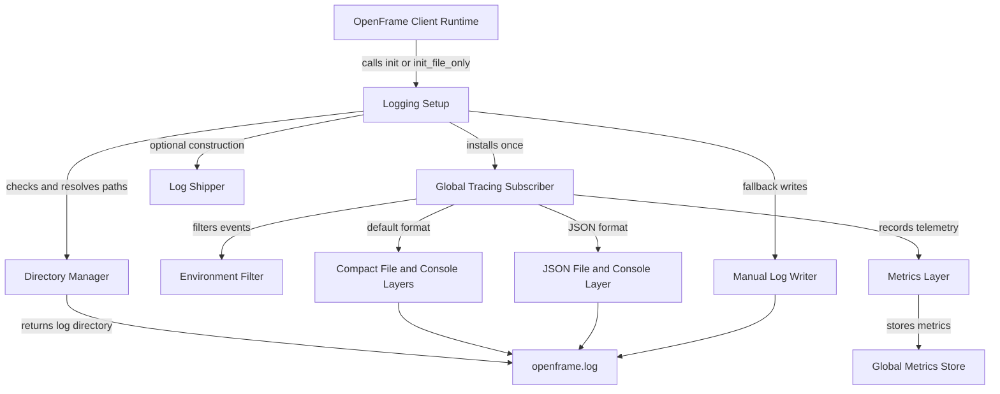
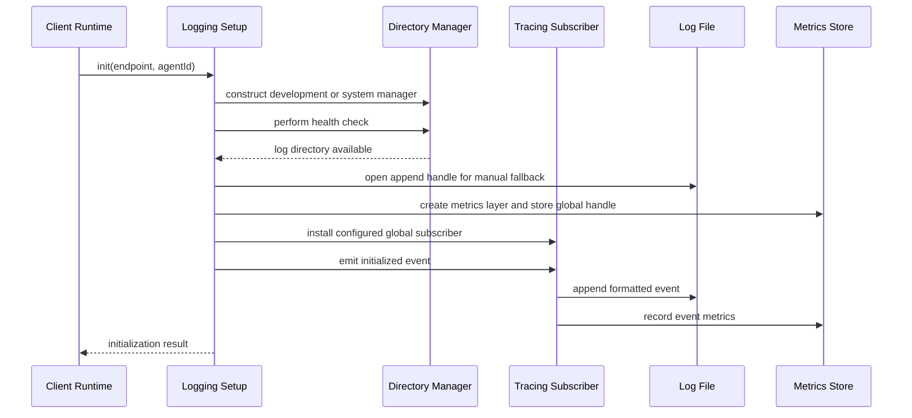
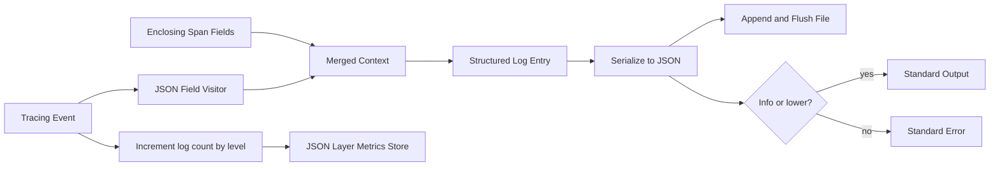

# Logging Setup

Logging Setup initializes process-wide tracing for the OpenFrame client agent. It validates and selects a platform-managed log directory, installs the global tracing subscriber once, writes operational events to `openframe.log`, and exposes the metrics store created during initialization. The implementation is supplied by the `openframe_agent_lib` dependency from OpenFrame OSS Library and is executed by this repository's OpenFrame client runtime.

The implementation lives in [the Logging Setup source](https://github.com/flamingo-stack/openframe-oss-lib/blob/16e7c1cbd9664e7d10ec5ebca7d53c9bd314decf/clients/openframe-client/src/logging/mod.rs). It works with the logging parsing, source, rotation, shipping, NATS streaming, and metrics parts of the client library. Rotation is intentionally coordinated by the streaming run manager so log data can be streamed before a file is rotated; Logging Setup itself does not rotate files.

## Responsibilities

- Select the system log directory in normal operation, or the per-user log directory when `OPENFRAME_DEV_MODE` is set.
- Run the directory manager health check before opening the log file.
- Create or append to `openframe.log` and retain a direct file handle for fallback writes.
- Install one global `tracing` subscriber, including an environment-driven level filter and the metrics layer.
- Select compact text output by default or structured JSON output when `OPENFRAME_LOG_FORMAT=json`.
- Optionally construct a log shipper when both a log endpoint and agent identifier are supplied.
- Provide a synchronous fallback writer through `manual_log` and access to the global metrics store through `get_metrics_store`.

## Architecture

The module has two persistent process-wide resources:

- `LOG_FILE` is a lazily initialized, mutex-protected optional file handle used by `manual_log`.
- `METRICS_STORE` contains the store returned by `MetricsLayer::new()` and is available only after successful setup reaches the metrics-layer stage.

For compact file logging, the module also retains a `WorkerGuard` for the non-blocking writer. Retaining this guard keeps the writer worker alive for the process lifetime.

## Initialization API

| Entry point | Behavior |
|---|---|
| `init(log_endpoint, agent_id)` | Performs normal setup. In text mode, logs to both the file and standard output. |
| `init_file_only(log_endpoint, agent_id)` | Performs the same setup but suppresses the compact text standard-output layer. |
| `get_log_file_path(directory_manager)` | Returns the path ending in `openframe.log`, using a user directory in development mode and the system log directory otherwise. |
| `get_metrics_store()` | Returns a clone of the shared asynchronous metrics-store handle when initialized. |
| `manual_log(level, message)` | Writes an RFC 3339 UTC timestamped one-line fallback entry to the fallback file handle and standard output. |

The initializer is guarded by `std::sync::Once`. Therefore the first call determines the installed subscriber, selected format, output mode, and optional shipping setup. Later calls do not reconfigure logging. Callers should initialize early, before emitting application tracing events, and should choose either regular or file-only initialization consistently.

## Configuration and Output Modes

### Directory and filter selection

`OPENFRAME_DEV_MODE` changes the directory manager selection and ultimately places the log file under its user-log location. Without it, Logging Setup uses the normal system log location. In either case, the directory manager's health check must succeed before logging can continue.

The subscriber's filter comes from the standard tracing environment filter when present. If no valid filter is supplied, the fallback is `info,async_nats=warn`, allowing informational application logs while reducing `async_nats` verbosity.

### Text mode

Text mode is the default when `OPENFRAME_LOG_FORMAT` is absent or has a value other than `json`, ignoring case. It installs compact, ANSI-free formatting layers:

- The file layer appends target, level, and a compact event representation through a non-blocking writer.
- The standard-output layer uses the same compact representation unless `init_file_only` was selected.
- The metrics layer observes the same events.

### JSON mode

When `OPENFRAME_LOG_FORMAT=json`, Logging Setup installs `JsonLayer`. Each event is serialized as one JSON object containing:

| Field | Source |
|---|---|
| `timestamp` | Current UTC time with microsecond precision. |
| `level` | Tracing event metadata. |
| `target`, `module_path`, `file`, `line` | Tracing event metadata when available. |
| `thread` | Current thread identifier. |
| `message` | The event's message field. |
| `error` | The event's `error` string field, when present. |
| Additional JSON properties | Event fields plus fields inherited from enclosing spans. |

Span fields are recorded when a span is created. For an event, fields from the root span through the leaf span are merged first, then event fields are merged last. Consequently, event-level fields override same-named span fields, while contextual values such as a tool identifier can follow nested operations into each log line.

After writing JSON to the file, `JsonLayer` writes informational and lower-severity events to standard output and warnings or errors to standard error. This behavior is part of the JSON layer itself, so `init_file_only` only suppresses the text-mode standard-output layer; it does not suppress JSON console output.

## Event Flow

The initial tracing event confirms that the subscriber has been installed. For normal initialization, the module also calls `manual_log` with an initialization message, producing a separate direct-write entry. This deliberate direct write gives operators a fallback-visible signal but means the two initialization messages use different output paths.

## JSON Event Processing

`JsonLayer` maintains its own metrics store and increments a `log_count` counter labelled with the event level. This is distinct from the shared store installed by `MetricsLayer::new()`: `get_metrics_store` returns the shared metrics-layer store, not the private store owned by `JsonLayer`.

## Fallback Logging

`manual_log` is intended for situations in which tracing cannot be relied on. It formats a single text line with a UTC timestamp, supplied level, the fixed `manual` target, and the supplied message. It then attempts to acquire the fallback file mutex, writes and flushes when a file exists, and prints the same line to standard output.

Fallback writes are best-effort: file lock, write, and flush failures are ignored. The normal JSON event path intentionally does not call `manual_log`, preventing duplicate entries for successfully processed tracing events.

## Optional Shipping and Related Components

When `init` receives both `log_endpoint` and `agent_id`, it constructs `LogShipper` with those values and emits an informational tracing event identifying the endpoint. The endpoint is not used when either argument is absent. The shipping component owns the transfer behavior; Logging Setup only performs this optional bootstrap.

The module's adjacent client-library components divide responsibility as follows:

- Log parsing turns newly read lines into batches and deduplicates entries.
- Log sources register file-backed inputs and provide coordinated commit or rollback semantics.
- Log rotation persists read offsets and decides when rotation is ready.
- NATS streaming coordinates streaming runs and is responsible for ensuring logs are streamed before rotation.
- Shipping sends log batches to the configured destination.
- Metrics defines the metrics store and tracing layer used by this setup module.

## Failure Behavior and Operational Considerations

- A directory health-check failure, fallback log-file open failure, JSON-layer file open failure, or global-subscriber installation failure causes the first initialization call to return an I/O error.
- In text mode, the second file open used by the non-blocking writer uses `expect`; a failure there terminates the process rather than returning an initialization error.
- If another part of the process has already installed a global tracing subscriber, setup cannot replace it and returns an error from subscriber installation.
- The initial direct fallback file handle and the normal logging layer open the same log path independently. Both append, while their concurrency and buffering characteristics differ by mode.
- Do not place secrets, tokens, or other sensitive values in tracing fields. JSON output persists event and span fields verbatim, and optional shipping may forward collected log data.
- `manual_log` is not a substitute for normal tracing: it has no structured context, filtering, or metrics-layer integration.

## Maintainer Checklist

1. Invoke Logging Setup before creating long-running client services or listeners.
2. Decide whether the process needs console output, then call exactly one initialization entry point first.
3. Set `OPENFRAME_LOG_FORMAT=json` only when downstream collection expects JSON Lines; otherwise retain compact text logs.
4. Verify the selected directory is writable during installation and service startup.
5. When adding tracing spans, use stable, non-sensitive fields so inherited context remains useful in JSON logs.
6. Keep rotation and shipping changes coordinated with the streaming components, because rotation is intentionally deferred until streaming has handled available log data.
