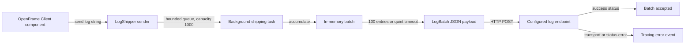
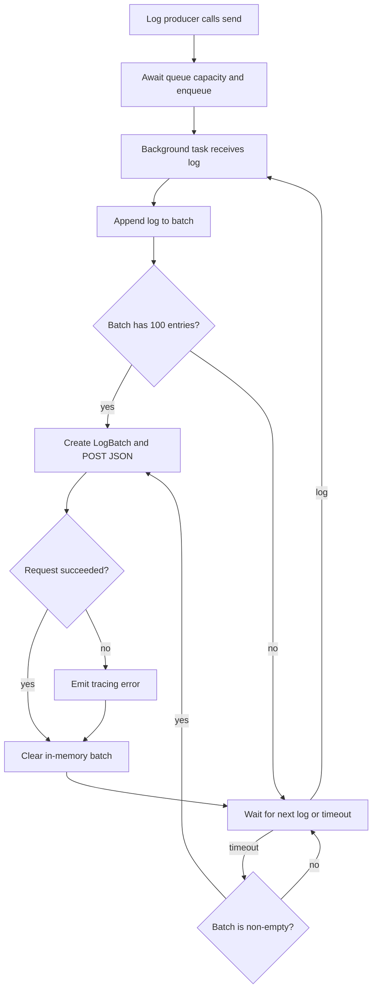
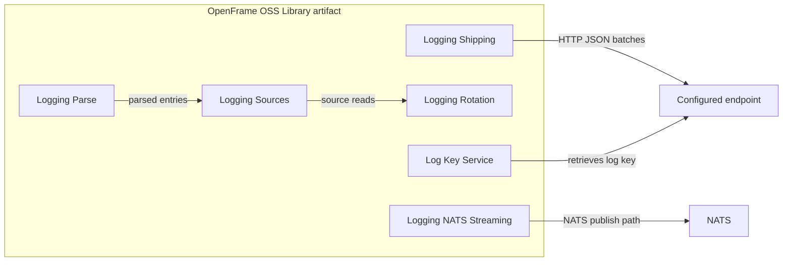
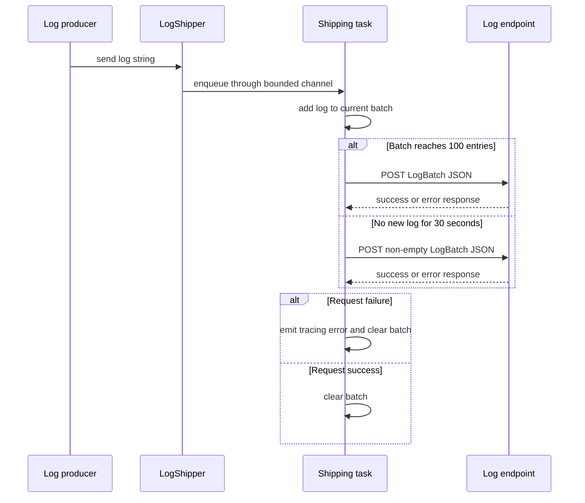

# Logging Shipping

Logging Shipping is an asynchronous HTTP batching utility in the OpenFrame Client agent library. It accepts individual log strings through `LogShipper`, buffers them in memory, and posts serialized `LogBatch` payloads to a configured endpoint. The implementation is supplied by the `openframe_agent_lib` artifact from the OpenFrame OSS Library and runs as part of this repository's OpenFrame Client deployment.

> **Current integration status:** the `LogShipper` fields that retain the endpoint and agent identifier are explicitly marked as retained for future use. This module implements the transport primitive, but the supplied implementation does not itself discover log files, parse logs, rotate files, manage delivery acknowledgements, or configure a call site.

## Responsibilities

- Create a bounded asynchronous ingestion queue for log strings.
- Run a background Tokio task that aggregates queue entries.
- Flush a batch when it reaches 100 entries or after 30 seconds without another selected message.
- Attach the agent identifier and a UTC transmission timestamp to each outgoing payload.
- Send the payload as JSON with an HTTP POST request and treat non-success HTTP statuses as errors.
- Record shipping failures through the agent's tracing pipeline while keeping the background task alive.

The source implementation is maintained in the OpenFrame OSS Library: [shipping.rs](https://github.com/flamingo-stack/openframe-oss-lib/blob/16e7c1cbd9664e7d10ec5ebca7d53c9bd314decf/clients/openframe-client/src/logging/shipping.rs).

## Architecture

`LogShipper::new` creates a Tokio multi-producer, single-consumer channel with capacity 1,000. It preserves one sender in the returned shipper and moves the receiver, endpoint copy, and agent identifier copy into a spawned task. Consequently, construction must occur while a Tokio runtime is active.

## Core Types and Operations

| Component | Role | Behavior |
| --- | --- | --- |
| `LogBatch` | Wire payload | Contains `logs`, `agent_id`, and a UTC `timestamp`; it derives serialization for JSON encoding. |
| `LogShipper` | Producer-facing handle | Owns the bounded channel sender and retains the configured endpoint and agent identifier. |
| `new` | Initializer | Builds the queue, clones task inputs, spawns the persistent shipping loop, and returns a sender handle. |
| `send` | Ingestion API | Awaits queue capacity and enqueues one log string. It returns an error if the receiver is no longer available. |
| Background shipping loop | Batch coordinator | Receives logs, checks the batch limit, or sends a non-empty batch after the timeout branch wins. |
| Batch sender | HTTP adapter | Constructs `LogBatch`, posts JSON, awaits the response, and rejects non-success statuses. |

## Batch Payload

Every successful send attempt uses one logical payload:

| Field | Type | Meaning |
| --- | --- | --- |
| `logs` | Array of strings | The queued raw log strings in their receive order. |
| `agent_id` | String | The identifier supplied when the shipper was created. |
| `timestamp` | UTC date-time | The time the batch is created for transmission, not a per-entry event time. |

The module does not add sequence identifiers, tenant information, compression, signatures, or a per-log schema. Those concerns must be handled by the supplied strings, endpoint contract, or surrounding client configuration.

## Shipping Flow

### Flush Triggers

- **Size trigger:** receipt of the 100th pending entry immediately initiates a send.
- **Timeout trigger:** the loop creates a 30-second sleep alongside each receive operation. Because a new sleep is created after each handled log, continuous arrivals reset the timer. In practice, a partial batch flushes after approximately 30 seconds of inactivity rather than at a fixed interval from its first entry.
- **Empty timeout:** no request is sent when the timeout occurs and the batch is empty.

## Dependencies and Boundaries

Logging Shipping has a deliberately narrow boundary: it only accepts strings and performs HTTP delivery. It has no direct dependency in its source file on the adjacent parsing, source registry, rotation, NATS streaming, or log-key components.

Within the wider client library, those adjacent components address separate concerns:

- **Logging Parse** reads a log file from an offset, detects truncation by resetting an offset that exceeds the current file length, and parses accepted lines into entries.
- **Logging Sources** provides a registry of log sources with read, commit, and rollback operations.
- **Logging Rotation** persists offsets and controls rotation readiness.
- **Logging NATS Streaming** has its own run manager, NATS connection, stream key, and publishing path.
- **Log Key Service** retrieves and maintains log-key material for the client.

These components are related at the system level, but they are not invoked by this HTTP shipper as currently implemented. Keep this distinction when adding integration: do not assume the HTTP endpoint shares the NATS transport's delivery semantics or credentials.

## Failure and Delivery Semantics

The module is best-effort, in-memory delivery rather than durable shipping.

| Situation | Observed behavior | Operational consequence |
| --- | --- | --- |
| Queue reaches capacity | `send` waits until the worker receives an entry. | Callers can be back-pressured rather than dropping immediately. |
| Receiver unavailable | `send` returns the channel error. | Caller decides how to handle logging failure. |
| HTTP connection, serialization, or response failure | The worker records a tracing error. | The batch is cleared afterward; no retry occurs in this module. |
| Non-success HTTP response | `error_for_status` turns the response into an error. | The batch is cleared afterward; no retry occurs in this module. |
| Process exits or task is aborted | Pending channel entries and the in-memory batch are not persisted. | Unsent logs can be lost. |
| All senders are dropped | The receive branch no longer yields a log, while the loop continues through timeout waits. | There is no explicit shutdown or final flush protocol. |

A batch is cloned before each send attempt and then cleared irrespective of success. This prevents the worker from being blocked by retry behavior, but means delivery is **at most once from this module's perspective**, with no durable replay guarantee.

## Component Interaction Sequence

## Configuration and Integration Guidance

The constructor takes two values:

- **Endpoint:** a complete HTTP destination accepted by the `reqwest` client. The module applies no URL transformation, authentication header, timeout policy, or retry policy.
- **Agent identifier:** a string copied into every `LogBatch` payload.

The code constructs a default `reqwest::Client`; it does not expose client configuration from `LogShipper`. If an integration needs custom certificates, proxy behavior, authentication, request timeouts, payload limits, or retries, those capabilities require an implementation change or an endpoint that accepts the existing client behavior.

When integrating a source pipeline, only advance a durable source offset after choosing the desired delivery contract. The shipper itself does not acknowledge persistence at the destination, and it discards failed batches. A source registry's commit or rollback operations should therefore be coordinated by a higher-level run manager, not inferred from `send` returning successfully: `send` only confirms local queue admission.

## Maintenance Considerations

1. **Define delivery guarantees before adding retries.** Retrying a request after an uncertain network failure can duplicate an already accepted batch. Add an idempotency key or server-side deduplication if at-least-once delivery is required.
2. **Avoid unbounded producer tasks.** Backpressure is intentional. Callers should not spawn unlimited tasks that all await `send` when the endpoint is slow.
3. **Plan graceful shutdown explicitly.** A shutdown signal should flush a non-empty batch within a bounded deadline and terminate the worker, rather than relying on sender drop.
4. **Treat payload size independently of entry count.** The current limit is 100 entries, not a byte limit. Very large log strings can still produce oversized HTTP requests.
5. **Add observability around drops and latency.** The module currently emits failures through tracing but does not expose counters for queued, shipped, failed, or discarded logs.

## Source Ownership

Although this documentation belongs to OpenFrame OSS Tenant, the Rust implementation is owned by the OpenFrame OSS Library and consumed here through the `openframe_agent_lib` cargo artifact, pinned to version `v0.0.5`. Changes to `LogBatch` serialization, batching behavior, or request semantics should be reviewed in the library source and validated against the receiving endpoint contract.