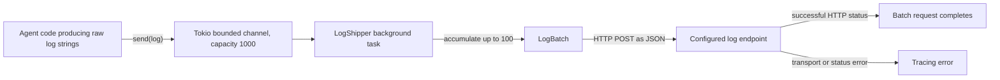
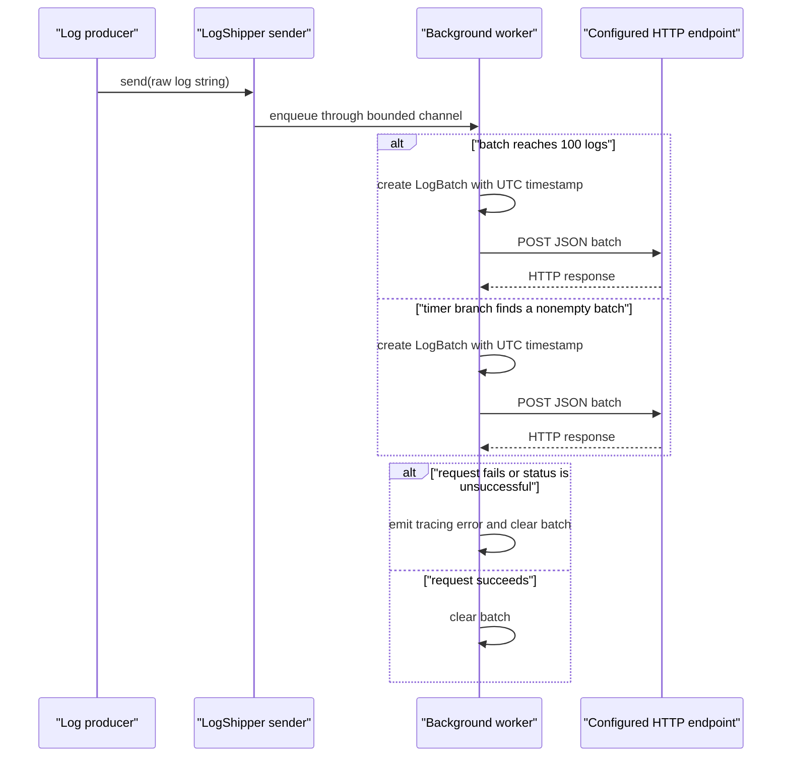
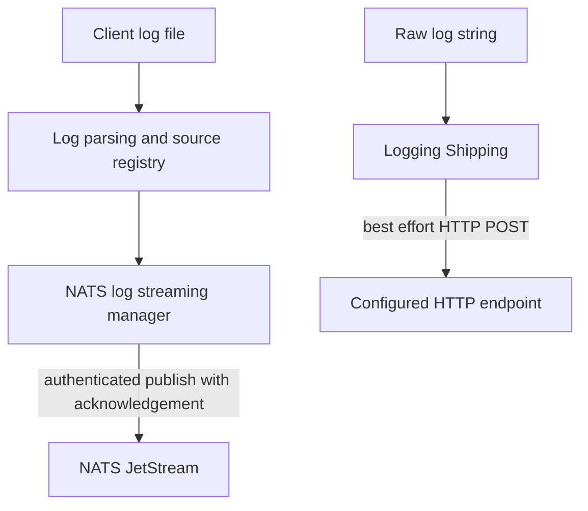

# Logging Shipping

Logging Shipping is an in-process, asynchronous HTTP batching helper in the OpenFrame client agent. It accepts individual log strings, buffers them on a Tokio channel, and posts batches to a configured endpoint. The implementation is supplied by the `openframe_agent_lib` Rust dependency from OpenFrame OSS Library, version `v0.0.5`, and runs as part of this repository's OpenFrame client deployment.

This component is intentionally separate from the client’s NATS-based log streaming path. It is marked as retained for future shipping use in the source and is not the acknowledged NATS pipeline used by the current client log streaming manager.

## Responsibilities and boundaries

Logging Shipping provides a narrow producer interface:

- `LogShipper::new` creates a bounded queue and starts a background shipping task.
- `LogShipper::send` asynchronously queues one raw log line.
- `LogBatch` is the JSON payload sent over HTTP, containing `logs`, `agent_id`, and a UTC `timestamp`.
- The background worker flushes when it has 100 queued logs or when its 30-second wait expires with a nonempty batch.
- `send_batch` uses a fresh `reqwest` client created for the worker and rejects non-successful HTTP status codes.

The helper does **not** parse log lines, track file offsets, discover log sources, rotate files, add request authentication, retry HTTP failures, or persist an outbox. Those concerns belong to other client logging components or to the configured HTTP receiver.

The implementation is defined in [the OpenFrame OSS Library shipping source](https://github.com/flamingo-stack/openframe-oss-lib/blob/7a766f00e4f58b5d89db007b878ac8d6e0c344f4/clients/openframe-client/src/logging/shipping.rs).

## Architecture



A `LogShipper` retains its sender, endpoint, and agent identifier. Construction clones the endpoint and agent identifier into the spawned worker so the returned handle can continue to enqueue logs. The worker owns the receiving end of the channel and serially performs all outbound HTTP requests.

## Component model

| Component | Role | Key behavior |
|---|---|---|
| `LogShipper` | Producer-facing handle and worker owner | Queues strings through a bounded sender; its endpoint and agent identifier are retained on the structure for future shipping use. |
| `LogBatch` | HTTP request model | Serializes a list of raw strings, one agent identifier, and the UTC time at which the batch is assembled. |
| `new` | Lifecycle entry point | Creates the channel with capacity 1000 and spawns the shipping loop. |
| `send` | Ingestion operation | Awaits channel capacity, providing natural backpressure; returns an error if the receiver is no longer available. |
| `ship_logs` | Private worker loop | Collects records, checks the size threshold, and attempts timed flushing. |
| `send_batch` | Private transport operation | Builds `LogBatch`, posts JSON to the endpoint, and treats unsuccessful responses as errors. |

## Batch and transport contract

The HTTP body is a serialized `LogBatch`. It has this conceptual shape:

```json
{
  "logs": ["first raw log line", "second raw log line"],
  "agent_id": "agent identifier",
  "timestamp": "UTC batch creation time"
}
```

`timestamp` identifies when the batch is built, not when an individual log was emitted or enqueued. The component preserves incoming strings as received; it does not attach per-line metadata or normalize their content.

The receiver address is supplied when constructing the shipper. The worker sends an HTTP `POST`, serializes the body as JSON, waits for the response, and invokes status validation. A completed request therefore establishes only that the receiver responded with a successful status; the module exposes no application-level acknowledgement, idempotency key, or retry state.

## Shipping flow



### Flush behavior

The worker reserves a vector sized for 100 records. On each received string it appends the item, then immediately sends a clone of the batch if the threshold is reached. The timer branch posts any nonempty batch after the 30-second duration.

An important implementation detail is that the timeout future is created within each iteration of the `select` loop. Receiving another message wins the selection and starts a new 30-second wait in the next iteration. Consequently, a continuous low-volume stream that never reaches 100 entries can continually reset the wait rather than being flushed 30 seconds after the first entry. Maintainers should account for this behavior when interpreting the timeout as a maximum batch age.

## Failure, loss, and backpressure semantics

| Condition | Observed behavior | Delivery implication |
|---|---|---|
| Queue has 1000 pending messages | `send` waits for capacity | Producer tasks are backpressured rather than the queue growing without bound. |
| Receiver task is unavailable | `send` returns an error | The caller must decide whether to log, retry, or drop the record. |
| Connection, serialization, or HTTP status validation fails | Worker emits a tracing error | The attempted batch is cleared afterward. |
| Process exits with queued records | No durable queue is present | Pending in-memory records are not recoverable through this module. |
| Receiver accepts a request | Worker clears its local batch | No receiver-side processing acknowledgement is modeled. |

Because the worker clears the batch after either success or failure, this is best-effort delivery rather than at-least-once delivery. The endpoint must be reachable and ready to receive unauthenticated JSON requests unless a caller supplies an endpoint that independently enforces a suitable transport or access policy.

## Relationship to the client logging pipeline

The adjacent NATS log streaming facility is the richer operational pipeline. It waits for a log key, connects through the client gateway WebSocket path, sends tenant, machine, and key headers, serializes parsed `LogBatchMessage` data, and waits for JetStream publish acknowledgement. It also combines source discovery, log source registration, offsets, and rotation handling. Logging Shipping does not call that facility and must not be treated as a replacement for its authentication or acknowledgement guarantees.



The tenant deployment includes NATS as a datasource for the OpenFrame client, and the stream service contains a Kafka listener for inbound log events. These are platform-level integration points downstream of the agent flow; no direct HTTP-to-stream-service route is established by Logging Shipping itself.

## Operational guidance for maintainers

- Construct one shipper for a stable endpoint and agent identity rather than constructing a new worker per log record.
- Await `send` and handle its error. Ignoring it hides receiver shutdown and can make loss invisible to the producer.
- Treat the endpoint as a sensitive configuration boundary: log strings can contain operational detail, and the module does not redact content or attach authentication headers.
- Monitor the tracing error emitted for failed batch sends. The module has no built-in retry, failure backoff, or durable recovery.
- If bounded-age flush is required under steady low-volume traffic, revise the worker to preserve a deadline across receives rather than recreating the timeout on every loop iteration.
- If delivery guarantees are required, introduce a durable outbox and explicit acknowledgement protocol before clearing sent data. Avoid adding retries without considering duplicate delivery and receiver idempotency.

## Source and integration references

- [Logging Shipping implementation](https://github.com/flamingo-stack/openframe-oss-lib/blob/7a766f00e4f58b5d89db007b878ac8d6e0c344f4/clients/openframe-client/src/logging/shipping.rs)
- [NATS log streaming implementation](https://github.com/flamingo-stack/openframe-oss-lib/blob/7a766f00e4f58b5d89db007b878ac8d6e0c344f4/clients/openframe-client/src/logging/nats_streaming.rs)
- [Log parsing implementation](https://github.com/flamingo-stack/openframe-oss-lib/blob/7a766f00e4f58b5d89db007b878ac8d6e0c344f4/clients/openframe-client/src/logging/log_parser.rs)

All three referenced sources are provided by the OpenFrame OSS Library dependency, rather than being implemented directly in this repository.
