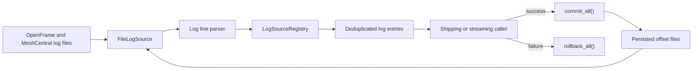
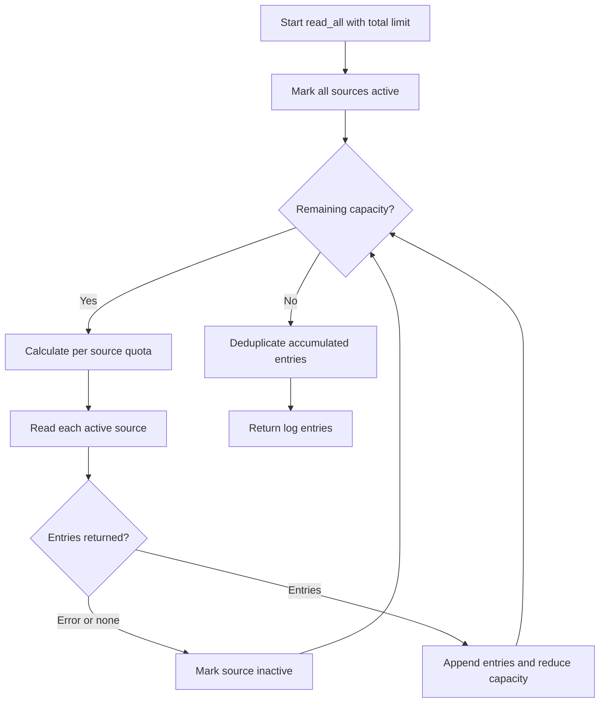
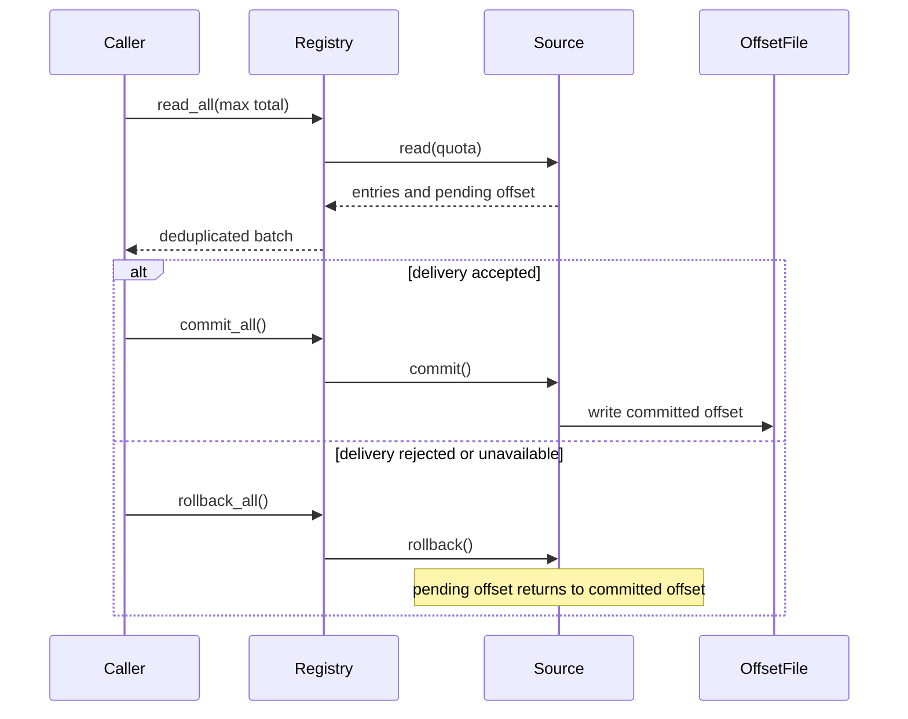
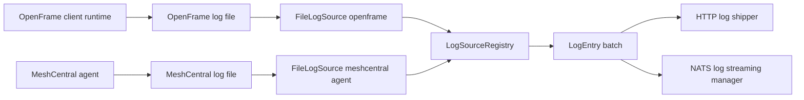

# Logging Source

Logging Source is the client-side acquisition layer for log forwarding. It provides a common transactional contract for reading records from one or more log origins, then advances each origin's checkpoint only after the caller decides that the batch is durable. The current implementation is file-backed and distinguishes OpenFrame client logs from MeshCentral agent logs.

The implementation is supplied by the `openframe_agent_lib` Cargo dependency from the OpenFrame OSS Library, pinned by this repository at version `v0.0.5`. Its source is [`log_source.rs`](https://github.com/flamingo-stack/openframe-oss-lib/blob/7a766f00e4f58b5d89db007b878ac8d6e0c344f4/clients/openframe-client/src/logging/log_source.rs). It runs inside the OpenFrame client assembled by this repository.

## Responsibilities

Logging Source separates four concerns:

- **Source identification:** `LogSourceKind` assigns the stable wire-facing names `openframe` and `meshcentral-agent`.
- **Incremental file reading:** `FileLogSource` resumes at a persisted byte offset, handles a file that was truncated or replaced, and converts recognized lines into parsed log entries.
- **Batch coordination:** `LogSourceRegistry` polls registered sources fairly within a total entry budget and combines their results.
- **Acknowledgement control:** `commit_all` persists the proposed offsets, while `rollback_all` discards proposed offsets so the same input remains eligible for a later attempt.

The module deliberately does not transmit logs, manage stream connections, or own retention policy. Those responsibilities belong to adjacent logging components that consume the entries it supplies.

## Architecture

`LogSource` is the module boundary. It is `Send + Sync`, enabling implementations to be stored as trait objects in the registry. Every source exposes:

| Method | Contract |
|---|---|
| `name()` | Returns the source identifier used in operational logs. |
| `read(max_count)` | Returns at most the requested number of parsed entries and records a candidate checkpoint. It does not persist that checkpoint. |
| `commit()` | Accepts the candidate checkpoint and persists it when applicable. |
| `rollback()` | Discards the candidate checkpoint and leaves the committed checkpoint unchanged. |

This contract allows another source type to be added without changing batch scheduling or acknowledgement code.

## Components

### Log Source Kind

`LogSourceKind` enumerates the built-in source labels:

| Variant | Display value | Intended origin |
|---|---|---|
| `Openframe` | `openframe` | The OpenFrame client log. |
| `Meshcentral` | `meshcentral-agent` | The integrated MeshCentral agent log. |

`FileLogSource::new` receives a kind, log file path, and offset file path. It converts the kind to its display value once and initializes both its committed and pending offsets from the offset file. A missing, unreadable, or non-numeric offset is treated as zero.

### File Log Source

`FileLogSource` implements `LogSource` for append-oriented local files. Its internal state has two cursors:

| State | Meaning |
|---|---|
| `committed_offset` | The byte position most recently accepted and persisted. Every read starts here. |
| `pending_offset` | The byte position obtained by the latest read. It becomes durable only during commit. |

The source opens the configured file and compares its current length with the committed offset. If the file is shorter, it begins at byte zero instead of seeking past the end. This permits reading to resume when a file has been truncated or replaced by rotation.

Lines are read through a buffered reader. Unreadable individual lines are skipped. Each readable line is passed to `parse_log_line`; unrecognized lines produce no entry and recognized lines become `LogEntry` values. The reader stops after gathering `max_count` parsed entries, and saves the resulting file position as the pending offset.

### Log Source Registry

`LogSourceRegistry` owns an ordered list of registered `LogSource` implementations. Calling `register` records the source name at information level and appends it to that list. Sources are therefore polled in registration order, but the allocation algorithm prevents an early source from permanently consuming a limited batch.

`read_all(max_total)` works in rounds:

1. It marks every registered source active and sets the remaining allowance to `max_total`.
2. It divides the remaining allowance across active sources, with a minimum quota of one entry.
3. It asks each active source for its quota, bounded by the remaining allowance.
4. A source becomes inactive when it returns no entries, returns fewer entries than requested, or produces an error. Errors are logged and do not prevent other sources from being read.
5. The registry repeats while capacity and active sources remain, then deduplicates the accumulated entries before returning them.

Deduplication happens after all sources are polled and only applies to the batch returned by this invocation. It does not replace durable checkpointing or provide cross-batch duplicate suppression.

## Checkpoint and Delivery Semantics

The source itself does not decide whether a batch has been delivered. Its caller must select exactly one acknowledgement path after processing the batch:

On commit, `FileLogSource` copies `pending_offset` to `committed_offset` and writes that number to the offset file. A write failure is logged but does not cause `commit` to return an error, because the trait method has no result type. On rollback, it resets only the pending cursor. The next read starts again at the committed cursor.

This yields an at-least-once input model when a failed or unacknowledged batch is rolled back: the same parsed records can be re-read. A caller should commit only after downstream processing has succeeded. Calling `commit_all` commits every registered source, including sources whose entries were already accumulated before another source failed; the registry does not provide an all-or-nothing transaction across files.

## Data Flow and Integration

The parser defines `LogEntry` with timestamp, level, message, and an optional repetition count. Logging Source consumes the parser rather than interpreting OpenFrame or tool log formats itself. In particular, parser support for tracing-style client lines and `time` / `level` / `msg` tool lines determines which physical lines become entries.

The last two consumers are represented by the library's `LogShipper` and `LogStreamingRunManager` components. Logging Source does not select a transport, authenticate it, or start its run loop. It supplies parsed batches and cursor control to the component that does.

## Operational Behavior and Limits

- **Per-source continuity:** Offset files are independent, so each source resumes from its own accepted byte position after restart.
- **Truncation recovery:** A current file shorter than the stored offset is treated as a new file and read from the beginning.
- **Source isolation:** One unreadable file or source error is logged and deactivated for the current registry read; other sources continue.
- **Bounded collection:** The registry never intentionally requests more than the supplied total maximum, and allocates remaining capacity among active sources.
- **Empty registry:** With no registered sources, `read_all` returns an empty collection; commit and rollback perform no work.
- **Read-before-commit:** A repeated read before either commit or rollback starts at the same committed offset and can return overlapping data. Treat a read result as one in-flight batch and acknowledge it before reading again.
- **Batch-only deduplication:** The registry invokes `LogDeduplicator` only after collection. Downstream systems should not assume it is a global idempotency mechanism.

## Maintenance Guidance

When implementing another `LogSource`, preserve the pending-versus-committed cursor separation. `read` must not make the new checkpoint durable; `commit` must make the last proposed checkpoint durable; and `rollback` must restore eligibility from the last committed position. This is the invariant that lets transport failures retry without silently losing source records.

Keep source names stable because they are recorded during registration and can be used to identify forwarding behavior in client logs. If a new physical origin has a distinct format, extend parsing separately rather than having a source manufacture `LogEntry` values, so all sources retain a consistent entry model.

File-backed offsets are plain numeric byte positions. Operators investigating a replay or skipped region should inspect both the source file's size and the companion offset file, then correlate any `Failed to save log offset` or source read error messages from the client log.
