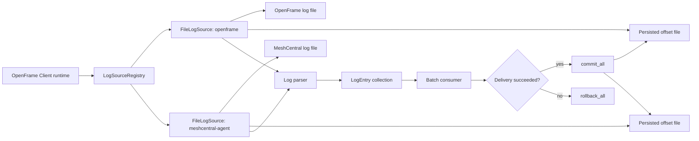
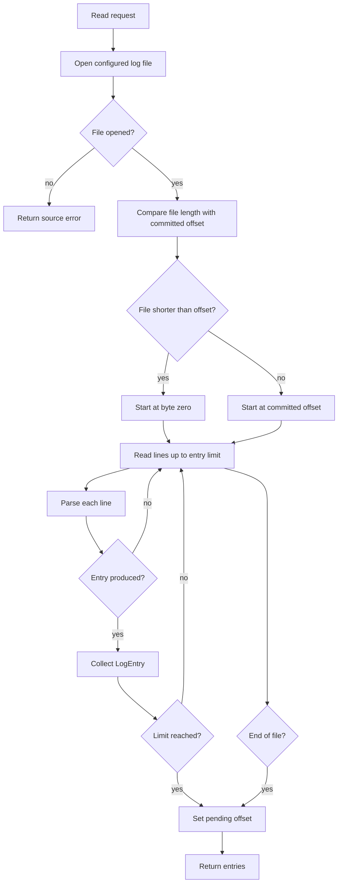
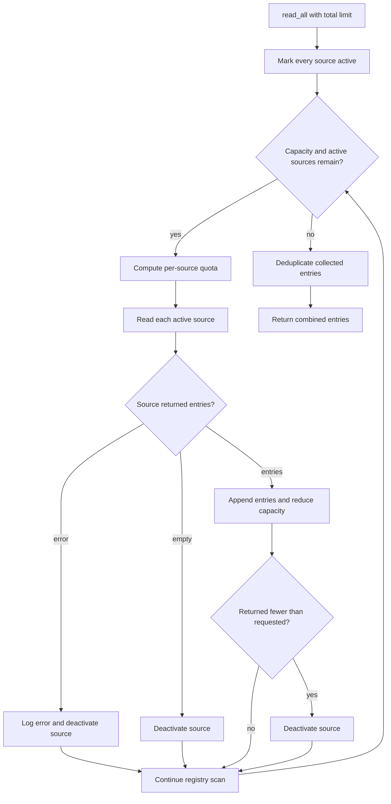
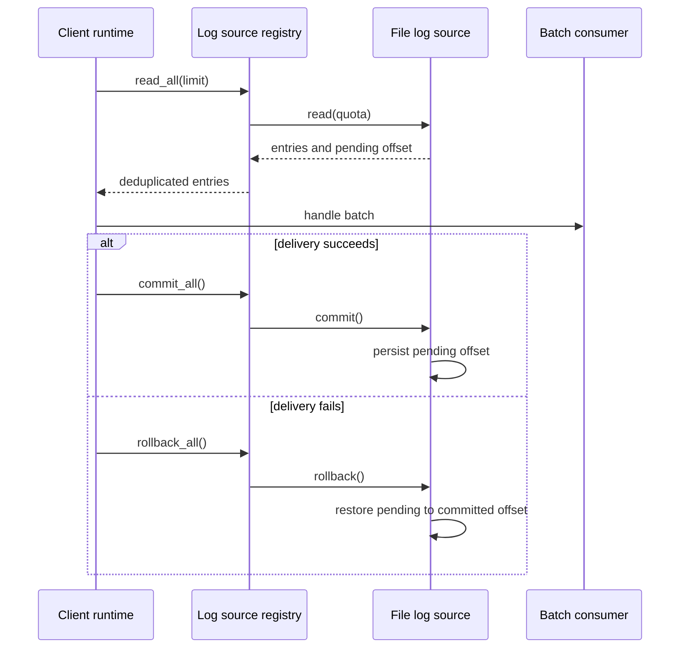

# Logging Sources

Logging Sources is the OpenFrame Client library component that reads incremental log records from one or more local files. It provides a small transactional cursor model: records are read from a persisted offset, then callers either commit the new offset after successful downstream handling or roll it back to retry the same range. The implementation is supplied by the `openframe_agent_lib` dependency from the OpenFrame OSS Library and is run by this repository's OpenFrame Client service.

The implementation is in [log_source.rs](https://github.com/flamingo-stack/openframe-oss-lib/blob/16e7c1cbd9664e7d10ec5ebca7d53c9bd314decf/clients/openframe-client/src/logging/log_source.rs).

## Responsibilities

- Represent a readable source through the `LogSource` trait.
- Provide `FileLogSource`, a file-backed source with a durable byte-offset checkpoint.
- Identify built-in sources as `openframe` or `meshcentral-agent` through `LogSourceKind`.
- Coordinate multiple sources fairly through `LogSourceRegistry`.
- Keep checkpoint advancement separate from reading so a consumer can decide whether to acknowledge or retry a batch.
- Ignore malformed or unreadable individual lines where possible, while reporting source-level failures through the client logger.

Logging Sources does not parse arbitrary formats itself, deliver batches over the network, or perform file rotation. It delegates line conversion to the adjacent log parser and is intended to participate in the wider logging pipeline alongside rotation and transport components.

## Architecture

Each registered source is stored as a boxed `LogSource` implementation. This abstraction allows a registry to coordinate different source implementations without knowing how they obtain records. The current concrete implementation is `FileLogSource`.

## Core Types and Interfaces

| Component | Role | Key behavior |
|---|---|---|
| `LogSourceKind` | Built-in source identifier | Formats `Openframe` as `openframe` and `Meshcentral` as `meshcentral-agent`. The formatted value becomes the source name. |
| `LogSource` | Source contract | Requires `name`, bounded `read`, `commit`, and `rollback`. Implementations must be safe to send and share across threads. |
| `FileLogSource` | Local-file implementation | Holds the log path, offset path, committed offset, and pending offset. |
| `LogSourceRegistry` | Multi-source coordinator | Registers sources, apportions a batch budget across active sources, deduplicates combined entries, and applies commit or rollback to every registered source. |

### Source cursor state

A file source initializes both cursor values from the offset file. If the file is absent, unreadable, or contains a non-numeric value, initialization falls back to byte position zero.

| State | Meaning |
|---|---|
| Committed offset | The durable restart point used as the next read position. |
| Pending offset | The position reached by the most recent read. It is not durable until commit. |

The two offsets are deliberately distinct. A read can safely prepare a candidate batch without claiming that the associated log bytes were handled successfully.

## File Source Read Semantics

`FileLogSource.read(max_count)` opens the configured file and requests records beginning at the committed offset. The read helper applies two protective rules:

1. If the current file length is smaller than the saved position, it begins at zero. This allows the reader to recover after truncation or replacement without seeking beyond the end of the new file.
2. A line that cannot be read is skipped. A line that does not produce a parsed entry is also omitted from the result.

The parser accepts the client tracing format and a tool-oriented format containing `time`, `level`, and `msg` fields. Parsed tool messages are marked with a `[tool]` prefix. Parsed records are represented by `LogEntry`, which contains a timestamp, level, message, and an optional repeat count.

The requested maximum is a limit on parsed entries, not physical lines. Consequently, unparseable lines do not consume the entry allowance. A successful read updates only the in-memory pending offset.

## Registry Scheduling and Aggregation

`LogSourceRegistry.read_all(max_total)` aggregates records while respecting a global maximum. It starts with every registered source active, divides remaining capacity among active sources, and gives each source at least one record of quota so that no active source is starved when the remaining capacity is smaller than the number of sources.

A source is deactivated for the current aggregation operation when it returns no entries, returns fewer entries than its quota, or returns an error. This prevents repeated reads of an exhausted or failing source during the same call. Before the registry returns, it invokes the log parser module's `LogDeduplicator` extension on the combined vector.

The registry does not automatically commit after aggregation. That separation lets its caller apply a single delivery outcome to all sources that participated in a batch.

## Acknowledgement and Retry Flow

`commit_all` moves each source's committed offset to its pending offset and writes that value to the configured offset file. Offset persistence failures are logged but do not change the in-memory committed offset. `rollback_all` discards each source's pending progress by restoring it to the committed offset; it does not alter the stored checkpoint.

## Integration Boundaries

Logging Sources sits between local logging and the transport portion of the OpenFrame Client runtime:

- **Logging setup** creates local logs and exposes the log file path used by a file-backed source.
- **Logging parse** converts individual file lines into structured `LogEntry` values and provides the deduplication extension applied after aggregation.
- **Logging rotation** manages the client log and its offset-related lifecycle independently of this registry.
- **Logging NATS streaming** and **logging shipping** are downstream delivery concerns. They can use the transactional read, commit, and rollback pattern but are not implemented by this source module.
- **Initial configuration and log key services** provide broader client configuration and authentication material for protected log delivery; Logging Sources itself only reads local files and checkpoints.

At the platform level, the tenant deployment provides NATS as a datasource, and the OpenFrame Client configuration points its NATS server setting at `nats.datasources.svc.cluster.local`. The source registry does not connect to NATS directly.

## Operational Considerations

- Keep each offset file writable and colocated on durable storage appropriate for the agent. If it cannot be read, the source replays from the beginning; if it cannot be written, the next process start can also replay already handled content.
- Register a source only after its log path and offset path are known. Registration preserves insertion order, which is the order used for each registry scan.
- Call `commit_all` only after the complete aggregated batch has been accepted by the downstream consumer. Calling it early can skip records after a delivery failure.
- Call `rollback_all` after an unsuccessful delivery attempt to make the same committed range eligible for a future read.
- A rotated or truncated file is detected only by comparing its current size with the committed offset. The source then restarts at byte zero of the current file.
- Source read errors are isolated: a failing source is logged and excluded from the current aggregation, while other sources continue to contribute entries.

## Extension Guidance

To add a non-file source, implement `LogSource` with the same acknowledgement contract:

1. Return a stable, human-readable `name` for diagnostics.
2. Implement `read` without making progress durable.
3. Make `commit` durably acknowledge the records represented by the pending cursor.
4. Make `rollback` restore the pending cursor to the last committed cursor.
5. Register the implementation with `LogSourceRegistry` so it receives the same bounded, fair aggregation and batch-level acknowledgement behavior.

A new source should preserve the distinction between pending and committed state. This is the compatibility boundary that allows consumers to retry failed batches without requiring `LogSourceRegistry` to understand source-specific storage or cursor mechanics.
