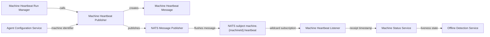
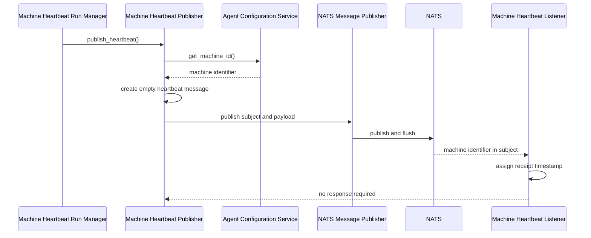
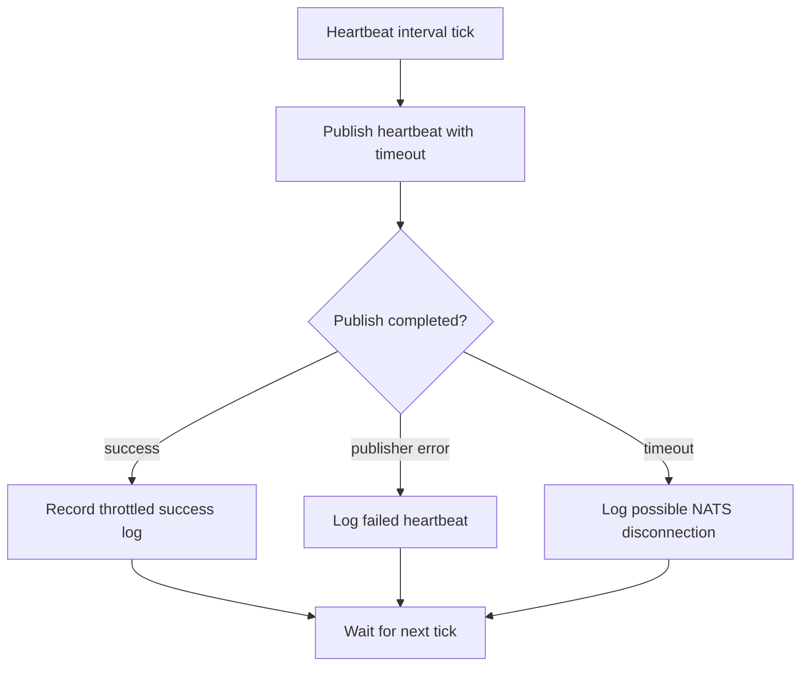

# Machine Heartbeat Publisher

The Machine Heartbeat Publisher is the OpenFrame Client agent component that emits a lightweight liveness signal for an enrolled machine. It resolves the persisted machine identifier, creates a `MachineHeartbeatMessage`, and publishes to the machine-specific NATS subject. The receiving client service records the receipt time, which downstream offline detection can use to identify stale devices.

This implementation is supplied by the `openframe_agent_lib` crate from the OpenFrame OSS Library and runs in this repository's OpenFrame Client deployment. Its source is [machine heartbeat publisher source](https://github.com/flamingo-stack/openframe-oss-lib/blob/16e7c1cbd9664e7d10ec5ebca7d53c9bd314decf/clients/openframe-client/src/services/machine_heartbeat_publisher.rs).

## Responsibilities

Machine Heartbeat Publisher has a deliberately narrow boundary:

- Obtain the registered machine identifier through `AgentConfigurationService`.
- Create an empty `MachineHeartbeatMessage`; the message contract places machine identity in the NATS subject and lets the receiving service assign the timestamp.
- Publish to `machine.{machineId}.heartbeat` through `NatsMessagePublisher`.
- Count locally attempted successful publishes and emit an informational health log periodically, using debug logging for intervening sends.
- Return configuration, serialization, connection, publish, or flush errors to its caller instead of retrying internally.

It does not schedule heartbeats, determine whether a machine is offline, persist heartbeat state, or process received messages. Those responsibilities stay in the run manager and server-side services.

## Architecture

The subject is the routing and identity contract. Server-side `MachineHeartbeatListener` subscribes to `machine.*.heartbeat`, extracts the machine identifier from the subject, sets `Instant.now()` on receipt, and passes both values to `MachineStatusService`. Consequently, heartbeat payload contents are not used by that listener.

## Component Design

### Machine Heartbeat Publisher

`MachineHeartbeatPublisher` owns three cloneable or shared dependencies:

| Dependency | Purpose |
|---|---|
| `NatsMessagePublisher` | Serializes, publishes, and flushes the message through the current NATS connection. |
| `AgentConfigurationService` | Reads persisted agent configuration and provides the registered machine identifier. |
| `Arc<AtomicU64>` | Shares a relaxed-ordering successful-publish counter between publisher clones for log throttling. |

The constructor accepts the NATS publisher and configuration service, then initializes the counter to zero. Cloning a publisher shares the same counter, so the log cadence applies across copies created for the same publisher instance.

### Message and subject contract

`MachineHeartbeatMessage` is intentionally an empty object. Machine identity is encoded in the subject, not the body, and the service that consumes the signal creates the authoritative receive timestamp. This avoids trusting an agent-provided clock for online-state calculation.

The publisher explicitly serializes the empty message to a string before passing it to `NatsMessagePublisher`. `NatsMessagePublisher.publish` serializes its generic input again, publishes it, and flushes the NATS client before returning. Since the current listener ignores the payload, the effective interoperability contract is the subject rather than the serialized body. Any change that makes consumers inspect the body should align the publisher and shared publisher serialization behavior first.

## Publish Flow

The operation completes only after `NatsMessagePublisher` reports that publishing and flushing succeeded. Then the publisher increments the counter and logs the event. The first success and every sixtieth subsequent counter position selected by the implementation produce an `info` health log that includes the machine identifier, total sent count, and compile-time OpenFrame version. Other successes log at `debug` level.

## Scheduling and Failure Behavior

The companion Machine Heartbeat Run Manager owns the recurring execution policy. It spawns a Tokio task, waits for its configured interval, and invokes `publish_heartbeat` under a configured timeout. It logs a failed result when configuration lookup, serialization, NATS client acquisition, publish, or flush fails. It separately logs a timeout as a possible NATS disconnection. The loop continues after either outcome, so retry cadence is governed by the next scheduled tick rather than publisher-local retries.

This separation keeps the publisher deterministic and easy to reuse: it performs one delivery attempt, while the run manager provides lifetime management, cadence, and timeout containment.

## Server-Side Processing

On the service side, `MachineHeartbeatListener` creates a NATS dispatcher after application readiness and subscribes to the wildcard subject. For each message it:

1. Extracts the machine identifier from the subject.
2. Captures the service-side current time.
3. Calls `MachineStatusService.processHeartbeat` with the identifier and timestamp.
4. Logs unexpected processing failures without propagating them to the agent.

During shutdown, the listener drains its dispatcher with a five-second limit. Offline detection is independently enabled by configuration and periodically invokes `DeviceHeartbeatOfflineDetectionService.markStaleDevicesOffline`. Therefore, missing heartbeats become an offline-state concern only through server-side policy; the publisher itself does not classify connectivity.

## Operational Notes

- A machine must have persisted registration data containing a machine identifier before heartbeats can be published successfully.
- A publish success means the client published and flushed to its available NATS client. It is not an application-level acknowledgement that the listener updated machine state.
- Preserve the `machine.{machineId}.heartbeat` subject shape when evolving the module. The listener's wildcard subscription and identifier extractor depend on it.
- Keep heartbeat payloads minimal unless the receiving contract changes. The current system relies on subject-derived identity and service-side timing.
- Investigate repeated timeout logs alongside NATS connection-manager health, because the run manager identifies timeout as a likely disconnected-NATS condition.

## Maintenance Boundaries

Changes to Machine Heartbeat Publisher should be reviewed with the following adjacent components:

- The Machine Heartbeat Run Manager, for timing and timeout behavior.
- `AgentConfigurationService`, for registration-data and machine-identifier availability.
- `NatsMessagePublisher`, for serialization, connection acquisition, publish, and flush semantics.
- The server-side `MachineHeartbeatListener` and machine status service, for subject parsing and liveness updates.
- Offline detection configuration and policy, for the threshold at which a missing signal marks a device offline.

No separate acknowledgement, persistence, or retry mechanism exists in this module. Add one only with a corresponding server-side delivery contract, since current heartbeat processing is fire-and-forget and derives liveness from observed NATS messages.
