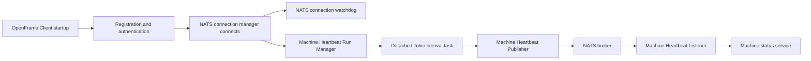
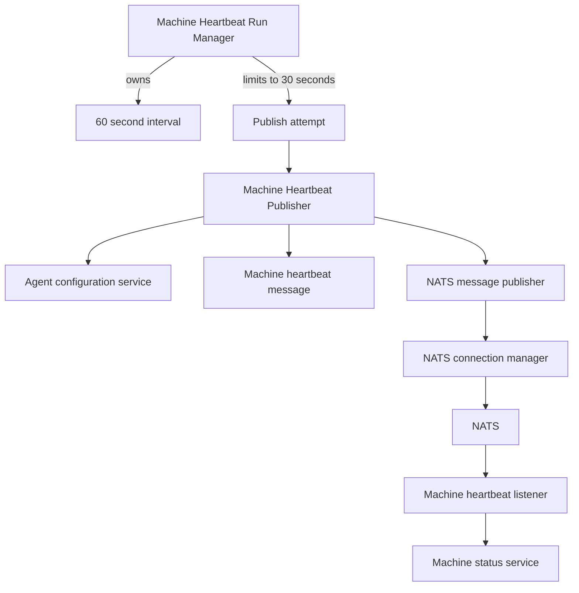
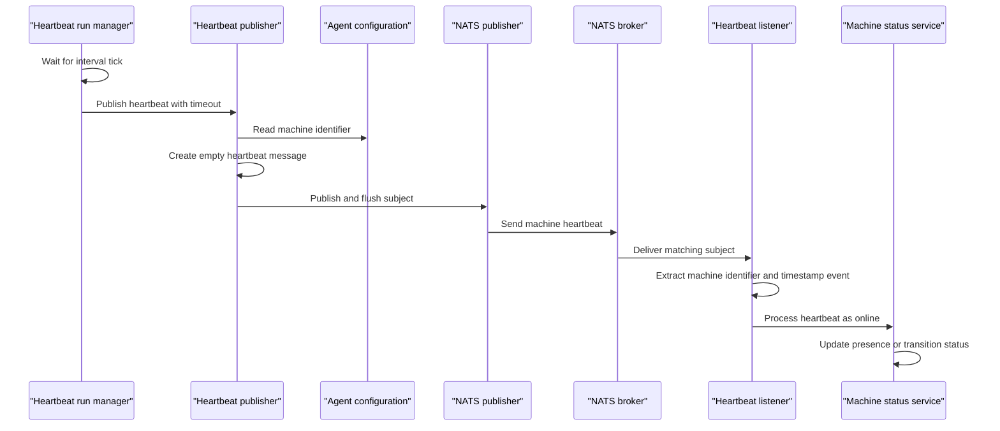
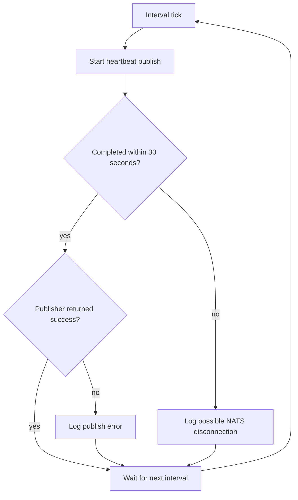

# Machine Heartbeat Run Manager

Machine Heartbeat Run Manager is the OpenFrame Client background scheduler that maintains a device's presence signal. Once the client has authenticated and connected to NATS, it starts a detached Tokio task that asks the heartbeat publisher to send a heartbeat every 60 seconds. Each publish has a 30-second upper bound, so a blocked broker operation does not indefinitely stall the scheduler loop.

The implementation is supplied by the OpenFrame OSS Library's `openframe_agent_lib` Cargo artifact, consumed by this repository at version `v0.0.5`. The implementation source is [machine heartbeat run manager](https://github.com/flamingo-stack/openframe-oss-lib/blob/16e7c1cbd9664e7d10ec5ebca7d53c9bd314decf/clients/openframe-client/src/services/machine_heartbeat_run_manager.rs).

## Responsibilities

- Own the periodic execution loop, rather than the construction or transport details of a heartbeat.
- Trigger a heartbeat on the initial Tokio interval tick and then at 60-second intervals.
- Limit each `publish_heartbeat` call to 30 seconds.
- Log publisher errors and timeout conditions, then continue with the next interval rather than terminate the client.
- Run independently of command listeners, tool management, timezone reporting, and the other long-running OpenFrame Client services.

The manager does **not** determine the machine identifier, serialize the heartbeat payload, select the NATS subject, reconnect NATS, or mark a machine online. Those responsibilities remain in collaborating client and server components.

## Runtime Placement

The OpenFrame Client's startup sequence registers and authenticates the agent, connects the NATS connection manager, starts its connection watchdog, and then starts the Machine Heartbeat Run Manager. This ordering means heartbeat attempts begin only after a successful initial NATS connection. The spawned task is not awaited by startup, so the rest of the client can initialize listeners and tool services concurrently.

## Component Model

The manager is deliberately small and has one injected dependency: `MachineHeartbeatPublisher`. `new` stores the publisher, and `start` clones it into a Tokio task. This lets the run manager retain a simple lifecycle boundary while the publisher encapsulates message construction and delivery.

| Component | Ownership | Role |
|---|---|---|
| `MachineHeartbeatRunManager` | OpenFrame Client library | Schedules heartbeat attempts, applies the per-attempt timeout, and records failures. |
| `MachineHeartbeatPublisher` | OpenFrame Client library | Reads the persisted machine identifier, creates the empty heartbeat message, derives the NATS subject, and publishes it. |
| `AgentConfigurationService` | OpenFrame Client library | Supplies the registered machine identifier used in the subject. |
| `NatsMessagePublisher` | OpenFrame Client library | Acquires the current NATS client, publishes and flushes the serialized payload. |
| `NatsConnectionManager` | OpenFrame Client library | Establishes the initial connection and runs a watchdog that can replace a stalled client. |
| `MachineHeartbeatListener` | OpenFrame Client Core Java library | Subscribes to `machine.*.heartbeat`, extracts the machine identifier from the subject, and assigns a service-side timestamp. |
| `MachineStatusService` | OpenFrame Client Core Java library | Updates the machine's `lastSeen` value and online telemetry state while guarding against stale or conflicting updates. |
| Offline detection scheduler | OpenFrame Management Service Core library | Periodically invokes the server-side stale-device detection service when that optional feature is enabled. |

## Heartbeat Data and Transport

A heartbeat uses `MachineHeartbeatMessage`, which is an empty object. Identity is intentionally carried by the NATS subject rather than duplicated in the payload, and the receiving Java service creates the event timestamp when it handles the message.

For each scheduled attempt, the publisher performs the following operations:

1. Retrieves the machine identifier from `AgentConfigurationService`.
2. Constructs and serializes an empty `MachineHeartbeatMessage`.
3. Produces the subject `machine.{machineId}.heartbeat`.
4. Uses `NatsMessagePublisher` to publish and flush the message through the current NATS client.
5. Records the local heartbeat count only after a successful publish.

The client publisher serializes the message before passing it to `NatsMessagePublisher`, which serializes its generic payload for transport. As a result, the broker receives a JSON-encoded representation of the already serialized heartbeat payload. The server-side listener does not deserialize the body for presence tracking; it derives identity from the subject and supplies its own timestamp, so this representation does not affect the listener's processing path.

## Scheduling and Failure Behavior

`start` creates a Tokio `interval` using a fixed 60-second duration. Tokio intervals yield their first tick immediately, so the manager attempts a heartbeat as soon as the task is scheduled, followed by subsequent 60-second ticks. The publisher call is wrapped in `tokio::time::timeout` with a 30-second duration.

| Result | Manager behavior | Operational effect |
|---|---|---|
| Publish completes successfully | Continues silently to the next tick. | Device presence is refreshed by the receiving service. |
| Publisher returns an error | Logs `Failed to send heartbeat` with the error. | The current heartbeat is lost, but future attempts continue. |
| Timeout expires | Logs that the heartbeat timed out and NATS may be disconnected. | The current attempt is abandoned, and the next interval still runs. |

There is no retry loop inside an individual tick, no durable outbox, and no acknowledgement requirement in this manager. Reliability at this boundary is therefore periodic best effort: a later successful heartbeat restores current presence. The NATS connection manager's watchdog is complementary infrastructure; it detects a stalled client and attempts connection replacement, while the heartbeat manager keeps issuing bounded publish attempts.

## Server-Side Presence Processing

The client-side heartbeat becomes a device-presence update in the Java services assembled by this repository:

- `MachineHeartbeatListener` subscribes to the NATS wildcard subject `machine.*.heartbeat` after the service is ready. It extracts the machine identifier from the received subject and uses the server's current time as the event timestamp.
- `MachineStatusService.processHeartbeat` treats the event as an online update. A newer heartbeat refreshes `lastSeen` and online telemetry. A device in the pending state can become online and emit a first-connected event; a previously offline device can transition online and emit an online event.
- A heartbeat that does not change device status updates presence directly, avoiding unnecessary machine-write and downstream projection work. Events older than the recorded `lastSeen` value are ignored.
- The optional `DeviceHeartbeatOfflineDetectionScheduler` runs at a configured fixed delay, defaulting to 60 seconds, and delegates stale-device evaluation to the offline-detection service. This scheduler provides the counterpart to the client heartbeat, but its exact stale threshold is configured and enforced server-side, not by the run manager.

## Configuration and Lifecycle Notes

The two timing values are compile-time constants in the library implementation:

| Constant | Value | Meaning |
|---|---:|---|
| `HEARTBEAT_INTERVAL` | 60 seconds | Cadence of heartbeat attempts. |
| `HEARTBEAT_TIMEOUT` | 30 seconds | Maximum duration permitted for a single publisher call. |

The manager exposes only `new` and `start`; it has no explicit stop, pause, or reconfiguration API. Its task lives for the remaining lifetime of the client process. A service restart therefore creates a new manager task as part of the normal client startup sequence.

## Maintenance Considerations

- Preserve the startup ordering: start this manager only after successful NATS connection setup, or publish failures will begin before the transport is available.
- Keep heartbeat payload changes compatible with the server listener's subject-derived identity model. The current listener does not rely on body fields for this event type.
- Changes to interval or timeout alter both broker traffic volume and the time required for a failed attempt to release the scheduler loop.
- Do not convert errors into task termination. Continuous scheduling is the mechanism that allows presence to recover after transient connectivity failures.
- Investigate persistent timeout logs alongside NATS connection-manager watchdog logs. The manager reports the symptom, while the connection manager owns transport replacement.
