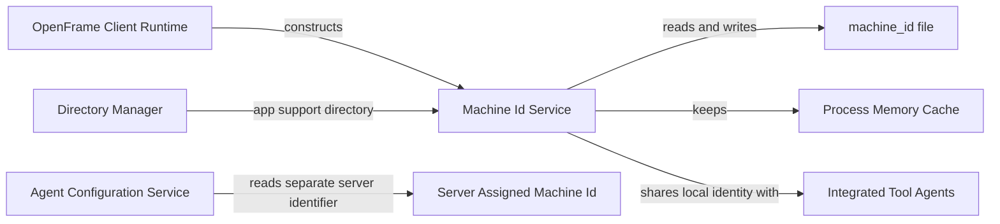
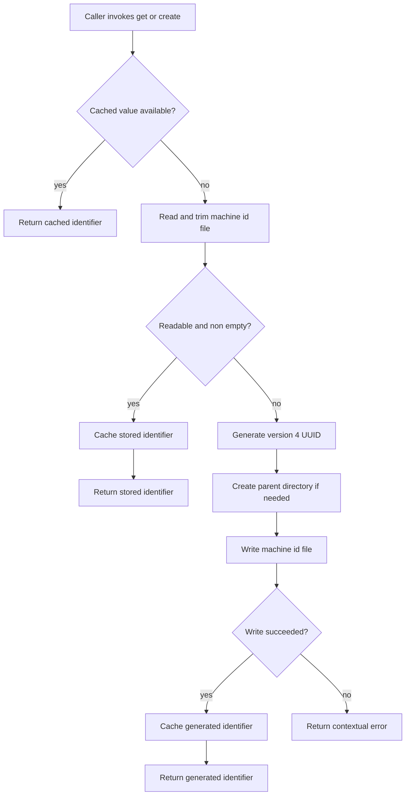
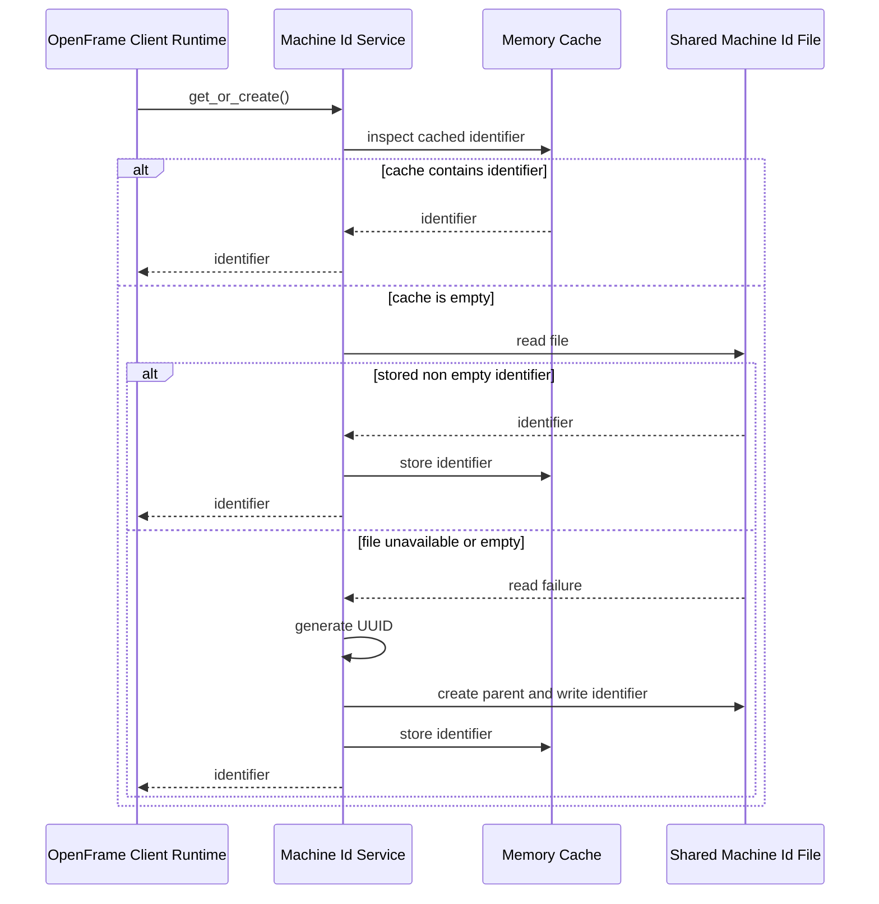
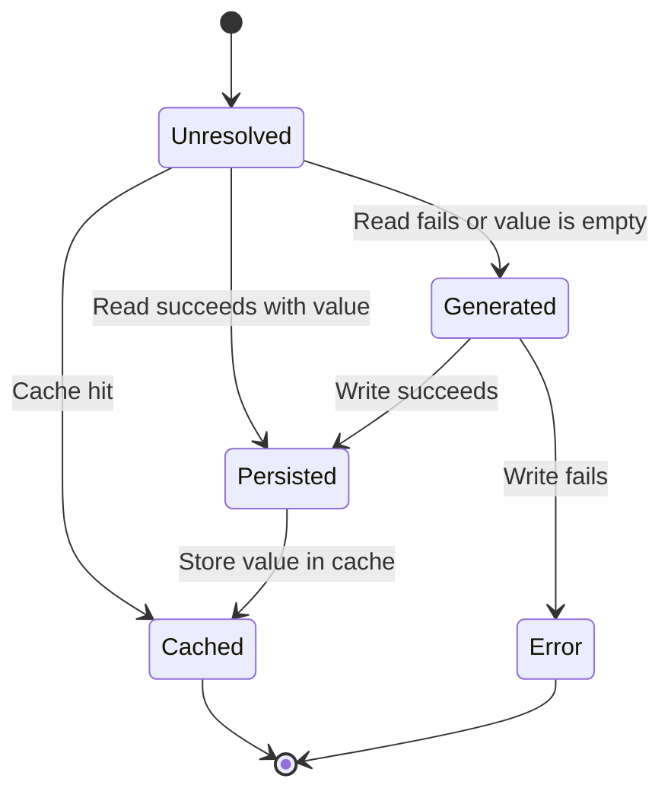

# Machine Id Service

Machine Id Service gives an OpenFrame client installation a stable, locally generated identifier. It is implemented by the Rust `MachineIdService` in the OpenFrame OSS Library's `openframe_agent_lib` artifact, which OpenFrame OSS Tenant consumes at version `v0.0.5` for its endpoint client runtime. The identifier is deliberately separate from the server-assigned machine identifier stored in agent configuration.

The service persists a UUID in the client shared application-support directory so the same local identity can be reused by integrated tool agents, including Mesh and Fleet. The module also exposes `MACHINE_ID_HEADER`, whose value is `x-machine-id`, for code that needs to convey that local identity in an HTTP request.

**Implementation source:** [machine_id_service.rs](https://github.com/flamingo-stack/openframe-oss-lib/blob/16e7c1cbd9664e7d10ec5ebca7d53c9bd314decf/clients/openframe-client/src/services/machine_id_service.rs)

## Responsibilities and boundaries

Machine Id Service owns only the lifecycle of the local identifier:

- Resolving the shared application-support location through `DirectoryManager`.
- Reusing an identifier already loaded in process memory.
- Reading and validating a previously persisted identifier.
- Creating a version 4 UUID when no readable, non-empty persisted value exists.
- Persisting the generated value and caching it for subsequent callers.

It does not register the agent, authenticate it, determine the operating-system identity, or manage the server-assigned agent configuration. In particular, `AgentConfigurationService.get_machine_id` reads `machine_id` from persisted agent configuration; that is a distinct value and must not be conflated with Machine Id Service's locally generated identifier.

## Architecture

The service is constructed with a `DirectoryManager`. Its file location is the application-support directory joined with `machine_id`. Both the file location and the cache are private implementation details; callers interact through the constructor, `get_or_create`, and `get`.

## Components

| Component | Role | Behavior |
|---|---|---|
| `MACHINE_ID_HEADER` | Wire-level constant | Defines the local-identity header name as `x-machine-id`. |
| `MachineIdService` | Identity owner | Holds the target file path and a cloneable, shared read-write cache. |
| `new` | Constructor | Derives the `machine_id` file path from `DirectoryManager.app_support_dir()` and starts with an empty cache. |
| `get_or_create` | Main retrieval operation | Returns a cached ID, otherwise tries persisted storage, otherwise generates and saves a UUID. |
| `get` | Cache-only accessor | Returns the cached value, or an empty string until `get_or_create` has succeeded. |
| Private read operation | Persistence validation | Reads the file, trims surrounding whitespace, and rejects an empty value. |
| Private write operation | Persistence update | Creates the parent directory when necessary and writes the identifier to the target file. |

## Retrieval and creation flow

`get_or_create` establishes the module's lookup order. A cache hit avoids file system work. A cache miss can still reuse the prior identity from disk. Only a failed read, including a missing, unreadable, or empty file, causes generation of a new UUID.

The service records debug output when it reuses a stored value and informational output when it creates a new one. File system failures are returned with the affected path in their error context.

## Component interaction

## Identity semantics

There are two identity domains in the client ecosystem:

| Identity | Owner | Creation and storage | Intended use |
|---|---|---|---|
| Local machine identifier | Machine Id Service | Generated locally as a UUID and saved in the shared application-support `machine_id` file | A stable local identity that integrated tool agents can read and that request-building code can place in the `x-machine-id` header. |
| Server-assigned machine identifier | Registration and agent configuration services | Created as part of registration and retained in agent configuration | Platform-facing agent registration and configuration identity. |

Maintainers should preserve this separation. Replacing the local value with the configuration value, or assuming both values are interchangeable, would violate the module's explicit design boundary.

## Lifecycle and operational behavior

### Startup and reuse

A newly constructed service has no cached value. `get` therefore returns an empty string at that point; consumers that require an identifier must call `get_or_create` first. Once a value has been obtained, clones of the service share the same `Arc<RwLock<Option<String>>>` cache, allowing them to reuse the in-memory value.

Across process restarts, the shared file is the continuity mechanism. The stored content is trimmed when read, which tolerates leading or trailing whitespace, but an all-whitespace file is treated as invalid and triggers replacement with a newly generated UUID when `get_or_create` is called.

### Failure behavior

- Failure to read the file does not itself stop identity resolution: the service attempts generation and persistence.
- Failure to create the parent directory or write the generated UUID is returned as an error; no generated value is cached on that path.
- `get` never performs file I/O and never returns an error. It is intentionally only an observation of already initialized state.

### Concurrency note

The cache is guarded by a standard read-write lock, which safely coordinates access to the in-process optional value. The implementation does not describe cross-process locking or atomic replacement for the file. Deployments in which independent processes can initialize the same shared file concurrently should account for that operational boundary.

## Integration guidance

1. Construct Machine Id Service from the runtime's `DirectoryManager`; do not duplicate the path calculation.
2. Call `get_or_create` before a mandatory header or tool-agent handoff so the local identity has been loaded or initialized.
3. Use `get` only where an empty result is an acceptable indication that initialization has not happened.
4. Treat the persisted file as identity state. Removing or replacing it results in a different locally generated identity on the next successful initialization.
5. Keep this identifier separate from registration credentials, access tokens, and the machine identifier supplied by agent configuration.

## Maintenance considerations

- Preserve the shared application-support location because integrated tool agents rely on it to discover the same identity.
- Preserve trimming and empty-file validation so malformed empty state is not silently accepted as an identifier.
- Preserve error context around directory and file operations to make endpoint installation failures diagnosable.
- Avoid logging the identifier at more verbose levels than the current implementation without evaluating operational privacy requirements.
- Any change to the header constant is a protocol compatibility change for consumers that send or inspect the local machine identity.
